# KnoBridge — Visão do Projeto

> Rascunho v0.2 · 2026-10-09 · Status: ideia em definição (ver seção 13, "Perguntas em aberto")
>
> **Mudanças da v0.2**: saem WhatsApp, Telegram e Chatwoot; entram Slack e Google Chat. A **API compatível com OpenAI** (Chat Completions) vira canal. Código-fonte passa a ser mapeado por **harness de agente** (Claude Code ou Codex) com fallback tree-sitter (seção 7.1.1). LLM por API (OpenAI, Anthropic, OpenRouter) e por **assinatura OpenAI**. **Temporal** como fila/orquestração. Embeddings por **API** (OpenAI ou Gemini). Autenticação só e-mail/senha por ora. Observabilidade e avaliação ficam fora do escopo por ora.

## 1. Em uma frase

**KnoBridge** é uma plataforma open source (Apache 2.0) que conecta repositórios de código, sistemas de chamados, documentações e outras fontes de conhecimento de uma empresa, transforma tudo em índices otimizados para RAG por meio de **pipelines visuais e incrementais**, e entrega **suporte em linguagem natural** (via LLMs) por API REST, API compatível com OpenAI, webhooks, MCP, Slack, Google Chat e um chat embutível.

"Bridge" = a ponte entre o conhecimento disperso sobre um sistema e quem precisa dele: cliente final, equipe de suporte e desenvolvedores.

## 2. Problema

- O conhecimento sobre um sistema está espalhado: código-fonte, chamados antigos (com a resolução dentro), wikis, changelogs, manuais, conversas.
- Suporte N1/N2 responde as mesmas perguntas repetidamente e precisa interromper desenvolvedores para explicar comportamentos que só estão no código.
- Quando a empresa mantém **vários sistemas para vários clientes**, cada um com seu repositório e seu histórico de chamados, não existe um lugar único para perguntar "como funciona X no sistema Y?".
- As ferramentas existentes caem em três grupos, e nenhum resolve o caso completo:
  1. "Chat com documentos" (bom para PDFs, ruim para código e chamados).
  2. Plataformas genéricas de agentes/workflows (poderosas, mas você monta tudo do zero, e várias não são open source de verdade).
  3. Enterprise search fechado ou caro.

## 3. Para quem (personas)

| Persona | O que quer do KnoBridge | Canal típico |
|---|---|---|
| **Empresa de software (ISV)** que dá suporte a vários sistemas/clientes | Reduzir volume de chamados e tempo de resposta; centralizar conhecimento | Painel admin |
| **Atendente de suporte (N1/N2)** | Resposta sugerida com citação de chamados anteriores, docs e trechos de código | Slack, Google Chat, widget no sistema de chamados |
| **Desenvolvedor** | "Onde essa regra está implementada?", "o que mudou nessa versão?", "já houve chamado sobre esse erro?" | MCP no IDE (Claude Code, Cursor, VS Code), CLI, API compatível com OpenAI em extensões de IDE |
| **Cliente final** | Autoatendimento 24h com respostas confiáveis e abertura de chamado quando não resolve | Chat no site/sistema (widget); Slack Connect ou Google Chat quando o cliente usa esses workspaces |
| **Admin/ops** | Conectar fontes, desenhar pipelines, configurar assistentes e canais, acompanhar custos e qualidade | Painel admin (canvas) |

## 4. Posicionamento e diferenciais

### 4.1 Onde o KnoBridge se encaixa frente ao que já existe

| Projeto | Licença | Força | Lacuna em relação ao KnoBridge |
|---|---|---|---|
| **Onyx** (ex-Danswer) | MIT (CE) + EE paga | 40+ conectores, bot Slack, API, embed, sincroniza permissões das fontes | Sem canvas de pipeline; código e chamados não são fontes de primeira classe; SSO/RBAC só na EE |
| **Dify** | "Dify Open Source License" (Apache 2.0 com restrições; não OSI) | Plataforma completa; **Knowledge Pipeline** é um canvas de ingestão muito parecido com a ideia aqui | Genérica (apps de LLM), foco em documentos, licença restringe SaaS multi-tenant, API não padronizada |
| **RAGFlow** | Apache 2.0 | Parsing profundo de documentos, knowledge graph, agentes | Foco em documentos; sem canais de atendimento prontos; sem código como fonte |
| **Kotaemon** | Apache 2.0 | UI limpa, busca híbrida, citações, multiusuário | É um "chat com documentos" (UI Gradio); sem pipelines, conectores ou canais |
| **AnythingLLM** | MIT | Simples de instalar | Pouco configurável (chunking, rerank); sem pipelines |
| **n8n / Activepieces / Langflow** | n8n: Sustainable Use (não OSI); Activepieces: MIT; Langflow: MIT | Canvas de automação geral | Não são plataformas de conhecimento; RAG é um nó entre muitos. **Flowise foi arquivado em 13/08/2026.** |
| **CocoIndex** | Apache 2.0 | Engine de pipeline **incremental** (Python + Rust) para RAG: só reprocessa o que mudou | Sem UI/canvas, sem canais; é uma biblioteca, não um produto |

### 4.2 Diferenciais a defender

1. **Código + chamados + documentação como fontes de primeira classe**, com correlação entre elas (chamado ↔ commit/PR ↔ doc ↔ versão). Nenhum concorrente open source faz isso bem. O conhecimento de código é **gerado por um harness de agente** (Claude Code ou Codex) que lê o repositório e devolve regras em linguagem de negócio com evidência `arquivo:linhas` verificada mecanicamente (seção 7.1.1), e não só "código fatiado e embedado".
2. **Canvas de pipeline com processamento incremental** e **múltiplos destinos**: banco vetorial, arquivos `.md` (para Obsidian, Claude Code, Cursor, repositórios de docs), ou outros formatos.
3. **Canais de atendimento prontos** (widget, Slack, Google Chat, MCP, API compatível com OpenAI, webhooks), e não apenas uma UI própria. Qualquer cliente de chat que fale o formato Chat Completions da OpenAI (Open WebUI, LibreChat, LobeChat, extensões de IDE) consome o KnoBridge sem adaptador.
4. **Licença OSI (Apache 2.0)**, self-host com um `docker compose up`, sem esconder o essencial atrás de "enterprise edition".
5. **Foco em suporte de sistemas**, não em "chat com PDF": respostas citam a fonte, sabem a versão do sistema, e sabem quando abrir um chamado em vez de inventar.

## 5. Conceitos do domínio (glossário)

| Conceito | Definição |
|---|---|
| **Workspace** | Unidade de isolamento (tenant). Uma empresa, ou um cliente de uma empresa. Tudo abaixo pertence a um workspace. |
| **Fonte (Source)** | Um sistema externo configurado: um repositório Git, uma instância do Movidesk, um espaço do Confluence, uma pasta, um site. |
| **Conector** | O código que sabe ler uma Fonte (autenticar, listar, detectar mudanças). |
| **Pipeline** | Um grafo desenhado no canvas: Fonte → Parsing → Chunking → Enriquecimento → Embedding → Destino(s). Versionado, testável, agendável. |
| **Execução (Run)** | Uma rodada de um pipeline, com log por nó, contagem de itens processados/pulados/falhos e custo. |
| **Documento** | Unidade lógica vinda de uma Fonte (um arquivo, um ticket, uma página). Tem metadados e permissões. |
| **Chunk** | Fragmento indexável de um Documento, com texto, metadados, vetor(es) e referência de volta ao original. |
| **Coleção (Knowledge Space)** | Agrupamento lógico de índices que um assistente pode consultar. Ex.: "Sistema ERP v12", "Portal do Cliente". |
| **Destino (Target)** | Onde os chunks são gravados: Postgres/pgvector, Qdrant, pasta de `.md`, etc. |
| **Assistente** | Prompt + Coleções + Ferramentas + Políticas (tom, idioma, quando escalar) + modelo LLM. |
| **Ferramenta (Action)** | Algo que o assistente pode fazer além de responder: abrir chamado, consultar status, criar issue. |
| **Canal** | Como o assistente é acessado: API REST, API compatível com OpenAI, webhook, MCP, widget, Slack, Google Chat. |
| **Harness** | Execução controlada de um agente de código (Claude Code headless ou Codex CLI) sobre um checkout, somente leitura, com saída em JSON Schema e evidência verificada. É o conector de "entendimento" do código. |
| **Conversa** | Histórico de mensagens de um usuário em um canal, com feedback e rastreamento. |

## 6. Arquitetura

```mermaid
flowchart LR
  subgraph Fontes
    GIT[Repositórios Git]
    TK[Sistemas de chamados]
    DOC[Wikis / Documentações]
    WEB[Sites / Arquivos / Bancos]
  end

  subgraph Pipelines["Pipelines (canvas, incremental, workflows Temporal)"]
    CON[Conectores] --> PRS["Parsing / mapeamento de código (harness ou tree-sitter)"] --> CHK[Chunking] --> ENR[Enriquecimento LLM] --> EMB[Embeddings via API] --> DST[Destinos]
  end

  subgraph Armazenamento
    PG[(Postgres + pgvector + FTS)]
    QD[(Qdrant opcional)]
    MD[Arquivos .md]
    S3[(MinIO / S3)]
  end

  subgraph Retrieval["Recuperação"]
    HY[Busca híbrida BM25 + vetor] --> RR[Reranker] --> CTX[Contexto + citações + filtros de permissão]
  end

  subgraph Assistentes
    AG[Assistente: prompt + coleções + ferramentas + políticas]
    LLM[Camada LLM multi-provedor]
  end

  subgraph Canais
    API[REST API / Webhooks]
    OAI[API compatível com OpenAI]
    MCP[Servidor MCP]
    WG[Widget embutível]
    SL[Slack]
    GC[Google Chat]
  end

  Fontes --> CON
  DST --> PG & QD & MD & S3
  PG & QD --> HY
  CTX --> AG --> LLM
  Canais --> AG
```

### 6.1 Camadas

1. **Conectores (ingestão)**: leem fontes, normalizam para um modelo comum de Documento, e detectam mudanças (webhook, polling, hash, cursor incremental).
2. **Pipelines (canvas)**: o usuário desenha o grafo; o engine executa de forma incremental (só o que mudou), com retry, log por nó e custo por execução.
3. **Armazenamento**: Postgres como banco principal (metadados, chunks, vetores via pgvector, BM25 via FTS nativo). Destinos extras opcionais (Qdrant para escala, `.md` para portabilidade, MinIO para originais).
4. **Recuperação**: busca híbrida (BM25 + vetor, fusão por RRF) → reranker → montagem de contexto com citações, respeitando filtros de workspace/coleção/permissão.
5. **Assistentes**: orquestração da conversa, chamada ao LLM (qualquer provedor), ferramentas, políticas de escalonamento, memória de conversa.
6. **Canais**: adaptadores finos que convertem cada protocolo (Slack, Google Chat, widget, MCP, REST, Chat Completions da OpenAI) no mesmo contrato de "mensagem → resposta com citações".
7. **Transversal**: autenticação (e-mail/senha por ora), RBAC, multi-tenant, auditoria, custos. Observabilidade (traces) e avaliação (evals) ficam para uma fase posterior.

### 6.2 Princípios de design

- **Postgres primeiro**: um único banco para metadados, vetores e busca lexical cobre a maioria dos casos (até dezenas de milhões de vetores). Qdrant entra como destino opcional, não como dependência obrigatória.
- **Incremental por padrão**: cada documento tem hash e versão; reindexa-se só o que mudou. Reprocessar um repositório inteiro a cada commit não escala.
- **Modelos são plugáveis**: embeddings, reranker e LLM ficam atrás de interfaces. Trocar de provedor não pode exigir reescrever pipelines.
- **Citações obrigatórias**: toda resposta aponta o chunk/documento de origem. Sem fonte, o assistente diz que não sabe e oferece abrir chamado.
- **Permissão vem da fonte**: um chunk herda quem pode vê-lo (ex.: ticket do cliente A nunca aparece para o cliente B).
- **Self-host simples**: `docker compose up` sobe tudo (app, worker, Temporal, Postgres, MinIO; Redis opcional para cache e rate limit). Sem GPU: embeddings e LLM vêm de APIs.
- **Sem framework pesado de LLM**: SDKs oficiais dos provedores + abstrações próprias e pequenas. Evita lock-in em abstrações de terceiros que mudam rápido.
- **Conhecimento de código com evidência**: o que um agente escreve sobre o código só entra na base se apontar `arquivo:linhas` que existem no checkout; dúvida vira pergunta aberta, nunca regra. Arquivos `.md` em git são a verdade; índices são descartáveis e reconstruíveis.

## 7. Módulos em detalhe

### 7.1 Conectores

Ordem sugerida de implementação (primeiro os que validam a tese):

| Prioridade | Fonte | Observações |
|---|---|---|
| P0 | **Git** (GitHub, GitLab, Bitbucket, Gitea, pasta local) | Clona/atualiza, lê árvore, histórico de commits, PRs/MRs, issues, READMEs. Incremental por SHA. O conteúdo do código é mapeado pelo **harness de agente** (7.1.1); tree-sitter é o fallback. |
| P0 | **Arquivos** (upload, pasta, S3) | PDF, DOCX, XLSX, MD, HTML, TXT. |
| P0 | **Sistema de chamados #1** (a definir: Movidesk, Jira Service Management, GLPI, Zendesk, Freshdesk, Zammad, osTicket) | Tickets + comentários + artigos da base de conhecimento. Movidesk tem API REST com token e endpoint de artigos. |
| P1 | **Wikis/docs**: Confluence, Notion, Google Drive, SharePoint, GitBook, Docusaurus (via site) | |
| P1 | **Sites** (crawler com sitemap/robots) | Portais de ajuda, documentação pública. |
| P2 | **Bancos de dados** (SQL read-only, consulta parametrizada) | Para "dados de referência" (tabelas de códigos de erro, parâmetros). |
| P2 | **Conversas**: Slack, Teams, Discord, exportações de WhatsApp | Alto valor, mas ruidoso; exige curadoria. |
| P2 | **API genérica / webhook de entrada** | Qualquer sistema envia documentos via HTTP. |

Contrato de um conector: `list_changes(cursor) → [DocumentRef]`, `fetch(ref) → Document`, `permissions(ref) → ACL`, `test_connection()`.

#### 7.1.1 Mapeamento de código por harness de agente

Para código-fonte, o caminho principal não é "fatiar e embedar": é pedir a um agente de código (**Claude Code** em modo headless, `claude -p`, ou **Codex CLI**, `codex exec`) que leia o repositório e produza conhecimento em português de negócio, com evidência verificável. O padrão vem de um projeto interno de helpdesk que já roda assim (base gerada a partir do código de um ERP, com custo medido por módulo) e é portado aqui de forma genérica, sem nada específico de linguagem ou produto:

1. **Camada 0, determinística (sem LLM)**: inventário do repositório por módulo/pasta (arquivos, linhas, linguagem) e extrações baratas por regex ou AST: mensagens ao usuário, parâmetros/configurações, rotas, menus, `git log` por pasta com o número do chamado nos commits. Sai como `.md` com frontmatter e `confianca: extraido`.
2. **Briefing**: para cada módulo, um texto montado da camada 0 (arquivos e tamanhos, mensagens que ele dispara, parâmetros que lê, documentação existente) entra no prompt. O agente não lê o repositório inteiro: lê o módulo e o que ele chama.
3. **Harness**: o agente roda como subprocesso, com cwd no checkout, **somente leitura** (Claude Code: `--tools Read,Grep,Glob` e `--disallowedTools Edit,Write,Bash`; Codex: `--sandbox read-only`), saída estruturada por **JSON Schema** (`--json-schema` / `--output-schema`), eventos em JSONL (`--output-format stream-json` / `--json`) gravados em log, orçamento por execução (`--max-budget-usd`), timeout com kill da árvore de processos, detecção de limite de franquia (dorme até o reset) e de falha de autenticação, e "resgate" por `--resume` na mesma sessão quando o agente termina sem emitir o JSON.
4. **Regras do prompt**: nada sem fonte lida na sessão; toda regra, FAQ, campo obrigatório e passo de fluxo traz `fontes[] = {arquivo, linha_inicial, linha_final, simbolo?}`; distinguir comportamento observado de intencional e marcar bug conhecido; dúvida vai para `duvidas[]` e nunca vira afirmação; texto curto, sem copiar código para dentro do JSON (o excerto é buscado depois a partir de `arquivo:linhas`).
5. **Verificação mecânica**: cada fonte só é aceita se o arquivo existe dentro do checkout, o intervalo de linhas existe (e é curto) e, quando citado, o símbolo é a rotina que envolve a linha inicial. Item sem nenhuma fonte válida é **rejeitado e registrado com o motivo**, nunca gravado.
6. **Escrita**: um `.md` por regra (`<MOD>.R001.md`, com excerto real do código e "como o usuário resolve") e um `.md` de enriquecimento por módulo (objetivo, fluxo principal, campos obrigatórios, mensagens com causa e ação, FAQ, dúvidas), todos com frontmatter (`id`, `tipo`, `modulo`, `fontes`, `confianca: inferido`, `gerado_por: harness:<modelo>`, `commit`, `atualizado_em`). O JSON bruto, as rejeições e o custo ficam ao lado, em `harness/<MOD>.json`.
7. **Incremental e priorizado**: reprocessa só módulos cujos arquivos mudaram desde o commit registrado no frontmatter. A ordem vem de uma pontuação por valor (chamados por módulo no `git log`, mensagens exibidas, telemetria de uso, feedback "não ajudou" do chat), com paralelismo configurável e espera pelo reset da franquia. Cada job é uma activity Temporal, o lote é um workflow.
8. **Depois do harness**: os `.md` seguem pelo pipeline normal (chunking por seção, embedding, destinos), com `confianca` e `fontes` como metadados dos chunks. Revisão humana sobe `confianca` para `revisado`, e o conteúdo revisado é preservado nas regenerações.

**Fallback sem harness**: quando não há CLI logado, orçamento ou permissão para rodar um agente (ou em linguagens em que ele rende pouco), o conector Git cai para o caminho determinístico: **tree-sitter** → chunking por nó da AST (função, classe, método) com metadados (caminho, linguagem, escopo pai, assinatura) → embedding. Os dois caminhos convivem no mesmo pipeline: o harness produz conhecimento explicado; o tree-sitter garante que todo o código esteja ao menos localizável.

Ordem de grandeza observada no projeto de referência (Delphi, modelo Sonnet, effort alto): US$ 0,5 a 4 por módulo, média de US$ 1,6; 4 a 12 minutos por módulo; cerca de 10% dos itens rejeitados por fonte inválida. Serve como estimativa inicial para o orçamento, não como meta.

### 7.2 Canvas de pipelines

- **Nós de fonte**: um por conector.
- **Nós de parsing**: documento → texto estruturado (Markdown) + metadados. Docling para PDF/Office; trafilatura para HTML. Para código, o **nó de mapeamento por harness** (7.1.1) e o nó tree-sitter, que também serve de fallback automático quando o harness não está disponível.
- **Nós de chunking**: por estrutura (títulos de Markdown), por AST (função/classe/método para código), por tamanho com overlap (fallback), por ticket (um chunk = pergunta + resolução).
- **Nós de enriquecimento (LLM)**: resumo do documento, "contexto do chunk" (contextual retrieval), extração de entidades (módulo, tela, código de erro, versão), classificação, tradução, anonimização de dados pessoais (LGPD).
- **Nós de filtro/roteamento**: if/else por metadado, deduplicação, política de retenção.
- **Nós de embedding**: modelo configurável; suporta dense + sparse.
- **Nós de destino**: Postgres/pgvector, Qdrant, pasta `.md` (com frontmatter), JSONL, webhook de saída.
- **Nó de código** (Python sandboxed) para transformações que o catálogo não cobre.
- **Recursos do canvas**: executar com amostra ("test run" com 10 documentos), ver saída de cada nó, versionar o pipeline, agendar (cron) ou disparar por webhook da fonte, ver custo estimado antes de rodar.
- **Execução**: cada execução de pipeline é um **workflow Temporal** (uma activity por nó, retry e timeout por activity, histórico durável, cancelamento, visível na UI do Temporal). A lógica incremental (hash/versão por documento, cursor por fonte) é própria, sobre o Temporal. CocoIndex fica como biblioteca opcional a validar num spike, não como engine obrigatório (ver seção 9).

> Sobre "BPM": a interpretação adotada aqui é que o canvas é primeiro um **pipeline de dados** (DAG de ingestão). Um segundo tipo de fluxo, de **atendimento** (triagem → classificar → responder → escalar para humano → abrir chamado, com SLA), faz sentido numa fase posterior e pode reaproveitar o mesmo canvas. Ver pergunta 6 na seção 13.

### 7.3 Processamento e indexação

- **Parsing**: Docling (tabelas e layout, MIT), MarkItDown como fallback leve. Código: harness de agente (7.1.1) como caminho principal; tree-sitter (gramáticas por linguagem) como fallback e para o chunking por AST.
- **Chunking de código**: no caminho do harness, um chunk = uma regra ou uma seção do enriquecimento (já em linguagem de negócio, com `fontes`). No fallback tree-sitter, por nó da AST (função, classe, método) com metadados: caminho, linguagem, escopo pai, imports, assinatura; split recursivo em linguagens sem gramática.
- **Chunking de chamados**: um chunk = título + descrição + resolução final, com metadados (sistema, módulo, versão, cliente, tags, data). Comentários intermediários podem virar chunks secundários.
- **Enriquecimento**: contextual retrieval (uma frase de contexto por chunk gerada por LLM barato) melhora recall de forma mensurável; custo = uma chamada por chunk, então é opcional por pipeline.
- **Embeddings**: interface única; **prioridade para APIs**: OpenAI (`text-embedding-3-small` ou `-large`) ou **Gemini Embedding** (multilíngue, dimensões Matryoshka). Self-host (BGE-M3, Qwen3-Embedding) só como alternativa para ambientes sem saída para API. Lotes (batch) e cache por hash do chunk para conter custo.
- **Índice**: dense (HNSW no pgvector) + lexical (tsvector/BM25) + metadados. Registro de "qual modelo gerou o vetor" para permitir reindexação quando o modelo mudar.

### 7.4 Recuperação

1. Reescrita de consulta (opcional): expandir siglas, traduzir, gerar variações.
2. Busca híbrida: top-k vetorial + top-k BM25 → fusão por RRF.
3. Filtros: workspace, coleção, permissões do usuário, versão do sistema, tipo de fonte.
4. Reranker (cross-encoder) nos top-30: default self-host **bge-reranker-v2-m3**; alternativas Qwen3-Reranker, Cohere Rerank, Voyage.
5. Montagem do contexto: dedup, agrupamento por documento, limite de tokens, citações numeradas.
6. Opcional (v2): grafo de relações (chamado ↔ commit ↔ doc) para "pular" entre fontes correlatas.

### 7.5 Assistentes

- Configuração: nome, prompt de sistema, coleções, modelo LLM, ferramentas habilitadas, idioma, tom, política de confiança (quando dizer "não sei"), política de escalonamento.
- Ferramentas (ações) iniciais: `buscar_conhecimento`, `abrir_chamado`, `consultar_status_chamado`, `escalar_para_humano`, `enviar_link`.
- Memória: histórico da conversa por canal/usuário, com janela configurável e resumo.
- Resposta sempre com citações e com indicação de confiança.
- Multi-modelo: adaptadores para **OpenAI**, **Anthropic** e **OpenRouter** (que dá acesso a Google, Meta, Mistral e outros com uma chave só). Endpoints compatíveis com OpenAI (Ollama, vLLM, LM Studio) entram pelo adaptador OpenAI com `base_url` configurável.
- **Uso por assinatura OpenAI**: além das APIs, suporte a conta ChatGPT (Plus, Pro, Business) por meio do login do Codex CLI, que consome a franquia do plano em vez de cobrar por token. Cobre o harness de ingestão (7.1.1) e o uso em desenvolvimento. O assistente em produção usa API com chave: cobrança por token, sem janela de franquia, e dentro do que os termos de cada plano permitem.
- Sugestão de default: um modelo rápido/barato para triagem e classificação e um modelo mais forte para respostas (ver stack).

### 7.6 Canais e acesso

| Canal | Como | Observações |
|---|---|---|
| **REST API** | `POST /v1/assistants/{id}/chat`, `POST /v1/search`, CRUD de fontes/pipelines | OpenAPI; API keys por workspace; streaming via SSE |
| **API compatível com OpenAI** | `POST /v1/chat/completions` (+ `GET /v1/models`), um "modelo" por assistente, streaming SSE no formato da OpenAI | É o **padrão de fato** dos clientes de chat: Open WebUI, LibreChat, LobeChat, Chatbox, extensões de IDE (Continue, Cline) e qualquer SDK da OpenAI apontam para o KnoBridge trocando só `base_url` e a chave. Citações vão no texto e num campo extra da resposta, ignorado por clientes que não o conhecem |
| **Webhooks** | Eventos de saída (resposta gerada, escalonamento, pipeline concluído) | Assinatura HMAC |
| **MCP** | Servidor MCP (Streamable HTTP) expondo `search_knowledge`, `get_document`, `open_ticket` | Claude Code, Cursor, VS Code e qualquer cliente MCP; com HTTPS público entra como conector no claude.ai, Claude Desktop e ChatGPT |
| **Widget** | Web Component (um arquivo JS, sem iframe obrigatório), temável, com citações clicáveis | Embutir em sites e dentro dos próprios sistemas |
| **Slack** | App com Bolt (Python): menções, DMs, respostas em thread, slash command `/kb`; Socket Mode em dev, Events API (HTTP) em produção | Canal do time de suporte e, via Slack Connect, de clientes; botão "abrir chamado" e handoff humano na própria thread |
| **Google Chat** | Chat app via HTTP endpoint ou Pub/Sub (atrás de firewall); mensagens em espaços e DMs; cards com citações e botões | Para empresas em Google Workspace; publicação no Marketplace é opcional |
| **Microsoft Teams** | Bot | Fase posterior |

### 7.7 Administração

- Autenticação: **e-mail/senha por ora** (sessão + API keys com escopo). OIDC (Keycloak, Authentik, Entra ID) fica para uma fase posterior; o modelo de usuário já nasce com `provider` para não exigir migração.
- RBAC: owner, admin, editor, viewer por workspace.
- Multi-tenant desde o modelo de dados (coluna `workspace_id` em tudo; row-level security no Postgres).
- Auditoria: quem configurou o quê, quem perguntou o quê (configurável por LGPD).
- Custos: tokens por pipeline, por assistente, por canal.

### 7.8 Observabilidade e avaliação

**Fora do escopo por ora** (decisão D13). O que fica desde o início, porque é barato e evita retrabalho depois:

- Log estruturado por conversa e por execução de pipeline (consulta → chunks usados → modelo → tokens → custo), gravado no Postgres. É o que um trace exportaria no futuro.
- Feedback 👍/👎 com comentário, gravado na conversa. Alimenta a fila de priorização do harness ("módulos com mais 'não ajudou'").
- Custo por pipeline, assistente e canal (seção 7.7).

Quando entrar (fase 3): OpenTelemetry + Langfuse para traces; conjunto de avaliação por coleção (perguntas, respostas e chunks esperados) rodado em CI com DeepEval ou RAGAS; métricas de recall@k, faithfulness, taxa de "não sei", taxa de escalonamento.

## 8. Stack recomendada

| Camada | Recomendação | Alternativas | Por quê |
|---|---|---|---|
| **Backend/API** | Python 3.12+, FastAPI, SQLAlchemy 2, Alembic, Pydantic | TypeScript (NestJS/Hono) | O ecossistema de parsing e ML é Python-first (Docling, tree-sitter, sentence-transformers). Ver pergunta 7. |
| **Workers / fila** | **Temporal** (server + UI no compose; worker Python com o SDK oficial) | — | Workflows duráveis com retry, timeout e histórico por execução; serve tanto para pipelines longos quanto para o harness de código (horas, com espera de franquia). |
| **Engine incremental** | Lógica própria (hash/versão por documento, cursor por fonte) sobre workflows Temporal | CocoIndex como biblioteca, se um spike mostrar ganho | O Temporal resolve execução e durabilidade; o "só reprocessar o que mudou" é regra simples o bastante para ser própria. |
| **Frontend** | React + TypeScript + Vite, shadcn/ui, **React Flow (xyflow)**, TanStack Query | Next.js; Vue + Vue Flow | React Flow é o padrão de fato (MIT) para canvas de nós; trocar depois é caro. |
| **Banco principal** | **PostgreSQL 17+** com pgvector e FTS nativo | — | Um banco para tudo; produção até dezenas de milhões de vetores. |
| **Vetorial para escala** | **Qdrant** como destino opcional | Milvus, Weaviate, LanceDB (embutido) | Filtros e híbrido nativos, Rust, operador K8s. |
| **Objetos** | MinIO (S3-compatível) | Filesystem | Originais e artefatos de execução. |
| **Parsing de documentos** | **Docling** | MarkItDown (leve), Unstructured | Tabelas e layout; MIT; roda sem GPU (mais lento). |
| **Mapeamento de código** | **Harness de agente**: Claude Code headless (`claude -p`) ou Codex CLI (`codex exec`), somente leitura, JSON Schema, verificação de evidência | **tree-sitter** (fallback obrigatório e chunking por AST) | Produz conhecimento explicado com `arquivo:linhas` verificado (7.1.1); tree-sitter cobre dezenas de linguagens quando não há harness. |
| **Web** | trafilatura (extração), crawler próprio com sitemap | crawl4ai | |
| **Embeddings** | **API**: OpenAI `text-embedding-3-small`/`-large` ou **Gemini Embedding** | BGE-M3 / Qwen3-Embedding self-host (ambientes sem API) | Sem GPU; multilíngue; comparar os dois em PT-BR com uma amostra antes de fixar. Registrar o modelo no índice para reindexar depois. |
| **Reranker** | **bge-reranker-v2-m3** (self-host) | Qwen3-Reranker; Cohere Rerank; Voyage rerank | Apache 2.0, roda em GPU de consumo ou CPU com paciência. |
| **LLM** | Interface própria + adaptadores **OpenAI**, **Anthropic**, **OpenRouter**; **assinatura OpenAI** (conta ChatGPT via Codex CLI) para harness e desenvolvimento | Ollama/vLLM via endpoint compatível com OpenAI; proxy LiteLLM ou Bifrost opcional | Default sugerido: Claude Haiku 5.5 para triagem/classificação/enriquecimento (US$ 0,10 / 0,50 por MTok), Claude Sonnet 5.5 (US$ 2 / 10) ou Opus 5.5 (US$ 4 / 20) para respostas. Sempre configurável. |
| **Framework de RAG/agente** | Nenhum pesado. SDKs oficiais + MCP SDK | LlamaIndex só pelos readers | Menos lock-in; o canvas já é a abstração. |
| **MCP** | SDK oficial (Python) | — | Expor busca e ações a IDEs/agentes. |
| **API compatível com OpenAI** | Rotas `/v1/chat/completions` e `/v1/models` no próprio FastAPI, mesmo formato de streaming | — | Zero dependência; qualquer cliente de chat se conecta. |
| **Slack** | Bolt for Python (Socket Mode em dev, Events API em produção) | slack-sdk direto | SDK oficial; threads, slash commands e blocos interativos prontos. |
| **Google Chat** | Google Chat API (HTTP endpoint; Pub/Sub atrás de firewall) com `google-api-python-client` | — | Cards v2 para citações e botões. |
| **Widget** | Web Component (Lit ou Preact) empacotado em 1 JS | Deep Chat; assistant-ui (React) | Sem dependência de framework no site hospedeiro. |
| **Handoff humano** | Próprio: `escalar_para_humano` abre chamado no sistema de chamados e notifica um canal/thread no Slack ou Google Chat | — | Sem inbox omnichannel: o sistema de chamados já é a fila do humano. |
| **Auth** | E-mail/senha (por ora) + API keys com escopo; RLS no Postgres | OIDC (Keycloak/Authentik/Entra ID) em fase posterior | |
| **Observabilidade** | Sem agora: log estruturado no Postgres | OpenTelemetry + Langfuse (fase 3) | |
| **Avaliação** | Sem agora | DeepEval ou RAGAS em CI (fase 3) | |
| **Deploy** | Docker Compose (MVP); Helm chart (v1) | — | |
| **Licença** | Apache 2.0 (já definida) | — | Permite uso comercial e SaaS por terceiros; combina com a proposta. |

## 9. Decisões-chave (ADR-lite)

| # | Decisão | Opções | Recomendação | Reversível? |
|---|---|---|---|---|
| D1 | Linguagem do backend | Python / TypeScript / C# | Python (ecossistema de ML e parsing) | Difícil depois |
| D2 | Biblioteca de canvas | React Flow / Rete.js / próprio | React Flow | Difícil depois |
| D3 | Banco vetorial default | pgvector / Qdrant / ambos | pgvector default, Qdrant opcional | Fácil (é um destino) |
| D4 | Orquestração dos pipelines | Própria / CocoIndex / Temporal | **Temporal** (decidido); lógica incremental própria; CocoIndex só como biblioteca opcional | Médio |
| D5 | Modelo de embeddings default | API (OpenAI / Gemini) / BGE-M3 self-host | **API** (OpenAI ou Gemini; comparar em PT-BR); BGE-M3 como alternativa sem API | Fácil (reindexar) |
| D6 | Framework de LLM | Nenhum / LangChain / LlamaIndex | Nenhum (SDKs + abstração própria) | Médio |
| D7 | Canais de mensageria | WhatsApp e Telegram / Slack e Google Chat | **Slack e Google Chat**; WhatsApp e Telegram fora do escopo | Fácil (adaptador) |
| D8 | Handoff humano | Próprio / Chatwoot | **Próprio**: abrir chamado + notificar Slack ou Google Chat | Fácil |
| D9 | Multi-tenant | Desde o início / depois | Desde o início (modelo de dados) | Muito difícil depois |
| D10 | Mapeamento de código | Harness de agente / tree-sitter / ambos | **Harness** (Claude Code ou Codex) como principal; tree-sitter como fallback obrigatório | Fácil (são dois nós do canvas) |
| D11 | Provedores de LLM | — | APIs **OpenAI, Anthropic, OpenRouter**; **assinatura OpenAI** (Codex CLI) para harness e desenvolvimento | Fácil |
| D12 | Autenticação inicial | E-mail/senha / OIDC desde o início | **E-mail/senha** por ora; OIDC depois | Médio (prever `provider` no modelo) |
| D13 | Observabilidade e avaliação | Agora / depois | **Depois** (fase 3); agora só log estruturado e feedback | Fácil |
| D14 | Canal no "padrão OpenAI" | Só REST própria / também Chat Completions | **Também Chat Completions** (`/v1/chat/completions`) | Fácil |

## 10. Fluxos de exemplo

**A. Ingestão de um sistema**
1. Admin cria workspace "Cliente Alfa" e a coleção "ERP v12".
2. Conecta o repositório Git do ERP e a instância do Movidesk.
3. No canvas: Git → mapeamento por harness (Claude Code ou Codex, um job por módulo, evidência verificada) → `.md` por regra e por módulo → chunking por seção → embedding (OpenAI ou Gemini) → Postgres + export `.md`. Módulos sem harness → tree-sitter → chunking por AST → embedding. Movidesk → chunking por ticket → enriquecimento (extrai módulo e código de erro) → embedding → Postgres + export `.md`.
4. Roda com amostra (2 módulos), revisa saída e rejeições, publica, agenda a cada 15 minutos (ou webhook do GitHub). Cada execução é um workflow Temporal, visível na UI.

**B. Atendente pergunta no Slack**
1. No canal `#suporte-erp`, o atendente menciona o bot: "@KnoBridge erro 4021 ao fechar o caixa".
2. Assistente "Suporte ERP" busca na coleção com filtro de permissão do workspace.
3. Encontra 3 chamados resolvidos e a regra gerada pelo harness que explica o erro, com `arquivo:linhas`.
4. Responde na thread com passos e citações; se confiança baixa, mostra o botão "abrir chamado", que chama `abrir_chamado` no Movidesk e avisa a thread.

**C. Desenvolvedor no IDE**
1. No Claude Code, com o servidor MCP do KnoBridge conectado, pergunta "já tivemos chamado sobre timeout na integração com a SEFAZ?".
2. O MCP retorna chunks de tickets e o trecho de código envolvido, com links.

**D. Cliente de chat genérico pela API compatível com OpenAI**
1. Admin cria uma API key e configura no Open WebUI (ou LibreChat, ou Continue no IDE) `base_url = https://kb.empresa.com/v1`.
2. Cada assistente aparece como um "modelo" na lista; a conversa segue o protocolo Chat Completions com streaming.
3. As citações vêm no texto da resposta e num campo extra do JSON, que clientes desconhecidos simplesmente ignoram.

## 11. Roadmap sugerido

**Fase 0 — Validação (2 a 4 semanas)**
- Protótipo em linha de comando: 1 repositório + 1 export de chamados → Postgres/pgvector → perguntas via terminal com citações.
- Harness de código em 2 ou 3 módulos reais, com Claude Code e com Codex (mesmo prompt e schema): custo, tempo, taxa de rejeição, qualidade lida por alguém do suporte.
- Spike Temporal: um pipeline de 3 nós como workflow, com retry, cancelamento e test run.
- Comparação rápida OpenAI x Gemini embedding em PT-BR com ~20 perguntas (manual, sem framework de eval).
- Decidir D1, D2 e confirmar D4, D5, D10.

**Fase 1 — MVP (2 a 3 meses)**
- Conectores: Git (harness + fallback tree-sitter), arquivos, 1 sistema de chamados.
- Canvas com os nós básicos, execução incremental sobre Temporal, test run, agendamento.
- Postgres/pgvector + FTS, busca híbrida + reranker.
- 1 assistente, REST API com streaming, API compatível com OpenAI, widget, Slack, MCP.
- Auth e-mail/senha, 1 workspace, Docker Compose (app, worker, Temporal, Postgres, MinIO).

**Fase 2 — v1 (3 a 4 meses)**
- Multi-workspace, RBAC, permissões herdadas das fontes.
- Google Chat, webhooks de saída, handoff humano (abrir chamado + notificar canal).
- Mais conectores (Confluence, Notion, Drive, crawler), destino Qdrant e `.md`.
- Ferramentas de ação (abrir chamado etc.), painel de custos.

**Fase 3 — v2**
- OIDC (Keycloak, Authentik, Entra ID); observabilidade (OpenTelemetry + Langfuse) e avaliação em CI.
- Fluxos de atendimento no canvas (triagem, escalonamento, SLA).
- Grafo de correlação (chamado ↔ commit ↔ doc), GraphRAG leve.
- Helm chart, marketplace de nós/conectores da comunidade, Microsoft Teams.

## 12. Riscos

| Risco | Mitigação |
|---|---|
| Escopo grande demais (plataforma + canvas + canais) | Fase 0 e MVP enxutos; canais em ordem de valor; canvas com poucos nós bons antes de muitos nós medianos |
| Qualidade de resposta em PT-BR | Citações obrigatórias; reranker; "não sei" explícito; revisão manual de amostras de resposta até a avaliação automatizada entrar (fase 3) |
| Vazamento entre clientes (multi-tenant) | RLS no Postgres, permissões herdadas, testes automatizados de isolamento |
| LGPD (dados pessoais em chamados; código e chamados enviados a APIs externas) | Nó de anonimização no pipeline; retenção configurável; logs opcionais; fallback tree-sitter + embeddings self-host quando o contrato proíbe API externa |
| Infra extra (Temporal) | Sobe no mesmo compose; só o worker fala com ele; orquestração abstraída atrás do canvas |
| Custo e franquia do harness de código (~US$ 1,6/módulo no projeto de referência; limites de uso por assinatura) | Priorização por valor (chamados por módulo); orçamento por job; espera pelo reset; só reprocessar módulos alterados; fallback tree-sitter mantém cobertura |
| Uso por assinatura (conta ChatGPT) fora do que o plano permite | Assinatura só para harness e desenvolvimento; assistente em produção por API com chave; conferir os termos do plano antes de automatizar |
| Dependência de APIs externas para embeddings (custo, latência, indisponibilidade) | Modelo registrado no índice para reindexar; batch e cache por hash do chunk; BGE-M3 como saída para ambientes sem API |
| Custo de LLM em enriquecimento | Enriquecimento opcional por pipeline; modelo barato; cache; estimativa antes de rodar |
| Manutenção de conectores (APIs mudam) | Contrato simples; testes de contrato; comunidade |

## 13. Perguntas em aberto

Respostas aqui mudam decisões de arquitetura. As mais importantes estão primeiro.

1. **Primeiro caso de uso real**: qual sistema, qual repositório, qual sistema de chamados e quantos clientes? Vai ser usado internamente na sua empresa primeiro?
2. **Quem pergunta primeiro**: cliente final (autoatendimento), equipe de suporte, ou desenvolvedores? Isso define o primeiro canal (Slack x widget x MCP x API compatível com OpenAI).
3. **Linguagens dos repositórios** a indexar (Delphi, C#, Java, PHP, JavaScript…)? Define gramáticas do tree-sitter e o quanto o chunking por AST vai render.
4. **Sistema de chamados prioritário**: Movidesk? Jira Service Management? GLPI? Zendesk? Freshdesk? Um sistema próprio?
5. **Hospedagem e privacidade**: self-host no cliente, na sua infra, ou SaaS? Enviar código-fonte e chamados para APIs externas (OpenAI, Anthropic, Gemini, OpenRouter) é aceitável por LGPD/contrato? Se não, o fallback tree-sitter + embeddings self-host vira obrigatório para esse cliente.
6. **"BPM" significa** só o canvas de pipeline de dados, ou também fluxos de atendimento (triagem, aprovação humana, SLA)? Isso muda o tamanho do MVP.
7. **Stack e time**: linguagem com que o time é mais produtivo (Python, TypeScript, C#…)? Quantas pessoas e por quanto tempo? Isso pode mudar D1.
8. **Ler x agir**: o assistente só responde, ou também abre chamado, atualiza status, cria issue?
9. **Modelo de produto**: open source puro com serviços, open core (recursos enterprise pagos), ou SaaS gerenciado além do self-host? Multi-tenant desde o dia 1?
10. **Permissões**: precisa respeitar as permissões originais das fontes (ex.: quem não vê o ticket no Movidesk também não vê no chat)?
11. **Idiomas**: só PT-BR, ou também ES/EN? Afeta embeddings e prompts.
12. **Slack ou Google Chat primeiro**: qual workspace o time de suporte usa hoje? Há clientes em Slack Connect ou em Google Workspace?
13. **Nome**: "KnoBridge" está fechado? Há domínio e organização no GitHub?
14. **Harness**: Claude Code ou Codex como padrão? Qual orçamento por módulo e quantas contas disponíveis? O checkout do repositório pode ficar no mesmo host do worker (o harness precisa de acesso local aos arquivos)?
15. **Assinatura OpenAI**: qual plano (Plus, Pro, Business) e em nome de quem? Define a franquia do harness e se o uso automatizado cabe nos termos.

## 14. Referências

### Concorrentes e projetos relacionados
- Onyx (ex-Danswer): https://www.onyx.app · https://docs.onyx.app
- Dify Knowledge Pipeline: https://www.dify.ai/blog/introducing-knowledge-pipeline · https://docs.dify.ai/en/use-dify/knowledge/knowledge-pipeline/knowledge-pipeline-orchestration
- Comparativo Dify / RAGFlow / n8n / Coze (2026): https://jimmysong.io/blog/open-source-ai-agent-workflow-comparison/
- Comparativo Dify / Flowise / Langflow (2026): https://futureagi.com/blog/dify-vs-flowise-vs-langflow-2026/
- Flowise (arquivado em 13/08/2026): https://github.com/FlowiseAI/Flowise
- Kotaemon: https://github.com/Cinnamon/kotaemon
- CocoIndex: https://cocoindex.io/docs/getting_started/overview.md · https://cocoindex.io/blogs/cocoindex-open-source/

### Harness de agentes de código
- Claude Code headless (`claude -p`, `--output-format stream-json`, `--json-schema`, `--resume`): https://docs.claude.com/en/docs/claude-code/headless
- Codex CLI não-interativo (`codex exec`, `--json`, `--output-schema`, `--sandbox read-only`): https://developers.openai.com/codex/noninteractive
- Codex: assinatura ChatGPT x chave de API (franquia, janelas de uso, planos): https://developers.openai.com/codex/pricing
- Projeto de referência interno (`suporte_assistente`): camada 0 determinística, briefing, harness somente leitura, verificação mecânica de `arquivo:linhas`, `.md` com frontmatter. Usado só como exemplo do método.

### Orquestração
- Temporal (SDK Python): https://docs.temporal.io/develop/python

### Bancos vetoriais e busca
- Comparativo 2026 (pgvector, Qdrant, Milvus, Weaviate, LanceDB): https://encore.dev/articles/best-vector-databases · https://alexcloudstar.com/blog/vector-database-comparison-2026/
- Busca híbrida e reranking: https://denser.ai/blog/hybrid-search-for-rag/ · https://wz-it.com/en/knowledge/ki/hybrid-search-reranking/
- Contextual retrieval x late chunking (ECIR 2025): https://arxiv.org/abs/2504.19754
- RAG em produção 2026: https://dev.to/nexmind_ai/rag-in-production-in-2026-beyond-naive-chunk-and-embed-3803

### Indexação de código
- Chunking por AST com tree-sitter: https://medium.com/@vishnudhat/rag-for-llm-code-generation-using-ast-based-chunking-for-codebase-c55bbd60836e
- CodebaseIndexer (Merkle tree para incremental): https://github.com/anirudhsengar/CodebaseIndexer
- CocoIndex: indexar codebase: https://cocoindex.io/blogs/index-codebase-v1.md
- Agno AST chunker: https://www.agno.com/changelog/higher-quality-code-retrieval-with-ast-based-chunking

### Parsing de documentos
- Docling x Unstructured x MarkItDown: https://www.file2markdown.ai/blog/docling-vs-unstructured · https://aicoolies.com/comparisons/docling-vs-markitdown
- Avaliação para RAG air-gapped: https://dev.to/ashokan/from-pdfs-to-markdown-evaluating-document-parsers-for-air-gapped-rag-systems-58eh

### Modelos
- OpenAI embeddings (`text-embedding-3-small`/`-large`): https://platform.openai.com/docs/guides/embeddings
- Gemini Embedding: https://ai.google.dev/gemini-api/docs/embeddings
- Comparativo OpenAI x Gemini embedding (2026): https://ofox.ai/blog/text-embedding-models-compared-2026/
- Embeddings 2026 (self-host): https://www.datallmlab.com/blog/best-embedding-models.html · https://aiindigo.com/blog/qwen3-embedding-review-a-multilingual-powerhouse-for-rag-in-2026
- Rerankers 2026: https://futureagi.com/blog/best-rerankers-for-rag-2026/ · https://presenc.ai/research/best-open-weight-reranker-models-2026
- Gateways LLM: https://dupple.com/learn/best-llm-gateways · https://llmgateway.io/blog/litellm-alternatives
- Frameworks RAG (ou nenhum): https://techsy.io/en/blog/best-rag-framework-2026 · https://kanerika.com/blogs/llamaindex-vs-langchain-vs-haystack/

### Canais
- OpenAI Chat Completions (formato da API compatível): https://platform.openai.com/docs/api-reference/chat
- Slack Bolt for Python: https://tools.slack.dev/bolt-python/
- Google Chat: arquiteturas de app (HTTP, Pub/Sub): https://developers.google.com/chat/concepts/structure · https://developers.google.com/workspace/add-ons/chat/quickstart-pubsub
- Widgets de chat: https://jimmysong.io/ai/deep-chat · https://assistant-ui.com/blog/2024-07-29-hello
- MCP + RAG: https://enterprisedna.co/directories/mcp/ragieai-mcp-server · https://glama.ai/mcp/servers/@kalicyh/mcp-rag
- Movidesk API: https://atendimento.movidesk.com/kb/en/article/130599/api-do-movidesk · https://atendimento.movidesk.com/kb/en/article/382259/movidesk-api-knowledge-base-articles-query
- Zammad como fonte RAG (limitação): https://community.zammad.org/t/ai-enable-zammad-as-a-rag-retrieval-augmented-generation-data-source-instead-of-chat-completions-only-usage/19846

### Canvas e observabilidade (observabilidade: fase 3)
- React Flow x Rete.js x LiteGraph (2026): https://www.pistack.xyz/posts/2026-09-09-node-based-ui-editors-react-flow-rete-litegraph-comparison/
- Avaliação e observabilidade (RAGAS, DeepEval, Langfuse, Phoenix): https://futureagi.com/blog/best-rag-evaluation-tools-2026/ · https://learn.traeai.com/t/ai-engineering/phases/14-agent-engineering/24-agent-observability-platforms

### Knowledge graph (fase posterior)
- LightRAG / Cognee / GraphRAG: https://aicoolies.com/comparisons/cognee-vs-graphrag · https://docs.llamaindex.ai/en/stable/examples/graph_rag/llama_index_cognee_integration
