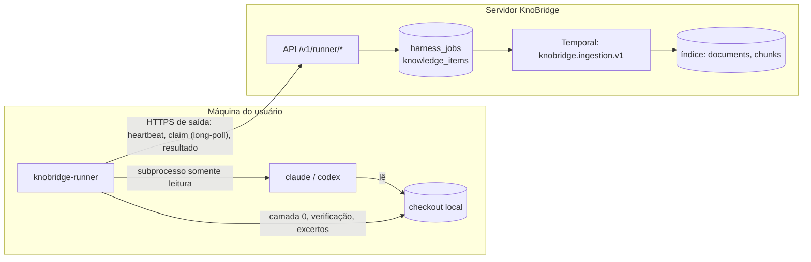

# ADR 0005 — Runner local do harness de código

> Status: aceito · 2026-10-11 · plano 0004 (F1.1)

## Contexto

A [visão](../01-visao-do-projeto.md) (seção 7.1.1 e decisões D10 e D11) faz do **harness de agente** o caminho principal do mapeamento de código: um agente de código (Claude Code em modo headless ou Codex CLI) lê um módulo do repositório, somente leitura, e devolve conhecimento em português de negócio com evidência `arquivo:linhas` verificável. A proposta inicial do [plano 0004](../planos/0004-harness-runner-local.md) rodava esse agente como activity do worker, com o checkout numa pasta do servidor.

Rodar no servidor tem dois custos que o usuário recusou:

- o código-fonte inteiro precisa estar numa pasta do servidor, mesmo quando o KnoBridge roda fora da rede de quem é dono do código;
- os CLIs precisam estar logados no servidor, com a assinatura ou a chave de API de alguém guardada lá, o que amplia o risco de vazamento e mistura a conta de uma pessoa com a instância.

Faltava decidir onde o agente roda, como ele recebe trabalho e devolve resultado, o que pode sair da máquina de quem tem o código, como o conhecimento se liga a uma fonte e em que linguagem e pacote o executor é distribuído. As decisões D1, D3, D6 a D9, D14 e D16 do plano registram as escolhas; este ADR é a referência de arquitetura. Os contratos ficam em [runner.md](../specs/runner.md) (protocolo) e [harness.md](../specs/harness.md) (camada 0, prompt, schema, verificação, itens e flags).

## Decisão

1. **O harness roda num runner local** (`knobridge-runner`), na máquina do usuário que tem o checkout e o login dos CLIs. O servidor nunca executa o agente nem guarda o repositório (D1).
2. **Credenciais dos CLIs ficam no runner.** Dois modos, escolhidos na máquina: login de assinatura já feito (`~/.claude`, `~/.codex`) ou chave de API em variável de ambiente do runner (`ANTHROPIC_API_KEY`, `CODEX_API_KEY`/`OPENAI_API_KEY`). O servidor nunca recebe, guarda nem repassa credencial do harness (D3).
3. **Transporte por HTTPS long-poll, só conexões de saída.** O runner pede tarefa (`POST /v1/runner/jobs/claim`, espera até 25 s), manda heartbeat e entrega resultado por REST. Nenhuma porta é aberta na máquina do usuário; proxy e firewall corporativos funcionam como para qualquer cliente HTTPS (D6).
4. **Runner em Python, no monorepo**, distribuído como o pacote `knobridge-runner` (instalável por `uv tool`, `pipx` ou `uvx`) a partir da pasta de primeiro nível `runner/`, com projeto `uv` próprio e dependências mínimas (`httpx`, `pydantic`, `pathspec`). O runner **não importa** o backend; pequenas duplicações (padrões de seleção de arquivos) são aceitas e documentadas. O contrato do fio é garantido por teste contra `docs/specs/openapi.json` (D7, D16).
5. **Fronteira de dados.** Da máquina do usuário sobem só: o conhecimento gerado, as referências `arquivo:linhas` (caminhos relativos), o commit, contagens, métricas e um excerto curto por evidência (até `excerpt_max_lines`, padrão 30 linhas), com segredos óbvios redigidos. Nunca sobem o caminho absoluto do checkout, arquivos inteiros, o prompt, o log do agente nem stderr (D8; lista completa em [runner.md](../specs/runner.md#o-que-sai-e-o-que-não-sai-da-máquina)).
6. **Fonte do tipo `runner`.** Um tipo novo de fonte liga um runner e um repositório local declarado por ele (por nome, nunca pelo caminho). O runner roda a camada 0, sugere módulos e informa o HEAD. Como o servidor não tem o código, a **verificação mecânica das evidências é do runner**; o servidor valida estrutura e limites do resultado. A fonte Git do plano 0003 continua separada (D9).
7. **Fila de tarefas no Postgres, não no Temporal.** As tarefas do harness ficam em `harness_jobs`, servidas pela API com reserva (lease) de 2 min renovada pelo heartbeat da tarefa (a cada 30 s), `SELECT ... FOR UPDATE SKIP LOCKED`, até 3 tentativas e adiamento por limite de franquia. O conhecimento aceito entra no índice pelo workflow de ingestão do Temporal (`knobridge.ingestion.v1`) já existente (D14).
8. **Token de runner.** Cada runner tem um token `kbr_<prefixo>_<segredo>`, mostrado uma única vez, guardado como hash SHA-256, revogável na hora; o workspace vem do token, nunca do cliente (regra 7).

## Alternativas consideradas

- **Harness como activity do worker, com o checkout no servidor** (proposta inicial): reaproveita o Temporal de ponta a ponta, mas exige o código e as credenciais dos CLIs no servidor. Descartada pelo usuário pelo risco de vazamento.
- **Chave de API cifrada no servidor e enviada ao runner a cada tarefa**: centraliza a gestão de chaves, mas faz o segredo trafegar e ficar guardado sem necessidade. Descartada (D3).
- **Só assinatura** ou **só chave de API**: a assinatura atende dev e ensaio; a chave atende uso automatizado. Os dois modos custam pouco no runner.
- **WebSocket** ou **SSE + REST**: menor latência para entregar tarefa, mas conexões longas sofrem mais com proxies corporativos, exigem reconexão e estado de sessão no servidor, e são mais difíceis de testar. A latência de até 25 s do long-poll é irrelevante para tarefas de minutos.
- **Binário Go único**: instalação mais simples, mas uma segunda linguagem, um segundo gate de qualidade e nenhum reaproveitamento de ferramentas. Descartada (D7).
- **Subpacote em `backend/` com outro entry point**: arrastaria FastAPI, SQLAlchemy, MarkItDown e tree-sitter para a máquina do usuário. Descartada (D16).
- **Workflow Temporal por tarefa com conclusão assíncrona de activity, ou runner como worker Temporal**: expõe o Temporal (ou um token de task) à máquina do usuário e acopla o runner ao SDK e à versão do servidor Temporal. A fila com lease dá entrega pelo menos uma vez, retentativa e expiração com testes simples. Descartada (D14).
- **Runner vinculado a uma fonte Git já cadastrada**: obrigaria o servidor a ter (ou clonar) o repositório, o que contradiz o item 1. Descartada (D9).
- **Só referências, sem excerto**: menos dado saindo, mas o chat e a revisão perderiam a evidência legível. O excerto é curto, configurável (0 desliga) e redigido (D8).

## Consequências

- O mapeamento só anda quando um runner está online; tarefas esperam na fila (sem expirar) enquanto ele está offline. O painel mostra online/offline (contato nos últimos 90 s).
- O servidor confia na verificação feita pelo runner: um runner adulterado pode enviar evidência falsa dentro dos limites estruturais. O risco é limitado pelo token por workspace, pela revisão humana (D11) e pelo selo de confiança (`inferido` até revisão).
- O custo do agente é cobrado na conta de quem roda o runner (assinatura ou chave); o servidor só registra o custo informado.
- Uma fonte do tipo `runner` tem um único runner nesta versão (sem balanceamento entre runners), e um runner pode servir várias fontes.
- Mudança incompatível do protocolo exige nova versão do protocolo (`KnoBridge-Runner-Protocol`) e, se mudar a arquitetura, um novo ADR.
- Nova pasta de primeiro nível `runner/`, com `AGENTS.md`, job próprio na CI e linha na tabela da seção 4 do `AGENTS.md` raiz.
- Tabelas novas (`runners`, `harness_modules`, `harness_jobs`, `knowledge_items`, `harness_rejections`) seguem o [ADR 0001](0001-tenancy-e-rls.md) (RLS forçada por `workspace_id`); modelo em [modelo-de-dados.md](../specs/modelo-de-dados.md).
