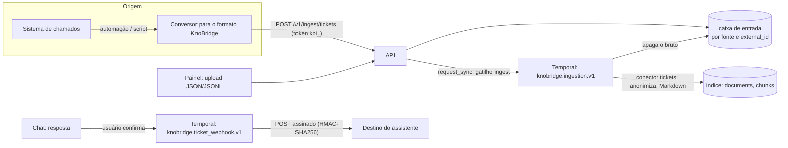

# ADR 0006 — Chamados por push e webhook de saída

> Status: aceito · 2026-10-12 · plano 0005 (F1.1) · item 6 (webhook por assistente) substituído pelo [ADR 0008](0008-produtos-e-niveis.md): o webhook é do produto

## Contexto

A [visão](../01-visao-do-projeto.md) previa chamados como mais um conector que **puxa** dados: "Sistema de chamados #1" (P0 na seção 7.1, com Movidesk, Jira Service Management, GLPI, Zendesk e outros como candidatos) e "1 sistema de chamados" no roadmap das Fases 0 e 1. Cada provedor tem API, autenticação, paginação, modelo de dados e limites próprios. Escolher um deixa os outros de fora. Suportar vários custa um conector, uma suíte de contrato e uma manutenção por provedor.

A regra 8 do `AGENTS.md` raiz também pede que, sem fonte, o assistente ofereça abrir um chamado. Até o plano 0004, o chat só mostrava o texto da oferta, sem um mecanismo para abrir o chamado.

O [plano 0005](../planos/0005-chamados-por-api.md) registra as escolhas do usuário: chamados entram por push num formato do KnoBridge (D1), pela API ou por upload (D2), e "abrir chamado" é um webhook de saída por assistente (D10). Faltava decidir onde os chamados recebidos esperam até serem indexados (D13) e como a entrega do webhook sobrevive a falhas e se protege contra SSRF (D16). Este ADR é a referência de arquitetura. O contrato está em [chamados.md](../specs/chamados.md).

## Decisão

1. **Chamados entram por push, num formato padrão do KnoBridge** (D1). O formato é publicado em JSON Schema na spec e no OpenAPI. Quem integra converte do sistema de origem para esse formato uma vez, por automação, webhook do próprio sistema, iPaaS ou script. O KnoBridge não tem conector por provedor nem mapeamento configurável de webhook nativo.
2. **Duas portas de entrada, mesma validação** (D2): `POST /v1/ingest/tickets`, autenticada por um token de envio da fonte (`kbi_…`, que só abre `/v1/ingest/*`), e o upload de arquivo JSON ou JSONL no painel. As duas validam cada chamado contra o mesmo schema e gravam na mesma caixa de entrada.
3. **Caixa de entrada no Postgres** (D13). Cada chamado validado vira uma linha por `(fonte, external_id)`, com o payload bruto, o `updated_at` e o hash do conteúdo. O upsert só substitui a linha quando o `updated_at` recebido é maior ou igual ao guardado. Reenviar não duplica e um envio atrasado não regride. A remoção grava uma lápide (tombstone) com data, que também barra envios atrasados.
4. **Conector interno `tickets` no workflow de ingestão existente** (D13). O conector lê a caixa de entrada, como o conector `knowledge` do [ADR 0005](0005-runner-local-do-harness.md) lê os itens de conhecimento. O envio dispara `request_sync` com o gatilho `ingest`. Se já houver execução, ela fica marcada como pendente (`sync_pending`). O workflow `knobridge.ingestion.v1` anonimiza, monta o Markdown, divide em trechos, gera os embeddings e grava no índice.
5. **O bruto não fica guardado** (D6). Quando o documento do chamado é gravado (ou removido) no índice, o payload da caixa de entrada é apagado. Restam o Markdown anonimizado no índice e os hashes e datas para a idempotência.
6. **Webhook de saída por assistente para abrir chamado** (D10). O assistente pode ter uma URL e um segredo. A partir de uma resposta do chat, o usuário vê o que será enviado (pergunta, conversa, resumo, nome e e-mail dele), confirma e o KnoBridge envia um POST assinado com HMAC-SHA256 (`KnoBridge-Signature: t=…,v1=…`). Se o destino devolver `{ticket_id, url}`, o painel mostra o número e o link.
7. **Entrega por workflow Temporal, com proteção contra SSRF** (D16). Cada pedido é um workflow com retentativas exponenciais por até 24 h, fora da requisição do usuário. O destino tem de ser `https`. O host é resolvido e recusado se algum endereço for privado, loopback, link-local ou reservado, e a conexão usa o endereço já verificado. Uma lista de permissão por variável de ambiente libera hosts de desenvolvimento.

## Alternativas consideradas

- **Um conector por provedor** (Zendesk, GLPI, Movidesk...): integração sem código para quem usa um provedor suportado. Mas cada provedor custa um conector, uma suíte de contrato e manutenção, e quem usa um provedor fora da lista fica sem nada. Descartada pelo usuário (D1).
- **Mapeamento configurável do webhook nativo de cada sistema**: dispensa o conversor, mas exige uma linguagem de mapeamento (caminhos JSON, transformações de status e datas), a tela dela e testes para cada combinação. A ambiguidade volta para dentro do produto. Descartada (D1, D2).
- **CSV com colunas fixas no upload**: familiar, mas não representa bem uma conversa com várias mensagens, papéis e formatos. Descartada (D2).
- **Fila separada (Redis, SQS) ou um workflow Temporal por chamado**: a fila separada é uma peça a mais na infraestrutura, sem ganho no volume esperado. Um workflow por chamado gera milhares de execuções e perde o incremental, o custo por execução e as telas de execuções que o workflow de ingestão já tem. Descartadas (D13).
- **Guardar o payload bruto por N dias**: permitiria reprocessar quando a anonimização ou o Markdown mudam, mas guarda dado pessoal sem necessidade. Descartada (D6). Quem precisar reprocessar reenvia.
- **Envio síncrono do webhook na requisição do chat**: mais simples, mas o usuário espera o destino responder e perde o pedido se ele estiver fora do ar. Descartada (D16).
- **Fila no Postgres com worker próprio para o webhook**: funcionaria, mas o Temporal já dá retentativa com backoff, prazo total e histórico visível. Descartada (D16).
- **Webhook por workspace só com a pergunta, ou só com o id interno do usuário**: menos dado saindo, mas o destino não teria como responder a quem pediu. O usuário escolheu nome e e-mail, enviados só depois da confirmação na tela (D10).

## Consequências

- Integrar um sistema de chamados exige escrever o conversor (fora do KnoBridge). O guia do plano mostra exemplos. Em troca, qualquer sistema serve, inclusive um sistema próprio.
- O formato do chamado é um contrato público. Mudança incompatível exige versão nova da rota (`/v2/ingest/tickets`) e um novo `$id` de schema.
- Como o bruto é apagado, **mudar a configuração da fonte** (anonimização, notas internas, filtro de status) **vale só para chamados recebidos depois**. O mesmo vale para mudanças futuras na anonimização ou no Markdown. Reaplicar exige reenviar os chamados.
- A anonimização é determinística, sem LLM: barata, testável e reproduzível, mas com falsos positivos (números que parecem telefone ou IP) e falsos negativos (nomes citados que não foram declarados no payload). A spec documenta os limites.
- Chamados seguem a permissão por coleção (D7): quem usa um assistente ligado à coleção vê os chamados dela. Não há ACL por chamado nesta versão.
- O webhook de saída envia nome e e-mail de quem pede para um sistema externo. Isso só acontece depois da confirmação explícita na tela, e o corpo do pedido é apagado quando a entrega termina.
- O worker passa a fazer requisições HTTP de saída para URLs configuradas por usuários. A checagem de SSRF é obrigatória em toda tentativa, não só ao salvar a URL.
- Tabelas novas (caixa de entrada de chamados, pedidos de chamado) seguem o [ADR 0001](0001-tenancy-e-rls.md) (RLS forçada por `workspace_id`). O segredo do webhook é cifrado como os demais segredos ([ADR 0003](0003-segredos-cifrados.md)). O modelo físico fica em [modelo-de-dados.md](../specs/modelo-de-dados.md).
- `runs.trigger` ganha o valor `ingest`; `sources.kind` ganha `tickets`; `documents.kind` e a citação do chat ganham `ticket` ([chat-sse.md](../specs/chat-sse.md), v0.6).
