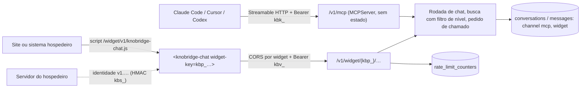

# ADR 0009 — Canais MCP e widget

> Status: aceito · 2026-10-14 · plano 0010 (F1.1)

## Contexto

A [visão](../01-visao-do-projeto.md) promete o conhecimento onde as pessoas perguntam (seção 7.6): um **servidor MCP** para IDEs e agentes (Claude Code, Cursor, Codex) e um **widget** embutível (Web Component em um único JS, sem iframe obrigatório, temável, com citações clicáveis). Até o plano 0009, só havia o painel e a API pública com chave `kbk_` ([ADR 0007](0007-chaves-e-api-publica.md)), com produtos e níveis de resposta ([ADR 0008](0008-produtos-e-niveis.md)).

O [plano 0010](../planos/0010-canais-mcp-e-widget.md) registra as escolhas do usuário: MCP com `search_knowledge`, `get_document`, `open_ticket`, `ask` e `list_products`, autenticado pela chave `kbk_`, sem OAuth (D2); widget com chave pública por produto, domínios permitidos, limite de requisições, visitante anônimo com histórico no navegador e identidade assinada opcional pelo sistema hospedeiro (D3); abrir chamado, feedback, modo embutido e tela de configuração com prévia (D4); widget sempre no nível Usuário final (D5). Faltava fechar as decisões técnicas propostas em D6: onde o MCP roda, como o widget é empacotado e servido, que credenciais o widget usa, como o visitante volta à própria conversa, onde fica o limite de requisições e como os canais aparecem nos dados. Os contratos estão em [mcp.md](../specs/mcp.md) e [widget.md](../specs/widget.md).

## Decisão

1. **MCP no mesmo processo da API, em `/v1/mcp`, com o SDK oficial Python** (D6). O servidor é um `MCPServer` do pacote `mcp` 2.x (o antigo `FastMCP`), montado no FastAPI pelo `streamable_http_app()`, com Streamable HTTP **sem estado** (`stateless_http=True`, resposta JSON sem SSE, `json_response=True`). O gerenciador de sessões do SDK entra no `lifespan` da API. Assim, o MCP usa o mesmo banco, a mesma busca, a mesma rodada de chat e o mesmo deploy, e qualquer réplica da API atende qualquer chamada.
2. **A chave `kbk_` autentica o MCP, com o escopo de produtos e o nível máximo dela** (D2). Um invólucro ASGI na frente do app do SDK valida `Authorization: Bearer kbk_…` como a API pública (mesma dependência, mesmo 401, `last_used_at`), antes de qualquer mensagem MCP. As ferramentas recebem a identidade da chave pelo contexto da requisição. Sem nível no pedido, vale o `max_level` da chave, como na API pública. A chave continua só abrindo a API pública, que agora inclui `/v1/mcp`. OAuth fica de fora (D2).
3. **`search_knowledge` e `get_document` não chamam o LLM.** Elas usam a busca híbrida do chat (`SearchService`), com o filtro de nível no SQL ([ADR 0008](0008-produtos-e-niveis.md), item 5). Só `search_knowledge` vetoriza a consulta (embedding, centavos de centavo); o modelo do IDE escreve a resposta. `ask` é a rodada de chat inteira, com custo, e grava a conversa da chave com `channel = mcp`. `open_ticket` usa o pedido de chamado do produto ([ADR 0006](0006-chamados-por-push.md)), a partir de uma resposta de `ask`.
4. **Widget em Lit, empacotado num único JS clássico (IIFE), servido pelo contêiner do frontend** (D6) no caminho estável `/widget/v1/knobridge-chat.js`. O elemento é `<knobridge-chat>`, com Shadow DOM, aparência por atributos, variáveis CSS e `::part`. Um script clássico não exige CORS para carregar; o caminho com a versão maior (`v1`) permite publicar correções sem quebrar quem embutiu.
5. **Duas credenciais do widget, com papéis diferentes** (D3, D6):
   - **chave pública `kbp_`**, uma por widget (e cada widget é de um produto): identifica o widget, vai no HTML do site e no caminho das rotas públicas (`/v1/widget/{chave}/…`). Não é segredo e fica gravada em claro. A proteção vem dos domínios permitidos e do limite de requisições, não do sigilo dela;
   - **segredo de assinatura `kbs_`**, opcional: fica no servidor do sistema hospedeiro e assina a identidade do visitante (HMAC-SHA256). O KnoBridge precisa dele para verificar, então o guarda cifrado com AES-256-GCM ([ADR 0003](0003-segredos-cifrados.md); `info` `knobridge/widget-signing-secrets/v1`, AAD `widget_signing_secret:<workspace_id>:<widget_id>`), mostrado uma única vez e rotacionável.
6. **O visitante volta à própria conversa por um token de conversa `kbv_`** (D6). Criar a conversa devolve o token uma vez; o servidor guarda só o SHA-256 dele na conversa e o widget guarda o token e o id no `localStorage` do site. Sem token, não há leitura nem pergunta. As mensagens ficam no servidor; o navegador guarda só o ponteiro.
7. **Identidade assinada opcional, só para identificar** (D3, D5). O formato é `v1.<payload base64url>.<HMAC-SHA256 hex>`, com `sub`, `name`, `email`, `iat` e `exp` (validade máxima de 24 h e tolerância de relógio de 60 s). Ela grava nome, e-mail e id externo na conversa e no chamado. Ela **não** muda o nível: o widget responde sempre em `end_user`, pela regra do canal público de `levels/policy.py` (D5). Um segredo vazado identifica alguém errado, mas nunca abre conteúdo acima de Usuário final.
8. **CORS e `Origin` por widget.** As rotas `/v1/widget/*` saem do `CORSMiddleware` global (que serve o painel com credenciais) e respondem CORS sem credenciais, ecoando o `Origin` só quando ele está nos domínios permitidos do widget (ou é a origem da própria instância, para a prévia do painel). `Origin` ausente ou fora da lista é recusado com 403. No MCP, uma requisição com `Origin` só passa se a origem estiver em `KNOBRIDGE_MCP_ALLOWED_ORIGINS` (vazia por padrão), contra DNS rebinding a partir de um navegador.
9. **Limite de requisições numa janela fixa no Postgres** (D6), na tabela `rate_limit_counters` (modo de sistema, como `login_attempts`): por widget e IP em todas as rotas públicas, por widget e IP nas mensagens e nos chamados, e por widget no total diário de mensagens. A chave do contador é o SHA-256 do escopo, do widget e do IP, então o IP não é gravado. Estourou: 429 com `Retry-After`. Os limites de mensagens são configuráveis por widget; os demais, por variável de ambiente.
10. **Canais `mcp` e `widget` em `conversations.channel` e `messages.channel`** (D6). A conversa do MCP pertence à chave (`api_key_id`), como a da API; a do widget pertence ao widget (`widget_id`), com o hash do token do visitante e a identidade, se houver. Exatamente um dono por conversa: pessoa, chave ou widget. Uso e custos e a visão administrativa ganham os dois canais.

## Alternativas consideradas

- **Processo MCP separado** (outro contêiner com o SDK): isolaria falhas, mas duplicaria configuração, conexões ao banco, autenticação e deploy, sem ganho no volume esperado. Descartada (D6).
- **MCP com sessão** (stateful, `Mcp-Session-Id`): exigiria afinidade de réplica e guardaria estado em memória. As ferramentas não precisam de sessão: cada chamada traz tudo. Descartada.
- **OAuth no MCP** (conector do claude.ai e do ChatGPT): fora do lote por escolha do usuário (D2). A chave `kbk_` cobre os clientes que aceitam header (Claude Code, Cursor, Codex).
- **Widget em Preact ou React**: React pesa mais no site hospedeiro; Preact é leve, mas o Web Component com Shadow DOM é o modelo nativo do Lit, sem adaptador. Descartadas (D6).
- **Widget em iframe**: isola o CSS de graça, mas complica o modo embutido (altura), a temática e a acessibilidade, e a visão pede "sem iframe obrigatório". Descartada.
- **Script como módulo ES** (`type="module"`): carregar módulo de outra origem exige CORS no arquivo e quebra em sites com CSP restritiva a módulos. O IIFE carrega com uma tag simples. Descartada.
- **Chave pública num header**: o preflight CORS não leva os valores dos headers, então o servidor não saberia quais origens permitir. No caminho, a chave está disponível já no `OPTIONS`.
- **Só a chave pública, sem token de conversa**: qualquer pessoa com a chave (que é pública) leria qualquer conversa do widget. Descartada.
- **Cookie para o visitante**: cookie de terceiro é bloqueado pelos navegadores e exigiria `SameSite=None` com credenciais no CORS. O token no `localStorage` do próprio site funciona em todos.
- **JWT padrão para a identidade**: exigiria escolher e travar algoritmo (`alg`), lidar com `none` e com chaves públicas; o formato próprio tem um algoritmo só, o mesmo HMAC do webhook de chamados ([ADR 0006](0006-chamados-por-push.md)), e cabe em dez linhas no hospedeiro. Descartado.
- **Identidade assinada subindo o nível do widget** (D5): exigiria mudar a regra do canal público do [ADR 0008](0008-produtos-e-niveis.md) e faria do segredo do hospedeiro uma chave para código e chamados internos. Descartada pelo usuário.
- **Limite em memória por processo ou Redis** (D6): em memória, cada réplica conta sozinha e o limite se multiplica; Redis é uma peça a mais na infraestrutura. O Postgres já guarda o limite de login com o mesmo desenho. Descartadas.

## Consequências

- Dependência nova no backend: `mcp` (SDK oficial, 2.x, fixado no `uv.lock`). O SDK limita o corpo a 4 MiB; o `BodyLimitMiddleware` aplica 64 KiB em `/v1/mcp` antes dele.
- Pacote novo `widget/` no monorepo (pnpm, Lit, Vite em modo biblioteca, gate de 95%), com job próprio na CI. O build vai para a imagem do frontend, que passa a precisar do diretório `widget/` no contexto de build (no compose, um contexto adicional).
- Tabelas novas `widgets` (RLS por workspace) e `rate_limit_counters` (só modo de sistema). `conversations` ganha `widget_id`, o hash do token do visitante e a identidade; `feedback.user_id` e `ticket_requests.user_id` passam a aceitar nulo (feedback do visitante, chamado do MCP e do widget). Migrações `0020` (widget, plano 0010 F3.1) e `0021` (canal `mcp`, F2.2) ([modelo-de-dados.md](../specs/modelo-de-dados.md)).
- O payload do webhook de chamado ganha `channel` e `requester.verified` e `requester.external_id` (campos aditivos, `version` continua 1); `requester.name` passa a poder ser o próprio e-mail, quando quem pede não informou nome ([chamados.md](../specs/chamados.md#payload)).
- A chave pública do widget é visível a qualquer um. Quem a copia para outro site é barrado pelo `Origin` no navegador, mas um script fora do navegador pode forjar o `Origin`. O teto real de abuso é o limite de requisições e de mensagens por dia, e o conteúdo exposto é só o de Usuário final, que o produto já publica no widget.
- O widget gasta LLM do workspace a cada pergunta de um visitante anônimo. O limite diário por widget é o freio de custo; Uso e custos mostra o canal `widget` e cada widget.
- Este ADR acrescenta ao [ADR 0007](0007-chaves-e-api-publica.md): a chave `kbk_` também abre `/v1/mcp`, e as conversas da chave podem ter `channel = mcp`.
- Fora deste ADR e do lote: OAuth no MCP, Slack e Google Chat, widget acima de Usuário final, anexos e voz no widget.
