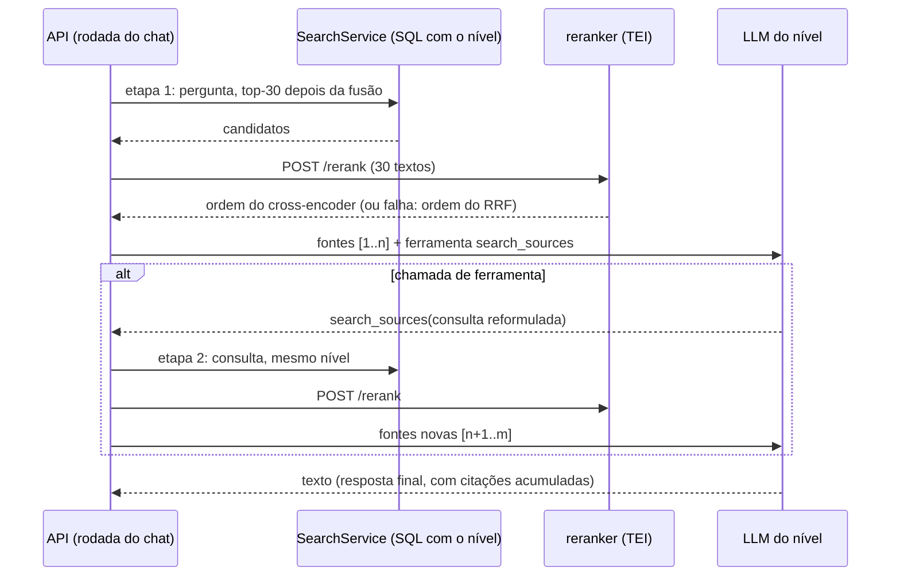

# ADR 0010 — Busca em etapas e reranker

> Status: aceito · 2026-10-17 · plano 0011 (F1.1) · emendado em 2026-10-17 pelo [ADR 0011](0011-reranker-opcional.md) (reranker opcional, fora do compose padrão, e produtos novos sem reordenação: itens 1 e 3) e pelas decisões D27 (sem chamada de ferramenta forçada: item 6), D29 (Usuário final com 1 busca por padrão; os padrões do item 4 passam a 1, 3 e 4) e D30 (busca inicial vazia permite uma reformulação só, e resposta sem marcador `[n]` fica `no_source`) do plano 0011

## Contexto

Até o plano 0010, cada pergunta faz **uma** busca híbrida com o texto da pergunta (vetor + FTS, fusão RRF, até 10 trechos, [indexacao.md](../specs/indexacao.md#busca-híbrida)) e o modelo do nível responde com o que veio. Os ensaios com dados reais mostraram três limites:

1. **A busca única fica presa à primeira formulação.** No [ensaio 0005](../pesquisa/0005-niveis-no-minski.md), o Suporte não montou as consultas SQL porque nenhum trecho do esquema entrou no contexto, e 9 de 48 respostas com fontes disseram "não sei". No [ensaio 0006](../pesquisa/0006-mcp-e-widget-no-minski.md), o Claude Code ligado ao MCP acertou 9 de 9 fazendo de 1 a 4 buscas por pergunta, enquanto o `ask` (busca única) acertou 7.
2. **A ordem do RRF é grosseira.** A [visão](../01-visao-do-projeto.md) (seções 6 e 7.4) previa um reranker cross-encoder nos top-30, com o `bge-reranker-v2-m3` self-host como padrão; o `Protocol Reranker` existe em `retrieval/rerank.py` desde o plano 0003, sem uso.
3. **O limiar de similaridade é um só.** O 0,35 foi calibrado para o `text-embedding-3-small`; com o Gemini, perguntas sem relação passam de 0,48 ([pesquisa 0004](../pesquisa/0004-embeddings-openai-x-gemini.md)) e a regra 8 deixa de funcionar.

O [plano 0011](../planos/0011-qualidade-da-resposta.md) registra as escolhas do usuário: reranker só self-host com o `bge-reranker-v2-m3` (D1), contêiner sempre ligado no compose (D2), reordenação por produto, ligada por padrão quando a instância tem reranker (D3), busca em etapas com o modelo do nível chamando uma ferramenta de busca, com máximo por nível e filtro de nível em cada busca (D4), avaliação sintética no repositório (D5) e limiar por modelo, aviso de arquivos gerados e etapas em todos os canais (D6). As decisões técnicas propostas em D7 são fechadas aqui. Os contratos estão em [chat.md](../specs/chat.md#busca-em-etapas), [chat-sse.md](../specs/chat-sse.md#step), [indexacao.md](../specs/indexacao.md#reranker), [produtos-e-niveis.md](../specs/produtos-e-niveis.md) e [avaliacao.md](../specs/avaliacao.md).

## Decisão

1. **Reranker pelo Text Embeddings Inference (TEI) da Hugging Face, imagem de CPU** (D1, D2, D7). Serviço `reranker` no `docker-compose.yml` com `ghcr.io/huggingface/text-embeddings-inference:cpu-1.9.4` e `--model-id BAAI/bge-reranker-v2-m3` (XLM-RoBERTa de classificação de sequência, arquitetura que o TEI serve como reranker), o modelo baixado na primeira subida para o volume `reranker-models` (montado em `/data`, o cache do TEI). A API chama `POST /rerank` com `{query, texts, raw_scores: false, return_text: false, truncate: true}` e recebe `[{index, score}]` em ordem decrescente. Sem GPU (fora do escopo do plano).
2. **Cliente HTTP atrás do `Protocol Reranker` que já existe**, montado pela API quando `KNOBRIDGE_RERANKER_URL` está definida ("a instância tem reranker"). Ele recebe os **30 melhores depois da fusão** (`KNOBRIDGE_RERANKER_CANDIDATES`) e devolve os 10 primeiros pela pontuação do cross-encoder. Timeout curto (10 s por padrão); qualquer falha (timeout, conexão, status de erro, resposta inválida) é registrada em log e a busca segue **na ordem do RRF**, sem derrubar a resposta. O reranker só reordena e corta: nunca acrescenta candidato, então o filtro de nível no SQL e o limiar continuam valendo antes dele.
3. **Reordenação por produto** (D3): `products.rerank`, padrão `true`. Vale quando o produto tem a opção **e** a instância tem reranker; sem reranker, a busca é a de hoje. Aplica-se a toda busca do produto: a inicial do chat, cada etapa da ferramenta e o `search_knowledge` do MCP. "Testar busca" aceita ligar e desligar por chamada.
4. **Busca em etapas pela chamada de ferramentas do provedor** (D4, D7). A interface `LLMProvider` ganha ferramentas (definição, chamada, resultado, `tool_choice`) com streaming, nos adaptadores OpenAI (que também serve ao OpenRouter, Chat Completions) e Anthropic (Messages), pelos SDKs oficiais e sem framework (D6 da visão). A rodada do chat continua começando pela busca com a pergunta (etapa 1, fase 1); depois o modelo do nível pode chamar a ferramenta `search_sources` com uma consulta reformulada, até o máximo de etapas do nível (`workspace_levels.max_steps`, padrões 2, 3 e 4, de 1 a 6). **Cada busca da ferramenta passa pelo mesmo `HybridRetriever`, com o nível da conversa no SQL dos dois braços**: um trecho acima do nível nunca chega ao contexto em nenhuma etapa.
5. **Regra da primeira saída.** Em cada rodada do LLM, o primeiro bloco que o modelo emite decide: **texto** é a resposta final (as citações acumuladas vão primeiro e o texto sai em streaming, como hoje); **chamada de ferramenta** é uma etapa (o texto da rodada, se vier, é descartado). Uma busca por rodada (chamadas paralelas desligadas). Ao chegar no máximo, a última rodada vai com `tool_choice: none`. As citações de todas as etapas se acumulam numa lista só, sem repetir trecho, numerada na ordem em que entraram.
6. **Regra 8 mantida, com uma mudança de mecanismo.** Sem nenhuma fonte depois da busca inicial, o modelo ainda pode ser chamado, mas só para buscar de novo (`tool_choice: required` nesta versão do ADR; desde a decisão D27, `auto` com a mensagem das fontes pedindo a nova busca, porque os modelos Claude 5.5 recusam a chamada forçada com 400). Se nenhuma etapa encontrar fonte, a resposta é a `no_source_message`, e **nenhum texto do LLM chega a quem perguntou**. Produto sem coleção continua respondendo "sem fonte" sem embedding nem LLM.
7. **Modelo sem chamada de ferramentas cai na busca única** (D7). O adaptador transforma a recusa do provedor em `ToolsUnsupportedError`; a rodada refaz a chamada sem ferramentas e grava o modelo em `workspace_levels.tools_unsupported_model`, para não tentar de novo e para a tela de níveis avisar. O provedor `fake` sem roteiro responde texto (nunca chama a ferramenta), o que equivale à busca única.
8. **Etapas e custo por resposta.** Cada resposta grava `steps` (buscas feitas) e `retrieval` (as consultas, as contagens e se houve reordenação); tokens e `cost_usd` passam a ser a soma de todas as chamadas ao LLM da resposta. Novo evento SSE `step` (a consulta reformulada, sem conteúdo dos trechos); o widget mostra só "Buscando mais informações…", sem a consulta.
9. **Limiar com padrão por modelo de embedding** (D6). `products.min_similarity` passa a aceitar nulo, que significa "o padrão do modelo de cada coleção": 0,35 para os `text-embedding-3-*`, 0,60 para o `gemini-embedding-001`, 0,57 para o `gemini-embedding-2` e 0,35 para modelo desconhecido. Um valor explícito continua valendo para todas as coleções do produto.
10. **Aviso de arquivos que dominam o índice** (D6). Ao fim de cada sincronização bem-sucedida de uma fonte de pasta ou Git, a ingestão calcula a participação de trechos por arquivo, por diretório e por padrões conhecidos de arquivo gerado, e grava em `sources.index_stats` os que passam dos limiares, com o glob de exclusão sugerido. A API da fonte mostra; o painel aplica a sugestão em `exclude_globs`.
11. **E2E sem baixar o modelo** (D7). A camada `docker-compose.e2e.yml` troca a imagem do serviço `reranker` por um reranker falso em Python puro (`scripts/fake_reranker.py`), determinístico, na mesma rota `/rerank`. A suíte padrão usa um `Reranker` fake atrás da interface, e o cliente HTTP tem um teste de contrato contra um servidor falso.

## Alternativas consideradas

- **Reranker no processo da API (sentence-transformers ou ONNX Runtime)**: dispensaria um contêiner, mas traria PyTorch ou ONNX e 2 GB de modelo para dentro da imagem da API, multiplicados por réplica, e o carregamento atrasaria a subida. Descartada (D7).
- **Provedor externo de reranker (Cohere, Jina, Voyage)**: mais rápido e sem memória local, mas manda as perguntas e os trechos para mais um terceiro. Fora deste bloco por escolha do usuário (D1); a interface permite acrescentar depois.
- **Reranker como perfil opcional do compose**: menos memória para quem não quer, mas a qualidade melhor deixaria de ser o padrão. Descartada pelo usuário (D2).
- **Reranker real no E2E**: baixaria cerca de 2 GB a cada execução da CI e o tempo da CPU tornaria o teste lento e instável. Descartada (D7).
- **Etapa fixa de reformulação** (uma chamada do LLM que reescreve a pergunta antes da busca): previsível, mas sempre paga uma chamada a mais e não decide se precisa buscar de novo. Descartada pelo usuário (D4).
- **Bufferizar o texto de cada rodada até saber se ela termina em ferramenta**: elimina o caso "texto e depois ferramenta", mas a resposta final deixaria de sair em streaming. A regra da primeira saída mantém o streaming; as regras fixas pedem que o modelo chame a ferramenta sem escrever antes.
- **Rodadas de decisão separadas da resposta** (uma ferramenta "responder" ou uma chamada final sem ferramentas sempre): toda pergunta pagaria ao menos duas chamadas com o contexto inteiro. Descartada.
- **Responder "sem fonte" sem LLM também quando a busca inicial volta vazia**: mais barato, mas é justamente o caso em que reformular ajuda (a pergunta com palavras do usuário não casa com o termo do índice). Descartada; o custo é limitado pelo máximo de etapas do nível.
- **Limiar de rerank (descartar trechos com pontuação baixa do cross-encoder)**: pode melhorar o "não sei", mas precisa de calibração com dados reais. Fica para depois do ensaio da F4.3.
- **Estatísticas de arquivos calculadas a cada leitura da fonte**: dispensaria a coluna, mas a lista de fontes precisaria agregar todos os trechos de cada fonte a cada página. Calcular no fim da sincronização custa uma consulta por execução.

## Consequências

- **Revisto pelo [ADR 0011](0011-reranker-opcional.md)**: medido no ensaio da F4.3, o `bge-reranker-v2-m3` em CPU leva de 34 s a 96 s para 30 trechos e precisa de 6 a 8 GB; o serviço saiu do `docker compose up` padrão (perfil `reranker`), `KNOBRIDGE_RERANKER_URL` ficou vazia por padrão e produtos novos nascem sem reordenação. O texto abaixo descreve a decisão original.
- Serviço novo no compose, sempre ligado: a primeira subida baixa o modelo (cerca de 2,3 GB) e o contêiner reserva até 4 GB de memória (`RERANKER_MEMORY_LIMIT`). A API não depende dele para subir: sem reranker saudável, as buscas seguem na ordem do RRF e o painel da instância mostra o serviço com erro.
- **Latência**: em CPU, reordenar 30 trechos leva de um a alguns segundos, conforme a máquina e o tamanho dos trechos (por isso o texto enviado é cortado em `KNOBRIDGE_RERANKER_MAX_CHARS`). Com etapas, cada busca reordena de novo. O ensaio da F4.3 mede no Minski; o timeout garante o teto.
- **Custo**: uma resposta com N etapas faz até N chamadas ao LLM, cada uma com o contexto acumulado. A tela de níveis mostra o custo estimado de uma resposta simples e o máximo com as etapas. O reranker não tem custo por chamada (self-host); o embedding das consultas da ferramenta não é registrado, como o da busca inicial.
- **Contratos aditivos**: o evento `step` antecede `citations` (clientes de SSE devem ignorar evento desconhecido); `done`, as mensagens, a REST, a API compatível com OpenAI e o `ask` do MCP ganham `steps`. A API compatível com OpenAI não emite chunks de etapa. O `tool_choice` e as `tools` do cliente da API compatível com OpenAI continuam ignorados: a ferramenta é interna.
- **Regra 8**: "sem fonte, sem LLM" vira "sem fonte, nenhum texto do LLM". Uma resposta `no_source` depois de etapas tem `model`, tokens e custo, e conta em Uso e custos como resposta que chamou o LLM.
- Migrações, na ordem da integração (decisão D9 do plano 0011): `0022` (F2.1) `products.rerank`; `0023` (F2.4) `products.min_similarity` nulo (os produtos com o antigo padrão 0,35 passam a usar o padrão do modelo) e `sources.index_stats`; `0024` (F2.3) `workspace_levels.max_steps` e `tools_unsupported_model`, `messages.steps` e `messages.retrieval` ([modelo-de-dados.md](../specs/modelo-de-dados.md#migrações)).
- Este ADR substitui a decisão D8 do plano 0003 (sem reranker) e a decisão D12 do mesmo plano na parte do limiar único. Ele também emenda o [ADR 0008](0008-produtos-e-niveis.md) (o nível ganha o máximo de etapas; o filtro de nível vale em cada etapa) e o [ADR 0009](0009-canais-mcp-e-widget.md) (o `ask` do MCP e o widget usam a mesma rodada em etapas).
- Fora deste ADR e do plano: provedor externo de reranker, GPU, limiar de rerank, avaliação automática na CI com LLM real (fase 3 da visão) e a troca do modelo de embedding padrão.

## Referências

- Text Embeddings Inference (README, rota `/rerank`, imagens): <https://github.com/huggingface/text-embeddings-inference>
- TEI, modelos e hardware suportados (rerankers XLM-RoBERTa, imagem `cpu-1.9`): <https://huggingface.co/docs/text-embeddings-inference/supported_models>
- TEI, versões (1.9.4): <https://github.com/huggingface/text-embeddings-inference/releases>
- Exemplo do TEI com o `bge-reranker-v2-m3` (corpo e resposta do `/rerank`, `/health`): <https://docs.salad.com/container-engine/reference/recipes/tei-bge-reranker-v2-m3>
- `BAAI/bge-reranker-v2-m3`: <https://huggingface.co/BAAI/bge-reranker-v2-m3>
- OpenAI, chamada de funções no Chat Completions: <https://platform.openai.com/docs/guides/function-calling>
- Anthropic, uso de ferramentas e streaming: <https://docs.claude.com/en/docs/agents-and-tools/tool-use/overview> e <https://docs.claude.com/en/docs/build-with-claude/streaming>
- OpenRouter, chamada de ferramentas: <https://openrouter.ai/docs/features/tool-calling>
