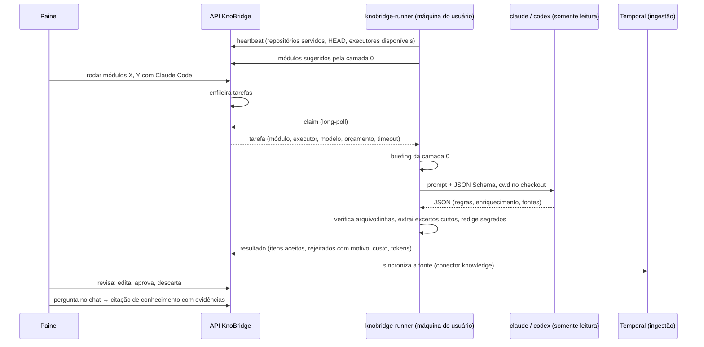

# Plano 0004 — Harness de código com runner local

## 1. Pedido original

> "Sugira um novo bloco para ser desenvolvido" → proposta do agente: harness de código (conhecimento a partir do código com Claude Code e Codex, somente leitura, evidência `arquivo:linhas` verificada). Resposta: "Gostei, pode executar".

Na rodada de perguntas, o usuário replanejou onde o harness roda:

> "Vamos replanejar: executar o harness no mesmo ambiente que o sistema implica que o código esteja em uma pasta no servidor e pode haver vazamentos.... que tal um pequeno runtime que executa na máquina do usuário e se comunica com o servidor via socket ou (outra forma mais indicada) e quando precisar esse runtime que chama o harness e executa o mapeamento?"

## 2. Entendimento (perguntas e respostas)

| # | Pergunta | Resposta | Data |
|---|---|---|---|
| 1 | Qual executor entra neste bloco? | Claude Code e Codex, mesmo prompt e schema | 2026-10-11 |
| 2 | Como o harness se autentica? | Os dois modos: login de assinatura e chave de API (no runner, ver D3) | 2026-10-11 |
| 3 | Como se define um módulo? | Sugerido pela camada 0 e editável | 2026-10-11 |
| 4 | Orçamento por tarefa? | Configurável, padrão US$ 5 | 2026-10-11 |
| 5 | Quando o harness roda (1ª versão)? | Replanejamento: runner local na máquina do usuário (pedido acima) | 2026-10-11 |
| 6 | Revisão humana entra? | Sim, completa | 2026-10-11 |
| 7 | Formato da saída? | Item por regra + enriquecimento por módulo | 2026-10-11 |
| 8 | Módulos do ensaio? | O agente escolhe 3 (D13) | 2026-10-11 |
| 9 | Transporte runner ↔ servidor? | HTTPS long-poll | 2026-10-11 |
| 10 | Linguagem e distribuição do runner? | Python, no monorepo | 2026-10-11 |
| 11 | O que sai da máquina do usuário? | Conhecimento + referências + excerto curto | 2026-10-11 |
| 12 | Checkout do runner x fontes do servidor? | Fonte nova do tipo runner | 2026-10-11 |
| 13 | Quando o mapeamento roda (com runner)? | Manual + automático em commit novo (ligável por fonte) | 2026-10-11 |

**O que será feito.**

- **Runner** (`runner/`, pacote `knobridge-runner`): configurado com a URL do servidor, um token de runner e a lista de repositórios locais que serve (nome → caminho). Mantém um heartbeat, informa HEAD e mudanças, pega tarefas por long-poll, roda a camada 0, monta o briefing, chama `claude -p` ou `codex exec` somente leitura com JSON Schema, verifica cada evidência no checkout, recorta excertos curtos (com redação de segredos) e envia o resultado. Detecta falha de autenticação e limite de franquia (devolve a tarefa como adiada), mata a árvore de processos no timeout e tenta o "resgate" por `--resume` quando o agente termina sem JSON.
- **Servidor**: cadastro de runners (token mostrado uma vez, guardado como hash, revogável, workspace vindo do token), fonte do tipo `runner`, módulos (sugeridos e editados), fila de tarefas com reserva, recebimento e validação dos resultados, itens de conhecimento com revisão (preservada na regeneração), exportação `.md`, conector interno `knowledge` que leva os itens não descartados para o índice e citações de conhecimento no chat (confiança e evidências).
- **Painel**: runners (status online, último contato, versão, executores), fonte do tipo runner, módulos e tarefas ao vivo (custo, tokens, aceitos e rejeitados), revisão do conhecimento e citação de conhecimento no chat.
- **Ensaio real**: 3 módulos do Minski × 2 executores, com relatório de métricas (`docs/pesquisa/0002-...`).

**Fora do escopo**: harness no servidor ou no worker; priorização por valor (chamados, telemetria, feedback) além da ordem manual; conectar o harness à fonte Git do plano 0003; nós no canvas (o canvas ainda não existe); vários runners servindo o mesmo repositório com balanceamento (um runner por fonte nesta versão); atualização automática do runner; assinatura do binário/pacote; Gemini CLI ou outros executores.

## 3. Critérios de aceite

- [ ] Um runner cadastrado no painel conecta só por conexões de saída (long-poll HTTPS), aparece como online com versão e executores disponíveis, e um token revogado deixa de funcionar na hora.
- [ ] O servidor nunca recebe o caminho absoluto do checkout nem arquivos inteiros: só nomes de repositório, caminhos relativos, HEAD, inventário (contagens), conhecimento, referências e excertos de até N linhas (padrão 30), com segredos óbvios redigidos (teste).
- [ ] Módulos sugeridos pela camada 0 aparecem na fonte; o usuário edita caminhos, liga e desliga, e roda um ou vários com Claude Code ou Codex.
- [ ] Tarefa sobrevive a runner offline (fica na fila), a runner que cai no meio (reserva vence e volta para a fila, até 3 tentativas) e a limite de franquia (adiada até o horário informado).
- [ ] O executor roda com `--tools Read,Grep,Glob` e `--disallowedTools Edit,Write,Bash` (Claude Code) ou `--sandbox read-only` (Codex), cwd no checkout, orçamento e timeout por tarefa; os argumentos são cobertos por teste.
- [ ] Item sem nenhuma evidência válida (arquivo fora do checkout ou inexistente, intervalo inválido ou longo demais, símbolo ausente) é rejeitado e registrado com o motivo, nunca gravado como conhecimento.
- [ ] Commit novo no checkout, com disparo automático ligado, enfileira só os módulos cujos arquivos mudaram.
- [ ] Conhecimento aceito vira documento `knowledge` indexado (chunking por seção, embedding com cache, custo registrado); o chat cita o item com título, confiança e evidências `arquivo:linhas` com excerto; o fallback "sem fonte" continua igual.
- [ ] Revisão: editar, aprovar (`revisado`) e descartar refletem no índice na sincronização seguinte; itens revisados sobrevivem à regeneração do módulo (marcados como "evidência mudou" quando os arquivos citados mudaram).
- [ ] Exportação `.md` de um módulo (zip) com o frontmatter da visão 7.1.1 (`id`, `tipo`, `modulo`, `fontes`, `confianca`, `gerado_por`, `commit`, `atualizado_em`).
- [ ] Testes sem LLM nem rede: executáveis `claude` e `codex` falsos que emitem o JSONL esperado; isolamento por workspace nas novas tabelas; cobertura ≥ 95% em backend, runner e frontend; CI com job do runner.
- [ ] E2E da stack: runner (com executor falso) sobre um repositório de fixture sintético → tarefa → revisão → chat com citação de conhecimento.
- [ ] Ensaio real Minski com os dois executores e relatório de métricas sem conteúdo (custo, tempo, aceitos, rejeitados por motivo, qualidade lida pelo orquestrador, efeito nas perguntas do ensaio 0001).
- [ ] ADR 0005, specs (`runner.md`, `harness.md`, modelo de dados, indexação, chat-sse), guia de uso do runner, visão (7.1.1 e D10) e `AGENTS.md` atualizados.

## 4. Fases e subfases

Convenções para todas as subfases: código em inglês, docs pt-BR; regras 1–10 do `AGENTS.md` raiz; a suíte padrão não chama LLM, CLI real ou rede (exceção: a suíte opt-in `real_harness` do runner, D17); agentes paralelos não editam `backend/AGENTS.md`, `backend/src/knobridge/AGENTS.md` nem o `AGENTS.md` raiz — relatam o texto e o orquestrador insere.

### F1 — Contrato e modelo de dados

Fixar o protocolo, o formato do conhecimento e as tabelas antes de qualquer código.

#### F1.1 — ADR 0005, spec do protocolo do runner e spec do harness

- **Objetivo**: decidir e documentar a arquitetura do runner e os contratos que servidor e runner implementam.
- **Entregáveis**: `docs/adr/0005-runner-local-do-harness.md` (D1, D3, D6–D9, D14, D16); `docs/specs/runner.md` (autenticação por token `Bearer kbr_…`, endpoints `/v1/runner/*` — heartbeat, relatório de repositório/módulos, claim com long-poll de até 25 s, heartbeat da tarefa, resultado, falha, adiamento —, estados e transições da tarefa, reserva de 2 min renovada pelo heartbeat, tentativas, códigos de erro, limites de payload, versionamento do protocolo, o que pode e o que não pode sair da máquina); `docs/specs/harness.md` (camada 0, briefing, regras do prompt genérico, JSON Schema da saída `schema_version: 1` com `objetivo`, `regras[]`, `mensagens[]`, `fluxo_principal[]`, `faq[]`, `duvidas[]` e `fontes[] = {arquivo, linha_inicial, linha_final, simbolo?}`, verificação mecânica e motivos de rejeição, excertos e redação, documentos de regra e de enriquecimento e o formato `.md` exportado com frontmatter, flags dos dois executores); visão: seção 7.1.1 passo 3 (runner local) e linha D10 da tabela apontando para o ADR; `docs/adr/AGENTS.md` e `docs/specs/AGENTS.md` se a lista de arquivos estiver lá.
- **Contexto necessário**: este plano (seções 2, 3, D1–D16); `docs/01-visao-do-projeto.md` seções 7.1.1 e 9; `docs/adr/0004-indice-de-conhecimento.md` (formato); `docs/specs/indexacao.md` e `docs/specs/conectores.md` (estilo); `docs/AGENTS.md`, `docs/adr/AGENTS.md`, `docs/specs/AGENTS.md`; referência de método (só leitura, sem copiar especificidades): `C:\Users\marco\Downloads\suporte_assistente\src\suporte_assistente\kb\harness\{prompt.py,verificacao.py,claude_code.py}`.
- **Critérios de aceite**: specs completas o bastante para F2 e F3 rodarem em paralelo sem conversar; nenhum produto ou cliente real citado; links relativos válidos (pre-commit).
- **Depende de**: nenhuma.
- **Tamanho**: médio (só docs).

#### F1.2 — Modelo de dados com RLS

- **Objetivo**: tabelas do harness com isolamento por workspace.
- **Entregáveis**: migração `0014` — `runners` (nome, `token_hash`, `token_prefix`, `last_seen_at`, `version`, `capabilities` jsonb, `revoked_at`, `created_by`); `sources.kind` aceita `runner` (config: `runner_id`, `repository`, `default_executor`, `model` por executor, `budget_usd` 5, `timeout_seconds` 1200, `auto_on_commit` false, `excerpt_max_lines` 30, `head_commit` informado); `harness_modules` (fonte, `key` estável, título, `paths` text[], `suggested`, `enabled`, `last_commit`, inventário resumido); `harness_jobs` (fonte, módulo, runner, executor, modelo, `trigger` manual/commit, `status` queued/leased/running/succeeded/failed/cancelled/deferred, `lease_expires_at`, `not_before`, `attempts`, `commit_sha`, tokens, `cost_usd`, duração, aceitos, rejeitados, `error`); `knowledge_items` (fonte, módulo, tarefa, `kind` rule/module, `key` como `<modulo>.R001`, título, `content` jsonb, `evidence` jsonb, `confidence` inferido/revisado, `review_status` pending/approved/discarded, `edited` jsonb, `evidence_changed`, `commit_sha`, `generated_by`); `harness_rejections` (tarefa, item, motivo, código); `documents.kind`/`run_items.document_kind` aceitam `knowledge`; RLS e políticas como as do índice; modelos SQLAlchemy; `docs/specs/modelo-de-dados.md` v0.6.
- **Contexto necessário**: `backend/AGENTS.md`, `backend/src/knobridge/db/AGENTS.md` (e de `migrations/`); `docs/specs/modelo-de-dados.md` (seções RLS e índice de conhecimento); migrações `0010`–`0013`; modelos do índice; `docs/adr/0001-tenancy-e-rls.md`; spec `harness.md` da F1.1.
- **Critérios de aceite**: `test_migration_0014_upgrade_downgrade`, `test_runner_tables_force_rls`, `test_harness_jobs_isolated_by_workspace`, `test_knowledge_items_isolated_by_workspace`, `test_source_kind_runner_accepted`, `test_documents_kind_knowledge_accepted`; cobertura ≥ 95%.
- **Depende de**: F1.1.
- **Tamanho**: médio.

### F2 — Servidor

#### F2.1 — Cadastro de runners, token e autenticação do runner

- **Objetivo**: o servidor reconhece runners com segurança.
- **Entregáveis**: API de sessão `GET/POST/PATCH/DELETE /v1/workspaces/{wid}/runners` (owner/admin gerenciam; criar devolve o token `kbr_<prefixo>_<segredo>` uma única vez; revogar), dependência `current_runner` (Bearer, hash SHA-256 com comparação em tempo constante, revogado → 401, workspace do token com `SET LOCAL`), `POST /v1/runner/heartbeat` (versão, executores disponíveis, repositórios servidos com HEAD; atualiza `last_seen_at`; devolve as fontes ligadas ao runner com a configuração necessária); status online derivado de `last_seen_at` (90 s); auditoria de criar, revogar e excluir; OpenAPI e tipos regenerados.
- **Contexto necessário**: `backend/AGENTS.md`; AGENTS de `api/`, `auth/`, `audit/`; `api/deps.py`, `api/providers.py` (padrão de rota), geração de token em `auth/`; specs `runner.md` e `modelo-de-dados.md` (F1); modelos da F1.2.
- **Critérios de aceite**: `test_create_runner_returns_token_once`, `test_runner_token_stored_hashed`, `test_revoked_runner_token_401`, `test_runner_requires_admin`, `test_heartbeat_updates_last_seen_and_capabilities`, `test_runner_cannot_see_other_workspace`, `test_runner_token_never_logged`; cobertura ≥ 95%.
- **Depende de**: F1.2.
- **Tamanho**: médio.

#### F2.2 — Fila de tarefas com reserva

- **Objetivo**: tarefas entregues pelo menos uma vez, com reserva, tentativas e adiamento.
- **Entregáveis**: `harness/queue.py` (enfileirar; `claim` com `FOR UPDATE SKIP LOCKED` sobre `queued`, `deferred` vencidas e reservas expiradas, só de fontes do runner; `attempts` até 3, depois `failed`); `POST /v1/runner/jobs/claim` com long-poll (espera até 25 s; relógio e espera injetados para os testes não dormirem); `POST /v1/runner/jobs/{id}/heartbeat` (renova a reserva, status `running`, progresso); `.../result` (valida contra o modelo do resultado: limites de itens, tamanho de texto, excerto ≤ `excerpt_max_lines`, caminhos relativos sem `..`; grava itens e rejeições; preserva itens `approved`/editados do módulo e marca `evidence_changed` quando os arquivos citados mudaram; substitui os `pending` anteriores; atualiza métricas da tarefa e `last_commit` do módulo; dispara a sincronização da fonte); `.../fail` e `.../defer` (com `not_before`); cancelar tarefa pela API de sessão (o heartbeat seguinte responde `cancelled`); resultado de tarefa não reservada por este runner → 409.
- **Contexto necessário**: `backend/AGENTS.md`; AGENTS de `api/` e do novo pacote `harness/` (criar); spec `runner.md`; modelos da F1.2; dependência da F2.1; `ingestion/sync.py` (`start_sync`).
- **Critérios de aceite**: `test_claim_returns_oldest_queued_job`, `test_claim_long_poll_returns_empty_after_timeout`, `test_expired_lease_is_reclaimed`, `test_job_fails_after_three_attempts`, `test_deferred_job_waits_until_not_before`, `test_result_from_wrong_runner_409`, `test_result_rejects_oversized_excerpt`, `test_regeneration_preserves_reviewed_items`, `test_result_triggers_source_sync`, `test_cancel_job_reported_on_heartbeat`, `test_concurrent_claims_never_share_a_job` (Postgres real); cobertura ≥ 95%.
- **Depende de**: F2.1.
- **Tamanho**: médio-grande.

#### F2.3 — Fonte do tipo runner, módulos e disparo por commit

- **Objetivo**: configurar a fonte, ver e editar módulos, disparar tarefas.
- **Entregáveis**: `parse_source_config` aceita `runner` (validação de D9/F1.2; `sync` de fonte runner indexa o conhecimento já existente; `test` de conexão = runner online e servindo o repositório); `POST /v1/runner/sources/{sid}/report` (HEAD, inventário, módulos sugeridos, arquivos alterados desde o último HEAD informado → upsert de módulos sugeridos sem sobrescrever os editados; com `auto_on_commit`, enfileira só módulos habilitados com interseção de caminhos, sem duplicar tarefa já na fila); API de sessão `GET/PATCH .../sources/{sid}/modules` (editar título, caminhos, `enabled`; criar módulo manual), `POST .../sources/{sid}/harness-jobs` (lote de módulos, executor, modelo opcional), `GET .../sources/{sid}/harness-jobs` e `GET .../harness-jobs/{jid}` (paginados, com rejeições); papéis: owner/admin/editor disparam e editam, viewer lê; auditoria.
- **Contexto necessário**: `backend/AGENTS.md`; AGENTS de `api/`, `ingestion/`, `harness/`; `ingestion/source_config.py`, `ingestion/sources.py`, `api/sources.py`; spec `runner.md`; fila da F2.2.
- **Critérios de aceite**: `test_runner_source_config_validated`, `test_report_upserts_suggested_modules_keeps_edited`, `test_report_with_auto_on_commit_enqueues_changed_modules_only`, `test_report_does_not_duplicate_queued_job`, `test_enqueue_batch_requires_editor`, `test_source_test_connection_runner_offline`, `test_modules_isolated_by_workspace`; cobertura ≥ 95%.
- **Depende de**: F2.2.
- **Tamanho**: médio.

#### F2.4 — Conhecimento no índice, revisão, exportação e citações

- **Objetivo**: o conhecimento revisável vira fonte citável do chat.
- **Entregáveis**: conector interno `knowledge` (lista itens não descartados da fonte; `natural_key` = `key` do item; conteúdo = Markdown renderizado do item, usando `edited` quando houver; hash para o incremental; removidos e descartados saem do índice); chunking de `knowledge` por seção com `meta` `{kind: knowledge, item_key, module, confidence, evidence[{path,start_line,end_line,symbol}]}` e excertos guardados para a citação; `retrieval/context.py` monta citação `kind: knowledge` (título, confiança, evidências com excerto); `docs/specs/chat-sse.md` v0.5 e `indexacao.md`; API de sessão `GET .../sources/{sid}/knowledge` (filtros por módulo, status, confiança), `PATCH .../knowledge/{iid}` (editar, aprovar → `revisado`, descartar; dispara sincronização), `GET .../sources/{sid}/knowledge/export?module=` (zip de `.md` com frontmatter de 7.1.1); auditoria de revisão.
- **Contexto necessário**: `backend/AGENTS.md`; AGENTS de `ingestion/`, `connectors/`, `retrieval/`, `api/`; `connectors/base.py`, `ingestion/chunking.py`, `ingestion/indexer.py`, `retrieval/context.py`; specs `harness.md`, `indexacao.md`, `chat-sse.md`; modelos da F1.2.
- **Critérios de aceite**: `test_knowledge_connector_lists_non_discarded_items`, `test_edited_item_reindexed_with_edited_content`, `test_discarded_item_removed_from_index`, `test_knowledge_chunk_meta_carries_evidence`, `test_citation_kind_knowledge_has_confidence_and_evidence`, `test_approve_sets_confidence_revisado`, `test_export_zip_has_frontmatter`, `test_knowledge_isolated_by_workspace`; cobertura ≥ 95%.
- **Depende de**: F2.2 (pode correr em paralelo com F2.3).
- **Tamanho**: médio-grande.

### F3 — Runner local (`knobridge-runner`)

As subfases F3.x usam só a spec `runner.md`/`harness.md` e o `openapi.json`; podem correr em paralelo com F2.x depois da F1.1.

#### F3.1 — Pacote, configuração, cliente, CLI e CI

- **Objetivo**: um runner instalável que conversa com o servidor.
- **Entregáveis**: `runner/` (projeto uv `knobridge-runner`, Python 3.12, ruff, pyright strict, pytest com gate de 95%, `AGENTS.md`, `README.md` curto); `config.py` (arquivo TOML em pasta de config do usuário + variáveis de ambiente: URL, token, repositórios `nome → caminho`, concorrência padrão 1, executores habilitados); `client.py` (httpx, Bearer, long-poll de claim, heartbeat de tarefa em segundo plano, backoff exponencial com teto e jitter com seed injetável, TLS verificado, proxy por variáveis padrão); laço principal com cancelamento limpo (Ctrl+C devolve a tarefa como falha retentável); CLI `knobridge-runner configure | run | doctor` (doctor confere servidor, token, repositórios, `claude`/`codex` no PATH e logados); logs JSON sem conteúdo de código; teste de contrato: modelos do runner batem com os schemas de `/v1/runner/*` em `docs/specs/openapi.json`; job `runner` na CI; `scripts/check_agents_md.py` sem mudança se já cobre a pasta; linha `runner/` relatada para a tabela da seção 4 do AGENTS raiz.
- **Contexto necessário**: `AGENTS.md` raiz (seções 2, 4, 5, 6); `backend/pyproject.toml` (padrão de ferramentas); `.github/workflows/ci.yml`; specs `runner.md`; `docs/specs/openapi.json` (após F2.1, ou spec se F2.1 não terminou — então o teste de contrato entra na F3.4).
- **Critérios de aceite**: `test_config_loads_toml_and_env_override`, `test_client_retries_with_backoff`, `test_claim_long_poll_handles_empty`, `test_job_heartbeat_runs_until_done`, `test_ctrl_c_fails_job_retryably`, `test_doctor_reports_missing_cli`, `test_models_match_openapi_runner_schemas`; cobertura ≥ 95%.
- **Depende de**: F1.1.
- **Tamanho**: médio.

#### F3.2 — Camada 0 determinística

- **Objetivo**: inventário, módulos e briefing sem LLM.
- **Entregáveis**: `layer0/` — seleção de arquivos (`.gitignore` + padrões do plano 0003: binários, lockfiles, `node_modules`, limites), inventário por pasta (arquivos, linhas, linguagem por extensão), sugestão de módulos por pasta com tamanho-alvo (ex.: 2–40 arquivos, até ~6 mil linhas; pastas grandes descem um nível, pequenas sobem; chave estável derivada do caminho), extrações baratas por regex (strings de mensagem ao usuário, leituras de configuração/variáveis de ambiente, rotas HTTP comuns, README/AGENTS do módulo), `git` (HEAD, arquivos alterados entre dois commits, `git log` curto da pasta — com `safe.directory`), briefing de um módulo (texto limitado em tamanho); relatório para `/v1/runner/sources/{sid}/report` (só caminhos relativos e contagens).
- **Contexto necessário**: `runner/AGENTS.md` (F3.1); spec `harness.md` (camada 0 e briefing); `backend/src/knobridge/connectors/selection.py` e `connectors/git/runner.py` (padrões de seleção e de chamar git; copiar a ideia, sem importar o backend).
- **Critérios de aceite**: `test_inventory_respects_gitignore_and_defaults`, `test_module_suggestion_splits_large_and_merges_small`, `test_module_key_stable_across_runs`, `test_extracts_user_messages_and_env_reads`, `test_changed_files_between_commits`, `test_briefing_capped_in_size`, `test_report_has_no_absolute_paths`; fixtures: repositório Git sintético criado no teste; cobertura ≥ 95%.
- **Depende de**: F3.1.
- **Tamanho**: médio.

#### F3.3 — Executores, prompt, schema e executáveis falsos

- **Objetivo**: chamar Claude Code e Codex do jeito seguro e igual.
- **Entregáveis**: interface `Executor` (`run(briefing, checkout, limits) -> ExecutorResult` com JSON, custo, tokens, duração, sessão, log JSONL); `claude_code.py` (`claude -p --output-format stream-json --verbose --json-schema <schema> --tools Read,Grep,Glob --disallowedTools Edit,Write,Bash --max-budget-usd <x> [--model]`, cwd no checkout, sem herdar variáveis além das necessárias, resgate por `--resume <sessão>` quando termina sem JSON); `codex.py` (`codex exec --json --output-schema <arquivo> --sandbox read-only -C <checkout> [--model]`; custo estimado por tokens quando houver preço, senão nulo); timeout com kill da árvore de processos (Windows e POSIX); detecção de falha de autenticação e de limite de franquia (→ `defer` com horário de reset quando informado); prompt genérico pt-BR (regras de 7.1.1 passo 4) e JSON Schema `schema_version: 1` vindos da spec; executáveis falsos `tests/fakes/claude` e `tests/fakes/codex` (scripts Python com cenários: sucesso, sem JSON + resgate, auth, quota, travado) e o mesmo par empacotado para o E2E.
- **Contexto necessário**: `runner/AGENTS.md`; spec `harness.md` (prompt, schema, flags); docs oficiais citadas na visão seção 14 (headless do Claude Code, `codex exec`); referência de método `suporte_assistente/.../claude_code.py` (só leitura).
- **Critérios de aceite**: `test_claude_args_are_read_only`, `test_codex_args_are_read_only_sandbox`, `test_timeout_kills_process_tree`, `test_missing_json_triggers_resume_once`, `test_auth_failure_reported`, `test_quota_limit_defers_with_reset_time`, `test_prompt_and_schema_identical_for_both_executors` com os falsos; suíte opt-in `real_harness` (D17) com `test_real_claude_returns_schema_valid_json` e `test_real_codex_returns_schema_valid_json` sobre um repositório sintético pequeno, orçamento ≤ US$ 0,50 por teste, pulada sem `KNOBRIDGE_RUNNER_REAL_HARNESS=1`; cobertura ≥ 95% sem a opt-in.
- **Depende de**: F3.1 (paralela a F3.2).
- **Tamanho**: médio-grande.

#### F3.4 — Verificação, excertos e ciclo completo

- **Objetivo**: nada sem evidência sai do runner.
- **Entregáveis**: `verify.py` (arquivo relativo, resolvido dentro do checkout sem escapar por `..` ou symlink; intervalo existe e tem no máximo 80 linhas; `simbolo`, quando citado, aparece no intervalo ou na assinatura que o envolve; item sem fonte válida → rejeição com código `file_not_found`, `outside_checkout`, `bad_range`, `range_too_long`, `symbol_mismatch`, `no_valid_source`; fontes inválidas de item com outras válidas são descartadas e contadas); `excerpt.py` (recorte até `excerpt_max_lines`, redação de segredos por padrões — chaves de API comuns, `password=`, tokens, chaves privadas — e de arquivos sensíveis por nome: `.env*`, `*.pem`, `id_rsa`); montagem dos itens de regra e de enriquecimento conforme a spec; `job.py` (claim → briefing → executor → verificação → resultado/falha/adiamento, heartbeat durante a execução, respeita cancelamento); teste de ponta a ponta do runner com executável falso e servidor HTTP falso (httpx MockTransport).
- **Contexto necessário**: `runner/AGENTS.md`; spec `harness.md` (verificação, rejeições, excertos, itens); módulos de F3.1–F3.3.
- **Critérios de aceite**: `test_rejects_path_outside_checkout`, `test_rejects_symlink_escape`, `test_rejects_range_too_long`, `test_symbol_must_match_range`, `test_item_without_valid_source_rejected_with_reason`, `test_excerpt_truncated_to_limit`, `test_excerpt_redacts_secrets`, `test_sensitive_files_never_excerpted`, `test_job_end_to_end_with_fake_claude`, `test_job_cancelled_mid_run`; opt-in `real_harness`: `test_real_job_end_to_end_claude` e `test_real_job_end_to_end_codex` (ciclo completo com servidor HTTP falso e evidências verificadas); cobertura ≥ 95% sem a opt-in.
- **Depende de**: F3.2, F3.3.
- **Tamanho**: médio.

### F4 — Painel

#### F4.1 — Runners e fonte do tipo runner

- **Objetivo**: cadastrar runners e ligar um repositório local a uma coleção.
- **Entregáveis**: `features/runners` (lista com online/offline, último contato, versão, executores; criar mostra o token uma vez com o comando de instalação e configuração copiável; revogar e excluir com confirmação; rota e item de menu para owner/admin); formulário de fonte com tipo `runner` (runner, repositório entre os que ele serve, executor padrão, modelo por executor, orçamento, timeout, disparo automático, limite de excerto); `lib/api/runners.ts`, handlers MSW e factories; i18n pt-BR.
- **Contexto necessário**: `frontend/AGENTS.md` e AGENTS de `src/features/`, `src/lib/`; `features/sources` e `features/providers` (padrões); tipos gerados do OpenAPI após F2.1/F2.3.
- **Critérios de aceite**: testes de criar runner exibindo token uma vez, revogar, status online/offline por `last_seen_at`, validação do formulário runner, papéis (editor não vê runners); cobertura ≥ 95%.
- **Depende de**: F2.1, F2.3.
- **Tamanho**: médio.

#### F4.2 — Módulos e tarefas

- **Objetivo**: escolher módulos, rodar e acompanhar.
- **Entregáveis**: abas na fonte runner: **Módulos** (sugeridos e manuais, caminhos, arquivos/linhas, último commit mapeado, editar, ligar/desligar, selecionar vários e rodar com executor escolhido) e **Tarefas** (ao vivo por polling enquanto houver tarefa ativa: status, executor, modelo, duração, custo, tokens, aceitos, rejeitados; detalhe com rejeições por motivo; cancelar); estados vazios explicando como subir o runner.
- **Contexto necessário**: `frontend/AGENTS.md`; `features/sources` (detalhe da fonte e polling de execuções); tipos gerados após F2.3.
- **Critérios de aceite**: testes de editar módulo, rodar lote, polling que para quando nada está ativo, detalhe com rejeições, cancelar, viewer sem ações; cobertura ≥ 95%.
- **Depende de**: F4.1.
- **Tamanho**: médio.

#### F4.3 — Revisão, exportação e citações de conhecimento

- **Objetivo**: curar o conhecimento e vê-lo citado.
- **Entregáveis**: aba **Conhecimento** (por módulo; filtros por status e confiança; item mostra texto, "como o usuário resolve", evidências `arquivo:linhas` com excerto e símbolo, marca "evidência mudou"; editar, aprovar, descartar; rejeitados com motivo; exportar `.md` do módulo); `CitationSheet` e `AssistantMessage` exibem citação `kind: knowledge` (título, selo de confiança, lista de evidências com excerto); `lib/citationLocation.ts` para evidências.
- **Contexto necessário**: `frontend/AGENTS.md`; `components/CitationSheet.tsx`, `AssistantMessage.tsx`, `lib/citationLocation.ts`; spec `chat-sse.md` v0.5; tipos gerados após F2.4.
- **Critérios de aceite**: testes de editar/aprovar/descartar com atualização otimista e erro, filtros, exportar dispara download, citação de conhecimento com evidências, compatibilidade com citações antigas; cobertura ≥ 95%.
- **Depende de**: F2.4, F4.2.
- **Tamanho**: médio.

### F5 — Entrega e ensaio real

#### F5.1 — E2E da stack, guia e documentação

- **Objetivo**: provar o fluxo inteiro e ensinar a usar.
- **Entregáveis**: E2E Playwright da stack: cria runner pelo painel, sobe `knobridge-runner` no host da CI (uv, executáveis falsos no PATH) sobre um repositório Git sintético de fixture, cria fonte runner, roda um módulo, aprova um item, pergunta no chat e vê a citação de conhecimento; ajuste do job da CI de E2E; `docs/guias/mapear-codigo-com-runner.md` (instalar, `configure`, `doctor`, login de assinatura x chave de API, segurança e o que sai da máquina, custos); README, CHANGELOG, `AGENTS.md` raiz (seção 4 com `runner/`, seção 12 com o plano 0004), `.env.example` se houver variável nova.
- **Contexto necessário**: `frontend/e2e/stack/platform.spec.ts` e AGENTS de `frontend/e2e/`; `deploy/docker-compose.e2e.yml`; `.github/workflows/ci.yml`; `runner/README.md`; guias existentes (`indexar-uma-fonte.md`).
- **Critérios de aceite**: E2E verde localmente contra o compose (duas rodadas seguidas); guia revisado pelo orquestrador; checagem de `AGENTS.md` e de planos verde.
- **Depende de**: F3.4, F4.3.
- **Tamanho**: médio.

#### F5.2 — Ensaio real com o Minski

- **Objetivo**: medir o harness de verdade, Claude Code x Codex.
- **Entregáveis**: na stack local `knobridge-minski` (com chave nova do OpenRouter para embedding e chat, se a atual tiver expirado — ver seção 6), runner na máquina do usuário servindo `MINSKI-MAESTRO` e `MINSKI-MAESTRO-RUNTIME` com os logins já feitos; os 3 módulos de D13 × 2 executores; métricas por tarefa (custo, tempo, tokens, itens, rejeições por motivo), leitura da qualidade pelo orquestrador (amostra de itens conferida contra o código), as 11 perguntas do ensaio 0001 de novo com o conhecimento no índice (sobretudo a 5) e correções que o ensaio revelar (com teste); `docs/pesquisa/0002-ensaio-harness-minski.md` só com métricas, perguntas e conclusões (regra 9).
- **Contexto necessário**: orquestrador, na sessão principal (precisa da stack e dos logins locais); `docs/pesquisa/0001-ensaio-minski.md` (formato e perguntas).
- **Critérios de aceite**: relatório com a comparação dos executores e recomendação de executor padrão; nada do Minski no repositório; gasto informado.
- **Depende de**: F5.1.
- **Tamanho**: médio.

## 5. Decisões

- **D14 (fila no Postgres, não no Temporal)**: a ingestão continua no Temporal; só a entrega de tarefas ao runner é uma fila com reserva. Reserva de 2 min renovada pelo heartbeat da tarefa (a cada 30 s); expirou, a tarefa volta para `queued` com `attempts + 1`; na terceira falha vira `failed`. Long-poll: a API espera até 25 s por tarefa, consultando a fila em intervalos curtos com um "despertador" injetado (sem `sleep` nos testes).
- **D16 (pasta `runner/`)**: o runner não importa o backend. Duplicações pequenas (padrões de seleção de arquivos) são aceitas e documentadas; o contrato do fio é testado contra o `openapi.json`.

## 6. Pendências do usuário

Nenhuma aberta. Observação para a F5.2: a chave do OpenRouter cadastrada na stack `knobridge-minski` expira em 2026-10-12; se o ensaio rodar depois disso, o orquestrador pede uma chave nova (o harness em si usa os logins locais do Claude Code e do Codex, não o OpenRouter).

## 7. Registro de andamento

- 2026-10-11 — perguntas respondidas em três rodadas (com replanejamento para o runner local); plano criado; aguardando aprovação.
- 2026-10-11 — aprovado pelo usuário, com o ajuste de usar os harness verdadeiros nos testes do runner (D17: suíte opt-in); execução iniciada.
- 2026-10-11 — F1.1 iniciada.
- 2026-10-11 — F1.1 concluída: ADR 0005, specs runner.md e harness.md, visão v0.3 (7.1.1 e D10); detalhes do contrato em D18.
- 2026-10-11 — F1.2 e F3.1 iniciadas em paralelo.
- 2026-10-11 — F3.1 concluída: pacote runner/ (config, cliente com long-poll e backoff, laço, CLI configure/run/doctor), job runner na CI; 151 testes, cobertura 100%.
- 2026-10-11 — F3.2 e F3.3 iniciadas em paralelo.
- 2026-10-11 — F1.2 concluída: migração 0014 (runners, harness_modules, harness_jobs, knowledge_items, harness_rejections; kinds runner e knowledge), RLS forçada, modelo de dados v0.6; 1175 testes, cobertura 99%. Observado um flaky isolado em test_admin_cannot_promote_to_owner_or_touch_owner (não reproduziu).
- 2026-10-11 — F3.2 concluída: camada 0 em runner/layer0 (seleção, inventário, módulos, extrações, git, briefing, report) e correção dos padrões de módulo em harness.md; 202 testes, cobertura 99,8%.

## 8. Encerramento

A preencher ao concluir.
