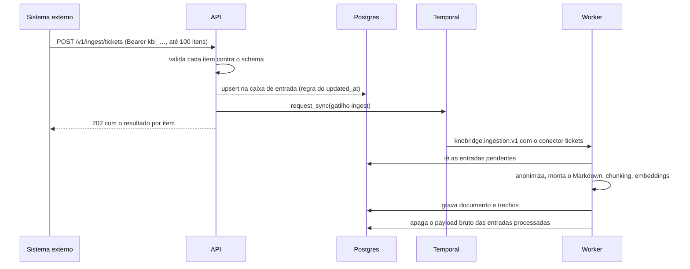
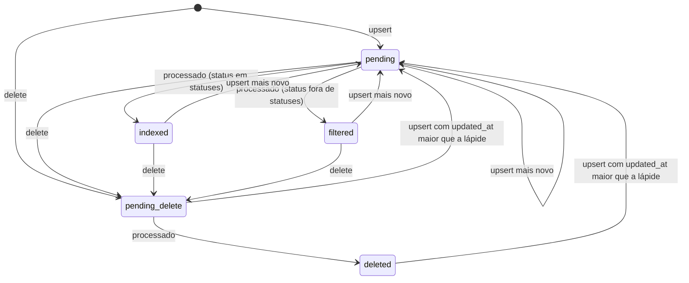

# Chamados

> Rascunho v0.2 · 2026-10-13 · Em uso (planos 0005 e 0009)
>
> **Mudanças da v0.2** (plano 0009, F1.1; implementação nas F2.1 e F2.4): o webhook de abrir chamado passa do assistente para o **produto** ([produtos-e-niveis.md](produtos-e-niveis.md)), com as rotas em `/products/{pid}/ticket-webhook`, `product_id` no pedido e `product` e `level` no payload (que mantém `assistant`, obsoleto, com os mesmos valores); a fonte `tickets` tem nível mínimo padrão `support`; os **cards de desenvolvimento** seguem o mesmo caminho dos chamados, em [cards.md](cards.md).

Como chamados de qualquer sistema entram no KnoBridge e viram fonte do chat, e como o chat abre um chamado quando não sabe responder. Cobre o formato do chamado (JSON Schema), o envio pela API com token, o upload no painel, a caixa de entrada e seu ciclo de vida, a anonimização, o Markdown e o chunking, a citação `kind: ticket` e o webhook de saída. A arquitetura está no [ADR 0006](../adr/0006-chamados-por-push.md); o workflow de ingestão, em [indexacao.md](indexacao.md); o formato da citação no fio, em [chat-sse.md](chat-sse.md#citations) (v0.6); as tabelas, em [modelo-de-dados.md](modelo-de-dados.md).

Código: `backend/src/knobridge/tickets/` (token de envio em `tokens.py`, formato do chamado em `wire.py`, validação por item e caixa de entrada em `ingest.py`, disparo da sincronização em `ingest_sync.py`) e as rotas `backend/src/knobridge/api/ingest.py` e `ingest_tokens.py` (plano 0005, F2.1); anonimização em `anonymize.py` e Markdown em `markdown.py` (F2.2); conector interno em `connector.py` e citação no chat em `retrieval/context.py` (F2.3); upload e prévia em `upload.py` e `upload_files.py`, com as rotas em `api/ticket_uploads.py` (F2.4); webhook do assistente (URL, segredo e evento de teste) em `webhook.py` e `signature.py`, proteção contra SSRF e cliente de saída em `core/outbound.py`, e as rotas em `api/ticket_webhook.py` e `api/assistants.py` (F3.1); pedidos de chamado em `requests.py` e `summary.py`, a entrega em `delivery.py`, o workflow em `workers/ticket_webhook.py` e `workers/ticket_webhook_activities.py`, e as rotas em `api/ticket_requests.py` (F3.2); o resumo da fonte no painel em `inbox_summary.py`, com a rota em `api/ingest_tokens.py` (F4.2). Telas do painel: `frontend/src/features/sources/tickets/` (fonte de chamados, F4.1, e o resumo na aba Integração, F4.2), o webhook no formulário do assistente (`features/assistants/`) e "Abrir chamado" no chat (`features/chat/`) (F4.2).

## Visão geral



## Convenções

- **JSON**: UTF-8, nomes de campo em `snake_case` inglês. Instantes em RFC 3339 **com fuso** (`2026-10-01T10:00:00-03:00` ou `…Z`); instante sem fuso é recusado. O servidor compara instantes, não textos, e devolve sempre em UTC com `Z`.
- **Textos**: sem NUL (`\u0000`). Espaços nas pontas são removidos antes de validar comprimento. Comprimentos em caracteres (pontos de código Unicode).
- **Requisições** validadas com campos desconhecidos recusados. **Respostas** podem ganhar campos novos; o cliente ignora o que não conhece.
- **Erros** no formato único da API: `{"error": {"code": "...", "message": "...", "details": ...}}`.
- **Nomes dos schemas no OpenAPI**: `TicketIn` (o chamado), `TicketMessageIn`, `TicketRequesterIn`, `TicketPersonIn`, `TicketResolutionIn`, `TicketAttachmentIn`, `TicketUpsertItemIn`, `TicketDeleteItemIn`, `TicketIngestIn`, `TicketIngestOut`, `TicketIngestItemResult`, `TicketUploadOut`, `TicketUploadError`, `TicketPreviewIn`, `TicketPreviewOut`, `TicketPreviewMarker`, `TicketsSourceConfig`, `TicketsSummaryOut`, `TicketsInboxCounts`, `IngestTokenOut`, `TicketRequestPreviewIn`, `TicketRequestPreviewOut`, `TicketRequestIn`, `TicketRequestOut`, `TicketWebhookSecretOut`, `TicketWebhookTestOut`, `TicketWebhookTestError`.

## Formato do chamado

Um chamado é um objeto JSON validado pelo schema abaixo (`TicketIn`). A validação é a mesma na API e no upload.

### Campos

| Campo | Tipo | Obrigatório | Regras |
|---|---|---|---|
| `external_id` | texto | sim | Id estável no sistema de origem, 1 a 200 caracteres, sem caractere de controle. Chave do chamado na fonte. |
| `number` | texto ou `null` | não | Número exibido ao usuário (`"48213"`, `"INC-0042"`), 1 a 50 caracteres. Sem ele, a citação mostra o `external_id`. |
| `title` | texto | sim | 1 a 500 caracteres. |
| `status` | `open`, `pending`, `resolved` ou `closed` | sim | Status normalizado (tabela abaixo). |
| `original_status` | texto ou `null` | não | Status como o sistema de origem chama, até 100 caracteres. |
| `priority` | texto ou `null` | não | Livre, até 50 caracteres (`"alta"`, `"P2"`). |
| `category` | texto ou `null` | não | Até 200 caracteres. |
| `product` | texto ou `null` | não | Produto ou módulo, até 200 caracteres. |
| `tags` | lista de textos | não | Até 50, cada uma de 1 a 100 caracteres, sem repetição. Padrão `[]`. |
| `url` | texto ou `null` | não | Link do chamado no sistema de origem: `http` ou `https`, até 2000 caracteres. |
| `created_at` | instante | sim | Abertura. |
| `updated_at` | instante | sim | Última alteração na origem. Decide a idempotência ([Idempotência](#idempotência-e-regra-do-updated_at)). Não pode ser anterior a `created_at`. |
| `resolved_at` | instante ou `null` | não | Resolução. |
| `requester` | objeto ou `null` | não | Solicitante: `name` (até 200), `email` (e-mail, até 320) e `organization` (até 200), todos opcionais e anuláveis. |
| `assignees` | lista | não | Até 20 atendentes, cada um `{name, email}` (mesmos limites, opcionais). Padrão `[]`. |
| `messages` | lista | não | Até 500 mensagens (abaixo). Padrão `[]`. |
| `resolution` | objeto ou `null` | não | Solução final: `body` (1 a 100 000 caracteres) e `body_format` (`text`, `markdown` ou `html`; padrão `text`). |
| `attachments` | lista | não | Até 100, cada um `{name}` (1 a 255 caracteres). Só os nomes: o arquivo não é enviado nem baixado. Padrão `[]`. |
| `custom_fields` | objeto | não | Até 50 chaves (`^[A-Za-z0-9_.-]{1,100}$`), valores texto (até 1000 caracteres), número, booleano ou `null`. Padrão `{}`. |

Cada mensagem (`TicketMessageIn`):

| Campo | Tipo | Obrigatório | Regras |
|---|---|---|---|
| `id` | texto ou `null` | não | Id da mensagem na origem, até 200 caracteres. Não é usado para idempotência. |
| `role` | `customer`, `agent` ou `system` | sim | Quem escreveu: cliente, atendente ou o próprio sistema (mudança de status, automação). |
| `author_name` | texto ou `null` | não | Nome do autor, até 200 caracteres. Anonimizado ([Anonimização](#anonimização)). |
| `public` | booleano | não | Padrão `true`. `false` = nota interna, só indexada se a fonte ligar `include_internal_notes`. |
| `body` | texto | sim | 1 a 100 000 caracteres. |
| `body_format` | `text`, `markdown` ou `html` | não | Padrão `text`. |
| `created_at` | instante | sim | Data da mensagem. |

Limites do conjunto: um chamado serializado tem no máximo **1 MiB** (1 048 576 bytes de JSON em UTF-8). O servidor confere depois de decodificar o item; acima disso, `ticket_too_large`.

### Status normalizado

| `status` | Significado | Na citação |
|---|---|---|
| `open` | Aberto, ainda sem resposta ou em atendimento. | Aberto |
| `pending` | Aguardando alguém (cliente, terceiro, outro time). | Pendente |
| `resolved` | Solução dada, ainda pode ser reaberto. | Resolvido |
| `closed` | Encerrado. | Fechado |

O sistema de origem mapeia os seus status para estes quatro. O nome original vai em `original_status` e aparece no Markdown.

### JSON Schema

O schema publicado (draft 2020-12). O OpenAPI expõe o mesmo contrato como `TicketIn`; as duas formas mudam juntas.

```json
{
  "$schema": "https://json-schema.org/draft/2020-12/schema",
  "$id": "urn:knobridge:schema:ticket:1",
  "title": "KnoBridge ticket v1",
  "type": "object",
  "additionalProperties": false,
  "required": ["external_id", "title", "status", "created_at", "updated_at"],
  "properties": {
    "external_id": { "type": "string", "minLength": 1, "maxLength": 200, "pattern": "^[^\\u0000-\\u001f\\u007f]+$" },
    "number": { "type": ["string", "null"], "minLength": 1, "maxLength": 50 },
    "title": { "type": "string", "minLength": 1, "maxLength": 500 },
    "status": { "enum": ["open", "pending", "resolved", "closed"] },
    "original_status": { "type": ["string", "null"], "maxLength": 100 },
    "priority": { "type": ["string", "null"], "maxLength": 50 },
    "category": { "type": ["string", "null"], "maxLength": 200 },
    "product": { "type": ["string", "null"], "maxLength": 200 },
    "tags": {
      "type": "array",
      "maxItems": 50,
      "uniqueItems": true,
      "items": { "type": "string", "minLength": 1, "maxLength": 100 }
    },
    "url": { "type": ["string", "null"], "maxLength": 2000, "pattern": "^https?://" },
    "created_at": { "type": "string", "format": "date-time" },
    "updated_at": { "type": "string", "format": "date-time" },
    "resolved_at": { "type": ["string", "null"], "format": "date-time" },
    "requester": {
      "type": ["object", "null"],
      "additionalProperties": false,
      "properties": {
        "name": { "type": ["string", "null"], "maxLength": 200 },
        "email": { "type": ["string", "null"], "format": "email", "maxLength": 320 },
        "organization": { "type": ["string", "null"], "maxLength": 200 }
      }
    },
    "assignees": {
      "type": "array",
      "maxItems": 20,
      "items": { "$ref": "#/$defs/person" }
    },
    "messages": {
      "type": "array",
      "maxItems": 500,
      "items": { "$ref": "#/$defs/message" }
    },
    "resolution": {
      "type": ["object", "null"],
      "additionalProperties": false,
      "required": ["body"],
      "properties": {
        "body": { "type": "string", "minLength": 1, "maxLength": 100000 },
        "body_format": { "$ref": "#/$defs/body_format" }
      }
    },
    "attachments": {
      "type": "array",
      "maxItems": 100,
      "items": {
        "type": "object",
        "additionalProperties": false,
        "required": ["name"],
        "properties": { "name": { "type": "string", "minLength": 1, "maxLength": 255 } }
      }
    },
    "custom_fields": {
      "type": "object",
      "maxProperties": 50,
      "propertyNames": { "pattern": "^[A-Za-z0-9_.-]{1,100}$" },
      "additionalProperties": {
        "anyOf": [
          { "type": "string", "maxLength": 1000 },
          { "type": "number" },
          { "type": "boolean" },
          { "type": "null" }
        ]
      }
    }
  },
  "$defs": {
    "body_format": { "enum": ["text", "markdown", "html"], "default": "text" },
    "person": {
      "type": "object",
      "additionalProperties": false,
      "properties": {
        "name": { "type": ["string", "null"], "maxLength": 200 },
        "email": { "type": ["string", "null"], "format": "email", "maxLength": 320 }
      }
    },
    "message": {
      "type": "object",
      "additionalProperties": false,
      "required": ["role", "body", "created_at"],
      "properties": {
        "id": { "type": ["string", "null"], "maxLength": 200 },
        "role": { "enum": ["customer", "agent", "system"] },
        "author_name": { "type": ["string", "null"], "maxLength": 200 },
        "public": { "type": "boolean", "default": true },
        "body": { "type": "string", "minLength": 1, "maxLength": 100000 },
        "body_format": { "$ref": "#/$defs/body_format" },
        "created_at": { "type": "string", "format": "date-time" }
      }
    }
  }
}
```

Regras que o JSON Schema não expressa e o servidor também confere (erro `validation_error` no item, com `loc` e `problem`):

- instantes com fuso (`format: date-time` exige; validadores que não checam `format` deixam passar, o servidor não);
- `updated_at >= created_at` (`problem: "updated_at_before_created_at"`);
- textos sem NUL e, depois de tirar os espaços das pontas, dentro dos comprimentos (`title` só com espaços é vazio);
- `url` com host (`problem: "invalid_url"`);
- tamanho total de 1 MiB (`ticket_too_large`, `details.max_bytes`).

### Exemplo válido

```json
{
  "external_id": "4f6c2a10-0001",
  "number": "48213",
  "title": "Erro 4021 ao fechar o caixa",
  "status": "resolved",
  "original_status": "Resolvido pelo atendente",
  "priority": "alta",
  "category": "Financeiro",
  "product": "Caixa",
  "tags": ["caixa", "fechamento"],
  "url": "https://suporte.exemplo.com.br/chamados/48213",
  "created_at": "2026-09-30T14:02:00-03:00",
  "updated_at": "2026-10-01T09:15:00-03:00",
  "resolved_at": "2026-10-01T09:10:00-03:00",
  "requester": { "name": "Ana Souza", "email": "ana.souza@exemplo.com.br", "organization": "Padaria Exemplo" },
  "assignees": [{ "name": "Bruno Lima", "email": "bruno@suporte.exemplo.com.br" }],
  "messages": [
    {
      "role": "customer",
      "author_name": "Ana Souza",
      "body": "Ao fechar o caixa aparece o erro 4021. Meu telefone é (11) 98765-4321.",
      "created_at": "2026-09-30T14:02:00-03:00"
    },
    {
      "role": "agent",
      "author_name": "Bruno Lima",
      "public": false,
      "body": "Cliente com sangria pendente no turno anterior.",
      "created_at": "2026-09-30T15:20:00-03:00"
    },
    {
      "role": "agent",
      "author_name": "Bruno Lima",
      "body_format": "html",
      "body": "<p>Olá Ana, finalize a <b>sangria pendente</b> e tente de novo.</p>",
      "created_at": "2026-10-01T09:05:00-03:00"
    }
  ],
  "resolution": { "body": "O erro 4021 indica sangria pendente. Finalizar a sangria do turno anterior libera o fechamento.", "body_format": "text" },
  "attachments": [{ "name": "tela-erro-4021.png" }],
  "custom_fields": { "versao_sistema": "12.4.1", "loja": 3 }
}
```

### Exemplo inválido

```json
{
  "external_id": "4f6c2a10-0002",
  "title": "",
  "status": "em andamento",
  "created_at": "2026-10-02 10:00:00",
  "updated_at": "2026-10-01T10:00:00Z",
  "requester": { "name": "Carla", "phone": "11 3333-4444" },
  "messages": [{ "role": "customer", "body": "Não consigo emitir a nota." }]
}
```

Problemas, como aparecem em `error.details` do item (`loc` no estilo do Pydantic):

| `loc` | `problem` |
|---|---|
| `["title"]` | `string_too_short` |
| `["status"]` | `enum` (valores aceitos: `open`, `pending`, `resolved`, `closed`) |
| `["created_at"]` | `timezone_aware` (instante sem fuso) |
| `["requester", "phone"]` | `extra_forbidden` |
| `["messages", 0, "created_at"]` | `missing` |

Com `created_at` corrigido, ainda faltaria `updated_at >= created_at`.

## Envio pela API

### Token de envio

- **Formato**: `kbi_<prefixo>_<segredo>`, validado por `^kbi_([a-z0-9]{8})_([A-Za-z0-9_-]{43})$`. `prefixo`: 8 caracteres aleatórios de `[a-z0-9]`, único na instância, guardado em claro e mostrado no painel. `segredo`: `secrets.token_urlsafe(32)` (43 caracteres). O prefixo fixo `kbi_` permite varredura de segredos.
- **Um token por fonte `tickets`**, criado ou girado por `POST /v1/workspaces/{wid}/sources/{sid}/ingest-token` (sessão, CSRF, owner ou admin, como os tokens de runner: é uma credencial). Resposta 201 `IngestTokenOut` = `{"token": "kbi_…", "token_prefix": "…", "created_at": "…"}`, com o token inteiro **uma única vez**. O servidor guarda só o prefixo e o SHA-256 hex do token inteiro. Girar invalida o anterior na hora. Fonte que não é `tickets` do workspace: 404 `source_not_found`. Auditoria: `source.ingest_token_rotated` (com o prefixo, nunca o token).
- **Verificação** (dependência `current_ingest_source`):
  1. header `Authorization: Bearer …` ausente ou fora do formato → 401;
  2. busca a fonte por prefixo em modo de sistema;
  3. compara `SHA-256(token)` com o hash guardado em tempo constante (`hmac.compare_digest`);
  4. fonte inexistente, hash diferente ou token girado → 401 `invalid_ingest_token` (mesma resposta nos três casos), com `WWW-Authenticate: Bearer`;
  5. workspace suspenso → 403 `workspace_suspended`;
  6. abre a transação com `SET LOCAL app.workspace_id` da fonte.
- O token **só abre `/v1/ingest/*`**. As rotas de ingestão ignoram cookie de sessão e CSRF. O token nunca é logado nem auditado.

### `POST /v1/ingest/tickets`

Headers: `Authorization: Bearer kbi_…` e `Content-Type: application/json`. Corpo (`TicketIngestIn`):

```json
{
  "items": [
    { "op": "upsert", "ticket": { "external_id": "4f6c2a10-0001", "...": "..." } },
    { "op": "delete", "external_id": "4f6c2a10-0099", "deleted_at": "2026-10-02T08:00:00Z" }
  ]
}
```

| Campo | Regras |
|---|---|
| `items` | 1 a **100** itens, processados na ordem. |
| `op: upsert` | `ticket`: um chamado ([Formato do chamado](#formato-do-chamado)). |
| `op: delete` | `external_id` (mesmas regras do chamado) e `deleted_at` (instante, opcional; padrão = relógio do servidor). |

- **Corpo máximo: 5 MiB** (5 242 880 bytes). O servidor confere `Content-Length` e corta a leitura no limite (413 mesmo sem `Content-Length`).
- **Validação por item.** Um item inválido não derruba o lote: ele volta `rejected` e os outros seguem. Só erros do corpo inteiro (JSON inválido, `items` ausente, vazio ou com mais de 100, item que não é objeto ou com `op` desconhecido) dão 422 para a requisição toda.
- **Mesmo `external_id` duas vezes no lote**: o segundo item volta `rejected` com `duplicate_in_batch`.
- Todos os itens aceitos são gravados numa transação. Depois do commit, se algum item ficou `queued`, a API chama `request_sync` com o gatilho `ingest` ([Disparo da sincronização](#disparo-da-sincronização)).

Resposta **202** (`TicketIngestOut`):

```json
{
  "results": [
    { "index": 0, "op": "upsert", "external_id": "4f6c2a10-0001", "status": "queued", "error": null },
    { "index": 1, "op": "delete", "external_id": "4f6c2a10-0099", "status": "queued", "error": null }
  ],
  "counts": { "queued": 2, "unchanged": 0, "stale": 0, "rejected": 0 },
  "sync": "started",
  "run_id": "6a1f…"
}
```

| Campo | Descrição |
|---|---|
| `results[]` | Um por item, na ordem: `index` (a partir de 0), `op`, `external_id` (`null` se o item não tinha um válido), `status`, `error` (`null` ou `{code, message, details}`). |
| `status` | `queued`: gravado, aguarda indexação. `unchanged`: igual ao que já está guardado (mesmo hash ou lápide igual ou mais nova); nada muda. `stale`: mais antigo que o guardado ([regra do updated_at](#idempotência-e-regra-do-updated_at)); ignorado. `rejected`: inválido, com `error`. |
| `counts` | Totais por `status`. |
| `sync` | `started` (execução nova), `pending` (já havia execução; marcada como pendente), `deferred` (Temporal fora do ar; as entradas esperam a próxima sincronização) ou `none` (nenhum item `queued`). |
| `run_id` | Id da execução iniciada quando `sync = started`; senão `null`. |

Códigos de erro **por item** (`results[].error.code`):

| `code` | Quando | `details` |
|---|---|---|
| `validation_error` | Chamado ou remoção fora do schema ou das regras extras. | Lista de `{"loc", "problem"}`, até 50. |
| `ticket_too_large` | Chamado acima de 1 MiB. | `{"max_bytes": 1048576}` |
| `duplicate_in_batch` | `external_id` já apareceu num item anterior do mesmo lote. | `{"first_index"}` |

Detalhes do resultado por item:

- `loc` dos problemas de um `upsert` é relativo ao chamado (`["title"]`, `["messages", 0, "created_at"]`, como no [exemplo inválido](#exemplo-inválido)); só os problemas da forma do próprio item são relativos ao item (`["ticket"]` com `missing` ou `model_type`, chave extra com `extra_forbidden`). Num `delete`, `loc` é relativo ao item (`["deleted_at"]`).
- `problem` é o tipo do erro do Pydantic (`missing`, `string_too_short`, `enum`, `timezone_aware`, `bool_type`, `extra_forbidden`…) ou uma das regras extras: `updated_at_before_created_at`, `invalid_url`, `invalid_email`, `string_contains_nul`, `not_unique` (`tags` repetidas depois de aparadas), `custom_field_key`, `custom_field_type` e `finite_number`.
- A validação é estrita: booleano é `true`/`false`, número é número, texto é texto (nada de `"true"` ou `1` no lugar).
- `duplicate_in_batch` aponta para o primeiro item **aceito** com o mesmo `external_id`; um item anterior rejeitado não barra um posterior válido.

Códigos de erro **da requisição**:

| Código | HTTP | Quando |
|---|---|---|
| `invalid_ingest_token` | 401 | Token ausente, malformado, desconhecido ou girado. |
| `workspace_suspended` | 403 | Workspace da fonte suspenso. |
| `source_inactive` | 409 | Fonte desativada: nada é gravado. |
| `payload_too_large` | 413 | Corpo acima de 5 MiB (`details.max_bytes`). |
| `validation_error` | 422 | Corpo malformado (veja acima). |
| `internal_error` | 500 | Erro inesperado. |
| `service_unavailable` | 503 | Banco indisponível. Nada foi gravado: o cliente pode repetir o lote inteiro. |

Repetir um lote é sempre seguro: o mesmo conteúdo volta `unchanged`. O cliente deve repetir em erro de rede, 500 e 503, com backoff.

### Idempotência e regra do `updated_at`

A caixa de entrada guarda uma entrada por `(fonte, external_id)`. O hash do chamado (`content_hash`) é o SHA-256 hex do JSON canônico do chamado validado: campos opcionais ausentes preenchidos com o padrão, instantes normalizados para UTC com `Z`, chaves ordenadas, sem espaços, UTF-8.

**Upsert** de um chamado `T`, com a entrada guardada `E`:

| Situação | Resultado |
|---|---|
| Não há `E`. | Grava `T`, `queued`. |
| `E` é lápide e `T.updated_at > E.updated_at`. | Ressuscita: grava `T`, `queued`. |
| `E` é lápide e `T.updated_at <= E.updated_at`. | `stale`. |
| `E` é chamado e `T.updated_at < E.updated_at`. | `stale`. |
| `E` é chamado e `T.content_hash = E.content_hash`. | `unchanged`. |
| `E` é chamado, `T.updated_at >= E.updated_at` e hash diferente. | Substitui por `T`, `queued`. |

**Remoção** de `external_id` com `deleted_at` `D`:

| Situação | Resultado |
|---|---|
| Não há `E`. | Grava uma lápide com `updated_at = D`, `queued`. Barra um upsert atrasado mais antigo. |
| `E` é chamado e `E.updated_at > D`. | `stale`. |
| `E` é chamado e `E.updated_at <= D`. | Vira lápide com `updated_at = D`, `queued`. |
| `E` é lápide e `E.updated_at >= D`. | `unchanged`. |
| `E` é lápide e `E.updated_at < D`. | Atualiza a data da lápide, `unchanged`. |

A comparação e a gravação de cada item são atômicas por linha (`INSERT … ON CONFLICT … DO UPDATE … WHERE`), então dois lotes simultâneos com o mesmo chamado convergem para o de `updated_at` maior.

## Upload no painel

`POST /v1/workspaces/{wid}/sources/{sid}/tickets/upload`: sessão, CSRF, papel editor, `multipart/form-data` com um campo `file`.

- **Formatos**, pela extensão do nome do arquivo:
  - `.json`: uma lista de elementos, ou um objeto `{"items": [...]}` igual ao corpo da API;
  - `.jsonl`: um elemento por linha (linhas em branco ignoradas).
- **Elemento**: um item da API (`{"op": "upsert", "ticket": …}` ou `{"op": "delete", …}`) ou um chamado puro, sem `op` (lido como upsert). Assim, um export de chamados já no formato pode ser enviado direto.
- Elemento que não é objeto, ou objeto com `op` diferente de `upsert`/`delete`, é rejeitado naquela linha ou posição (`validation_error`, `details` = `[{"loc": [], "problem": "model_type"}]` ou `[{"loc": ["op"], "problem": "literal_error"}]`); os outros seguem.
- **Limite: 50 MiB** por arquivo (413 `payload_too_large`, `details.max_bytes = 52428800`). `Content-Length` acima do limite (mais 64 KiB do envelope multipart) é recusado antes da leitura, e a leitura para assim que o corpo passa dele. Sem limite de quantidade de itens; o servidor processa em lotes de 100, cada um numa transação, com as mesmas regras da API (validação, `duplicate_in_batch` dentro do arquivo inteiro, com `details.first_index` = linha ou posição do primeiro, regra do `updated_at`).
- **Leitura em fluxo**: o arquivo nunca é carregado inteiro na memória. `.jsonl` é lido linha a linha; `.json` é decodificado um elemento por vez. Como um `.json` malformado é erro do arquivo inteiro, ele é conferido numa primeira passada antes de gravar qualquer lote.
- Erros do arquivo inteiro (nada é gravado): extensão diferente de `.json` ou `.jsonl` → 422 `upload_format_unsupported`; `.json` que não é JSON válido (UTF-8), nem lista, nem exatamente `{"items": [...]}` → 422 `upload_invalid_json`; arquivo vazio, só com espaços, `[]`, `{"items": []}` ou `.jsonl` só com linhas em branco → 422 `upload_empty`; corpo que não é `multipart/form-data` ou sem o arquivo no campo `file` → 422 `validation_error` (`details` = `[{"loc": ["body", "file"], "problem": "multipart_required" | "multipart_invalid" | "missing"}]`). Fonte que não é `tickets` do workspace → 404 `source_not_found`; desativada → 409 `source_inactive`.
- Em `.jsonl`, uma linha que não é JSON válido vira um erro daquela linha (`invalid_json`, `details = null`) e as outras seguem.
- O processamento é síncrono. Ao fim, com algum item `queued`, um único `request_sync` com o gatilho `ingest` (`sync` e `run_id` como na API).

Resposta **200** (`TicketUploadOut`):

```json
{
  "format": "jsonl",
  "total": 1200,
  "counts": { "queued": 1180, "unchanged": 12, "stale": 3, "rejected": 5 },
  "errors": [
    { "line": 17, "index": null, "external_id": "A-17", "code": "validation_error", "message": "…", "details": [{"loc": ["status"], "problem": "enum"}] }
  ],
  "errors_truncated": false,
  "sync": "started",
  "run_id": "6a1f…"
}
```

- `errors`: só os itens `rejected`, na ordem, até 1000 (`errors_truncated = true` quando há mais). Em `.jsonl`, `line` (a partir de 1) e `index = null`; em `.json`, `index` (a partir de 0) e `line = null`.
- O arquivo não é guardado: só os itens aceitos vão para a caixa de entrada. Auditoria: `source.tickets_uploaded` com `name` (da fonte), `filename` (até 255 caracteres), `format`, `total` e os `counts`; nunca o conteúdo.
- Uma falha no meio (banco fora, fonte excluída) deixa gravados os lotes já confirmados; reenviar o arquivo é seguro (o que já entrou volta `unchanged`).

### Prévia do chamado

`POST /v1/workspaces/{wid}/sources/{sid}/tickets/preview`: sessão, CSRF, papel editor. Corpo (`TicketPreviewIn`) `{"ticket": {…}}`, até **2 MiB**, com um chamado validado como um `upsert` da API (estrito, até 1 MiB). Monta o [Markdown](#markdown-do-chamado) com a configuração atual da fonte (`anonymize`, `include_internal_notes`) e **não grava nada**: nem caixa de entrada, nem execução, nem auditoria. Funciona com a fonte desativada.

Resposta **200** (`TicketPreviewOut`):

```json
{
  "title": "Erro 4021 ao fechar o caixa",
  "markdown": "# Chamado 48213: Erro 4021 ao fechar o caixa\n\n- Status: …",
  "markers": [
    { "marker": "[TELEFONE]", "count": 1 },
    { "marker": "[ATENDENTE_1]", "count": 1 },
    { "marker": "[SOLICITANTE]", "count": 1 }
  ],
  "anonymize": true,
  "include_internal_notes": false
}
```

- `title`: o título como vai para o índice (anonimizado, se for o caso).
- `markers` (`TicketPreviewMarker`): os marcadores que a anonimização aplicou e quantas vezes, na ordem da primeira aparição no Markdown. Um marcador já escrito no próprio chamado não conta. Vazio com `anonymize: false`.
- Erros: chamado fora do formato → 422 `validation_error` com `details` = `[{"loc", "problem"}]` relativos ao chamado (como em `results[].error` da API); chamado acima de 1 MiB → 422 `ticket_too_large`; corpo acima de 2 MiB → 413 `payload_too_large`; envelope inválido (`ticket` ausente, chave extra) → 422 `validation_error`; fonte que não é `tickets` do workspace → 404 `source_not_found`.

## Fonte do tipo `tickets`

`sources.kind = tickets`; `sources.config` validado por `parse_source_config` (`TicketsSourceConfig`, campos desconhecidos recusados, 422 `source_config_invalid`):

| Campo | Tipo | Regras |
|---|---|---|
| `include_internal_notes` | booleano | Padrão `false`. Notas internas (`public: false`) entram no índice. |
| `anonymize` | booleano | Padrão `true`. Aplica a [anonimização](#anonimização). |
| `statuses` | lista | Status indexados, subconjunto não vazio de `open`, `pending`, `resolved`, `closed`, sem repetição. Padrão: os quatro. |

- Globs (`include_globs`, `exclude_globs`) não se aplicam: a API recusa globs não vazios numa fonte `tickets` (422 `source_config_invalid`, `loc = ["include_globs"]` ou `["exclude_globs"]`). Agendamento é permitido, mas desnecessário: cada envio já pede a sincronização.
- **Mudar a configuração vale para os chamados processados depois.** O bruto já processado foi apagado e não é reprocessado: para reaplicar, reenvie os chamados (o hash é o mesmo, então use um `updated_at` igual ou maior e mude o conteúdo, ou remova e reenvie). O painel avisa isso ao salvar.
- **Testar conexão** (`POST .../sources/{id}/test`): `{"ok": true, "error": null}` se a fonte tem token; senão `{"ok": false, "error": {"code": "source_unavailable", "details": {"reason": "ingest_token_missing"}}}`.
- **Sincronizar** manualmente processa as entradas pendentes da caixa de entrada.
- **Excluir a fonte** apaga a caixa de entrada e invalida o token.
- **Nível mínimo** (v0.2): padrão `support`, alterável pelo admin; perguntas no nível `end_user` não recebem chamados ([produtos-e-niveis.md](produtos-e-niveis.md#padrões-por-tipo)).

## Caixa de entrada

Uma entrada por `(fonte, external_id)`, com `workspace_id` e RLS ([ADR 0001](../adr/0001-tenancy-e-rls.md)). Campos lógicos (as colunas exatas ficam em [modelo-de-dados.md](modelo-de-dados.md)): `external_id`, `state`, `payload` (JSON do chamado validado, ou `null`), `content_hash`, `updated_at` (da origem), `indexed_hash` (hash do que está no índice, ou `null`), `received_at`, `processed_at`, `last_error`.

### Estados

| `state` | `payload` | Significado |
|---|---|---|
| `pending` | presente | Chamado recebido, ainda não processado. |
| `indexed` | `null` | Documento gravado no índice. |
| `filtered` | `null` | Processado, mas fora de `statuses` da fonte: não está no índice. |
| `pending_delete` | `null` | Lápide recebida, documento ainda não removido. |
| `deleted` | `null` | Lápide aplicada: documento removido (ou nunca existiu). |



### Disparo da sincronização

Depois de gravar itens `queued`, a API chama `request_sync(source_id, trigger=ingest)` ([indexacao.md](indexacao.md#sincronização-pendente)). `runs.trigger` aceita `ingest`.

- começou uma execução: `sync = started`, com `run_id`;
- já havia execução da fonte: `sources.sync_pending = true`, `sync = pending`; a execução seguinte cobre o que chegou;
- Temporal fora do ar (`sync_unavailable`) ou qualquer outra recusa ao iniciar: `sync = deferred`, sem erro para o cliente. As entradas ficam `pending` e saem na próxima sincronização (outro envio, manual ou agendada).

### Conector interno `tickets`

`SettingsConnectorFactory` usa o conector `tickets` (`tickets/connector.py`, `TicketsConnectorFactory(sessions, clock)`, que a API e o worker passam com `tickets=`) para todo tipo `tickets`; sem a fábrica, a sincronização falha com `source_unavailable`. Como o `knowledge`, ele lê o banco numa transação no escopo do workspace, sem usuário.

- **`list_changes`**: lê as entradas `pending` e `pending_delete` da fonte. `pending` com status em `statuses` → `added` (sem `indexed_hash`) ou `changed`. `pending` com status fora de `statuses` → `removed` (a entrada vira `filtered` ao ser processada). `pending_delete` → `removed`. Remover um documento que não existe no índice não faz nada, mas conta como item feito. Cursor: `{"kind": "tickets", "version": 1}` (a caixa de entrada é o estado; o cursor só identifica o conector; outro cursor → `invalid_cursor`).
- **`fetch`**: lê o payload da entrada `pending` (a versão atual, e guarda o `content_hash` dela para o fechamento), valida de novo contra o schema, aplica a [anonimização](#anonimização) (se ligada), monta o [Markdown](#markdown-do-chamado) e devolve o documento. Entrada que não está mais `pending` (processada, ou virou lápide) ou cuja versão atual tem status fora de `statuses` → `document_not_found`; payload que não passa mais no schema → `ticket_invalid` (422). Os dois viram `RunError` sem derrubar a execução. Versão nova chegada entre a listagem e o `fetch` é a indexada.
- **`permissions`**: a fonte não traz ACL por chamado (D7); vale a permissão da coleção.
- **`test_connection`**: como em [Fonte do tipo tickets](#fonte-do-tipo-tickets).
- **Documento**: `natural_key` = `external_id`, `kind = ticket`, `title` = título anonimizado, `uri = ticket:<external_id>`. `content_hash` = SHA-256 do Markdown e dos metadados de citação.

### Fim do processamento e apagamento do bruto

Cada item é fechado na activity `process_batch`, **na mesma transação** em que o motor grava o documento, o remove ou registra o erro e marca o `run_items` como feito (o conector implementa o gancho `settle` de `ingestion/settle.py`; [indexacao.md](indexacao.md#workflow-knobridgeingestionv1)). Ou os dois acontecem, ou nenhum: o bruto só some junto com a gravação do documento, e um lote reexecutado não perde chamado nem fecha duas vezes. Vale em qualquer desfecho da execução, para os itens já feitos.

- documento gravado (ou já indexado com o mesmo hash): se o `content_hash` da entrada ainda é o lido no `fetch`, `pending` → `indexed`, `payload = null`, `indexed_hash = content_hash`, `processed_at`, `last_error = null`; se mudou (versão nova chegou depois do `fetch`), a entrada fica como está, com o payload novo, para a próxima sincronização, já pedida pelo envio;
- remoção aplicada: `pending_delete` → `deleted`; `pending` cuja versão atual ainda tem status fora de `statuses` → `filtered` com `payload = null`; nos dois, `indexed_hash = null`, `processed_at`, `last_error = null`. Entrada que entrou em `statuses` nesse meio fica `pending`;
- item com erro (`fetch` ou parsing): a entrada fica `pending`, com o payload, e `last_error` = `<código>: <mensagem>` (até 500 caracteres, sem conteúdo do chamado). Ela é tentada de novo na próxima sincronização.

`processed_at` vem do relógio injetado na fábrica do conector.

Só restam, depois do processamento: o Markdown anonimizado no índice e, na entrada, `external_id`, estado, hashes e datas.

### Resumo no painel

`GET /v1/workspaces/{wid}/sources/{sid}/tickets/summary` (sessão, papel viewer) → 200 `TicketsSummaryOut`:

| Campo | Descrição |
|---|---|
| `counts` | `TicketsInboxCounts` `{pending, indexed, filtered, pending_delete, deleted}`: entradas da caixa de entrada da fonte em cada estado (zero quando não há). |
| `failed` | Entradas `pending` com `last_error` (já contadas em `counts.pending`). |
| `last_received_at` | Última gravação de item `queued` (o maior `received_at` da caixa de entrada da fonte), ou `null` sem entradas. |
| `token_prefix` | Prefixo do token atual, ou `null` sem token. |
| `token_created_at` | Data do token atual, ou `null`. |

Fonte que não é `tickets` do workspace: 404 `source_not_found`. Não há rota que liste payloads.

## Anonimização

Determinística, sem LLM, ligada por padrão (`anonymize: true`). Roda no `fetch`, sobre os textos já convertidos para Markdown, antes do chunking: nada do texto original chega ao índice.

### Onde se aplica

`title`, `original_status`, `priority`, `category`, `product`, `tags`, corpo das mensagens, `resolution.body`, valores texto de `custom_fields` e nomes dos anexos. Não se aplica a `external_id`, `number`, `status`, datas e `url` (o link vai só para a citação, não para o texto indexado; quem integra não deve pôr dado pessoal na URL). `requester` e `assignees` **nunca** são renderizados: servem só para descobrir os nomes a trocar.

### Regras, na ordem

| # | Regra | Detecta | Marcador |
|---|---|---|---|
| 1 | E-mail | `local@domínio.tld` (local `[A-Za-z0-9._%+-]+`, domínio com pelo menos um ponto e TLD de 2 ou mais letras). | `[EMAIL]` |
| 2 | IP | IPv4 com quatro octetos de 0 a 255; IPv6 completo ou abreviado (pelo menos dois `:` e grupos hexadecimais). IPv4 precedido de `v`/`V` colado ou de `versão `, `versao `, `version `, `release ` ou `build ` (sem diferenciar maiúsculas) não é trocado, para preservar números de versão. | `[IP]` |
| 3 | CNPJ | `00.000.000/0000-00` ou 14 dígitos seguidos, com dígitos verificadores válidos. | `[CNPJ]` |
| 4 | CPF | `000.000.000-00` ou 11 dígitos seguidos, com dígitos verificadores válidos (todos iguais, como `111.111.111-11`, não conta). | `[CPF]` |
| 5 | Cartão | 13 a 19 dígitos, seguidos ou em grupos separados por um espaço ou hífen, que passam no algoritmo de Luhn. | `[CARTAO]` |
| 6 | Telefone | Com DDD: `+55` opcional, DDD com ou sem parênteses, separador opcional (espaço, ponto ou hífen), `9` opcional e `dddd`, separador opcional, `dddd`; DD de 11 a 99 sem zero no segundo dígito; sem DDD: `9?dddd-dddd` (hífen obrigatório). | `[TELEFONE]` |
| 7 | Nomes declarados | Nomes vindos do payload (abaixo), trocados em qualquer texto. | `[SOLICITANTE]`, `[ORGANIZACAO]`, `[ATENDENTE_n]`, `[CLIENTE_n]` |

- Os números (regras 2 a 6) só casam entre limites de dígito: não pode haver dígito colado antes nem depois (`(?<!\d)` e `(?!\d)`), e um trecho já trocado não é olhado de novo pelas regras seguintes.
- A ordem importa: e-mail antes dos nomes (`ana.souza@…` vira `[EMAIL]`, não `[SOLICITANTE]@…`), CNPJ antes de CPF e de cartão (14 dígitos contêm 11), IP antes de telefone.

### Nomes declarados

Os nomes vêm de `requester.name`, `requester.organization`, `assignees[].name` e `messages[].author_name`:

| Origem | Marcador |
|---|---|
| `requester.name`, e `author_name` igual a ele | `[SOLICITANTE]` |
| `requester.organization` | `[ORGANIZACAO]` |
| `assignees[].name` e `author_name` de mensagens `agent` | `[ATENDENTE_1]`, `[ATENDENTE_2]`… na ordem da primeira aparição (atendentes primeiro, depois autores na ordem das mensagens) |
| `author_name` de mensagens `customer` diferente do solicitante | `[CLIENTE_1]`, `[CLIENTE_2]`… na mesma ordem |
| `author_name` de mensagens `system` | não é nome de pessoa; não é trocado nem renderizado |

- Para cada pessoa, são trocados o nome completo e o primeiro nome (primeira palavra), se ele tiver 3 ou mais letras. Organização: só o nome completo.
- Comparação sem diferenciar maiúsculas, nem acentos (`José` casa `jose`), e só em palavra inteira (`\b`). Nomes mais longos são trocados primeiro (`Ana Souza` antes de `Ana`).
- Nomes iguais (depois de normalizar) recebem o mesmo marcador, com a precedência da tabela.

### Limites conhecidos

- **Falsos positivos**: um número de 10 ou 11 dígitos com DDD válido vira `[TELEFONE]`; um primeiro nome comum troca a mesma palavra em qualquer lugar.
- **Falsos negativos**: nomes de terceiros não declarados no payload, endereços, placas e outros dados fora das regras passam. Quem integra pode removê-los antes de enviar.
- Com `anonymize: false`, nenhum texto é trocado; `requester` e `assignees` continuam sem ser renderizados, e o autor das mensagens aparece pelo nome.

## Markdown do chamado

Montado no `fetch`, depois da conversão dos corpos e da anonimização.

### Conversão dos corpos

- `text`: como veio, com CRLF trocado por LF.
- `markdown`: como veio.
- `html`: convertido para Markdown pelo mesmo conversor de HTML do parsing (MarkItDown), com `script` e `style` descartados.
- Em todos, linhas que começam com um título ATX (`#` a `######` seguido de espaço) viram negrito (`**texto**`), para que o corpo não crie seções no chunking.

### Seleção das mensagens

Entram as mensagens `public: true` e, com `include_internal_notes`, também as notas internas. Ordem: `created_at` crescente, empate pela posição no payload.

### Layout

```markdown
# Chamado 48213: Erro 4021 ao fechar o caixa

- Status: Resolvido (original: Resolvido pelo atendente)
- Prioridade: alta
- Categoria: Financeiro
- Produto: Caixa
- Tags: caixa, fechamento
- Aberto em: 2026-09-30T17:02:00Z
- Atualizado em: 2026-10-01T12:15:00Z
- Resolvido em: 2026-10-01T12:10:00Z

## Problema

Ao fechar o caixa aparece o erro 4021. Meu telefone é [TELEFONE].

## Solução

O erro 4021 indica sangria pendente. Finalizar a sangria do turno anterior libera o fechamento.

## Conversa

**Atendente [ATENDENTE_1] · 2026-10-01T12:05:00Z**

Olá [SOLICITANTE], finalize a **sangria pendente** e tente de novo.

## Campos adicionais

- loja: 3
- versao_sistema: 12.4.1

## Anexos

- tela-erro-4021.png
```

Regras:

- **Título**: `# Chamado <number>: <title>`; sem `number`, `# Chamado <external_id>: <title>`.
- **Lista de metadados**: só as linhas com valor. Status em pt-BR (tabela do [status normalizado](#status-normalizado)), com `(original: …)` quando `original_status` existe e é diferente. Instantes em UTC com `Z`.
- **`## Problema`**: o corpo da primeira mensagem selecionada com `role: customer`; sem ela, da primeira mensagem selecionada. Sem mensagens, a seção sai.
- **`## Solução`**: `resolution.body`. Sem `resolution`, a seção sai.
- **`## Conversa`**: as demais mensagens selecionadas, cada uma com a linha `**<Papel> <autor> · <instante>**`, uma linha em branco e o corpo. Papel: `Cliente`, `Atendente` ou `Sistema`; nota interna ganha ` (nota interna)` depois do papel. `<autor>` é o marcador (com anonimização) ou o nome (sem anonimização); sem autor e em `system`, omitido. Sem mensagens restantes, a seção sai.
- **`## Campos adicionais`**: `- <chave>: <valor>`, chaves em ordem alfabética, `null` omitido, booleano como `sim`/`não`. Sem campos, a seção sai.
- **`## Anexos`**: um nome por linha. Sem anexos, a seção sai.

### Chunking

Por títulos, como Markdown ([indexacao.md](indexacao.md#chunking)), sem linhas (o Markdown é gerado): `## Problema`, `## Solução`, `## Conversa` (dividida por linhas com sobreposição se passar de `MAX_TOKENS`), `## Campos adicionais` e `## Anexos`. A lista de metadados sob o título vai junto com o primeiro trecho, e a `## Solução` também, quando título, metadados, problema e solução cabem juntos em `MAX_TOKENS` (o trecho fica com `section: problem`); senão a solução é um trecho próprio (`resolution`). Motivo, do ensaio [0003](../pesquisa/0003-ensaio-chamados-sinteticos.md): a pergunta descreve o sintoma e acha o trecho do problema, que precisa trazer a resposta.

- **Texto embedado**: cabeçalho `ticket: <number ou external_id> · <title>`, `status: <status>` e `section: <seção>`, depois o corpo.
- **`meta` de cada trecho**: `kind` (`ticket`), `external_id`, `ticket_number` (`number` ou `external_id`), `title`, `ticket_status`, `original_status`, `date` (`resolved_at` se houver, senão `updated_at`, em UTC com `Z`), `date_kind` (`resolved` ou `updated`), `url` (ou `null`), `headings` e `section` (`problem`, `resolution`, `conversation`, `fields` ou `attachments`).

## No chat

### Contexto enviado ao LLM

Cada fonte de chamado entra na mensagem de fontes como as demais (`[n] título (uri)` + conteúdo, [chat.md](chat.md)), com o conteúdo precedido de uma linha `Chamado <número> · <status em pt-BR> · <data> · seção <Problema|Solução|Conversa|…>`. A linha não entra na citação (o `snippet` continua só o trecho). As regras fixas do prompt ganham uma: "Em chamados, prefira a solução de chamados resolvidos ou fechados; trate chamados abertos ou pendentes como problema em andamento, sem solução confirmada, e diga o status deles quando os citar" (D9). Código: `retrieval/context.py` (`ticket_source`, `ticket_context_line`) e `conversations/prompt.py`.

### Citação `kind: ticket`

Formato no fio em [chat-sse.md](chat-sse.md#citations) (v0.6):

| Campo | Valor |
|---|---|
| `kind` | `ticket` |
| `title` | Título do chamado (anonimizado). |
| `uri` | `ticket:<external_id>`. |
| `snippet` | Até 300 caracteres do trecho, sem o cabeçalho de embedding. |
| `document_id` | Id do documento. |
| `ticket_number` | `number`, ou `external_id` sem ele. |
| `ticket_status` | `open`, `pending`, `resolved` ou `closed`. |
| `date` | `resolved_at` se houver, senão `updated_at` (ISO 8601 UTC). |
| `ticket_date_kind` | `resolved` ou `updated`: diz qual data é. |
| `url` | Link do chamado na origem, ou `null`. O painel só o mostra como link se for `http` ou `https`. |
| `path`, `symbol`, `start_line`, `end_line`, `language`, `sha`, `author`, `confidence`, `evidence` | `null`. |

## Abrir chamado (webhook de saída)

Quando o KnoBridge não sabe responder, o usuário pode pedir que um chamado seja aberto. O KnoBridge envia o pedido para um webhook configurado no produto da conversa (até a v0.1, no assistente). Quem recebe abre o chamado no sistema que quiser.

### Configuração no produto

| Campo | Regras |
|---|---|
| `ticket_webhook_url` | `https`, até 2000 caracteres (espaços nas pontas removidos), sem usuário e senha, ou `null` (desligado). Validada ao salvar (no `POST` e no `PATCH` do produto, pelos mesmos papéis que editam o produto) pelas regras de [SSRF](#proteção-contra-ssrf) (422 `webhook_url_invalid` ou `webhook_destination_blocked`, com `details.reason`). No `PATCH`, omitida fica e `null` desliga. |
| `ticket_webhook_configured` | Só leitura: `true` quando há URL e segredo. |
| `ticket_webhook_secret_created_at` | Só leitura: quando o segredo atual foi gerado, ou `null` sem segredo. Nunca o segredo. |

- **Segredo**: gerado pelo servidor em `POST /v1/workspaces/{wid}/products/{pid}/ticket-webhook/secret` (sessão, CSRF, owner ou admin: é uma credencial), que devolve 201 `TicketWebhookSecretOut` `{"secret": "kbw_<segredo>", "created_at"}` **uma única vez** (`segredo` = `secrets.token_urlsafe(32)`). O servidor precisa do segredo para assinar, então o guarda cifrado com AES-256-GCM ([ADR 0003](../adr/0003-segredos-cifrados.md)), nunca o devolve de novo nem o loga. Gerar de novo substitui o anterior na hora. Auditoria: `product.ticket_webhook_secret_rotated` (só o nome do produto, sem o segredo); mudar a URL entra no `product.updated` (só o nome do campo, `ticket_webhook_url`, nunca a URL, que pode levar um token do destino).
- Apagar a URL desliga o recurso; o segredo continua guardado até ser girado ou o produto ser excluído. O segredo dos produtos migrados continua cifrado com os dados associados `assistant_ticket_webhook:<workspace_id>:<id>` (o id se preserva; [migração](produtos-e-niveis.md#migração-dos-assistentes)).

**Motivos (`details.reason`)** de `webhook_url_invalid`: `malformed` (URL ou porta inválida), `scheme_not_https`, `host_missing`, `credentials_in_url`, `host_unresolvable` (o host não resolve, ou não tem endereço); de `webhook_destination_blocked`: `loopback`, `private`, `link_local`, `cgnat`, `unspecified`, `multicast`, `reserved` (qualquer outro endereço que não é roteável na internet, como as faixas de documentação).

**Testar o webhook**: `POST /v1/workspaces/{wid}/products/{pid}/ticket-webhook/test` (sessão, CSRF, editor ou acima) envia **um** evento de teste assinado, sem retentativas, para a URL configurada, com as mesmas regras de SSRF, cabeçalhos e assinatura da entrega real, e responde 200 `TicketWebhookTestOut`:

```json
{ "ok": false, "delivery_id": "…", "status": 500, "error": { "code": "webhook_rejected", "message": "…", "details": { "status": 500 } } }
```

- `ok`: o destino respondeu 2xx (o corpo da resposta é ignorado). `status`: status HTTP do destino, ou `null` sem resposta. `delivery_id`: o `KnoBridge-Delivery` e o `id` do evento.
- `error` (ou `null`): `webhook_url_invalid` e `webhook_destination_blocked` (com `details.reason`, como acima: o destino é verificado de novo no envio), `webhook_unreachable` (`details.reason` `timeout` ou `network`) ou `webhook_rejected` (qualquer status fora de 2xx, inclusive 3xx, que não é seguido; `details.status`). Falha do destino não vira erro HTTP, para a tentativa ser auditada.
- Sem URL ou sem segredo: 409 `ticket_webhook_not_configured`.
- Corpo do evento (`KnoBridge-Event: ticket.test`): `{"event": "ticket.test", "version": 1, "id", "created_at", "workspace": {"id", "name"}, "product": {"id", "name"}, "assistant": {"id", "name"}}` (`assistant` repete `product`, obsoleto desde a v0.2). O destino deve responder 2xx sem abrir chamado.
- Auditoria: `product.ticket_webhook_tested` com `name`, `ok`, `status` e `error_code`.

### Pedido no chat

Só o dono da conversa pede (como enviar mensagens); os demais recebem 403 `forbidden` ou 404 `not_found`, como no chat. Rotas sob `/v1/workspaces/{wid}/conversations/{cid}`, com sessão e CSRF:

**`POST .../ticket-requests/preview`** (`TicketRequestPreviewIn`: `{"message_id"}`) → 200 `TicketRequestPreviewOut`, o que será enviado, para o usuário conferir:

```json
{
  "message_id": "…",
  "question": "Como emito nota fiscal para cliente do exterior?",
  "summary": "O usuário quer emitir nota fiscal de exportação e não achou o passo a passo nas fontes.",
  "summary_generated": true,
  "requester": { "name": "Ana Souza", "email": "ana@exemplo.com.br" },
  "messages": [ { "role": "user", "content": "…", "created_at": "…" }, { "role": "assistant", "content": "…", "created_at": "…" } ]
}
```

- `message_id`: mensagem do assistente nesta conversa, com status `no_source` ou `completed`. O painel oferece o pedido nas respostas `no_source`. Outra mensagem: 422 `validation_error`.
- `question`: a pergunta do usuário que gerou essa resposta.
- `summary`: resumo gerado pelo modelo do nível da conversa (uma chamada, até 600 caracteres, em pt-BR, só a partir da conversa). Se o provedor falhar, `summary` = `question` cortada em 600 caracteres e `summary_generated = false`. O preview não grava nada.
- `requester`: nome e e-mail da conta do usuário logado.
- `messages`: as mensagens da conversa até `message_id`, inclusive, só `completed` e `no_source`, as 20 mais recentes, cada `content` cortado em 4000 caracteres.

**`POST .../ticket-requests`** (`TicketRequestIn`: `{"message_id", "summary"}`, `summary` de 1 a 2000 caracteres, editável pelo usuário na tela) → 202 `TicketRequestOut`. Monta o payload com os mesmos dados do preview e o `summary` recebido, grava o pedido `pending` e inicia o workflow de entrega. Auditoria: `ticket_request.created` (`conversation_id`, `message_id` e `product_id`, sem conteúdo).

- O workflow é iniciado depois do commit, em segundo plano. **Temporal fora do ar**: a resposta continua 202 com o pedido `pending` (log `ticket_request_deferred`); o worker, ao subir, inicia o workflow de todo pedido `pending` que ainda não tem um, com o prazo de 24 h contado da criação do pedido (log `ticket_deliveries_resumed`).
- O resumo é gerado no preview e só lá; o `POST` não chama o modelo. A chamada do preview é limitada a 400 tokens de saída, temperatura 0, com a conversa como dado numa mensagem só (instruções que estejam nela não são seguidas).
- O preview responde com os mesmos erros da criação (inclusive 409 `ticket_request_exists` e `ticket_webhook_not_configured`), sem gravar nada.

**`GET .../ticket-requests/{rid}`** → 200 `TicketRequestOut`. Lê quem lê a conversa (o dono, ou owner/admin do workspace); pedido de outra conversa ou inexistente: 404 `not_found`.

`TicketRequestOut`: `id`, `conversation_id`, `message_id`, `product_id` (até a v0.1, `assistant_id`), `status` (`pending`, `delivered` ou `failed`), `attempts`, `external_ticket_id` (texto ou `null`), `external_url` (texto ou `null`), `error_code` (ou `null`), `created_at`, `delivered_at` (ou `null`).

`GET .../conversations/{cid}` ganha `ticket_requests_enabled` (o produto tem `ticket_webhook_configured`) e, em cada mensagem do assistente, `ticket_request` (`TicketRequestOut` ou `null`). O evento `done` do chat traz o mesmo `ticket_requests_enabled` ([chat-sse.md](chat-sse.md#done), v0.7).

Erros:

| Código | HTTP | Quando |
|---|---|---|
| `ticket_webhook_not_configured` | 409 | O produto não tem URL ou segredo. |
| `ticket_request_exists` | 409 | Já há pedido para essa mensagem (`details.ticket_request_id`). |
| `product_inactive` | 409 | Produto desativado (até a v0.1, `assistant_inactive`). |
| `not_found` | 404 | Conversa, mensagem ou pedido inexistente ou de outro workspace. |
| `validation_error` | 422 | Corpo inválido ou mensagem que não pode gerar pedido. |

### Payload

`POST` para `ticket_webhook_url` com o corpo JSON (UTF-8, sem espaços extras):

```json
{
  "event": "ticket.requested",
  "version": 1,
  "id": "0e8b…",
  "created_at": "2026-10-12T13:00:00Z",
  "workspace": { "id": "…", "name": "Cliente Alfa" },
  "product": { "id": "…", "name": "ERP" },
  "level": "end_user",
  "assistant": { "id": "…", "name": "ERP" },
  "conversation": { "id": "…", "url": "https://kb.exemplo.com.br/w/…/conversations/…" },
  "requester": { "name": "Ana Souza", "email": "ana@exemplo.com.br" },
  "question": "Como emito nota fiscal para cliente do exterior?",
  "summary": "O usuário quer emitir nota fiscal de exportação e não achou o passo a passo nas fontes.",
  "messages": [
    { "role": "user", "content": "Como emito nota fiscal para cliente do exterior?", "created_at": "2026-10-12T12:59:50Z" },
    { "role": "assistant", "content": "Não encontrei essa informação…", "created_at": "2026-10-12T12:59:51Z" }
  ]
}
```

- `product` e `level` (v0.2): o produto e o nível da conversa. `assistant` repete `product` e é obsoleto: fica enquanto houver destinos que o leem e sai numa versão futura, anunciada no `CHANGELOG.md`. `version` continua 1, porque a mudança só acrescenta campos.
- `id`: id do pedido, o mesmo em todas as tentativas. O destino deve usá-lo para não abrir dois chamados.
- `conversation.url`: `KNOBRIDGE_PUBLIC_BASE_URL` + caminho da conversa no painel; `null` sem a variável.
- O corpo é montado uma vez, na criação do pedido, e reenviado byte a byte em cada tentativa.

### Cabeçalhos e assinatura

| Cabeçalho | Valor |
|---|---|
| `Content-Type` | `application/json` |
| `User-Agent` | `KnoBridge-Webhook/1` |
| `KnoBridge-Event` | `ticket.requested` |
| `KnoBridge-Delivery` | `id` do pedido |
| `KnoBridge-Signature` | `t=<unix>,v1=<assinatura>` |

- `t`: segundos Unix da tentativa (relógio do servidor; muda a cada tentativa).
- `v1`: HMAC-SHA256 em hexadecimal minúsculo, com o segredo `kbw_…` inteiro (a string, em UTF-8) como chave, sobre `"<t>.<corpo>"` (o valor de `t`, um ponto e os bytes exatos do corpo).

**Verificação no destino**:

1. separar `t` e `v1` do cabeçalho (pode haver outros pares `chave=valor`, que são ignorados; versões futuras podem enviar mais de um `v1`);
2. recusar se `|agora - t| > 300` segundos (proteção contra replay);
3. calcular `HMAC-SHA256(segredo, t + "." + corpo_bruto)` sobre o corpo recebido, antes de qualquer parse;
4. comparar com `v1` em tempo constante.

### Resposta esperada e retentativas

- **2xx**: entregue (`delivered`). Se o corpo for um objeto JSON (até 64 KiB lidos) com `ticket_id` (texto de até 200 caracteres, ou número, guardado como texto) e/ou `url` (`http` ou `https`, até 2000 caracteres), eles viram `external_ticket_id` e `external_url`. Corpo vazio, não JSON ou com campos inválidos: entregue, sem eles.
- **408, 429, 5xx, timeout ou erro de rede**: nova tentativa.
- **Demais 4xx** (incluindo 410): falha definitiva, `failed` com `error_code = webhook_rejected` (`status` do HTTP guardado).
- **Redirecionamentos** não são seguidos: 3xx é falha definitiva (`webhook_rejected`).
- **Timeout** por tentativa: 10 s (conexão e resposta).

Entrega pelo workflow `knobridge.ticket_webhook.v1` (id `ticket-webhook-<pedido>`), com uma activity `knobridge.ticket_webhook.deliver.v1` (timeout 30 s) que faz **uma** tentativa e grava o desfecho. Política de retentativa: primeira espera de 10 s, multiplicador 2, intervalo máximo de 1 h, **prazo total de 24 h** desde a criação. As esperas são timers do workflow (não a política de retentativa da activity, que só cobre falha da própria activity, como o banco fora): nenhuma tentativa começa depois do prazo. Esgotado o prazo: a activity `knobridge.ticket_webhook.expire.v1` grava `failed` com `webhook_expired` (mantendo `last_error` e `last_http_status` da última tentativa). Cada tentativa incrementa `attempts`. Pedido já `delivered` ou `failed` nunca é reenviado; pedido apagado (conversa, mensagem ou produto excluídos) encerra o workflow sem enviar. A suíte de testes usa um destino fake e relógio injetado.

Além das regras acima, na entrega: host que não resolve é tentado de novo (pode ser falha passageira de DNS); destino bloqueado ou URL que deixou de passar nas regras (ex.: `http` fora da lista de desenvolvimento) é falha definitiva; webhook desligado depois do pedido (sem URL ou sem segredo) é falha definitiva sem envio. A assinatura usa o segredo atual do produto; a URL é a atual do produto.

`error_code` possíveis: `webhook_rejected`, `webhook_expired`, `webhook_destination_blocked` (o destino passou a resolver para endereço proibido; definitivo), `webhook_url_invalid` (a URL deixou de passar nas regras; definitivo) e `ticket_webhook_not_configured` (o webhook foi desligado depois do pedido).

Quando o pedido chega a `delivered` ou `failed`, o corpo guardado é apagado. Restam status, tentativas, `external_ticket_id`, `external_url`, `error_code` e datas.

### Proteção contra SSRF

Valem ao salvar a URL e **em toda tentativa**:

1. esquema `https`, host presente, sem usuário e senha na URL (`webhook_url_invalid`);
2. o host é resolvido (A e AAAA); se **algum** endereço for loopback (`127.0.0.0/8`, `::1`), privado (`10.0.0.0/8`, `172.16.0.0/12`, `192.168.0.0/16`, `fc00::/7`), link-local (`169.254.0.0/16`, `fe80::/10`), CGNAT (`100.64.0.0/10`), não especificado (`0.0.0.0`, `::`), multicast ou reservado, o destino é recusado (`webhook_destination_blocked`). IPv4 mapeado em IPv6 é verificado como IPv4. Host que é um IP literal segue a mesma regra;
3. a conexão é feita para o endereço já verificado (com o nome original no SNI e no `Host`), para que uma nova resolução (DNS rebinding) não mude o destino;
4. proxy das variáveis de ambiente não é usado nessa conexão.

**Desenvolvimento**: `KNOBRIDGE_WEBHOOK_ALLOWED_HOSTS` (lista separada por vírgula, vazia por padrão; comparada sem diferenciar maiúsculas, só o nome do host, sem porta) libera hosts exatos: para eles, `http` é aceito e os passos 2 e 3 não se aplicam (o host é alcançado pelo nome). Usado pelo destino fake do Compose e do E2E. Em produção, deve ficar vazia.

## Referências

- JSON Schema 2020-12: <https://json-schema.org/draft/2020-12/json-schema-core>
- RFC 3339 (data e hora): <https://www.rfc-editor.org/rfc/rfc3339>
- Algoritmo de Luhn: <https://en.wikipedia.org/wiki/Luhn_algorithm>
- Faixas de endereços IPv4 de uso especial (RFC 6890): <https://www.rfc-editor.org/rfc/rfc6890>
- OWASP, prevenção de SSRF: <https://cheatsheetseries.owasp.org/cheatsheets/Server_Side_Request_Forgery_Prevention_Cheat_Sheet.html>
- HMAC (RFC 2104): <https://www.rfc-editor.org/rfc/rfc2104>
- MarkItDown: <https://github.com/microsoft/markitdown>
- Temporal, políticas de retentativa: <https://docs.temporal.io/encyclopedia/retry-policies>
