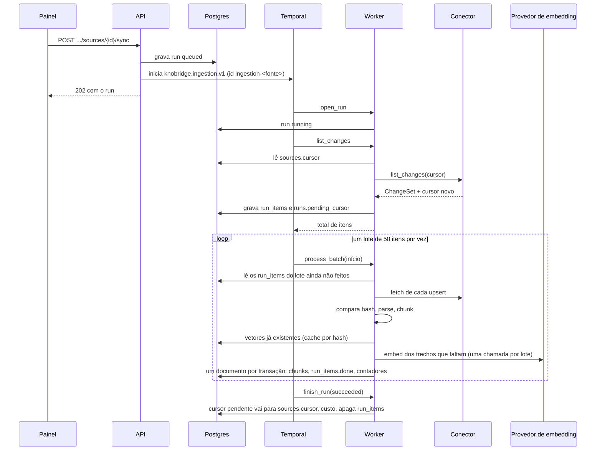

# Indexação e busca

> Rascunho v0.5 · 2026-10-17 · Em uso (planos 0003, 0004, 0008 e 0009; plano 0011 em implementação)
>
> **Mudança da v0.5, na F4.3** ([ADR 0011](../adr/0011-reranker-opcional.md)): o reranker passou a ser **opcional e desligado por padrão**: o serviço só sobe com o perfil `reranker` do compose, `KNOBRIDGE_RERANKER_URL` fica vazia por padrão, `mem_limit` de 8 GB e produtos novos sem reordenação ([Serviço no compose](#serviço-no-compose)).
>
> **Mudanças da v0.5** (plano 0011, F1.1; implementação nas F2.1 e F2.4; [ADR 0010](../adr/0010-busca-em-etapas-e-reranker.md)): o [reranker](#reranker) self-host (TEI com o `bge-reranker-v2-m3`) reordena os 30 melhores depois da fusão quando o produto tem a opção e a instância tem reranker, com queda para a ordem do RRF em falha; o [limiar](#limiar-por-modelo-de-embedding) ganha padrão por modelo de embedding (0,35 OpenAI, 0,60 `gemini-embedding-001`); a ingestão calcula os [arquivos que dominam o índice](#arquivos-que-dominam-o-índice) de cada fonte de pasta ou Git e sugere globs de exclusão; "testar busca" aceita `rerank` e o limiar opcional.
>
> **Mudanças da v0.4** (plano 0009, F1.1; implementação nas F1.2, F2.2 e F2.3): cada trecho tem um [nível mínimo](#nível-mínimo) (o maior entre o da fonte, o do documento e o do trecho), a [busca híbrida](#busca-híbrida) filtra pelo nível da pergunta no SQL dos dois braços, a lista de fontes filtra por `min_level`, "testar busca" exige editor e aceita `level`, e as fontes [`cards`](#cards) entram como as de chamados.
>
> **Mudanças da v0.3** (plano 0008, F1.1; implementação na F2.5): [reindexar uma fonte](#reindexar-uma-fonte), [sincronizar todas as fontes de uma coleção](#sincronizar-todas-as-fontes-de-uma-coleção) e [busca, filtros e ordenação](#listagens-de-coleções-e-fontes) nas listas de coleções e fontes. Na F4.1, a [sincronização pendente](#sincronização-pendente) tenta iniciar de novo com esperas crescentes enquanto o workflow anterior fecha.
>
> **Mudanças da v0.2** (plano 0004, F2.4): conhecimento do harness indexado pelo conector interno `knowledge` ([Conhecimento do harness](#conhecimento-do-harness)), gatilho `harness` e [sincronização pendente](#sincronização-pendente), citação `knowledge` no chat.

Como um documento lido por um conector vira trechos (chunks) com vetor no índice, como a sincronização roda no Temporal (manual ou agendada), quanto ela custa e como a busca híbrida encontra os trechos que viram citações no chat. A leitura das fontes está em [conectores.md](conectores.md); o uso da busca no chat, em [chat.md](chat.md#recuperação-de-fontes); as tabelas, em [modelo-de-dados.md](modelo-de-dados.md#índice-de-conhecimento); as decisões de arquitetura, no [ADR 0004](../adr/0004-indice-de-conhecimento.md).

Código:

- [`backend/src/knobridge/ingestion/`](../../backend/src/knobridge/ingestion/AGENTS.md): parsing, chunking, motor incremental, agendamento e gestão de coleções e fontes;
- [`backend/src/knobridge/workers/`](../../backend/src/knobridge/workers/AGENTS.md): workflows, activities e Temporal Schedules;
- [`backend/src/knobridge/retrieval/`](../../backend/src/knobridge/retrieval/AGENTS.md): busca híbrida e montagem das fontes do chat;
- [`backend/src/knobridge/llm/`](../../backend/src/knobridge/llm/AGENTS.md): adaptadores de embedding e preços.

## Visão geral



A sincronização agendada entra pelo mesmo caminho: o Temporal Schedule da fonte inicia o `ScheduledSyncWorkflow`, cuja activity chama o mesmo `start_sync` da API (ver [Agendamento](#agendamento)).

## Parsing

`ingestion/parsing.py` transforma cada `RawDocument` num `ParsedDocument`: Markdown mais o que é preciso para dividir e citar. O tipo (`ParsedKind`) decide o chunking.

| Entrada | Resultado |
|---|---|
| Commit (`DocumentKind.COMMIT`) | `commit`: Markdown gerado por `render_commit` (abaixo). |
| PDF, DOCX, XLSX, PPTX | `document`: conversor MarkItDown do formato, escolhido **pela extensão** (nunca por detecção de conteúdo, então arquivo corrompido falha em vez de ser lido como texto), rodado em `asyncio.to_thread`. Quebras de página do PDF viram linha em branco. Título: o do conversor, senão o primeiro `# `, senão o nome do arquivo. |
| `.html`/`.htm` que começa com `<!doctype html` ou `<html` | `document`: página convertida pelo MarkItDown, título do `<title>`. |
| Qualquer outro `.html`/`.htm` (template, fragmento) | `code` com linguagem `html`. |
| `.md`, `.markdown` | `markdown`, sem alteração. Título: primeiro `# `, senão o nome do arquivo. |
| Extensão de código conhecida (`CODE_LANGUAGES`: Python, TypeScript, TSX, JavaScript, JSX, Go, Java, Kotlin, C#, Rust, Ruby, PHP, C, C++, Swift, Pascal, SQL, shell, PowerShell, JSON, YAML, TOML, XML, CSS, SCSS, Vue, Svelte) | `code`: bloco cercado com a linguagem (cerca mais longa que qualquer sequência de crases do arquivo). |
| Demais | `text`, sem alteração. |

- **Encoding.** Texto é decodificado por `decode_text`, sempre igual para os mesmos bytes: UTF-8 (BOM removido), senão cp1252, senão latin-1 (que aceita qualquer byte). CRLF vira LF.
- **Erros por documento.** `unsupported_format` (`format: document` com extensão sem conversor, como `.doc`, ou texto com byte NUL) e `parse_failed` (conversor falhou ou documento sem texto extraível) viram um `RunError` na etapa `parse`, sem derrubar a execução. As mensagens são curtas e nunca levam conteúdo.

**Commits** (`ingestion/commits.py`). O conteúdo do documento de commit é só a mensagem completa ([conectores.md](conectores.md#commits-como-documentos)); SHA, autor, data e arquivos vêm dos metadados. O Markdown é `# <assunto>` (vazio: `Commit <sha12>`), as linhas `- Commit`, `- Autor` (só o nome; o e-mail nunca é renderizado) e `- Data` (ISO 8601, como veio), o corpo da mensagem (tudo depois da primeira linha) e a seção `## Arquivos alterados`, com até 200 arquivos e o status em pt-BR (`adicionado`, `modificado`, `removido`, `renomeado`...); quando há mais, a última linha é `- … e mais N arquivos`, contando também os que o conector cortou (`files_total`). Cada informação aparece uma vez só, em pt-BR. Os metadados são lidos de forma tolerante: campo ausente ou malformado é omitido, nunca falha.

## Chunking

`ingestion/chunking.py` produz `ChunkDraft`s numerados a partir de 0, na ordem do documento. Cada um tem:

- `content`: o texto embedado e indexado, com um cabeçalho curto de contexto (`path: …`, `symbol: …`, `section: …`) antes do corpo;
- `display`: só o corpo, usado como trecho citado;
- `meta`;
- `tokens`, estimados;
- `content_hash`: SHA-256 de `content`, a chave do cache de embedding.

**Limites** (`chunk_base.py`), em tokens estimados por `estimate_tokens` (caracteres / 4, o mesmo estimador dos lotes de embedding):

| Constante | Valor | Papel |
|---|---|---|
| `TARGET_TOKENS` | 400 | Tamanho que uma janela busca. |
| `MAX_TOKENS` | 800 | Maior unidade mantida inteira (seção, função, classe); acima disso, divide. |
| `OVERLAP_TOKENS` | 60 | Sobreposição entre janelas consecutivas de uma unidade dividida. |

O divisor por linhas faz janelas gulosas de cerca de `TARGET_TOKENS`, cada uma repetindo até `OVERLAP_TOKENS` do fim da anterior; linha maior que `MAX_TOKENS` é cortada por caracteres; linhas em branco nas bordas saem.

**Por tipo:**

- **Markdown e documentos convertidos**: corte nos títulos ATX fora de blocos cercados. Cada trecho leva o caminho de títulos (`headings`) no `meta` e na linha `section:` do texto embedado (`Título > Subtítulo`). Título sem corpo próprio não vira trecho (ele já está no caminho das subseções). Seção acima de `MAX_TOKENS` é dividida por linhas com sobreposição.
- **Código TypeScript, TSX, JavaScript/JSX e Go**: pela árvore sintática do tree-sitter (bindings oficiais e gramáticas em wheels, sem download em tempo de execução; `code_chunking.py`).
  - Unidades de topo: funções, classes, interfaces, tipos, enums e `const f = () => …` (TS/JS); funções, métodos (`Tipo.metodo`, com `parent` = tipo do receptor) e tipos (Go).
  - O comentário logo acima vai junto com a declaração; imports e constantes acompanham o vizinho.
  - Unidades pequenas vizinhas são juntadas até `TARGET_TOKENS` (o `symbol` vira a lista separada por vírgula).
  - Classe acima de `MAX_TOKENS` é trocada pelos métodos (`Classe.metodo`); qualquer outra unidade grande é dividida por linhas.
- **Fallback**: arquivo sem nenhum símbolo, código de linguagem sem gramática aqui (Python, Pascal, SQL, C#...) e texto simples viram janelas por linhas.
- **Commits**: um trecho com o Markdown renderizado; se passar de `MAX_TOKENS`, dividido por linhas, cada parte repetindo `# <assunto>` no texto embedado.

**Metadados** (`chunks.meta`):

| Chave | Quando |
|---|---|
| `path`, `symbol` | `path` sempre que há caminho, `symbol` em código. Alimentam o índice textual. |
| `start_line`, `end_line` | 1-based e inclusivas, no arquivo original, para Markdown, texto e código. Ausentes em documentos convertidos e commits, cujo Markdown é gerado. |
| `headings` | Markdown e documentos convertidos. |
| `language`, `parent`, `node_type` | Código (`node_type`: `function`, `method`, `class`, `interface`, `type`, `enum`, `struct`). |
| `sha`, `title`, `author`, `date` | Commits (`author` só o nome). |
| `display` | Gravado pelo motor junto com o trecho: o corpo sem o cabeçalho de embedding. |
| `min_level` | Opcional (v0.4): refinamento do nível mínimo do trecho pelo chunking (hoje, só a seção de evidências do conhecimento, `support`). O nível efetivo fica na coluna `chunks.min_level` ([Nível mínimo](#nível-mínimo)). |

## Conhecimento do harness

Fontes `runner` (plano 0004, decisão D15) passam pelo mesmo workflow, com o conector interno `knowledge` (`harness/knowledge_connector.py`), que `SettingsConnectorFactory` usa para todo tipo `runner` sem validar a config (ela é do runner). Diferente dos conectores de arquivos, ele lê o banco: os `knowledge_items` da fonte, numa transação no escopo do workspace, sem usuário.

- **Documentos**: um por item não descartado; `natural_key` = chave do item (`src-faturamento.R001`), `kind = knowledge`, `title` = título (o editado, se houver), `uri = knowledge:<chave>`. Conteúdo = [Markdown do item](harness.md#markdown-de-um-item), de `edited` quando houver.
- **Hash**: SHA-256 do Markdown **e** dos metadados de citação (módulo, confiança, título, evidências com excerto). Aprovar um item muda só a confiança e, por isso, também o reindexa.
- **Incremental**: o cursor (`{"kind": "knowledge", "version": 1, "items": {chave: hash}}`) compara os hashes; item novo é adicionado, hash diferente é alterado, item descartado ou apagado sai do índice.
- **Parsing**: o Markdown passa direto (`ParsedKind.KNOWLEDGE`), com o título do item.
- **Chunking**: por títulos, como Markdown, sem linhas (o Markdown é gerado). Texto embedado com o cabeçalho `item: <chave>` e `section: …`. `meta` de cada trecho: `kind` (`knowledge`), `item_key`, `module`, `confidence`, `title`, `headings` e `evidence` (`[{path, start_line, end_line, symbol, excerpt}]`): as evidências que o trecho cita com `[n]` (enriquecimento do módulo, até 10), ou, sem marcador (regras e seções sem citação), as 5 primeiras do item.
- **Citação**: `kind: knowledge`, com a confiança e as evidências ([Da busca à citação](#da-busca-à-citação)).

## Chamados

Fontes `tickets` (plano 0005) passam pelo mesmo workflow, com o conector interno `tickets` (`tickets/connector.py`), que `SettingsConnectorFactory` recebe em `tickets=` (a API e o worker passam o `TicketsConnectorFactory`; `ingestion/` não importa `tickets/`). Ele lê a caixa de entrada da fonte, no escopo do workspace, sem usuário; cada envio de chamados pede a sincronização com o gatilho `ingest`. Contrato completo em [chamados.md](chamados.md#conector-interno-tickets):

- **Incremental pela caixa de entrada**: entradas `pending` com status em `statuses` são adicionadas ou alteradas, as fora de `statuses` e as lápides são removidas; o cursor (`{"kind": "tickets", "version": 1}`) só identifica o conector.
- **Documento**: `natural_key` = `external_id`, `kind = ticket`, `uri = ticket:<external_id>`, Markdown anonimizado (`tickets/markdown.py`), hash do Markdown e dos metadados de citação; parsing direto (`ParsedKind.TICKET`) e chunking por seção (`chunk_ticket`).
- **Fechamento do item**: o conector implementa `settle` (`ingestion/settle.py`), que o lote chama na transação de cada documento ([Um lote](#workflow-knobridgeingestionv1)): a entrada sai de `pending` e o payload bruto é apagado junto com a gravação do documento, nunca antes.

## Cards

Fontes `cards` (plano 0009) passam pelo mesmo caminho das fontes `tickets`, com o conector interno `cards` sobre a mesma caixa de entrada: documento `kind = card`, `uri = card:<external_id>`, Markdown do card e chunking por seção ([cards.md](cards.md#conector-interno-cards)).

## Nível mínimo

Desde a v0.4 (plano 0009; contrato em [produtos-e-niveis.md](produtos-e-niveis.md#nível-mínimo-de-fonte-de-documento-e-de-trecho)), cada trecho guarda o nível mínimo de pergunta que pode recebê-lo, em `chunks.min_level` (`end_user`, `support` ou `product_dev`):

- **Cálculo**, no lote que grava o documento: o maior entre `sources.min_level`, `documents.min_level` (refinamento do conector, opcional) e `chunks.meta.min_level` (refinamento do chunking, opcional).
- **Padrões da fonte**: `folder` e `runner`, `end_user`; `tickets`, `support`; `git` e `cards`, `product_dev`.
- **Refinamentos**: documento `ParsedKind.CODE` numa fonte `folder` → `product_dev`; item de conhecimento `inferido` → documento `support`; a seção `## Evidências` de um item de conhecimento → trecho `support` (o chunking do conhecimento nunca junta essa seção com outra). Os demais conectores não refinam.
- **Mudança do nível da fonte** (`PATCH .../sources/{id}` com `min_level`, só owner e admin): recalcula `chunks.min_level` dos trechos da fonte numa instrução, na mesma transação, sem reindexar nem chamar o embedding. Uma execução em andamento grava os documentos seguintes já com o nível novo, porque o lote lê o nível da fonte a cada documento.
- O nível **não** entra no `content_hash` do documento: mudar o nível não muda o conteúdo nem pede reindexação, por isso o recálculo é explícito.

## Embeddings

- **A coleção define o embedding** (ADR 0004): credencial de provedor e modelo. A credencial tem de ser do mesmo workspace e de um tipo com embeddings (OpenAI, OpenRouter ou, fora de produção, `fake`). A Anthropic não oferece embeddings: `provider_embeddings_unsupported` (422).
- **Dimensão fixa de 1536** (`chunks.embedding vector(1536)`, índice HNSW `vector_cosine_ops`). O modelo padrão é `openai/text-embedding-3-small` no OpenRouter (`text-embedding-3-small` na OpenAI direta). Vetor de outra dimensão é `embedding_dimension_mismatch`; resposta com quantidade diferente de vetores, `embedding_invalid_response`.
- **Gemini pelo OpenRouter** (plano 0005): `google/gemini-embedding-001` e `google/gemini-embedding-2` devolvem 3072 dimensões por padrão. Para os modelos `gemini-embedding*` (com ou sem o prefixo do fornecedor), o adaptador envia `dimensions: 1536` e o provedor trunca o vetor (Matryoshka); a dimensão da resposta continua conferida, e qualquer outra vira `embedding_dimension_mismatch`. Os demais modelos não recebem `dimensions`. Os lotes desses modelos têm no máximo 100 textos, o limite da API do Google (os demais seguem com 128). **Limiar**: com os Gemini, perguntas sem relação chegam a 0,49–0,55 de similaridade; o padrão de 0,35, calibrado para o OpenAI, não separa "sem fonte" ([pesquisa 0004](../pesquisa/0004-embeddings-openai-x-gemini.md)). Desde a v0.5, o limiar tem [padrão por modelo](#limiar-por-modelo-de-embedding) (0,60 para o `gemini-embedding-001`) e o produto não precisa mais de ajuste manual.
- **Troca de modelo travada.** Com documentos na coleção, credencial e modelo não mudam mais (`collection_embedding_locked`, 409): para outro modelo, crie outra coleção e cadastre as fontes nela. Cada trecho registra o modelo que o gerou (`chunks.embedding_model`).
- **Lotes.** O motor faz uma chamada `embed` por lote de documentos. O adaptador divide o pedido em requisições de até 128 textos e 100 mil tokens estimados (`plan_batches`; um texto maior vai sozinho) e devolve os vetores na ordem da entrada.
- **Cache por hash.** Antes de chamar o provedor, o motor procura na mesma coleção trechos com o mesmo `content_hash` e o mesmo modelo e reaproveita o vetor. Só o que falta vai ao provedor. Documento sem mudança nem chega ao chunking: é pulado pelo hash do conteúdo (`documents.content_hash`).
- **Tokens.** Vêm do `usage` da resposta; sem ele, a estimativa local (`tokens_estimated`).
- **Chave.** A chave da credencial é decifrada só em memória, na hora da chamada, e o adaptador é sempre fechado depois.

## Execução

### Disparo e unicidade

`start_sync` (`ingestion/sync.py`) é a entrada comum da API (`POST .../sources/{id}/sync`, papel editor ou acima) e do agendamento:

1. confere a fonte (`source_not_found` 404; fonte desativada, `source_inactive` 409);
2. grava um `Run` `queued` com o gatilho (`manual`, `schedule`, `harness` ou `ingest`);
3. inicia o workflow `knobridge.ingestion.v1` com id `ingestion-<source_id>`, `ALLOW_DUPLICATE` + `FAIL`: depois de uma execução terminada pode vir outra, mas não duas ao mesmo tempo. **Uma execução por fonte**: se já há uma, o run recém-criado é apagado e a API responde `sync_already_running` (409). Temporal fora do ar: `sync_unavailable` (503) e nada é iniciado.

### Sincronização pendente

O harness pede sincronizações que não podem se perder: depois de cada resultado de tarefa ([runner.md](runner.md#post-v1runnerjobsjob_idresult), efeito 6) e de cada revisão de item ([harness.md](harness.md#revisão-e-exportação)). Elas entram por `request_sync` (`ingestion/sync.py`), com o gatilho `harness`:

1. tenta `start_sync`; se começou, pronto;
2. se já há execução da fonte (`sync_already_running`), trava a linha da fonte (`FOR UPDATE`) e procura uma execução `queued` ou `running`: havendo, grava `sources.sync_pending = true` e devolve "pendente" (sem execução);
3. não havendo (o workflow anterior já fechou a execução, mas o Temporal ainda o vê aberto enquanto ele termina), espera e volta ao passo 1, com esperas crescentes de 50 ms, 100 ms, 200 ms, 400 ms, 800 ms e 1,6 s (`CLOSING_RETRY_DELAYS`, cerca de 3 s no total; a espera é injetável e os testes não esperam de verdade);
4. se o início for recusado em todas as tentativas sem execução ativa, grava a marca do mesmo jeito (log `ingestion_sync_left_pending`): nenhuma execução a consome agora, e ela fica para a próxima execução da fonte (manual, agendada ou outro pedido), que a limpa ao abrir.

Antes da F4.1 do plano 0008 eram só duas tentativas imediatas: um envio de chamados que chegava logo depois do fim da execução anterior ficava com a marca gravada e sem execução, e os chamados ficavam "Aguardando processamento" até o envio seguinte.

A marca é consumida pelo próprio workflow:

- `open_run` (`queued` → `running`) limpa a marca: essa execução lista a fonte depois, então já cobre o que foi pedido antes dela;
- `finish_run` com sucesso, numa fonte ativa com a marca, limpa a marca e grava uma execução nova `queued` com gatilho `harness`, cujo id a activity devolve; o workflow então faz `continue-as-new` com ela, com o mesmo id de workflow (a regra "uma execução por fonte" continua valendo);
- falha ou cancelamento deixam a marca para a próxima execução bem-sucedida.

`finish_run` trava a linha da fonte, como o passo 2: ou a execução que termina ainda aparece ativa e lê a marca depois do commit de quem a gravou, ou já aparece encerrada e quem pede começa a sua. Históricos gravados antes de a activity devolver o id são lidos como "sem continuação".

### Workflow `knobridge.ingestion.v1`

Workflow determinístico (`workers/ingestion.py`); todo IO fica nas activities (`workers/ingestion_activities.py`), cada uma com nome versionado, timeout e retry explícitos:

| Activity | Timeout | O que faz |
|---|---|---|
| `knobridge.ingestion.open_run.v1` | 30 s | `queued` → `running`, grava `started_at`. Retry não muda nada. |
| `knobridge.ingestion.list_changes.v1` | 1 h (heartbeat a cada 5 s, timeout de heartbeat 2 min) | Chama `list_changes` do conector **fora de transação**, grava o `ChangeSet` em `run_items` (adicionados e alterados como `upsert`, removidos como `remove`, cada um com um `ordinal`) e o cursor novo em `runs.pending_cursor`. Devolve só a contagem. Retry substitui os itens da tentativa anterior. |
| `knobridge.ingestion.process_batch.v1` | 30 min (heartbeat igual) | Processa os itens com `início <= ordinal < início + 50` ainda não feitos. |
| `knobridge.ingestion.finish_run.v1` | 30 s | Fecha a execução (abaixo). Execução já encerrada fica como está. Devolve o id da próxima execução quando consome uma [sincronização pendente](#sincronização-pendente), senão `null`. |

A lista de mudanças não passa pelo histórico do Temporal, que limita payloads a cerca de 2 MB. Ela fica em `run_items` e cada lote lê a sua página. Com `BATCH_SIZE` = 50, 10 mil arquivos dão 200 lotes e cerca de 1 400 eventos de histórico (o limite é 51 200).

**Um lote** (`ingestion/indexer.py`):

- remoções apagam o documento, e os trechos vão junto em cascata;
- cada upsert é lido (`fetch`) e comparado ao hash indexado: igual = pulado, sem custo;
- o que mudou passa por parsing e chunking, e depois pelo embedding com cache (seção anterior);
- erro de leitura (`ConnectorError`, menos `source_unavailable`) vira `RunError` na etapa `fetch`, e erro de parsing vira `RunError` na etapa `parse`. O lote segue.
- um conector que fecha os próprios itens (`SettlingConnector` de `ingestion/settle.py`, hoje só o `tickets`) recebe o desfecho de cada item (indexado, removido ou com erro) dentro da transação que o grava, logo abaixo.

**Uma transação por documento** (`ingestion/store.py`): upsert do `Document` pela chave natural, troca de todos os trechos dele, `run_items.done` e soma dos contadores da execução (`documents_new`, `documents_changed`, `documents_removed`, `documents_failed`, `chunks_written`) na mesma transação. Um lote reexecutado não grava nem conta duas vezes. Nenhuma transação fica aberta durante IO do conector ou do provedor. O worker não tem usuário: toda sessão é `scoped_session(workspace_id=<da execução>, user_id=None)`, e a RLS continua limitando ao workspace da execução.

### Retry, falha e cancelamento

- **Retry**: 5 tentativas, backoff de 2 s a 1 min. Só os erros transitórios se repetem: `source_unavailable`, `provider_unavailable` e `provider_rate_limited`. Os demais erros de domínio (chave recusada, modelo inexistente, cursor inválido) falham a execução na hora.
- **Falha**: activity que esgota as tentativas marca a execução `failed` com `runs.error` = `<código>: <mensagem>` (até 500 caracteres), e o workflow falha com `ingestion_failed`.
- **Cancelamento**: `POST .../sources/{id}/cancel` pede o cancelamento ao Temporal (sem execução rodando: `sync_not_running`, 409). O pedido chega à activity no próximo heartbeat, a execução é marcada `cancelled`, e o cancelamento se propaga. Excluir a fonte cancela a execução ativa.
- **Cursor só no sucesso**: `finish_run` copia `runs.pending_cursor` para `sources.cursor` apenas quando o status é `succeeded`. Uma execução que falhou ou foi cancelada é listada de novo, a partir do cursor anterior, na próxima vez; os documentos já gravados são pulados pelo hash. Em qualquer desfecho, `finish_run` grava `finished_at` e o custo e apaga os `run_items`.

### Reindexar uma fonte

`POST .../sources/{source_id}/reindex` (editor ou acima, CSRF) reprocessa **todos** os documentos da fonte, mesmo os que não mudaram (útil depois de mudar o parsing, o chunking ou os padrões da fonte). Numa só transação, na sessão da requisição:

1. confere a fonte (404 `source_not_found`; desativada, 409 `source_inactive`; do tipo `tickets`, 409 `source_reindex_unsupported`, porque o bruto dos chamados é apagado depois de indexado e não há o que reler: [chamados.md](chamados.md#fim-do-processamento-e-apagamento-do-bruto));
2. com execução `queued` ou `running` da fonte, 409 `sync_already_running` e nada muda;
3. zera `sources.cursor` (a próxima listagem é a inicial, como na primeira execução; em Git, com o mesmo `initial_commit_limit`) e grava `content_hash = ''` em todos os documentos da fonte (vazio nunca casa com um SHA-256, então nenhum é pulado pelo hash);
4. chama `start_sync` com o gatilho `manual`. Se o disparo falha (`sync_already_running` por corrida, ou Temporal fora do ar: 503 `sync_unavailable`), a transação inteira é desfeita e cursor e hashes ficam como estavam.

Resposta 202 com o run, como `POST .../sync`. Os documentos continuam no índice e na busca durante a reindexação; cada um é trocado na sua transação, como numa sincronização comum. Sem cursor, o conector lista tudo como adicionado e nada como removido ([conectores.md](conectores.md)): documentos indexados que a listagem inicial não traz (por exemplo, commits mais antigos que o `initial_commit_limit`) ficam no índice como estão, com o hash vazio, e são reprocessados se voltarem a aparecer. O embedding continua com cache por hash do trecho: trechos iguais aos já indexados reaproveitam o vetor, então reindexar sem mudança de conteúdo quase não custa embeddings. Auditoria: `source.reindex.started` (`name`, `run_id`), além do `source.sync.started` que o disparo já grava.

### Sincronizar todas as fontes de uma coleção

`POST .../collections/{collection_id}/sync` (editor ou acima, CSRF) dispara `start_sync` (gatilho `manual`) para cada fonte **ativa** da coleção, em ordem de nome, cada uma independente. Resposta 202:

```json
{"started": [{"source_id": "…", "run_id": "…"}], "skipped": [{"source_id": "…", "reason": "sync_already_running"}]}
```

- `reason`: `sync_already_running` ou `source_inactive` (fontes inativas entram em `skipped` para a tela explicar).
- Temporal fora do ar: se nenhuma começou, 503 `sync_unavailable`; se algumas já começaram, as restantes entram em `skipped` com `sync_unavailable`.
- Coleção inexistente ou de outro workspace: 404 `not_found`. Coleção sem fontes: 202 com as duas listas vazias.
- Auditoria: um `source.sync.started` por fonte iniciada (o mesmo do disparo manual) e nenhum evento extra.

## Listagens de coleções e fontes

`GET .../collections` e `GET .../sources` continuam paginadas (`limit` de 1 a 200, padrão 50; `offset`; `total`), por nome por padrão, e ganham (plano 0008, F2.5):

| Lista | `query` (até 200 caracteres, sem diferenciar maiúsculas, com `%`, `_` e `\` escapados) | Filtros | `sort` |
|---|---|---|---|
| Coleções | nome ou descrição | `provider_id` | `name` (padrão), `-name`, `created_at`, `-created_at`, `updated_at`, `-updated_at`, `document_count`, `-document_count` |
| Fontes | nome | `collection_id` (já existe), `kind` (`git`, `folder`, `runner`, `tickets`, `cards`), `min_level` (v0.4), `active`, `last_run_status` (`queued`, `running`, `succeeded`, `failed`, `cancelled` ou `never` para fonte sem execução) | `name` (padrão), `-name`, `created_at`, `-created_at`, `updated_at`, `-updated_at`, `last_run_at`, `-last_run_at` (pelo `created_at` da última execução; sem execução, por último) |

Empate pelo `id`; valor fora da lista: 422 `validation_error`. As contagens e a última execução continuam vindo em número constante de statements.

## Agendamento

Cada fonte pode ter `schedule_cron` (cron de cinco campos, sempre em **UTC**, validado e normalizado com `croniter`; `source_schedule_invalid` se inválido) e `schedule_enabled`. Habilitado sem cron é recusado. A API devolve `next_run_at`, o próximo disparo calculado pelo relógio do servidor (`None` sem agendamento habilitado ou com a fonte desativada).

- **Temporal Schedules** (`workers/schedules.py`): uma fonte ativa com cron tem o schedule `source-schedule-<source_id>`, pausado quando `schedule_enabled` é falso. Fonte desativada ou sem cron não tem schedule.
- **Política do schedule**: `ScheduleOverlapPolicy.SKIP` e janela de recuperação de 1 h: um disparo perdido há mais tempo é descartado, e a próxima sincronização incremental recupera o que mudou.
- **Workflow do disparo**: o schedule inicia `knobridge.scheduled_sync.v1`, que roda uma única activity (`knobridge.scheduled_sync.start.v1`). A activity relê a fonte no banco, que é a fonte da verdade (sem agendamento habilitado ou apagada: `skipped`), e chama `start_sync(trigger=schedule)`.
  - Por isso a regra "uma execução por fonte" fica num lugar só e vale igual para disparo manual e agendado: com execução em andamento, o disparo é pulado sem erro (`scheduled_sync_skipped`).
  - Um schedule desatualizado nunca sincroniza fonte desabilitada, inativa ou apagada.
- **Espelhamento**: a API cria, atualiza ou remove o schedule quando a fonte é criada, excluída ou muda cron, `schedule_enabled` ou `active`.
- **Reconciliação**: com o Temporal fora do ar, a API salva a fonte assim mesmo e registra `source_schedule_deferred`. Na subida, o worker reconcilia tudo: cria os schedules que faltam, atualiza os divergentes e remove os órfãos com o prefixo. A comparação usa uma impressão digital do pedido (workspace, cron, fuso, fila) guardada na nota do schedule, mais o estado `paused`.

## Custo registrado

Cada execução guarda `embedding_tokens` (soma dos tokens das chamadas de embedding, inclusive as de tentativas repetidas, porque foram pagas) e `cost_usd`. O custo é calculado em `finish_run`, em qualquer desfecho, pela `EmbeddingPriceTable` (`llm/pricing.py`): USD por milhão de tokens, com 6 casas.

| Modelo | USD / 1M tokens |
|---|---|
| `text-embedding-3-small` e `openai/text-embedding-3-small` | 0,02 |
| `text-embedding-3-large` e `openai/text-embedding-3-large` | 0,13 |
| `text-embedding-ada-002` e `openai/text-embedding-ada-002` | 0,10 |
| `google/gemini-embedding-001` (catálogo do OpenRouter, 2026-10-12) | 0,15 |
| `google/gemini-embedding-2` (catálogo do OpenRouter, 2026-10-12) | 0,20 |

`KNOBRIDGE_EMBEDDING_PRICES` (JSON, ex.: `{"openai/text-embedding-3-small": 0.02}`) sobrescreve ou acrescenta preços. Modelo sem preço tem custo desconhecido (`null`), nunca zero. Documentos pulados pelo hash e trechos achados no cache não custam nada. O painel mostra tokens, custo, duração e as contagens de cada execução na tela da fonte.

## Arquivos que dominam o índice

Desde a v0.5 (plano 0011, D6, F2.4). No [ensaio 0001](../pesquisa/0001-ensaio-minski.md), 34 relatórios gerados de uma pasta (`docs/resumos`) eram 23% de todos os trechos e ocupavam as vagas das respostas sem acrescentar nada. A saída era excluir a pasta com `exclude_globs`, mas nada avisava. Agora a ingestão calcula, por fonte, os arquivos e diretórios com participação desproporcional e sugere o glob de exclusão.

### Quando e onde

- **Fontes** `folder` e `git` (as de arquivos). Nas demais (`runner`, `tickets`, `cards`), `index_stats` fica `null`.
- **Quando**: na activity `finish_run`, só em execução `succeeded` (`ingestion/index_stats.py`), numa consulta agregada sobre os trechos da fonte: `SELECT documents.natural_key, count(chunks.id) … WHERE documents.source_id = :fonte AND documents.kind = 'file' GROUP BY documents.natural_key`, mais o total de trechos da fonte (todos os tipos, inclusive commits). O resultado vai para `sources.index_stats` (JSON) na mesma transação que fecha a execução. Execução que falha ou é cancelada não muda o valor anterior. Uma fonte nunca sincronizada com sucesso tem `null`.
- **Na API**: `SourceOut` ganha `index_stats` (objeto abaixo ou `null`) em `GET .../sources` e `GET .../sources/{id}` (o valor gravado, sem consulta extra: o número de statements da lista não muda) e `dominant_count` (quantidade de itens em `index_stats.dominant`, `0` sem estatísticas), para a lista mostrar o selo.

### Critérios

Constantes em `ingestion/index_stats.py`. `T` = trechos da fonte; `F` = trechos de arquivos; `N` = arquivos com trechos; `média` = `F / N`; a participação (`share`) de um grupo é `trechos do grupo / T`.

| Tipo (`kind`) | Grupo | Entra quando | Glob sugerido |
|---|---|---|---|
| `file` | Um arquivo | `share ≥ 0,05` e ao menos 50 trechos. | O caminho do arquivo (`docs/relatorio-anual.json`). |
| `directory` | Um diretório (qualquer profundidade, menos a raiz), com tudo abaixo dele | `share ≥ 0,15`, ao menos 200 trechos, ao menos 2 arquivos e trechos por arquivo no diretório `≥ 3 × média`. | `<diretório>/**` (`docs/resumos/**`). |
| `known_generated` | Os arquivos que casam um padrão conhecido de arquivo gerado (abaixo) | `share ≥ 0,02` e ao menos 20 trechos. | O próprio padrão. |

- **Fonte pequena**: com `T < 200`, `dominant` fica vazio (nada domina um índice desse tamanho).
- **Diretórios, do mais fundo para o mais raso**: um diretório que entra tem os arquivos dele descontados dos ancestrais antes de testá-los; assim `docs/resumos/**` aparece e `docs/**` só aparece se ainda passar sem os resumos.
- **Sem repetição**: um arquivo dentro de um diretório que entrou não aparece como `file`; um grupo `known_generated` cujos arquivos estão todos dentro de grupos já listados não aparece.
- **Padrões conhecidos** (sintaxe do `.gitignore`, a mesma de `exclude_globs`; os lockfiles e os diretórios `dist`, `build`, `vendor` e `node_modules` nem são lidos pelos conectores, [conectores.md](conectores.md#seleção-de-arquivos)): `*.min.js`, `*.min.css`, `*.map`, `*.snap`, `coverage/`, `__generated__/`, `*.generated.*`, `*.g.cs`, `*.Designer.cs`, `*_pb2.py`, `*.pb.go`.
- **Ordem e limite**: `dominant` por `share` decrescente, empate pelo `pattern`; no máximo 10 itens. `top_files`: os 10 arquivos com mais trechos, por trechos decrescentes e depois pelo caminho, com ou sem aviso.
- **Sugestão**: `suggested_exclude_globs` = os `pattern` de `dominant` que ainda não estão em `exclude_globs` da fonte, na mesma ordem.

### Formato de `index_stats`

```json
{
  "version": 1,
  "computed_at": "2026-10-17T12:00:00Z",
  "run_id": "…",
  "chunks": 19729,
  "file_chunks": 19100,
  "files": 2106,
  "top_files": [{"path": "docs/resumos/2026-09.json", "chunks": 412, "share": 0.0209}],
  "dominant": [
    {"kind": "directory", "pattern": "docs/resumos/**", "files": 34, "chunks": 4661, "share": 0.2363, "chunks_per_file": 137.1}
  ],
  "suggested_exclude_globs": ["docs/resumos/**"]
}
```

`share` com 4 casas; `chunks_per_file` com 1 casa; `computed_at` pelo relógio injetado; `run_id` = a execução que calculou.

### Aplicar a sugestão

Não há rota nova: o painel aplica com o `PATCH .../sources/{id}` de hoje (editor ou acima), acrescentando o padrão a `exclude_globs` (até 100 padrões), e oferece sincronizar. Na sincronização seguinte, o conector lista os arquivos que deixaram de ser selecionados como removidos ([conectores.md](conectores.md#conector-de-pasta)), os trechos saem do índice e o `index_stats` é recalculado. A auditoria é a do `PATCH` (`source.updated` com `exclude_globs` em `fields`).

## Busca híbrida

`SearchService.search` (`retrieval/search.py`) serve a rota "testar busca" (`POST .../collections/{id}/search`, editor ou acima desde a v0.4, antes qualquer membro; `query` até 2000 caracteres, `limit` padrão 10 e máximo 50, `level` padrão `product_dev` (v0.4), `min_similarity` opcional (desde a v0.5, omitido ou `null` = o [padrão do modelo](#limiar-por-modelo-de-embedding) da coleção; até a v0.4, padrão 0,35, calibrado pelo [ensaio com dados reais](../pesquisa/0001-ensaio-minski.md)) e `rerank` opcional (v0.5, [abaixo](#testar-busca-com-reranker))), o `HybridRetriever` do chat e o `search_knowledge` do MCP.

1. **Coleções e credenciais** numa consulta. Coleção ausente ou de outro workspace: 404 `not_found`.
2. **Embedding da pergunta**, um por par (credencial, modelo). Coleções com o mesmo modelo compartilham o vetor; vetores de modelos diferentes nunca se comparam.
3. **Braço vetorial**, por modelo: os `candidatos` mais próximos por distância de cosseno (`<=>`, índice HNSW, só trechos com aquele `embedding_model`). Os candidatos são `limit × 4`, entre 40 e 200, com `hnsw.ef_search` = 1000 (o máximo do pgvector) na transação, para compensar o filtro de workspace e coleção aplicado depois do índice e a recall do HNSW: no ensaio do plano 0004, 100 perdeu o trecho mais próximo de uma pergunta real numa coleção de 20 mil trechos (recall@10 de 0,90 contra a varredura exata; 0,98 com 1000). Um candidato só segue se `1 - distância >= min_similarity` (desde a v0.5, o limiar do modelo deste grupo quando a busca recebe `min_similarity = None`). Desde a v0.4, a consulta filtra também `chunks.min_level = ANY(:allowed_levels)` (os níveis de `end_user` até o da pergunta).
4. **Braço textual (FTS)**, numa consulta: `websearch_to_tsquery` em `portuguese` OU em `simple` OU em `simple` sobre a pergunta com `/` e `.` trocados por espaço, contra `chunks.tsv`, ordenado por `ts_rank_cd`, com o mesmo filtro de `chunks.min_level` (v0.4). `chunks.tsv` é uma coluna gerada pelo banco: `to_tsvector('portuguese', content)` mais `to_tsvector('simple', ...)` sobre o caminho (inteiro e quebrado em `/` e `.`) e o símbolo, com índice GIN.
5. **Fusão RRF** (Reciprocal Rank Fusion, `fusion.py`) sobre todos os rankings: `soma de 1 / (60 + posição)`. Não exige normalizar pontuações, que no cosseno e no `ts_rank_cd` vivem em escalas sem relação.
6. **Vizinhos removidos**: trecho do mesmo documento em posição adjacente, ou com faixa de linhas que se cruza, sai em favor do mais bem colocado.
7. **Carga**: os trechos escolhidos são lidos com o documento numa consulta. O número de statements é constante: 5, mais 1 por modelo extra.

**Nível** (v0.4): o filtro de `chunks.min_level` entra no SQL dos dois braços, antes da fusão; nunca se filtra depois. Um trecho acima do nível da pergunta não é candidato, não entra na fusão nem tira vaga de um trecho permitido ([produtos-e-niveis.md](produtos-e-niveis.md#o-filtro-na-busca)).

**Limiar** (decisão D12 do plano 0003): um trecho entra se alcança `min_similarity` **ou** se casa a busca textual. `websearch_to_tsquery` é conjuntivo: exige todos os termos da pergunta, fora stop words. Casar o FTS já é sinal forte, e é o que acha identificadores exatos que o embedding perde. Uma pergunta sem relação com o índice não passa em nenhum dos dois e volta vazia. Trechos de modelo diferente do da coleção só aparecem pelo FTS. Até a v0.4, o reranker (`retrieval/rerank.py`) existia só como interface; desde a v0.5, ele entra depois da busca ([Reranker](#reranker)).

Cada resultado traz `vector_similarity`, `fts_rank`, `fused_score`, o documento (tipo, chave natural, título, URI), `path`, `symbol`, linhas e `snippet` (corpo sem o cabeçalho, até 600 caracteres) e, desde a v0.5, `rerank_score` (`null` sem reordenação).

## Limiar por modelo de embedding

Desde a v0.5 (plano 0011, D6, F2.4). A similaridade de cosseno muda de escala com o modelo: no [ensaio 0004](../pesquisa/0004-embeddings-openai-x-gemini.md), as perguntas sem relação ficaram em até 0,30 com o `text-embedding-3-small` e entre 0,49 e 0,55 com os Gemini. Um limiar único ou deixa passar fontes irrelevantes (Gemini com 0,35, quebrando a regra 8) ou corta fontes boas (OpenAI com 0,60).

**Tabela de padrões** (`retrieval/thresholds.py`). A chave é o nome do modelo em minúsculas, sem o prefixo do fornecedor (o que vem antes da última `/`: `openai/text-embedding-3-small` e `text-embedding-3-small` são o mesmo):

| Modelo | Padrão | Base |
|---|---|---|
| `text-embedding-3-small` | 0,35 | Ensaios [0001](../pesquisa/0001-ensaio-minski.md) (relacionadas 0,364–0,664, sem relação 0,196–0,300) e 0004 (sem relação até 0,302). |
| `text-embedding-3-large` | 0,35 | Mesma família; não medido. |
| `gemini-embedding-001` | 0,60 | Ensaio 0004: relacionadas a partir de 0,682, sem relação até 0,544. |
| `gemini-embedding-2` | 0,57 | Ensaio 0004: relacionadas a partir de 0,594, sem relação até 0,552. Folga de só 0,04; o ensaio não recomenda o modelo. |
| qualquer outro (inclusive o `fake` e o `text-embedding-ada-002`) | 0,35 | `fallback`: o padrão antigo, sem medição. |

- **`KNOBRIDGE_MIN_SIMILARITY_DEFAULTS`** (JSON, ex.: `{"gemini-embedding-001": 0.62}`) sobrescreve ou acrescenta padrões, com a mesma normalização de nome. Valores de 0 a 1; JSON inválido ou fora da faixa impede a subida (erro de settings). Entra no `.env.example`.
- **Onde vale**: `SearchService.search(..., min_similarity=None)` usa, em cada grupo (credencial, modelo), o padrão do modelo do grupo. Um número explícito vale para todos os grupos, como até a v0.4. O braço textual não usa limiar.
- **Produto**: `products.min_similarity` nulo (o padrão desde a v0.5) = o padrão do modelo de cada coleção; a API mostra o que vale por modelo em `effective_min_similarity` ([produtos-e-niveis.md](produtos-e-niveis.md#campos)). O `HybridRetriever` e o `search_knowledge` do MCP passam o valor do produto (nulo ou número) para a busca.
- **Migração `0023`**: `products.min_similarity` passa a aceitar nulo e perde o padrão do banco; os produtos com exatamente 0,35 (o padrão antigo, que ninguém escolheu de propósito na maioria dos casos) ficam nulos. Em coleções OpenAI nada muda; em coleções Gemini, o limiar sobe para o do modelo. O `downgrade` grava 0,35 nos nulos.

## Reranker

Desde a v0.5 (plano 0011, D1 a D3, F2.1; [ADR 0010](../adr/0010-busca-em-etapas-e-reranker.md)); **opcional e desligado por padrão** desde a F4.3 ([ADR 0011](../adr/0011-reranker-opcional.md)). Um cross-encoder lê a pergunta e cada trecho juntos e dá uma pontuação de relevância, mais fina que a ordem do RRF. O KnoBridge usa o `BAAI/bge-reranker-v2-m3` (multilíngue, Apache 2.0) servido pelo Text Embeddings Inference (TEI), em CPU. Em CPU ele é lento (dezenas de segundos para 30 trechos; [Latência e memória](#serviço-no-compose)), por isso a instância padrão não tem reranker e as buscas ficam na ordem do RRF.

### Quando aplica

- A **instância tem reranker** quando `KNOBRIDGE_RERANKER_URL` está definida. Por padrão ela fica vazia; para ligar, `http://reranker:80` e o perfil `reranker` do compose ([Serviço no compose](#serviço-no-compose)). A disponibilidade é essa configuração, não uma checagem de saúde a cada busca: um reranker fora do ar cai na ordem do RRF (abaixo).
- O **produto tem a opção** (`products.rerank`, padrão `false` desde a migração `0025`; os produtos existentes ficam com o valor que tinham; [produtos-e-niveis.md](produtos-e-niveis.md#campos)).
- Com as duas, toda busca do produto é reordenada: a etapa 1 e cada etapa da [busca em etapas](chat.md#busca-em-etapas) (pelo `HybridRetriever`) e o `search_knowledge` do MCP. Sem uma delas, a busca é a da v0.4.

### Como aplica

1. `SearchService.search` roda com `limit = KNOBRIDGE_RERANKER_CANDIDATES` (padrão 30) no lugar do limite do chamador. Tudo antes da fusão é igual (filtro de nível no SQL, limiar, FTS, vizinhos), então o reranker só vê candidatos permitidos e nunca acrescenta nenhum.
2. Com 1 candidato ou nenhum, o reranker não é chamado (`reranked = false`).
3. O cliente (`retrieval/rerank.py`, `HttpReranker`, atrás do `Protocol Reranker` que já existe: `rerank(query, hits, *, limit) -> list[SearchHit]`) manda `POST {KNOBRIDGE_RERANKER_URL}/rerank`:

```json
{"query": "como fechar o caixa", "texts": ["<trecho 1>", "<trecho 2>", "…"], "raw_scores": false, "return_text": false, "truncate": true}
```

   - `texts[i]` é o corpo do candidato `i` sem o cabeçalho de embedding (`display_text`), precedido do título do documento numa linha, cortado em `KNOBRIDGE_RERANKER_MAX_CHARS` (padrão 2000) caracteres. O corte limita o tempo da CPU; `truncate: true` deixa o TEI cortar o que ainda passar do limite do modelo.
   - `query` é o texto buscado (a pergunta ou a consulta da etapa), até 2000 caracteres.
4. Resposta 200 do TEI: lista `[{"index": 0, "score": 0.997}, …]`, ordenada da maior para a menor pontuação, `score` de 0 a 1 (`raw_scores: false`), `index` = posição em `texts`. O cliente confere que há exatamente um item por texto, com `index` distintos e dentro da faixa, e `score` numérico; senão, é resposta inválida.
5. Os candidatos voltam na ordem do `score` (empate: a ordem do RRF), cortados no limite do chamador (10 no chat; o `limit` do `search_knowledge`), cada um com `rerank_score`. Depois, a montagem das fontes e o orçamento de contexto seguem como antes.

### Falha e queda para a ordem original

- Timeout (`KNOBRIDGE_RERANKER_TIMEOUT`, padrão 10 s, conexão e leitura), erro de conexão, status diferente de 200, JSON inválido ou resposta inválida levantam `RerankerError` dentro do cliente. Quem chama (`rerank_hits`, em `retrieval/rerank.py`, usado pelo `HybridRetriever`, pelo `search_knowledge` e pela rota "testar busca") captura, registra o log `reranker_failed` (com `workspace_id`, `product_id`, `error_type`, `candidates` e `duration_ms`; nunca a consulta nem os trechos) e devolve os primeiros candidatos **na ordem do RRF**, cortados no limite, com `reranked = false`. A resposta do chat continua normalmente.
- Sem novas tentativas: um reranker lento numa pergunta seria lento na repetição.
- Logs de sucesso: `reranker_finished` com `candidates`, `duration_ms` e `workspace_id`.

### Testar busca com reranker

`POST .../collections/{id}/search` aceita `rerank` (booleano ou `null`; padrão `null` = ligado quando a instância tem reranker; `true` sem reranker na instância é 422 `reranker_unavailable`). A resposta ganha `reranked` (booleano: houve reordenação; `false` também na queda por falha) e `rerank_score` em cada resultado. Assim o painel compara a ordem com e sem reranker na mesma consulta.

### Serviço no compose

Serviço `reranker` no `docker-compose.yml`, **atrás do perfil `reranker`** (decisão D25 do plano 0011, [ADR 0011](../adr/0011-reranker-opcional.md); até a F4.3, sempre ligado pela D2): o `docker compose up` padrão não o sobe. Para ligar:

```bash
# no .env da raiz
KNOBRIDGE_RERANKER_URL=http://reranker:80
# e suba com o perfil
docker compose --profile reranker up -d --build --wait
```

Depois, ligue "Reordenar trechos" nos produtos que devem reordenar (produtos novos nascem sem a opção).

| Item | Valor |
|---|---|
| Perfil | `profiles: [reranker]` (só sobe com `--profile reranker` ou `COMPOSE_PROFILES=reranker`) |
| Imagem | `${RERANKER_IMAGE:-ghcr.io/huggingface/text-embeddings-inference:cpu-1.9.4}` (x86_64; em ARM, `cpu-arm64-1.9.4`) |
| Comando | `--model-id ${RERANKER_MODEL_ID:-BAAI/bge-reranker-v2-m3} --revision ${RERANKER_MODEL_REVISION} --port 80 --max-client-batch-size 128 --max-batch-tokens 2048` (o padrão de `RERANKER_MODEL_REVISION` é `953dc6f6f85a1b2dbfca4c34a2796e7dde08d41e`, o commit do repositório do modelo no Hugging Face em 2026-10-17, fixado na F2.1 para a subida ser reproduzível) |
| Volume | `reranker-models:/data` (cache do modelo; a primeira subida baixa cerca de 2,3 GB, as seguintes não) |
| Memória | `mem_limit: ${RERANKER_MEMORY_LIMIT:-8g}` (pesos em fp32 de 568 M parâmetros, cerca de 2,3 GB, mais a execução). O `--max-batch-tokens 2048` limita os tokens de cada lote, e portanto o aquecimento e cada par pergunta e trecho (com o corte automático do TEI): sem ele, o TEI aquece no máximo do modelo, 8.192 tokens. Mesmo com ele, o aquecimento é morto por falta de memória com 4 GB: no ensaio da F4.3 o contêiner precisou de 6 a 8 GB. Os textos enviados têm até `KNOBRIDGE_RERANKER_MAX_CHARS` (2.000 caracteres). |
| Porta | só na rede do compose (`http://reranker:80`), sem porta no host |
| Saúde | healthcheck por `GET /health` (o TEI só abre a porta depois de carregar o modelo), `start_period` de 15 min para a primeira subida, intervalo de 10 s. Comando `curl -fsS http://127.0.0.1:80/health` (a imagem do TEI traz `curl`). |
| Dependências | `api` e `worker` **não** dependem do `reranker`: a API sobe sem ele (e cai na ordem do RRF até ele ficar saudável); o worker não o usa. Com o perfil, `docker compose up --wait` espera o `reranker` ficar saudável. |

Variáveis da API (`settings.py` e `.env.example`, F2.1):

| Variável | Padrão | Uso |
|---|---|---|
| `KNOBRIDGE_RERANKER_URL` | vazia (também no compose e no `.env.example`; só a camada de E2E define `http://reranker:80`) | Base do TEI. Vazia: a instância não tem reranker. Para ligar, `http://reranker:80` com o perfil `reranker`. Só `http` ou `https`. |
| `KNOBRIDGE_RERANKER_TIMEOUT` | 10 | Segundos por chamada (1 a 60). |
| `KNOBRIDGE_RERANKER_CANDIDATES` | 30 | Candidatos depois da fusão enviados ao reranker (10 a 100). |
| `KNOBRIDGE_RERANKER_MAX_CHARS` | 2000 | Caracteres por texto enviado (200 a 8000). |
| `KNOBRIDGE_RERANKER_MODEL` | `BAAI/bge-reranker-v2-m3` | Só informativo: o nome que a saúde da instância e o painel mostram. |

Variáveis só do compose (`.env.example`): `RERANKER_IMAGE`, `RERANKER_MODEL_ID`, `RERANKER_MODEL_REVISION`, `RERANKER_MEMORY_LIMIT`.

**Latência e memória**: medido no ensaio da F4.3 numa máquina de 16 CPUs, com a imagem de CPU (sem ONNX na revisão fixada, o TEI usa o backend candle), reordenar 30 trechos de 900 caracteres leva 34 s, e 30 de 2.000 caracteres, 96 s: bem acima do timeout de 10 s, então, com os padrões, a busca quase sempre cai na ordem do RRF depois de esperar o timeout. Cada etapa reordena de novo. Quem ligar o reranker em CPU deve contar com isso (e com 6 a 8 GB de memória); um cross-encoder menor com ONNX fica para um plano futuro ([ADR 0011](../adr/0011-reranker-opcional.md)). O painel da instância mostra o estado do serviço ([uso-e-custos.md](uso-e-custos.md#get-v1adminhealth)).

### E2E e testes

- **Suíte padrão**: um `Reranker` fake atrás da interface (ordem trocada de forma determinística, falha sob demanda) e um teste de contrato do `HttpReranker` contra um servidor HTTP falso (corpo enviado, resposta válida, resposta inválida, timeout, status de erro). Nenhum teste chama o TEI.
- **E2E da stack**: a camada `docker-compose.e2e.yml` troca o serviço `reranker` por `scripts/fake_reranker.py` (biblioteca padrão do Python, imagem `python:3.12.13-alpine3.22`, como o receptor de webhook), sem o volume do modelo, com `entrypoint` e `command` próprios e healthcheck em `GET /health`. Na camada de E2E ele fica sempre ligado: `profiles: !reset []` tira o perfil `reranker` e a `api` recebe `KNOBRIDGE_RERANKER_URL=http://reranker:80`; o teste liga "Reordenar trechos" no produto, que nasce sem a opção. Ele responde `POST /rerank` no formato do TEI, determinístico: a pontuação de cada texto é a fração das palavras da consulta (minúsculas, sem acento) presentes no texto; um texto com o marcador `[[rerank-top]]` recebe 1,0; empate pela ordem de entrada. As fixtures do E2E têm um documento com o marcador, para o teste ver a ordem mudar com a opção ligada e voltar com ela desligada.

## Da busca à citação

O `HybridRetriever` (`retrieval/retriever.py`) lê as coleções, a similaridade mínima e a opção `rerank` do produto e busca no nível da conversa. Sem coleção, devolve vazio sem chamar o embedding. Com coleções, busca até 10 trechos (desde a v0.5, com o [reranker](#reranker), 30 candidatos reordenados e cortados em 10) e transforma cada um numa fonte (`retrieval/context.py`):

| Campo da citação | Origem |
|---|---|
| conteúdo enviado ao LLM | `meta.display` (corpo sem o cabeçalho de embedding) |
| `title` | caminho do arquivo, ou título do commit |
| `uri` | `<caminho>#L<início>-L<fim>` (texto, Markdown e código), `<caminho>` (documento convertido, sem linhas) ou `commit:<sha>` |
| `kind`, `path`, `symbol`, `start_line`, `end_line`, `language`, `sha`, `author`, `date` | `meta` do trecho (`null` quando não se aplica) |
| item de conhecimento (`kind = knowledge`) | `title` = título do item, `uri` = `knowledge:<chave>`, `confidence` e `evidence` (arquivo, linhas, símbolo, excerto) do `meta`; sem `path` nem linhas ([Conhecimento do harness](#conhecimento-do-harness)) |
| chamado (`kind = ticket`) | `title` = título do chamado (anonimizado), `uri` = `ticket:<external_id>`, `date`, `ticket_number`, `ticket_status`, `ticket_date_kind` e `url` do `meta`; o LLM lê antes do conteúdo a linha `Chamado <número> · <status> · <data> · seção <Seção>`, que não entra na citação ([Chamados](#chamados)) |
| card (`kind = card`) | `title` = título do card, `uri` = `card:<external_id>`, `date`, `card_number`, `card_type`, `card_status`, `card_sprint`, `card_date_kind` e `url` do `meta`; o LLM lê antes do conteúdo a linha `Card <número> · <tipo> · <status> · sprint <nome> · <data> · seção <Seção>` ([cards.md](cards.md#no-chat)) |

As fontes ficam na ordem da busca e são cortadas pelo orçamento de 6000 tokens estimados; a numeração `[n]` é a posição nessa lista. Sem nenhuma fonte, o chat responde a mensagem de "sem fonte" sem chamar o LLM. Detalhes em [chat.md](chat.md#recuperação-de-fontes) e formato no fio em [chat-sse.md](chat-sse.md#citations).

## Referências

- MarkItDown: <https://github.com/microsoft/markitdown>
- tree-sitter (bindings Python): <https://github.com/tree-sitter/py-tree-sitter>
- pgvector (HNSW, `hnsw.ef_search`): <https://github.com/pgvector/pgvector>
- Busca textual do Postgres (`websearch_to_tsquery`, `ts_rank_cd`): <https://www.postgresql.org/docs/17/textsearch-controls.html>
- Reciprocal Rank Fusion (Cormack, Clarke e Büttcher, 2009): <https://plg.uwaterloo.ca/~gvcormac/cormacksigir09-rrf.pdf>
- Temporal Schedules: <https://docs.temporal.io/schedule>
- Limites de histórico e payload do Temporal: <https://docs.temporal.io/workflow-execution/limits>
- `croniter`: <https://github.com/kiorky/croniter>
