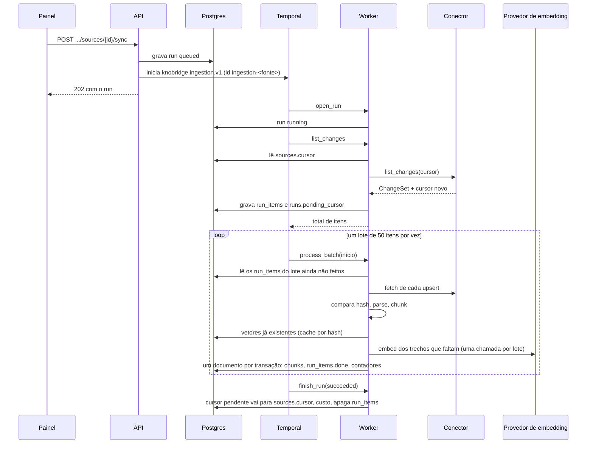

# Indexação e busca

> Rascunho v0.2 · 2026-10-11 · Em uso (planos 0003 e 0004)
>
> **Mudanças da v0.2** (plano 0004, F2.4): conhecimento do harness indexado pelo conector interno `knowledge` ([Conhecimento do harness](#conhecimento-do-harness)), gatilho `harness` e [sincronização pendente](#sincronização-pendente), citação `knowledge` no chat.

Como um documento lido por um conector vira trechos (chunks) com vetor no índice, como a sincronização roda no Temporal (manual ou agendada), quanto ela custa e como a busca híbrida encontra os trechos que viram citações no chat. A leitura das fontes está em [conectores.md](conectores.md); o uso da busca no chat, em [chat.md](chat.md#recuperação-de-fontes); as tabelas, em [modelo-de-dados.md](modelo-de-dados.md#índice-de-conhecimento); as decisões de arquitetura, no [ADR 0004](../adr/0004-indice-de-conhecimento.md).

Código:

- [`backend/src/knobridge/ingestion/`](../../backend/src/knobridge/ingestion/AGENTS.md): parsing, chunking, motor incremental, agendamento e gestão de coleções e fontes;
- [`backend/src/knobridge/workers/`](../../backend/src/knobridge/workers/AGENTS.md): workflows, activities e Temporal Schedules;
- [`backend/src/knobridge/retrieval/`](../../backend/src/knobridge/retrieval/AGENTS.md): busca híbrida e montagem das fontes do chat;
- [`backend/src/knobridge/llm/`](../../backend/src/knobridge/llm/AGENTS.md): adaptadores de embedding e preços.

## Visão geral

A sincronização agendada entra pelo mesmo caminho: o Temporal Schedule da fonte inicia o `ScheduledSyncWorkflow`, cuja activity chama o mesmo `start_sync` da API (ver [Agendamento](#agendamento)).

## Parsing

`ingestion/parsing.py` transforma cada `RawDocument` num `ParsedDocument`: Markdown mais o que é preciso para dividir e citar. O tipo (`ParsedKind`) decide o chunking.

| Entrada | Resultado |
|---|---|
| Commit (`DocumentKind.COMMIT`) | `commit`: Markdown gerado por `render_commit` (abaixo). |
| PDF, DOCX, XLSX, PPTX | `document`: conversor MarkItDown do formato, escolhido **pela extensão** (nunca por detecção de conteúdo, então arquivo corrompido falha em vez de ser lido como texto), rodado em `asyncio.to_thread`. Quebras de página do PDF viram linha em branco. Título: o do conversor, senão o primeiro `# `, senão o nome do arquivo. |
| `.html`/`.htm` que começa com `<!doctype html` ou `<html` | `document`: página convertida pelo MarkItDown, título do `<title>`. |
| Qualquer outro `.html`/`.htm` (template, fragmento) | `code` com linguagem `html`. |
| `.md`, `.markdown` | `markdown`, sem alteração. Título: primeiro `# `, senão o nome do arquivo. |
| Extensão de código conhecida (`CODE_LANGUAGES`: Python, TypeScript, TSX, JavaScript, JSX, Go, Java, Kotlin, C#, Rust, Ruby, PHP, C, C++, Swift, Pascal, SQL, shell, PowerShell, JSON, YAML, TOML, XML, CSS, SCSS, Vue, Svelte) | `code`: bloco cercado com a linguagem (cerca mais longa que qualquer sequência de crases do arquivo). |
| Demais | `text`, sem alteração. |

- **Encoding.** Texto é decodificado por `decode_text`, sempre igual para os mesmos bytes: UTF-8 (BOM removido), senão cp1252, senão latin-1 (que aceita qualquer byte). CRLF vira LF.
- **Erros por documento.** `unsupported_format` (`format: document` com extensão sem conversor, como `.doc`, ou texto com byte NUL) e `parse_failed` (conversor falhou ou documento sem texto extraível) viram um `RunError` na etapa `parse`, sem derrubar a execução. As mensagens são curtas e nunca levam conteúdo.

**Commits** (`ingestion/commits.py`). O conteúdo do documento de commit é só a mensagem completa ([conectores.md](conectores.md#commits-como-documentos)); SHA, autor, data e arquivos vêm dos metadados. O Markdown é `# <assunto>` (vazio: `Commit <sha12>`), as linhas `- Commit`, `- Autor` (só o nome; o e-mail nunca é renderizado) e `- Data` (ISO 8601, como veio), o corpo da mensagem (tudo depois da primeira linha) e a seção `## Arquivos alterados`, com até 200 arquivos e o status em pt-BR (`adicionado`, `modificado`, `removido`, `renomeado`...); quando há mais, a última linha é `- … e mais N arquivos`, contando também os que o conector cortou (`files_total`). Cada informação aparece uma vez só, em pt-BR. Os metadados são lidos de forma tolerante: campo ausente ou malformado é omitido, nunca falha.

## Chunking

`ingestion/chunking.py` produz `ChunkDraft`s numerados a partir de 0, na ordem do documento. Cada um tem:

- `content`: o texto embedado e indexado, com um cabeçalho curto de contexto (`path: …`, `symbol: …`, `section: …`) antes do corpo;
- `display`: só o corpo, usado como trecho citado;
- `meta`;
- `tokens`, estimados;
- `content_hash`: SHA-256 de `content`, a chave do cache de embedding.

**Limites** (`chunk_base.py`), em tokens estimados por `estimate_tokens` (caracteres / 4, o mesmo estimador dos lotes de embedding):

| Constante | Valor | Papel |
|---|---|---|
| `TARGET_TOKENS` | 400 | Tamanho que uma janela busca. |
| `MAX_TOKENS` | 800 | Maior unidade mantida inteira (seção, função, classe); acima disso, divide. |
| `OVERLAP_TOKENS` | 60 | Sobreposição entre janelas consecutivas de uma unidade dividida. |

O divisor por linhas faz janelas gulosas de cerca de `TARGET_TOKENS`, cada uma repetindo até `OVERLAP_TOKENS` do fim da anterior; linha maior que `MAX_TOKENS` é cortada por caracteres; linhas em branco nas bordas saem.

**Por tipo:**

- **Markdown e documentos convertidos**: corte nos títulos ATX fora de blocos cercados. Cada trecho leva o caminho de títulos (`headings`) no `meta` e na linha `section:` do texto embedado (`Título > Subtítulo`). Título sem corpo próprio não vira trecho (ele já está no caminho das subseções). Seção acima de `MAX_TOKENS` é dividida por linhas com sobreposição.
- **Código TypeScript, TSX, JavaScript/JSX e Go**: pela árvore sintática do tree-sitter (bindings oficiais e gramáticas em wheels, sem download em tempo de execução; `code_chunking.py`).
  - Unidades de topo: funções, classes, interfaces, tipos, enums e `const f = () => …` (TS/JS); funções, métodos (`Tipo.metodo`, com `parent` = tipo do receptor) e tipos (Go).
  - O comentário logo acima vai junto com a declaração; imports e constantes acompanham o vizinho.
  - Unidades pequenas vizinhas são juntadas até `TARGET_TOKENS` (o `symbol` vira a lista separada por vírgula).
  - Classe acima de `MAX_TOKENS` é trocada pelos métodos (`Classe.metodo`); qualquer outra unidade grande é dividida por linhas.
- **Fallback**: arquivo sem nenhum símbolo, código de linguagem sem gramática aqui (Python, Pascal, SQL, C#...) e texto simples viram janelas por linhas.
- **Commits**: um trecho com o Markdown renderizado; se passar de `MAX_TOKENS`, dividido por linhas, cada parte repetindo `# <assunto>` no texto embedado.

**Metadados** (`chunks.meta`):

| Chave | Quando |
|---|---|
| `path`, `symbol` | `path` sempre que há caminho, `symbol` em código. Alimentam o índice textual. |
| `start_line`, `end_line` | 1-based e inclusivas, no arquivo original, para Markdown, texto e código. Ausentes em documentos convertidos e commits, cujo Markdown é gerado. |
| `headings` | Markdown e documentos convertidos. |
| `language`, `parent`, `node_type` | Código (`node_type`: `function`, `method`, `class`, `interface`, `type`, `enum`, `struct`). |
| `sha`, `title`, `author`, `date` | Commits (`author` só o nome). |
| `display` | Gravado pelo motor junto com o trecho: o corpo sem o cabeçalho de embedding. |

## Conhecimento do harness

Fontes `runner` (plano 0004, decisão D15) passam pelo mesmo workflow, com o conector interno `knowledge` (`harness/knowledge_connector.py`), que `SettingsConnectorFactory` usa para todo tipo `runner` sem validar a config (ela é do runner). Diferente dos conectores de arquivos, ele lê o banco: os `knowledge_items` da fonte, numa transação no escopo do workspace, sem usuário.

- **Documentos**: um por item não descartado; `natural_key` = chave do item (`src-faturamento.R001`), `kind = knowledge`, `title` = título (o editado, se houver), `uri = knowledge:<chave>`. Conteúdo = [Markdown do item](harness.md#markdown-de-um-item), de `edited` quando houver.
- **Hash**: SHA-256 do Markdown **e** dos metadados de citação (módulo, confiança, título, evidências com excerto). Aprovar um item muda só a confiança e, por isso, também o reindexa.
- **Incremental**: o cursor (`{"kind": "knowledge", "version": 1, "items": {chave: hash}}`) compara os hashes; item novo é adicionado, hash diferente é alterado, item descartado ou apagado sai do índice.
- **Parsing**: o Markdown passa direto (`ParsedKind.KNOWLEDGE`), com o título do item.
- **Chunking**: por títulos, como Markdown, sem linhas (o Markdown é gerado). Texto embedado com o cabeçalho `item: <chave>` e `section: …`. `meta` de cada trecho: `kind` (`knowledge`), `item_key`, `module`, `confidence`, `title`, `headings` e `evidence` (`[{path, start_line, end_line, symbol, excerpt}]`): as evidências que o trecho cita com `[n]` (enriquecimento do módulo, até 10), ou, sem marcador (regras e seções sem citação), as 5 primeiras do item.
- **Citação**: `kind: knowledge`, com a confiança e as evidências ([Da busca à citação](#da-busca-à-citação)).

## Embeddings

- **A coleção define o embedding** (ADR 0004): credencial de provedor e modelo. A credencial tem de ser do mesmo workspace e de um tipo com embeddings (OpenAI, OpenRouter ou, fora de produção, `fake`). A Anthropic não oferece embeddings: `provider_embeddings_unsupported` (422).
- **Dimensão fixa de 1536** (`chunks.embedding vector(1536)`, índice HNSW `vector_cosine_ops`). O modelo padrão é `openai/text-embedding-3-small` no OpenRouter (`text-embedding-3-small` na OpenAI direta). Vetor de outra dimensão é `embedding_dimension_mismatch`; resposta com quantidade diferente de vetores, `embedding_invalid_response`.
- **Troca de modelo travada.** Com documentos na coleção, credencial e modelo não mudam mais (`collection_embedding_locked`, 409): para outro modelo, crie outra coleção e cadastre as fontes nela. Cada trecho registra o modelo que o gerou (`chunks.embedding_model`).
- **Lotes.** O motor faz uma chamada `embed` por lote de documentos. O adaptador divide o pedido em requisições de até 128 textos e 100 mil tokens estimados (`plan_batches`; um texto maior vai sozinho) e devolve os vetores na ordem da entrada.
- **Cache por hash.** Antes de chamar o provedor, o motor procura na mesma coleção trechos com o mesmo `content_hash` e o mesmo modelo e reaproveita o vetor. Só o que falta vai ao provedor. Documento sem mudança nem chega ao chunking: é pulado pelo hash do conteúdo (`documents.content_hash`).
- **Tokens.** Vêm do `usage` da resposta; sem ele, a estimativa local (`tokens_estimated`).
- **Chave.** A chave da credencial é decifrada só em memória, na hora da chamada, e o adaptador é sempre fechado depois.

## Execução

### Disparo e unicidade

`start_sync` (`ingestion/sync.py`) é a entrada comum da API (`POST .../sources/{id}/sync`, papel editor ou acima) e do agendamento:

1. confere a fonte (`source_not_found` 404; fonte desativada, `source_inactive` 409);
2. grava um `Run` `queued` com o gatilho (`manual`, `schedule` ou `harness`);
3. inicia o workflow `knobridge.ingestion.v1` com id `ingestion-<source_id>`, `ALLOW_DUPLICATE` + `FAIL`: depois de uma execução terminada pode vir outra, mas não duas ao mesmo tempo. **Uma execução por fonte**: se já há uma, o run recém-criado é apagado e a API responde `sync_already_running` (409). Temporal fora do ar: `sync_unavailable` (503) e nada é iniciado.

### Sincronização pendente

O harness pede sincronizações que não podem se perder: depois de cada resultado de tarefa ([runner.md](runner.md#post-v1runnerjobsjob_idresult), efeito 6) e de cada revisão de item ([harness.md](harness.md#revisão-e-exportação)). Elas entram por `request_sync` (`ingestion/sync.py`), com o gatilho `harness`:

1. tenta `start_sync`; se começou, pronto;
2. se já há execução da fonte (`sync_already_running`), trava a linha da fonte (`FOR UPDATE`) e procura uma execução `queued` ou `running`: havendo, grava `sources.sync_pending = true` e devolve "pendente" (sem execução);
3. não havendo (o workflow anterior já fechou a execução e está terminando), tenta `start_sync` mais uma vez; se ainda for recusado, grava a marca do mesmo jeito.

A marca é consumida pelo próprio workflow:

- `open_run` (`queued` → `running`) limpa a marca: essa execução lista a fonte depois, então já cobre o que foi pedido antes dela;
- `finish_run` com sucesso, numa fonte ativa com a marca, limpa a marca e grava uma execução nova `queued` com gatilho `harness`, cujo id a activity devolve; o workflow então faz `continue-as-new` com ela, com o mesmo id de workflow (a regra "uma execução por fonte" continua valendo);
- falha ou cancelamento deixam a marca para a próxima execução bem-sucedida.

`finish_run` trava a linha da fonte, como o passo 2: ou a execução que termina ainda aparece ativa e lê a marca depois do commit de quem a gravou, ou já aparece encerrada e quem pede começa a sua. Históricos gravados antes de a activity devolver o id são lidos como "sem continuação".

### Workflow `knobridge.ingestion.v1`

Workflow determinístico (`workers/ingestion.py`); todo IO fica nas activities (`workers/ingestion_activities.py`), cada uma com nome versionado, timeout e retry explícitos:

| Activity | Timeout | O que faz |
|---|---|---|
| `knobridge.ingestion.open_run.v1` | 30 s | `queued` → `running`, grava `started_at`. Retry não muda nada. |
| `knobridge.ingestion.list_changes.v1` | 1 h (heartbeat a cada 5 s, timeout de heartbeat 2 min) | Chama `list_changes` do conector **fora de transação**, grava o `ChangeSet` em `run_items` (adicionados e alterados como `upsert`, removidos como `remove`, cada um com um `ordinal`) e o cursor novo em `runs.pending_cursor`. Devolve só a contagem. Retry substitui os itens da tentativa anterior. |
| `knobridge.ingestion.process_batch.v1` | 30 min (heartbeat igual) | Processa os itens com `início <= ordinal < início + 50` ainda não feitos. |
| `knobridge.ingestion.finish_run.v1` | 30 s | Fecha a execução (abaixo). Execução já encerrada fica como está. Devolve o id da próxima execução quando consome uma [sincronização pendente](#sincronização-pendente), senão `null`. |

A lista de mudanças não passa pelo histórico do Temporal, que limita payloads a cerca de 2 MB. Ela fica em `run_items` e cada lote lê a sua página. Com `BATCH_SIZE` = 50, 10 mil arquivos dão 200 lotes e cerca de 1 400 eventos de histórico (o limite é 51 200).

**Um lote** (`ingestion/indexer.py`):

- remoções apagam o documento, e os trechos vão junto em cascata;
- cada upsert é lido (`fetch`) e comparado ao hash indexado: igual = pulado, sem custo;
- o que mudou passa por parsing e chunking, e depois pelo embedding com cache (seção anterior);
- erro de leitura (`ConnectorError`, menos `source_unavailable`) vira `RunError` na etapa `fetch`, e erro de parsing vira `RunError` na etapa `parse`. O lote segue.

**Uma transação por documento** (`ingestion/store.py`): upsert do `Document` pela chave natural, troca de todos os trechos dele, `run_items.done` e soma dos contadores da execução (`documents_new`, `documents_changed`, `documents_removed`, `documents_failed`, `chunks_written`) na mesma transação. Um lote reexecutado não grava nem conta duas vezes. Nenhuma transação fica aberta durante IO do conector ou do provedor. O worker não tem usuário: toda sessão é `scoped_session(workspace_id=<da execução>, user_id=None)`, e a RLS continua limitando ao workspace da execução.

### Retry, falha e cancelamento

- **Retry**: 5 tentativas, backoff de 2 s a 1 min. Só os erros transitórios se repetem: `source_unavailable`, `provider_unavailable` e `provider_rate_limited`. Os demais erros de domínio (chave recusada, modelo inexistente, cursor inválido) falham a execução na hora.
- **Falha**: activity que esgota as tentativas marca a execução `failed` com `runs.error` = `<código>: <mensagem>` (até 500 caracteres), e o workflow falha com `ingestion_failed`.
- **Cancelamento**: `POST .../sources/{id}/cancel` pede o cancelamento ao Temporal (sem execução rodando: `sync_not_running`, 409). O pedido chega à activity no próximo heartbeat, a execução é marcada `cancelled`, e o cancelamento se propaga. Excluir a fonte cancela a execução ativa.
- **Cursor só no sucesso**: `finish_run` copia `runs.pending_cursor` para `sources.cursor` apenas quando o status é `succeeded`. Uma execução que falhou ou foi cancelada é listada de novo, a partir do cursor anterior, na próxima vez; os documentos já gravados são pulados pelo hash. Em qualquer desfecho, `finish_run` grava `finished_at` e o custo e apaga os `run_items`.

## Agendamento

Cada fonte pode ter `schedule_cron` (cron de cinco campos, sempre em **UTC**, validado e normalizado com `croniter`; `source_schedule_invalid` se inválido) e `schedule_enabled`. Habilitado sem cron é recusado. A API devolve `next_run_at`, o próximo disparo calculado pelo relógio do servidor (`None` sem agendamento habilitado ou com a fonte desativada).

- **Temporal Schedules** (`workers/schedules.py`): uma fonte ativa com cron tem o schedule `source-schedule-<source_id>`, pausado quando `schedule_enabled` é falso. Fonte desativada ou sem cron não tem schedule.
- **Política do schedule**: `ScheduleOverlapPolicy.SKIP` e janela de recuperação de 1 h: um disparo perdido há mais tempo é descartado, e a próxima sincronização incremental recupera o que mudou.
- **Workflow do disparo**: o schedule inicia `knobridge.scheduled_sync.v1`, que roda uma única activity (`knobridge.scheduled_sync.start.v1`). A activity relê a fonte no banco, que é a fonte da verdade (sem agendamento habilitado ou apagada: `skipped`), e chama `start_sync(trigger=schedule)`.
  - Por isso a regra "uma execução por fonte" fica num lugar só e vale igual para disparo manual e agendado: com execução em andamento, o disparo é pulado sem erro (`scheduled_sync_skipped`).
  - Um schedule desatualizado nunca sincroniza fonte desabilitada, inativa ou apagada.
- **Espelhamento**: a API cria, atualiza ou remove o schedule quando a fonte é criada, excluída ou muda cron, `schedule_enabled` ou `active`.
- **Reconciliação**: com o Temporal fora do ar, a API salva a fonte assim mesmo e registra `source_schedule_deferred`. Na subida, o worker reconcilia tudo: cria os schedules que faltam, atualiza os divergentes e remove os órfãos com o prefixo. A comparação usa uma impressão digital do pedido (workspace, cron, fuso, fila) guardada na nota do schedule, mais o estado `paused`.

## Custo registrado

Cada execução guarda `embedding_tokens` (soma dos tokens das chamadas de embedding, inclusive as de tentativas repetidas, porque foram pagas) e `cost_usd`. O custo é calculado em `finish_run`, em qualquer desfecho, pela `EmbeddingPriceTable` (`llm/pricing.py`): USD por milhão de tokens, com 6 casas.

| Modelo | USD / 1M tokens |
|---|---|
| `text-embedding-3-small` e `openai/text-embedding-3-small` | 0,02 |
| `text-embedding-3-large` e `openai/text-embedding-3-large` | 0,13 |
| `text-embedding-ada-002` e `openai/text-embedding-ada-002` | 0,10 |

`KNOBRIDGE_EMBEDDING_PRICES` (JSON, ex.: `{"openai/text-embedding-3-small": 0.02}`) sobrescreve ou acrescenta preços. Modelo sem preço tem custo desconhecido (`null`), nunca zero. Documentos pulados pelo hash e trechos achados no cache não custam nada. O painel mostra tokens, custo, duração e as contagens de cada execução na tela da fonte.

## Busca híbrida

`SearchService.search` (`retrieval/search.py`) serve a rota "testar busca" (`POST .../collections/{id}/search`, qualquer membro; `query` até 2000 caracteres, `limit` padrão 10 e máximo 50, `min_similarity` padrão 0,35, calibrado pelo [ensaio com dados reais](../pesquisa/0001-ensaio-minski.md)) e o `HybridRetriever` do chat.

1. **Coleções e credenciais** numa consulta. Coleção ausente ou de outro workspace: 404 `not_found`.
2. **Embedding da pergunta**, um por par (credencial, modelo). Coleções com o mesmo modelo compartilham o vetor; vetores de modelos diferentes nunca se comparam.
3. **Braço vetorial**, por modelo: os `candidatos` mais próximos por distância de cosseno (`<=>`, índice HNSW, só trechos com aquele `embedding_model`). Os candidatos são `limit × 4`, entre 40 e 200, com `hnsw.ef_search` = 1000 (o máximo do pgvector) na transação, para compensar o filtro de workspace e coleção aplicado depois do índice e a recall do HNSW: no ensaio do plano 0004, 100 perdeu o trecho mais próximo de uma pergunta real numa coleção de 20 mil trechos (recall@10 de 0,90 contra a varredura exata; 0,98 com 1000). Um candidato só segue se `1 - distância >= min_similarity`.
4. **Braço textual (FTS)**, numa consulta: `websearch_to_tsquery` em `portuguese` OU em `simple` OU em `simple` sobre a pergunta com `/` e `.` trocados por espaço, contra `chunks.tsv`, ordenado por `ts_rank_cd`. `chunks.tsv` é uma coluna gerada pelo banco: `to_tsvector('portuguese', content)` mais `to_tsvector('simple', ...)` sobre o caminho (inteiro e quebrado em `/` e `.`) e o símbolo, com índice GIN.
5. **Fusão RRF** (Reciprocal Rank Fusion, `fusion.py`) sobre todos os rankings: `soma de 1 / (60 + posição)`. Não exige normalizar pontuações, que no cosseno e no `ts_rank_cd` vivem em escalas sem relação.
6. **Vizinhos removidos**: trecho do mesmo documento em posição adjacente, ou com faixa de linhas que se cruza, sai em favor do mais bem colocado.
7. **Carga**: os trechos escolhidos são lidos com o documento numa consulta. O número de statements é constante: 5, mais 1 por modelo extra.

**Limiar** (decisão D12 do plano 0003): um trecho entra se alcança `min_similarity` **ou** se casa a busca textual. `websearch_to_tsquery` é conjuntivo: exige todos os termos da pergunta, fora stop words. Casar o FTS já é sinal forte, e é o que acha identificadores exatos que o embedding perde. Uma pergunta sem relação com o índice não passa em nenhum dos dois e volta vazia. Trechos de modelo diferente do da coleção só aparecem pelo FTS. O reranker (`retrieval/rerank.py`) existe só como interface, sem uso.

Cada resultado traz `vector_similarity`, `fts_rank`, `fused_score`, o documento (tipo, chave natural, título, URI), `path`, `symbol`, linhas e `snippet` (corpo sem o cabeçalho, até 600 caracteres).

## Da busca à citação

O `HybridRetriever` (`retrieval/retriever.py`) lê as coleções e a similaridade mínima do assistente. Sem coleção, devolve vazio sem chamar o embedding. Com coleções, busca até 10 trechos e transforma cada um numa fonte (`retrieval/context.py`):

| Campo da citação | Origem |
|---|---|
| conteúdo enviado ao LLM | `meta.display` (corpo sem o cabeçalho de embedding) |
| `title` | caminho do arquivo, ou título do commit |
| `uri` | `<caminho>#L<início>-L<fim>` (texto, Markdown e código), `<caminho>` (documento convertido, sem linhas) ou `commit:<sha>` |
| `kind`, `path`, `symbol`, `start_line`, `end_line`, `language`, `sha`, `author`, `date` | `meta` do trecho (`null` quando não se aplica) |
| item de conhecimento (`kind = knowledge`) | `title` = título do item, `uri` = `knowledge:<chave>`, `confidence` e `evidence` (arquivo, linhas, símbolo, excerto) do `meta`; sem `path` nem linhas ([Conhecimento do harness](#conhecimento-do-harness)) |

As fontes ficam na ordem da busca e são cortadas pelo orçamento de 6000 tokens estimados; a numeração `[n]` é a posição nessa lista. Sem nenhuma fonte, o chat responde a mensagem de "sem fonte" sem chamar o LLM. Detalhes em [chat.md](chat.md#recuperação-de-fontes) e formato no fio em [chat-sse.md](chat-sse.md#citations).

## Referências

- MarkItDown: <https://github.com/microsoft/markitdown>
- tree-sitter (bindings Python): <https://github.com/tree-sitter/py-tree-sitter>
- pgvector (HNSW, `hnsw.ef_search`): <https://github.com/pgvector/pgvector>
- Busca textual do Postgres (`websearch_to_tsquery`, `ts_rank_cd`): <https://www.postgresql.org/docs/17/textsearch-controls.html>
- Reciprocal Rank Fusion (Cormack, Clarke e Büttcher, 2009): <https://plg.uwaterloo.ca/~gvcormac/cormacksigir09-rrf.pdf>
- Temporal Schedules: <https://docs.temporal.io/schedule>
- Limites de histórico e payload do Temporal: <https://docs.temporal.io/workflow-execution/limits>
- `croniter`: <https://github.com/kiorky/croniter>
