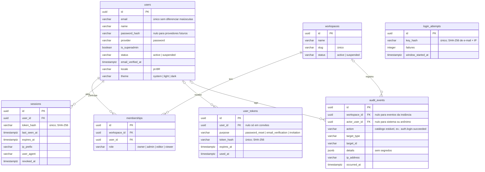

# Modelo de dados

> Rascunho v0.1 · 2026-10-10 · Em construção (plano 0002)

Tabelas do Postgres do KnoBridge, criadas pelas migrações em [`backend/migrations/`](../../backend/migrations/). Modelos ORM em `backend/src/knobridge/<módulo>/models.py`. Regras de tenancy e RLS no [ADR 0001](../adr/0001-tenancy-e-rls.md).

## Convenções

- Chave primária `id` UUID (gerada na aplicação ou por `gen_random_uuid()`).
- `created_at` e `updated_at` `timestamptz`, preenchidos pelo relógio do banco.
- Enums gravados como `varchar(32)` + `CHECK` (`ck_<tabela>_<coluna>`), com o valor em minúsculas.
- Nomes de restrição: `pk_<tabela>`, `uq_<tabela>_<colunas>`, `fk_<tabela>_<coluna>_<tabela_ref>`, `ix_<tabela>_<colunas>`.
- Tabela com dado de workspace: `workspace_id NOT NULL` e RLS `ENABLE` + `FORCE`.

## Escopo de RLS

| Configuração (por transação) | Quem define | Efeito |
|---|---|---|
| `app.workspace_id` | `scoped_session(workspace_id=...)` | Seleciona o workspace; já autorizado pela membership. |
| `app.user_id` | `scoped_session(user_id=...)` | Usuário autenticado; libera as próprias memberships e os workspaces dele. |
| `app.system` = `on` | `system_session()` | Modo de sistema: setup, superadmin, login. |

Sem nenhuma delas, as tabelas com RLS não retornam linhas. Exceção de modelo: `audit_events` aceita `workspace_id` nulo para eventos da instância, visíveis só em modo de sistema.

## Diagrama

## Tabelas

### `users`

Identidade da instância. Sem `workspace_id` e sem RLS.

| Coluna | Tipo | Regras |
|---|---|---|
| `email` | `varchar(320)` | Obrigatório; único por `lower(email)` (`uq_users_email_lower`). |
| `name` | `varchar(200)` | Obrigatório. |
| `password_hash` | `varchar(255)` | Opcional (identidades OIDC futuras não têm senha). |
| `provider` | `varchar(32)` | `password` (padrão). |
| `is_superadmin` | `boolean` | Padrão `false`. |
| `status` | `varchar(32)` | `active` (padrão) ou `suspended`. |
| `email_verified_at` | `timestamptz` | Nulo até a verificação. |
| `locale` | `varchar(16)` | Padrão `pt-BR`. |
| `theme` | `varchar(32)` | `system` (padrão), `light` ou `dark`. |

### `workspaces`

Tenant. RLS forçada.

| Coluna | Tipo | Regras |
|---|---|---|
| `name` | `varchar(200)` | Obrigatório. |
| `slug` | `varchar(64)` | Obrigatório; único (`uq_workspaces_slug`). |
| `status` | `varchar(32)` | `active` (padrão) ou `suspended`. |

Políticas: `workspaces_select` (selecionado, membro pelo `app.user_id` ou sistema) e `workspaces_write` (selecionado ou sistema).

### `memberships`

Papel de um usuário num workspace. RLS forçada.

| Coluna | Tipo | Regras |
|---|---|---|
| `workspace_id` | `uuid` | FK `workspaces.id`, `ON DELETE CASCADE`. |
| `user_id` | `uuid` | FK `users.id`, `ON DELETE CASCADE`; índice `ix_memberships_user_id`. |
| `role` | `varchar(32)` | `owner`, `admin`, `editor` ou `viewer`. |

Única por (`workspace_id`, `user_id`). Políticas: `memberships_select` (workspace selecionado, próprias memberships ou sistema) e `memberships_write` (workspace selecionado ou sistema).

### `sessions`

Sessão de login server-side ([ADR 0002](../adr/0002-sessao-server-side.md)). Dado da instância (sem `workspace_id`), com RLS forçada pelo dono: política `sessions_owner` (`user_id = app.user_id` ou sistema). Validação por token roda em modo de sistema.

| Coluna | Tipo | Regras |
|---|---|---|
| `user_id` | `uuid` | FK `users.id`, `ON DELETE CASCADE`; índice `ix_sessions_user_id`. |
| `token_hash` | `varchar(64)` | SHA-256 em hex do token do cookie; único (`uq_sessions_token_hash`). O token em claro nunca é gravado. |
| `last_seen_at` | `timestamptz` | Última validação. |
| `expires_at` | `timestamptz` | `last_seen_at + session_ttl` (expiração deslizante). |
| `ip_prefix` | `varchar(64)` | Prefixo de rede do IP (IPv4 /24, IPv6 /48); opcional. |
| `user_agent` | `varchar(200)` | User-agent truncado; opcional. |
| `revoked_at` | `timestamptz` | Nulo enquanto a sessão vale. |

`created_at` vem do relógio da aplicação (o mesmo da expiração).

### `user_tokens`

Token de uso único enviado por e-mail. Dado da instância, com RLS forçada pelo dono: política `user_tokens_owner` (`user_id = app.user_id` ou sistema). Emissão e consumo rodam em modo de sistema.

| Coluna | Tipo | Regras |
|---|---|---|
| `user_id` | `uuid` | FK `users.id`, `ON DELETE CASCADE`; índice `ix_user_tokens_user_id`. Obrigatório, exceto em convites (`ck_user_tokens_user_required`). |
| `purpose` | `varchar(32)` | `password_reset`, `email_verification` ou `invitation`. |
| `token_hash` | `varchar(64)` | SHA-256 em hex; único (`uq_user_tokens_token_hash`). |
| `expires_at` | `timestamptz` | Após este instante o token é recusado. |
| `used_at` | `timestamptz` | Preenchido no consumo; token usado é recusado. |

### `audit_events`

Trilha de auditoria, append-only ([`backend/src/knobridge/audit/`](../../backend/src/knobridge/audit/AGENTS.md)). Gravada pelo `AuditService.record` na mesma transação da mudança. Sem `created_at`/`updated_at`: a data é `occurred_at`, do relógio da aplicação. RLS forçada, com políticas separadas por comando:

- `audit_events_select`: `workspace_id = app.workspace_id` ou sistema. Eventos da instância (`workspace_id` nulo) só são legíveis em modo de sistema (superadmin).
- `audit_events_insert`: no workspace selecionado, evento da instância cujo ator é o `app.user_id`, ou sistema.
- `audit_events_delete`: só sistema (retenção).
- Sem política de UPDATE: nenhum evento é alterado, nem em modo de sistema.

| Coluna | Tipo | Regras |
|---|---|---|
| `workspace_id` | `uuid` | FK `workspaces.id`, `ON DELETE CASCADE`; nulo para eventos da instância (setup, login, superadmin). Índice `ix_audit_events_workspace_id_occurred_at` (`workspace_id`, `occurred_at`). |
| `actor_user_id` | `uuid` | FK `users.id`, `ON DELETE SET NULL`; nulo para o próprio sistema ou chamador anônimo (ex.: login falho). Índice `ix_audit_events_actor_user_id`. |
| `action` | `varchar(64)` | Obrigatório; valor do catálogo `AuditAction` (sem `CHECK`, para ação nova não exigir migração). Índice `ix_audit_events_action`. |
| `target_type` | `varchar(64)` | Tipo do alvo (ex.: `membership`); opcional. |
| `target_id` | `varchar(64)` | Id do alvo; opcional. |
| `details` | `jsonb` | Metadados da ação, padrão `{}`. Nunca segredo; dado pessoal só o necessário (chaves com `password`, `secret`, `token`, `cookie`, `authorization`, `api_key` são recusadas). |
| `ip_address` | `varchar(45)` | IP do chamador normalizado; opcional. |
| `occurred_at` | `timestamptz` | Obrigatório; relógio injetado da aplicação. |

### `login_attempts`

Limitação de tentativas de login ([ADR 0002](../adr/0002-sessao-server-side.md)), em `backend/src/knobridge/security/throttle.py`. Uma linha por chave: o SHA-256 de `lower(email)|ip`, de modo que a tabela não guarda e-mail nem IP. Janela fixa contada da primeira falha (`login_attempt_window`, padrão 15 min); atingido `login_max_attempts` (padrão 5) dentro da janela, o login responde 429 até ela acabar, mesmo com a senha certa. Login bem-sucedido apaga a linha. Sem `created_at`/`updated_at`: as datas vêm do relógio da aplicação. RLS forçada com uma única política, `login_attempts_system` (só modo de sistema), porque quem tenta logar ainda é anônimo.

| Coluna | Tipo | Regras |
|---|---|---|
| `key_hash` | `varchar(64)` | SHA-256 em hex da chave; único (`uq_login_attempts_key_hash`). |
| `failures` | `integer` | Falhas na janela atual. |
| `window_started_at` | `timestamptz` | Primeira falha da janela atual; janela vencida recomeça em 1 na próxima falha. |
