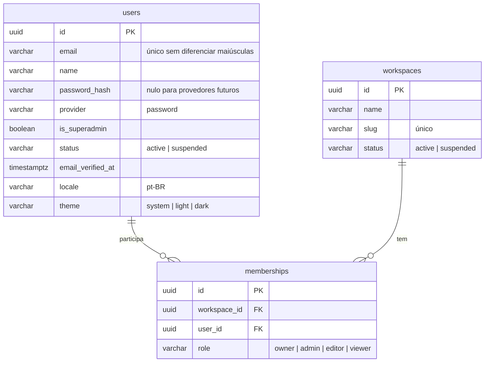

# Modelo de dados

> Rascunho v0.1 · 2026-10-10 · Em construção (plano 0002)

Tabelas do Postgres do KnoBridge, criadas pelas migrações em [`backend/migrations/`](../../backend/migrations/). Modelos ORM em `backend/src/knobridge/<módulo>/models.py`. Regras de tenancy e RLS no [ADR 0001](../adr/0001-tenancy-e-rls.md).

## Convenções

- Chave primária `id` UUID (gerada na aplicação ou por `gen_random_uuid()`).
- `created_at` e `updated_at` `timestamptz`, preenchidos pelo relógio do banco.
- Enums gravados como `varchar(32)` + `CHECK` (`ck_<tabela>_<coluna>`), com o valor em minúsculas.
- Nomes de restrição: `pk_<tabela>`, `uq_<tabela>_<colunas>`, `fk_<tabela>_<coluna>_<tabela_ref>`, `ix_<tabela>_<colunas>`.
- Tabela com dado de workspace: `workspace_id NOT NULL` e RLS `ENABLE` + `FORCE`.

## Escopo de RLS

| Configuração (por transação) | Quem define | Efeito |
|---|---|---|
| `app.workspace_id` | `scoped_session(workspace_id=...)` | Seleciona o workspace; já autorizado pela membership. |
| `app.user_id` | `scoped_session(user_id=...)` | Usuário autenticado; libera as próprias memberships e os workspaces dele. |
| `app.system` = `on` | `system_session()` | Modo de sistema: setup, superadmin, login. |

Sem nenhuma delas, as tabelas com RLS não retornam linhas.

## Diagrama

## Tabelas

### `users`

Identidade da instância. Sem `workspace_id` e sem RLS.

| Coluna | Tipo | Regras |
|---|---|---|
| `email` | `varchar(320)` | Obrigatório; único por `lower(email)` (`uq_users_email_lower`). |
| `name` | `varchar(200)` | Obrigatório. |
| `password_hash` | `varchar(255)` | Opcional (identidades OIDC futuras não têm senha). |
| `provider` | `varchar(32)` | `password` (padrão). |
| `is_superadmin` | `boolean` | Padrão `false`. |
| `status` | `varchar(32)` | `active` (padrão) ou `suspended`. |
| `email_verified_at` | `timestamptz` | Nulo até a verificação. |
| `locale` | `varchar(16)` | Padrão `pt-BR`. |
| `theme` | `varchar(32)` | `system` (padrão), `light` ou `dark`. |

### `workspaces`

Tenant. RLS forçada.

| Coluna | Tipo | Regras |
|---|---|---|
| `name` | `varchar(200)` | Obrigatório. |
| `slug` | `varchar(64)` | Obrigatório; único (`uq_workspaces_slug`). |
| `status` | `varchar(32)` | `active` (padrão) ou `suspended`. |

Políticas: `workspaces_select` (selecionado, membro pelo `app.user_id` ou sistema) e `workspaces_write` (selecionado ou sistema).

### `memberships`

Papel de um usuário num workspace. RLS forçada.

| Coluna | Tipo | Regras |
|---|---|---|
| `workspace_id` | `uuid` | FK `workspaces.id`, `ON DELETE CASCADE`. |
| `user_id` | `uuid` | FK `users.id`, `ON DELETE CASCADE`; índice `ix_memberships_user_id`. |
| `role` | `varchar(32)` | `owner`, `admin`, `editor` ou `viewer`. |

Única por (`workspace_id`, `user_id`). Políticas: `memberships_select` (workspace selecionado, próprias memberships ou sistema) e `memberships_write` (workspace selecionado ou sistema).
