# Modelo de dados

> v1.2 · 2026-10-14 · Em uso (planos 0002 a 0005, 0008 e 0009; plano 0010 em implementação)
>
> **Mudanças da v1.2** (plano 0010, F1.1; [ADR 0009](../adr/0009-canais-mcp-e-widget.md)), em duas migrações: `0020` (F3.1), tabelas [`widgets`](#widgets) e [`rate_limit_counters`](#rate_limit_counters), canal `widget`, `conversations.widget_id`, o hash do token do visitante e a identidade assinada, um dono por conversa entre pessoa, chave e widget, e `feedback.user_id` opcional (feedback do visitante); `0021` (F2.2), canal `mcp` em `conversations` e `messages` (conversa da chave) e `ticket_requests.user_id` opcional. A ordem segue a execução do plano (decisão D8).
>
> **Mudanças da v1.1**: migração `0019` (plano 0009, F2.2): `products` perde `credential_id`, `model` e `temperature` (a resposta usa os do nível da conversa, em [`workspace_levels`](#workspace_levels)); o lote de ingestão passa a gravar `documents.min_level` e `chunks.min_level` (o maior entre fonte, documento e trecho) e a mudança do nível de uma fonte recalcula `chunks.min_level` sem reindexar ([indexacao.md](indexacao.md#nível-mínimo)).
>
> **Mudanças da v1.0**: migração `0018` (plano 0009, F1.2; [ADR 0008](../adr/0008-produtos-e-niveis.md), contrato em [produtos-e-niveis.md](produtos-e-niveis.md)): `assistants` vira [`products`](#products) com os mesmos ids (`system_prompt` vira `instructions`) e `assistant_collections` vira [`product_collections`](#product_collections); `conversations.product_id`, `ticket_requests.product_id` e `api_keys.product_ids` no lugar dos `assistant_*`, com os mesmos valores; tabelas novas [`workspace_levels`](#workspace_levels) e [`member_product_levels`](#member_product_levels); `level` em `conversations` e `messages` (que ganha também `product_id`), `max_level` em `api_keys`; nível mínimo em `sources`, `documents` e `chunks` ([Nível mínimo no índice](#nível-mínimo-no-índice)); `invitations.product_levels`; `sources.kind` aceita `cards`, `documents.kind` e `run_items.document_kind` aceitam `card` ([cards.md](cards.md)).
>
> **Mudanças da v0.9**: migração `0017` (plano 0008, F1.2): tabela `api_keys` (chaves da API pública, [ADR 0007](../adr/0007-chaves-e-api-publica.md), contrato em [api-publica.md](api-publica.md)); `conversations` aceita o canal `api` e um dono do tipo chave (`user_id` opcional, `api_key_id`, exatamente um dos dois); `messages` ganha `channel` e `cost_usd` ([chat.md](chat.md#custo-e-canal-por-resposta)); `sessions` ganha o acesso de superadmin da sessão (`superadmin_workspace_id`, `superadmin_entered_at`; [autenticacao.md](autenticacao.md#acesso-de-superadmin-a-um-workspace)).
>
> **Mudanças da v0.8**: migração `0016` (plano 0005, F1.2): tabelas de chamados `ingest_tokens`, `ticket_inbox` e `ticket_requests` ([ADR 0006](../adr/0006-chamados-por-push.md), contrato em [chamados.md](chamados.md)); `assistants` ganha o webhook de pedido de chamado (`ticket_webhook_url`, `ticket_webhook_secret_ciphertext`, `ticket_webhook_secret_created_at`); `sources.kind` aceita `tickets`, `runs.trigger` aceita `ingest` e `documents.kind`/`run_items.document_kind` aceitam `ticket`.
>
> **Mudanças da v0.7**: migração `0015` (plano 0004, F2.4): `runs.trigger` aceita `harness` (sincronização pedida por um resultado do harness ou por uma revisão de conhecimento) e `sources.sync_pending` guarda uma sincronização pedida enquanto outra da fonte estava em andamento ([indexacao.md](indexacao.md#sincronização-pendente)).
>
> **Mudanças da v0.6**: migração `0014` (plano 0004, F1.2): tabelas do harness de código `runners`, `harness_modules`, `harness_jobs`, `knowledge_items` e `harness_rejections` ([ADR 0005](../adr/0005-runner-local-do-harness.md)); `sources.kind` aceita `runner` (com o par `(runner_id, repository)` único no workspace) e `documents.kind`/`run_items.document_kind` aceitam `knowledge`.
>
> **Mudanças da v0.5**: migração `0013`: padrão de `assistants.min_similarity` de 0,3 para 0,35 ([ensaio com dados reais](../pesquisa/0001-ensaio-minski.md)); valores gravados não mudam.
>
> **Mudanças da v0.4**: migração `0012` (plano 0003, F4.2): `assistant_collections` (coleções que cada assistente consulta) e `assistants.min_similarity` (limiar da busca do chat).
>
> **Mudanças da v0.3**: índice de conhecimento da migração `0010` (plano 0003, F1.1): `collections`, `sources`, `runs`, `run_errors`, `documents` e `chunks`, com `vector(1536)`, HNSW e `tsvector` gerado ([ADR 0004](../adr/0004-indice-de-conhecimento.md)). Migração `0011` (plano 0003, F3.1): `run_items` (trabalho pendente de uma execução), `runs.pending_cursor` e o índice do cache de embedding em `chunks`.

Tabelas do Postgres do KnoBridge, criadas pelas migrações em [`backend/migrations/`](../../backend/migrations/AGENTS.md). Modelos ORM em `backend/src/knobridge/<módulo>/models.py`. Produtos e níveis de resposta no [ADR 0008](../adr/0008-produtos-e-niveis.md) e em [produtos-e-niveis.md](produtos-e-niveis.md). Regras de tenancy e RLS no [ADR 0001](../adr/0001-tenancy-e-rls.md); sessão, tokens e limitação de login no [ADR 0002](../adr/0002-sessao-server-side.md); segredos cifrados no [ADR 0003](../adr/0003-segredos-cifrados.md); índice de conhecimento no [ADR 0004](../adr/0004-indice-de-conhecimento.md); harness de código com runner local no [ADR 0005](../adr/0005-runner-local-do-harness.md); chamados por push no [ADR 0006](../adr/0006-chamados-por-push.md); chaves e API pública no [ADR 0007](../adr/0007-chaves-e-api-publica.md). Autenticação e papéis em [autenticacao.md](autenticacao.md); chat em [chat.md](chat.md).

## Migrações

| Revisão | Arquivo | O que faz |
|---|---|---|
| `0001` | `20261010_0001_enable_pgvector.py` | Habilita a extensão `vector` (pgvector), usada por `chunks.embedding` (`0010`). |
| `0002` | `20261010_0002_tenancy.py` | `users`, `workspaces`, `memberships`; RLS forçada em `workspaces` e `memberships`. |
| `0003` | `20261010_0003_sessions_and_user_tokens.py` | `sessions` e `user_tokens`, com RLS forçada pelo dono. |
| `0004` | `20261010_0004_audit_events.py` | `audit_events`, append-only, com políticas separadas de leitura, inserção e exclusão. |
| `0005` | `20261010_0005_login_attempts.py` | `login_attempts`, só em modo de sistema. |
| `0006` | `20261010_0006_invitations.py` | `invitations`; `user_tokens.workspace_id` (só convites) e política `user_tokens_owner` ampliada ([emenda do ADR 0001](../adr/0001-tenancy-e-rls.md#emenda-2026-10-10-tokens-de-convite-com-workspace_id)). |
| `0007` | `20261010_0007_provider_credentials.py` | `provider_credentials` (chave cifrada). |
| `0008` | `20261010_0008_assistants.py` | `assistants`; único `(workspace_id, id)` em `provider_credentials`. |
| `0009` | `20261010_0009_conversations.py` | `conversations`, `messages`, `feedback`; único `(workspace_id, id)` em `assistants`. |
| `0010` | `20261010_0010_knowledge_index.py` | Índice de conhecimento: `collections`, `sources`, `runs`, `run_errors`, `documents`, `chunks`; HNSW cosseno em `chunks.embedding` e GIN em `chunks.tsv` (gerado). |
| `0011` | `20261010_0011_run_items.py` | `run_items` (documentos pendentes de uma execução, RLS forçada), `runs.pending_cursor` e `ix_chunks_collection_id_content_hash` (cache de embedding). |
| `0012` | `20261010_0012_assistant_collections.py` | `assistant_collections` (vínculo N:N assistente ↔ coleção, RLS forçada) e `assistants.min_similarity` (0 a 1, padrão 0,3). |
| `0013` | `20261011_0013_raise_min_similarity_default.py` | Padrão de `assistants.min_similarity` passa de 0,3 para 0,35; valores gravados ficam. |
| `0014` | `20261011_0014_harness.py` | Harness de código: `runners`, `harness_modules`, `harness_jobs`, `knowledge_items`, `harness_rejections` (RLS forçada); `sources.kind` aceita `runner` e ganha `uq_sources_workspace_id_runner_repository`; `documents.kind` e `run_items.document_kind` aceitam `knowledge`. O `downgrade` falha se houver fonte `runner` ou documento `knowledge` (não apaga dados). |
| `0015` | `20261011_0015_harness_sync.py` | `runs.trigger` aceita `harness`; `sources.sync_pending` (`boolean`, padrão `false`). O `downgrade` falha se houver execução `harness` (não reescreve o histórico). |
| `0016` | `20261012_0016_tickets.py` | Chamados: `ingest_tokens`, `ticket_inbox`, `ticket_requests` (RLS forçada); `assistants.ticket_webhook_url`, `ticket_webhook_secret_ciphertext` e `ticket_webhook_secret_created_at`; `sources.kind` aceita `tickets`, `runs.trigger` aceita `ingest`, `documents.kind` e `run_items.document_kind` aceitam `ticket`. O `downgrade` falha se houver fonte `tickets`, execução `ingest` ou documento `ticket` (não apaga dados). |
| `0017` | `20261012_0017_api_keys_and_usage.py` | `api_keys` (RLS forçada); `conversations.user_id` opcional, `conversations.api_key_id` e canal `api`; `messages.channel` (as existentes ficam `panel`) e `messages.cost_usd`; `sessions.superadmin_workspace_id` e `superadmin_entered_at`. O `downgrade` falha se houver conversa da API (não apaga dados). |
| `0018` | `20261013_0018_products_and_levels.py` | Produtos e níveis ([migração dos assistentes](#migração-dos-assistentes-0018)): `assistants` → `products` e `assistant_collections` → `product_collections` (mesmos ids, restrições e políticas renomeadas); `product_id` em `conversations`, `messages` e `ticket_requests`, `product_ids` em `api_keys`; `workspace_levels` e `member_product_levels` (RLS forçada); `level` em `conversations` e `messages`, `max_level` em `api_keys`; `min_level` em `sources`, `documents` e `chunks`; `invitations.product_levels`; `sources.kind` aceita `cards`, `documents.kind` e `run_items.document_kind` aceitam `card`. Os passos de dados rodam em modo de sistema. O `downgrade` falha se houver produto criado depois da migração, conversa ou chave abaixo de `product_dev`, nível gravado de membro, convite com níveis ou fonte `cards`. |
| `0020` | `20261014_0020_widgets.py` | F3.1: `widgets` (RLS forçada) e `rate_limit_counters` (só modo de sistema); `conversations.widget_id`, `visitor_token_hash`, `visitor_external_id`, `visitor_name` e `visitor_email`; canal `widget` em `conversations` e `messages`; `ck_conversations_one_owner` passa a `num_nonnulls(user_id, api_key_id, widget_id) = 1`, com `ck_conversations_widget_when_widget` e `ck_conversations_visitor_token_when_widget`; `feedback.user_id` deixa de ser `NOT NULL`, com o índice único parcial `uq_feedback_message_id_visitor`. O `downgrade` falha se houver widget, conversa `widget` ou feedback sem usuário. |

Prevista no plano 0010 (o nome do arquivo segue a data em que a migração for escrita):

| Revisão | Arquivo | O que faz |
|---|---|---|
| `0021` | `20261014_0021_mcp_channel.py` | F2.2: `ck_conversations_channel` e `ck_messages_channel` aceitam `mcp`; `ck_conversations_api_key_when_api` passa a `(channel IN ('api', 'mcp')) = (api_key_id IS NOT NULL)`; `ticket_requests.user_id` deixa de ser `NOT NULL`. O `downgrade` falha se houver conversa ou mensagem `mcp` ou pedido de chamado sem usuário (não apaga dados). |

Toda migração tem `downgrade` que desfaz o `upgrade`; o teste `test_migrations_match_orm_models` compara as migrações com os modelos ORM.

## Convenções

- Chave primária `id` UUID (gerada na aplicação ou por `gen_random_uuid()`).
- `created_at` e `updated_at` `timestamptz`, preenchidos pelo relógio do banco.
- Enums gravados como `varchar(32)` + `CHECK` (`ck_<tabela>_<coluna>`), com o valor em minúsculas.
- Nomes de restrição: `pk_<tabela>`, `uq_<tabela>_<colunas>`, `fk_<tabela>_<coluna>_<tabela_ref>`, `ix_<tabela>_<colunas>`.
- Tabela com dado de workspace: `workspace_id NOT NULL` e RLS `ENABLE` + `FORCE`.

## Escopo de RLS

| Configuração (por transação) | Quem define | Efeito |
|---|---|---|
| `app.workspace_id` | `scoped_session(workspace_id=...)` | Seleciona o workspace; já autorizado pela membership. |
| `app.user_id` | `scoped_session(user_id=...)` | Usuário autenticado; libera as próprias memberships e os workspaces dele. |
| `app.system` = `on` | `system_session()` | Modo de sistema: setup, superadmin, login. |

Sem nenhuma delas, as tabelas com RLS não retornam linhas. Exceção de modelo: `audit_events` aceita `workspace_id` nulo para eventos da instância, visíveis só em modo de sistema.

As políticas leem as configurações com `NULLIF(current_setting('app.workspace_id', true), '')::uuid`, `NULLIF(current_setting('app.user_id', true), '')::uuid` e `coalesce(current_setting('app.system', true), '') = 'on'`. Abaixo, "workspace" é `workspace_id = app.workspace_id`, "usuário" é `user_id = app.user_id` e "sistema" é `app.system = 'on'`.

### Resumo das políticas

Todas as tabelas abaixo têm `ENABLE` + `FORCE ROW LEVEL SECURITY`. `users` é a única sem RLS (identidade da instância; ADR 0001, item 1).

| Tabela | Política | Comando | Predicado |
|---|---|---|---|
| `workspaces` | `workspaces_select` | `SELECT` | `id` = workspace selecionado, ou o usuário tem membership nele, ou sistema |
| `workspaces` | `workspaces_write` | `ALL` | `id` = workspace selecionado, ou sistema |
| `memberships` | `memberships_select` | `SELECT` | workspace, ou usuário (as próprias memberships), ou sistema |
| `memberships` | `memberships_write` | `ALL` | workspace, ou sistema |
| `sessions` | `sessions_owner` | `ALL` | usuário, ou sistema |
| `user_tokens` | `user_tokens_owner` | `ALL` | usuário, ou workspace (tokens de convite), ou sistema |
| `audit_events` | `audit_events_select` | `SELECT` | workspace, ou sistema |
| `audit_events` | `audit_events_insert` | `INSERT` | workspace, ou (`workspace_id` nulo e `actor_user_id` = `app.user_id`), ou sistema |
| `audit_events` | `audit_events_delete` | `DELETE` | sistema |
| `login_attempts` | `login_attempts_system` | `ALL` | sistema |
| `invitations` | `invitations_workspace` | `ALL` | workspace, ou sistema |
| `provider_credentials` | `provider_credentials_workspace` | `ALL` | workspace, ou sistema |
| `products` | `products_select`, `products_insert`, `products_update`, `products_delete` | um por comando | workspace, ou sistema |
| `conversations` | `conversations_workspace` | `ALL` | workspace, ou sistema |
| `messages` | `messages_workspace` | `ALL` | workspace, ou sistema |
| `feedback` | `feedback_workspace` | `ALL` | workspace, ou sistema |
| `collections` | `collections_workspace` | `ALL` | workspace, ou sistema |
| `sources` | `sources_workspace` | `ALL` | workspace, ou sistema |
| `runs` | `runs_workspace` | `ALL` | workspace, ou sistema |
| `run_errors` | `run_errors_workspace` | `ALL` | workspace, ou sistema |
| `documents` | `documents_workspace` | `ALL` | workspace, ou sistema |
| `chunks` | `chunks_workspace` | `ALL` | workspace, ou sistema |
| `run_items` | `run_items_workspace` | `ALL` | workspace, ou sistema |
| `product_collections` | `product_collections_workspace` | `ALL` | workspace, ou sistema |
| `workspace_levels` | `workspace_levels_workspace` | `ALL` | workspace, ou sistema |
| `member_product_levels` | `member_product_levels_workspace` | `ALL` | workspace, ou sistema |
| `runners` | `runners_workspace` | `ALL` | workspace, ou sistema (a autenticação do runner busca por `token_prefix` em modo de sistema) |
| `harness_modules` | `harness_modules_workspace` | `ALL` | workspace, ou sistema |
| `harness_jobs` | `harness_jobs_workspace` | `ALL` | workspace, ou sistema |
| `knowledge_items` | `knowledge_items_workspace` | `ALL` | workspace, ou sistema |
| `harness_rejections` | `harness_rejections_workspace` | `ALL` | workspace, ou sistema |
| `ingest_tokens` | `ingest_tokens_workspace` | `ALL` | workspace, ou sistema (a verificação do token de envio busca por `token_prefix` em modo de sistema) |
| `ticket_inbox` | `ticket_inbox_workspace` | `ALL` | workspace, ou sistema |
| `ticket_requests` | `ticket_requests_workspace` | `ALL` | workspace, ou sistema |
| `api_keys` | `api_keys_workspace` | `ALL` | workspace, ou sistema (a autenticação da chave busca por `key_prefix` em modo de sistema) |
| `widgets` | `widgets_workspace` | `ALL` | workspace, ou sistema (as rotas públicas buscam o widget por `public_key` em modo de sistema; `0020`) |
| `rate_limit_counters` | `rate_limit_counters_system` | `ALL` | sistema (`0020`) |

A RLS isola workspaces; regras dentro do workspace (papel mínimo, privacidade de conversa entre membros) são da aplicação ([autenticacao.md](autenticacao.md#matriz-de-permissões)). Cada consulta tem teste de isolamento contra Postgres real, junto dos testes do seu módulo (ex.: `backend/tests/tenancy/test_invitations_rls.py`).

## Diagrama

```mermaid
erDiagram
    users ||--o{ memberships : "participa"
    workspaces ||--o{ memberships : "tem"
    users ||--o{ sessions : "abre"
    users |o--o{ user_tokens : "recebe"
    workspaces |o--o{ user_tokens : "emite convite"
    workspaces ||--o{ invitations : "convida"
    user_tokens ||--o| invitations : "link atual"
    users |o--o{ invitations : "convidou"
    workspaces |o--o{ audit_events : "registra"
    users |o--o{ audit_events : "age"
    workspaces ||--o{ provider_credentials : "guarda"
    provider_credentials {
        uuid id PK
        uuid workspace_id FK
        varchar name "único por workspace"
        varchar kind "openai | anthropic | openrouter | fake"
        varchar base_url "opcional"
        text key_ciphertext "AES-GCM; v1.base64url"
        varchar key_last4 "exibição ****1234"
    }
    workspaces ||--o{ products : "configura"
    products {
        uuid id PK "o do assistente de origem"
        uuid workspace_id FK
        varchar name "único por workspace; sem :nível no fim"
        text instructions "texto extra do produto"
        varchar language "pt-BR"
        varchar tone "neutral | formal | friendly"
        text no_source_message "nunca vazia"
        boolean active
        float min_similarity "0 a 1"
        varchar ticket_webhook_url "nulo = desligado"
        text ticket_webhook_secret_ciphertext "AES-GCM; v1.base64url"
    }
    products ||--o{ product_collections : "consulta"
    collections ||--o{ product_collections : "consultada por"
    product_collections {
        uuid workspace_id FK
        uuid product_id PK "mesmo workspace"
        uuid collection_id PK "mesmo workspace"
    }
    workspaces ||--|{ workspace_levels : "configura"
    provider_credentials |o--o{ workspace_levels : "usada por"
    workspace_levels {
        uuid workspace_id PK
        varchar level PK "end_user | support | product_dev"
        uuid credential_id FK "nulo = sem modelo"
        varchar model "nulo = sem modelo"
        float temperature "0 a 2"
        text instructions "nulo = texto padrão"
    }
    products ||--o{ member_product_levels : "limita"
    memberships ||--o{ member_product_levels : "tem"
    member_product_levels {
        uuid workspace_id FK
        uuid product_id PK "mesmo workspace"
        uuid user_id PK "membro do workspace"
        varchar max_level "valor gravado; sem linha = padrão do papel"
    }
    products ||--o{ conversations : "atende"
    users |o--o{ conversations : "conversa"
    workspaces ||--o{ api_keys : "emite"
    users |o--o{ api_keys : "criou"
    api_keys {
        uuid id PK
        uuid workspace_id FK
        varchar name "único por workspace"
        varchar key_prefix "único na instância"
        varchar key_hash "SHA-256"
        uuid_array product_ids "nulo = todos"
        varchar max_level "end_user | support | product_dev"
        uuid created_by FK
        timestamptz last_used_at
        timestamptz revoked_at
    }
    api_keys |o--o{ conversations : "conversa"
    products ||--o{ widgets : "publica"
    users |o--o{ widgets : "criou"
    widgets {
        uuid id PK
        uuid workspace_id FK
        uuid product_id FK "mesmo workspace"
        varchar name "único por workspace"
        varchar public_key "kbp_; único na instância"
        text_array allowed_origins "1 a 50"
        boolean active
        varchar mode "bubble | inline"
        integer messages_per_ip_per_hour
        integer messages_per_day
        text signing_secret_ciphertext "AES-GCM; nulo = sem identidade"
    }
    widgets |o--o{ conversations : "conversa"
    conversations {
        uuid id PK
        uuid workspace_id FK
        uuid product_id FK "mesmo workspace"
        varchar level "fixo na conversa"
        uuid user_id FK "dono no painel"
        uuid api_key_id FK "dona na API e no MCP, mesmo workspace"
        uuid widget_id FK "dono no widget, mesmo workspace"
        varchar visitor_token_hash "SHA-256 do kbv_; só widget"
        varchar title "da primeira pergunta"
        varchar channel "panel | api | mcp | widget"
    }
    conversations ||--o{ messages : "contém"
    messages {
        uuid id PK
        uuid workspace_id FK
        uuid conversation_id FK "mesmo workspace"
        integer position "único por conversa"
        varchar role "user | assistant"
        text content
        jsonb citations
        varchar status "streaming | completed | no_source | failed | interrupted"
        varchar error_code
        varchar model
        integer latency_ms
        numeric cost_usd "estimado; nulo sem preço"
        varchar channel "panel | api | mcp | widget"
        uuid product_id "o da conversa"
        varchar level "o da conversa"
    }
    messages ||--o{ feedback : "recebe"
    users |o--o{ feedback : "avalia"
    feedback {
        uuid id PK
        uuid workspace_id FK
        uuid message_id FK "mesmo workspace"
        uuid user_id FK "nulo = visitante do widget"
        varchar rating "up | down"
        text comment
    }
    workspaces ||--o{ collections : "indexa"
    provider_credentials ||--o{ collections : "gera embeddings"
    collections {
        uuid id PK
        uuid workspace_id FK
        varchar name "único por workspace"
        uuid credential_id FK "mesmo workspace"
        varchar embedding_model
        integer embedding_dimension "sempre 1536"
    }
    collections ||--o{ sources : "recebe"
    sources {
        uuid id PK
        uuid workspace_id FK
        uuid collection_id FK "mesmo workspace"
        varchar kind "git | folder | runner | tickets | cards"
        varchar name "único por workspace"
        varchar min_level "padrão por tipo"
        jsonb config "validado por tipo"
        text_array include_globs
        text_array exclude_globs
        varchar schedule_cron
        boolean schedule_enabled
        boolean sync_pending
        jsonb cursor "posição incremental"
        boolean active
    }
    sources ||--o{ runs : "executa"
    runs {
        uuid id PK
        uuid workspace_id FK
        uuid source_id FK "mesmo workspace"
        varchar trigger "manual | schedule | harness | ingest"
        varchar status "queued | running | succeeded | failed | cancelled"
        integer documents_new
        integer chunks_written
        integer embedding_tokens
        numeric cost_usd
        varchar error "resumo"
    }
    runs ||--o{ run_errors : "registra"
    runs ||--o{ run_items : "pendente"
    run_items {
        uuid run_id PK "FK, mesmo workspace"
        integer ordinal PK
        uuid workspace_id FK
        text document_key
        varchar document_kind "file | commit | knowledge | ticket"
        varchar change "upsert | remove"
        boolean done
    }
    run_errors {
        uuid id PK
        uuid workspace_id FK
        uuid run_id FK "mesmo workspace"
        text document_key
        varchar stage "fetch | parse | chunk | embed | store"
        varchar code
        varchar message
    }
    workspaces ||--o{ runners : "registra"
    runners {
        uuid id PK
        uuid workspace_id FK
        varchar name "único por workspace"
        varchar token_prefix "único na instância"
        varchar token_hash "SHA-256 do token"
        timestamptz last_seen_at
        jsonb capabilities
        timestamptz revoked_at
    }
    sources ||--o{ harness_modules : "divide em"
    harness_modules {
        uuid id PK
        uuid workspace_id FK
        uuid source_id FK "fonte runner"
        varchar key "único por fonte"
        text_array paths "1 a 50 padrões"
        boolean suggested
        boolean enabled
        varchar last_commit
    }
    harness_modules ||--o{ harness_jobs : "mapeado por"
    runners |o--o{ harness_jobs : "reserva"
    harness_jobs {
        uuid id PK
        uuid workspace_id FK
        uuid module_id FK
        uuid runner_id FK "nulo antes da reserva"
        varchar status "queued | leased | running | succeeded | failed | cancelled | deferred"
        integer attempts
        timestamptz lease_expires_at
        timestamptz not_before
    }
    harness_jobs ||--o{ harness_rejections : "recusa"
    harness_modules ||--o{ knowledge_items : "conhece"
    harness_jobs |o--o{ knowledge_items : "gerou"
    knowledge_items {
        uuid id PK
        uuid workspace_id FK
        uuid module_id FK
        varchar key "único por fonte; modulo.R001"
        varchar kind "rule | module"
        varchar confidence "inferido | revisado"
        varchar review_status "pending | approved | discarded"
    }
    sources ||--o| ingest_tokens : "recebe por"
    ingest_tokens {
        uuid id PK
        uuid workspace_id FK
        uuid source_id FK "único; fonte tickets"
        varchar token_prefix "único na instância"
        varchar token_hash "SHA-256 do token"
        timestamptz issued_at
    }
    sources ||--o{ ticket_inbox : "caixa de entrada"
    ticket_inbox {
        uuid id PK
        uuid workspace_id FK
        uuid source_id FK "mesmo workspace"
        varchar external_id "único por fonte"
        varchar state "pending | indexed | filtered | pending_delete | deleted"
        jsonb payload "só em pending"
        varchar content_hash "nulo em lápide"
        timestamptz ticket_updated_at
        varchar indexed_hash
        varchar last_error
    }
    conversations ||--o{ ticket_requests : "pede chamado"
    messages ||--o| ticket_requests : "sobre"
    products ||--o{ ticket_requests : "envia"
    ticket_requests {
        uuid id PK
        uuid workspace_id FK
        uuid message_id FK "único"
        uuid user_id FK "nulo = MCP ou widget"
        varchar status "pending | delivered | failed"
        integer attempts
        text body "só em pending"
        varchar external_ticket_id
        varchar error_code
    }
    sources ||--o{ documents : "contém"
    documents {
        uuid id PK
        uuid workspace_id FK
        uuid source_id FK "mesmo workspace"
        text natural_key "único por fonte; caminho ou SHA"
        varchar kind "file | commit | knowledge | ticket | card"
        varchar title
        text uri
        varchar content_hash "SHA-256"
        jsonb meta
        timestamptz indexed_at
        varchar min_level "refinamento do conector; nulo = o da fonte"
    }
    documents ||--o{ chunks : "divide em"
    collections ||--o{ chunks : "agrupa"
    chunks {
        uuid id PK
        uuid workspace_id FK
        uuid document_id FK "mesmo workspace"
        uuid collection_id FK "desnormalizado da fonte"
        integer position "único por documento"
        text content
        jsonb meta "path, linhas, symbol, headings"
        varchar content_hash "SHA-256"
        varchar embedding_model
        vector embedding "1536; HNSW cosseno"
        tsvector tsv "gerado; GIN"
        varchar min_level "efetivo: o maior entre fonte, documento e meta"
    }
    login_attempts {
        uuid id PK
        varchar key_hash "único; SHA-256 de e-mail + IP"
        integer failures
        timestamptz window_started_at
    }
    rate_limit_counters {
        varchar key_hash PK "HMAC de escopo + widget + IP"
        integer hits
        timestamptz window_ends_at
    }
    users {
        uuid id PK
        varchar email "único sem diferenciar maiúsculas"
        varchar name
        varchar password_hash "nulo para provedores futuros"
        varchar provider "password"
        boolean is_superadmin
        varchar status "active | suspended"
        timestamptz email_verified_at
        varchar locale "pt-BR"
        varchar theme "system | light | dark"
    }
    workspaces {
        uuid id PK
        varchar name
        varchar slug "único"
        varchar status "active | suspended"
    }
    memberships {
        uuid id PK
        uuid workspace_id FK
        uuid user_id FK
        varchar role "owner | admin | editor | viewer"
    }
    sessions {
        uuid id PK
        uuid user_id FK
        varchar token_hash "único; SHA-256"
        timestamptz last_seen_at
        timestamptz expires_at
        varchar ip_prefix
        varchar user_agent
        timestamptz revoked_at
        uuid superadmin_workspace_id FK "acesso de superadmin"
        timestamptz superadmin_entered_at
    }
    user_tokens {
        uuid id PK
        uuid user_id FK "nulo só em convites"
        uuid workspace_id FK "só em convites"
        varchar purpose "password_reset | email_verification | invitation"
        varchar token_hash "único; SHA-256"
        timestamptz expires_at
        timestamptz used_at
    }
    invitations {
        uuid id PK
        uuid workspace_id FK
        varchar email "minúsculas"
        varchar role "owner | admin | editor | viewer"
        uuid invited_by_user_id FK "nulo se o autor foi excluído"
        uuid token_id FK "único; link atual"
        timestamptz expires_at
        timestamptz accepted_at
        timestamptz revoked_at
    }
    audit_events {
        uuid id PK
        uuid workspace_id FK "nulo para eventos da instância"
        uuid actor_user_id FK "nulo para sistema ou anônimo"
        varchar action "catálogo estável, ex.: auth.login.succeeded"
        varchar target_type
        varchar target_id
        jsonb details "sem segredos"
        varchar ip_address
        timestamptz occurred_at
    }
```

## Tabelas

### `users`

Identidade da instância. Sem `workspace_id` e sem RLS.

| Coluna | Tipo | Regras |
|---|---|---|
| `email` | `varchar(320)` | Obrigatório; único por `lower(email)` (`uq_users_email_lower`). |
| `name` | `varchar(200)` | Obrigatório. |
| `password_hash` | `varchar(255)` | Opcional (identidades OIDC futuras não têm senha). |
| `provider` | `varchar(32)` | `password` (padrão). |
| `is_superadmin` | `boolean` | Padrão `false`. |
| `status` | `varchar(32)` | `active` (padrão) ou `suspended`. |
| `email_verified_at` | `timestamptz` | Nulo até a verificação. |
| `locale` | `varchar(16)` | Padrão `pt-BR`. |
| `theme` | `varchar(32)` | `system` (padrão), `light` ou `dark`. |

### `workspaces`

Tenant. RLS forçada.

| Coluna | Tipo | Regras |
|---|---|---|
| `name` | `varchar(200)` | Obrigatório. |
| `slug` | `varchar(64)` | Obrigatório; único (`uq_workspaces_slug`). |
| `status` | `varchar(32)` | `active` (padrão) ou `suspended`. |

Políticas: `workspaces_select` (selecionado, membro pelo `app.user_id` ou sistema) e `workspaces_write` (selecionado ou sistema).

### `memberships`

Papel de um usuário num workspace. RLS forçada.

| Coluna | Tipo | Regras |
|---|---|---|
| `workspace_id` | `uuid` | FK `workspaces.id`, `ON DELETE CASCADE`. |
| `user_id` | `uuid` | FK `users.id`, `ON DELETE CASCADE`; índice `ix_memberships_user_id`. |
| `role` | `varchar(32)` | `owner`, `admin`, `editor` ou `viewer`. |

Única por (`workspace_id`, `user_id`). Políticas: `memberships_select` (workspace selecionado, próprias memberships ou sistema) e `memberships_write` (workspace selecionado ou sistema).

### `sessions`

Sessão de login server-side ([ADR 0002](../adr/0002-sessao-server-side.md)). Dado da instância (sem `workspace_id`), com RLS forçada pelo dono: política `sessions_owner` (`user_id = app.user_id` ou sistema). Validação por token roda em modo de sistema.

| Coluna | Tipo | Regras |
|---|---|---|
| `user_id` | `uuid` | FK `users.id`, `ON DELETE CASCADE`; índice `ix_sessions_user_id`. |
| `token_hash` | `varchar(64)` | SHA-256 em hex do token do cookie; único (`uq_sessions_token_hash`). O token em claro nunca é gravado. |
| `last_seen_at` | `timestamptz` | Última validação. |
| `expires_at` | `timestamptz` | `last_seen_at + session_ttl` (expiração deslizante). |
| `ip_prefix` | `varchar(64)` | Prefixo de rede do IP (IPv4 /24, IPv6 /48); opcional. |
| `user_agent` | `varchar(200)` | User-agent truncado; opcional. |
| `revoked_at` | `timestamptz` | Nulo enquanto a sessão vale. |
| `superadmin_workspace_id` | `uuid` | Workspace em que o superadmin entrou **nesta sessão** ([acesso de superadmin](autenticacao.md#acesso-de-superadmin-a-um-workspace)); nulo sem acesso. FK `workspaces.id`, `ON DELETE SET NULL`; índice `ix_sessions_superadmin_workspace_id`. Vale só enquanto o usuário ainda é superadmin (checado por requisição). |
| `superadmin_entered_at` | `timestamptz` | Quando entrou (relógio da aplicação). Obrigatório com acesso (`ck_sessions_superadmin_access_dated`: `superadmin_workspace_id` nulo ou data presente); excluir o workspace anula só `superadmin_workspace_id`. |

`created_at` vem do relógio da aplicação (o mesmo da expiração).

### `user_tokens`

Token de uso único enviado por e-mail. Dado da instância, com RLS forçada pelo dono: política `user_tokens_owner` (`user_id = app.user_id`, `workspace_id = app.workspace_id` ou sistema). Tokens de conta (reset, verificação) são emitidos e consumidos em modo de sistema. Tokens de convite pertencem ao workspace que convida: são emitidos, reenviados e revogados na transação do workspace, junto com o convite; a pré-visualização e o aceite (só com o token) rodam em modo de sistema.

| Coluna | Tipo | Regras |
|---|---|---|
| `user_id` | `uuid` | FK `users.id`, `ON DELETE CASCADE`; índice `ix_user_tokens_user_id`. Obrigatório, exceto em convites (`ck_user_tokens_user_required`). |
| `workspace_id` | `uuid` | FK `workspaces.id`, `ON DELETE CASCADE`; índice `ix_user_tokens_workspace_id`. Só em convites (`ck_user_tokens_workspace_only_invitation`). |
| `purpose` | `varchar(32)` | `password_reset`, `email_verification` ou `invitation`. |
| `token_hash` | `varchar(64)` | SHA-256 em hex; único (`uq_user_tokens_token_hash`). |
| `expires_at` | `timestamptz` | Após este instante o token é recusado. |
| `used_at` | `timestamptz` | Preenchido no consumo; token usado é recusado. |

### `invitations`

Convite de um e-mail para um workspace com um papel (plano 0002, F2.3), em `backend/src/knobridge/tenancy/`. Dado de workspace com RLS forçada: política `invitations_workspace` (`workspace_id = app.workspace_id` ou sistema). Pendente = sem `accepted_at` e sem `revoked_at` (um convite vencido continua pendente e pode ser reenviado). Reconvidar o mesmo e-mail revoga o pendente; reenviar troca o token (o antigo é marcado como usado) e recomeça a validade (`invitation_ttl`, padrão 7 dias); revogar marca o token como usado.

| Coluna | Tipo | Regras |
|---|---|---|
| `workspace_id` | `uuid` | FK `workspaces.id`, `ON DELETE CASCADE`. |
| `email` | `varchar(320)` | Obrigatório, em minúsculas. Um pendente por (`workspace_id`, `email`): índice único parcial `uq_invitations_pending_email` (`WHERE accepted_at IS NULL AND revoked_at IS NULL`). |
| `role` | `varchar(32)` | `owner`, `admin`, `editor` ou `viewer`; nunca acima do papel de quem convida. |
| `invited_by_user_id` | `uuid` | FK `users.id`, `ON DELETE SET NULL`. |
| `token_id` | `uuid` | FK `user_tokens.id`, `ON DELETE CASCADE`; único (`uq_invitations_token_id`). Link atual. |
| `expires_at` | `timestamptz` | Cópia da validade do token atual, para listar sem ler `user_tokens`. |
| `accepted_at` | `timestamptz` | Preenchido no aceite, junto com a membership. |
| `revoked_at` | `timestamptz` | Preenchido ao revogar ou ao ser substituído por novo convite. |
| `product_levels` | `jsonb` | Desde a `0018`: o nível máximo da pessoa em cada produto (`[{"product_id", "max_level"}]`), gravado em `member_product_levels` no aceite ([convites com nível](produtos-e-niveis.md#convites-com-nível)); padrão `[]` (vale o padrão do papel). Lista (`ck_invitations_product_levels_is_array`); o formato é validado pela aplicação. |

### `audit_events`

Trilha de auditoria, append-only ([`backend/src/knobridge/audit/`](../../backend/src/knobridge/audit/AGENTS.md)). Gravada pelo `AuditService.record` na mesma transação da mudança. Sem `created_at`/`updated_at`: a data é `occurred_at`, do relógio da aplicação. RLS forçada, com políticas separadas por comando:

- `audit_events_select`: `workspace_id = app.workspace_id` ou sistema. Eventos da instância (`workspace_id` nulo) só são legíveis em modo de sistema (superadmin).
- `audit_events_insert`: no workspace selecionado, evento da instância cujo ator é o `app.user_id`, ou sistema.
- `audit_events_delete`: só sistema (retenção).
- Sem política de UPDATE: nenhum evento é alterado, nem em modo de sistema.

| Coluna | Tipo | Regras |
|---|---|---|
| `workspace_id` | `uuid` | FK `workspaces.id`, `ON DELETE CASCADE`; nulo para eventos da instância (setup, login, superadmin). Índice `ix_audit_events_workspace_id_occurred_at` (`workspace_id`, `occurred_at`). |
| `actor_user_id` | `uuid` | FK `users.id`, `ON DELETE SET NULL`; nulo para o próprio sistema ou chamador anônimo (ex.: login falho). Índice `ix_audit_events_actor_user_id`. |
| `action` | `varchar(64)` | Obrigatório; valor do catálogo `AuditAction` (sem `CHECK`, para ação nova não exigir migração). Índice `ix_audit_events_action`. |
| `target_type` | `varchar(64)` | Tipo do alvo (ex.: `membership`); opcional. |
| `target_id` | `varchar(64)` | Id do alvo; opcional. |
| `details` | `jsonb` | Metadados da ação, padrão `{}`. Nunca segredo; dado pessoal só o necessário (chaves com `password`, `secret`, `token`, `cookie`, `authorization`, `api_key` são recusadas). |
| `ip_address` | `varchar(45)` | IP do chamador normalizado; opcional. |
| `occurred_at` | `timestamptz` | Obrigatório; relógio injetado da aplicação. |

### `login_attempts`

Limitação de tentativas de login ([ADR 0002](../adr/0002-sessao-server-side.md)), em `backend/src/knobridge/security/throttle.py`. Uma linha por chave: o SHA-256 de `lower(email)|ip`, de modo que a tabela não guarda e-mail nem IP. Janela fixa contada da primeira falha (`login_attempt_window`, padrão 15 min); atingido `login_max_attempts` (padrão 5) dentro da janela, o login responde 429 até ela acabar, mesmo com a senha certa. Login bem-sucedido apaga a linha. Sem `created_at`/`updated_at`: as datas vêm do relógio da aplicação. RLS forçada com uma única política, `login_attempts_system` (só modo de sistema), porque quem tenta logar ainda é anônimo.

A mesma tabela guarda o limite de e-mails de conta por endereço (plano 0002, F2.2), com chaves de escopo próprio: SHA-256 de `password_reset|lower(email)|` e de `email_verification|lower(email)|` (sem IP, para limitar o que chega a uma caixa de entrada vinda de qualquer origem). Até `account_email_max_requests` (padrão 3) por `account_email_window` (padrão 1 h); acima disso, o "esqueci a senha" responde igual sem enviar e o reenvio de verificação responde 429. O contador conta pedidos, inclusive para e-mails sem conta.

| Coluna | Tipo | Regras |
|---|---|---|
| `key_hash` | `varchar(64)` | SHA-256 em hex da chave; único (`uq_login_attempts_key_hash`). |
| `failures` | `integer` | Falhas na janela atual. |
| `window_started_at` | `timestamptz` | Primeira falha da janela atual; janela vencida recomeça em 1 na próxima falha. |

### `provider_credentials`

Chave de API de um provedor de LLM, por workspace (plano 0002, F4.1), em [`backend/src/knobridge/llm/`](../../backend/src/knobridge/llm/AGENTS.md). Dado de workspace com RLS forçada: política `provider_credentials_workspace` (`workspace_id = app.workspace_id` ou sistema). A chave é gravada só cifrada com AES-256-GCM ([ADR 0003](../adr/0003-segredos-cifrados.md)), com chave de dados derivada de `KNOBRIDGE_SECRET_KEY` (HKDF, `info` `knobridge/provider-credentials/v1`) e dados associados `provider_credential:<workspace_id>:<id>`, de modo que o texto cifrado não decifra em outra linha nem em outro workspace. A API nunca devolve a chave, só `****` + `key_last4`. Owner, admin e editor gerenciam; viewer não. Criar, alterar e excluir auditam `provider.created`, `provider.updated` (`fields`: `name`, `base_url`, `key`) e `provider.deleted`, sem a chave. O teste de conexão (`POST .../providers/{id}/test`, F4.2) decifra a chave só em memória e audita `provider.tested` (`name`, `kind`, `ok`, `error_code`).

| Coluna | Tipo | Regras |
|---|---|---|
| `workspace_id` | `uuid` | FK `workspaces.id`, `ON DELETE CASCADE`. |
| `name` | `varchar(200)` | Obrigatório; único por workspace (`uq_provider_credentials_workspace_id_name`; 409 `provider_name_taken`). |
| `kind` | `varchar(32)` | `openai`, `anthropic`, `openrouter` ou `fake`. `fake` é recusado em produção (422 `provider_kind_not_allowed`). Não muda depois de criado. |
| `base_url` | `varchar(500)` | Opcional; endpoint alternativo (`http(s)://`), ex.: gateway ou servidor compatível. |
| `key_ciphertext` | `text` | `v<versão da chave>.<base64url(nonce ‖ cifrado ‖ tag)>`. Recifrado a cada troca de chave. |
| `key_last4` | `varchar(4)` | Últimos 4 caracteres da chave (que tem no mínimo 8), para exibição. |

Único extra `uq_provider_credentials_workspace_id_id` (`workspace_id`, `id`), alvo das FKs compostas de `collections` e `workspace_levels`. Credencial em uso por uma coleção ou um nível não pode ser excluída (409 `provider_in_use`).

### `products`

Um produto do workspace: o sistema sobre o qual as pessoas perguntam (plano 0009; [produtos-e-niveis.md](produtos-e-niveis.md#produto)). Até a `0018`, a tabela era `assistants` (plano 0002, F4.3): a migração renomeou a tabela, a coluna `system_prompt` (agora `instructions`), as restrições e as políticas, e manteve os ids, então conversas, chaves, pedidos de chamado e o segredo do webhook continuam valendo ([migração dos assistentes](#migração-dos-assistentes-0018)). Modelo ORM `Product` em `backend/src/knobridge/products/models.py` (o pacote `assistants/` saiu na F2.2 do plano 0009). Dado de workspace com RLS forçada, com o predicado padrão em políticas separadas: `products_select`, `products_insert`, `products_update` e `products_delete`. A auditoria dos produtos e dos assistentes de antes fica em [produtos-e-niveis.md](produtos-e-niveis.md#auditoria).

| Coluna | Tipo | Regras |
|---|---|---|
| `workspace_id` | `uuid` | FK `workspaces.id`, `ON DELETE CASCADE`. |
| `name` | `varchar(200)` | Obrigatório; único por workspace (`uq_products_workspace_id_name`). Não termina em `:end_user`, `:support` nem `:product_dev` (`ck_products_name_without_level`), porque o nome é o `model` da API compatível com OpenAI; a `0018` trocou o último `:` desses nomes por ` - ` (com ` (2)`, ` (3)`... se o nome novo já existia). |
| `description` | `text` | Até 1000 caracteres (validado na API); vazio permitido. |
| `instructions` | `text` | Texto extra do produto, acrescentado depois das instruções do nível; até 20000 caracteres (validado na API); vazio permitido. Era `system_prompt`. |
| ~~`credential_id`, `model`, `temperature`~~ | | Removidas pela migração `0019` (plano 0009, F2.2): a credencial, o modelo e a temperatura de uma resposta são os do nível da conversa ([`workspace_levels`](#workspace_levels)). O `downgrade` da `0019` devolve a cada produto os do nível `product_dev` do workspace e falha se um workspace com produtos tiver esse nível sem modelo. |
| `language` | `varchar(35)` | Tag BCP 47 das respostas; padrão da API `pt-BR`. |
| `tone` | `varchar(32)` | `neutral`, `formal` ou `friendly` (`ck_products_tone`). |
| `no_source_message` | `text` | Resposta quando não há fonte (regra 8 do AGENTS.md). Nunca vazia (`ck_products_no_source_message_not_empty`): vazio ou nulo na API grava a mensagem padrão em pt-BR, que diz que não sabe e oferece abrir chamado. |
| `active` | `boolean` | Padrão `true`. Inativo some para o leitor e não aceita conversa nova nem mensagem. |
| `min_similarity` | `double precision` | Similaridade mínima (cosseno) para um chunk virar fonte no chat (decisão D12 do plano 0003): entra o chunk que alcança o limiar ou casa a busca textual. De 0 a 1 (`ck_products_min_similarity_range`); padrão 0,35 (migração `0013`), o mesmo da rota "testar busca": no [ensaio com dados reais](../pesquisa/0001-ensaio-minski.md), com `text-embedding-3-small`, a maior similaridade das perguntas relacionadas ficou entre 0,364 e 0,664 e a das sem relação entre 0,196 e 0,300. |
| `ticket_webhook_url` | `varchar(2000)` | Destino dos pedidos de chamado ([chamados.md](chamados.md#abrir-chamado-webhook-de-saída)); nulo = desligado. O banco só exige `http://` ou `https://` (`ck_products_ticket_webhook_url_scheme`); a API exige `https` (salvo os hosts de `KNOBRIDGE_WEBHOOK_ALLOWED_HOSTS`) e aplica as regras de SSRF. |
| `ticket_webhook_secret_ciphertext` | `text` | Segredo `kbw_` de assinatura cifrado com AES-256-GCM ([ADR 0003](../adr/0003-segredos-cifrados.md)), `info` próprio `knobridge/ticket-webhook-secrets/v1` e dados associados `assistant_ticket_webhook:<workspace_id>:<id>`; nunca o segredo em claro. Nulo até ser gerado. O rótulo `assistant_ticket_webhook` continua nos produtos: o id se preservou na `0018`, então o segredo não foi recifrado (e a migração não precisa da `KNOBRIDGE_SECRET_KEY`). |
| `ticket_webhook_secret_created_at` | `timestamptz` | Quando o segredo atual foi gerado; presente se e somente se houver segredo (`ck_products_ticket_webhook_secret_dated`). |

`ticket_webhook_configured` da API = URL e segredo presentes.

Único extra `uq_products_workspace_id_id` (`workspace_id`, `id`), alvo das FKs compostas de `conversations`, `product_collections`, `member_product_levels` e `ticket_requests`. Excluir um produto exclui as conversas dele (com mensagens, feedback e pedidos de chamado) e os níveis gravados dos membros; para preservar o histórico, desative-o.

### `product_collections`

Coleções em que o chat de um produto busca as fontes, N:N (era `assistant_collections`, plano 0003, F4.2). Dado de workspace com RLS forçada e uma política padrão (`product_collections_workspace`). Produto sem coleção responde sempre "sem fonte", sem chamar embedding nem LLM. Chave primária `(product_id, collection_id)` (`pk_product_collections`).

| Coluna | Tipo | Regras |
|---|---|---|
| `workspace_id` | `uuid` | FK `workspaces.id`, `ON DELETE CASCADE`. |
| `product_id` | `uuid` | FK composta → `products (workspace_id, id)` (`fk_product_collections_workspace_id_products`), `ON DELETE CASCADE`. |
| `collection_id` | `uuid` | FK composta → `collections (workspace_id, id)` (`fk_product_collections_workspace_id_collections`), `ON DELETE CASCADE`: a coleção excluída some dos produtos que a usavam (coleção com fontes não se exclui). |
| `created_at` | `timestamptz` | Relógio do banco. |

Índice `ix_product_collections_workspace_id_collection_id`, para a cascata a partir de `collections`.

### `workspace_levels`

A configuração de cada nível de resposta no workspace ([produtos-e-niveis.md](produtos-e-niveis.md#configuração-dos-níveis-no-workspace)), em `backend/src/knobridge/levels/models.py`. **Exatamente três linhas por workspace**, uma por nível, criadas com o workspace (setup inicial e criação pelo superadmin, `create_workspace_levels`) e, para os existentes, pela `0018`. Dado de workspace com RLS forçada e a política padrão (`workspace_levels_workspace`). Chave primária `(workspace_id, level)` (`pk_workspace_levels`).

| Coluna | Tipo | Regras |
|---|---|---|
| `workspace_id` | `uuid` | FK `workspaces.id`, `ON DELETE CASCADE`. |
| `level` | `varchar(32)` | `end_user`, `support` ou `product_dev` (`ck_workspace_levels_level`). |
| `credential_id` | `uuid` | Credencial de LLM do nível. FK composta `(workspace_id, credential_id)` → `provider_credentials (workspace_id, id)` (`fk_workspace_levels_workspace_id_provider_credentials`), `NO ACTION`: credencial em uso por um nível não se exclui (409 `provider_in_use`). Índice `ix_workspace_levels_workspace_id_credential_id`. |
| `model` | `varchar(200)` | Modelo no provedor. `credential_id` e `model` são os dois nulos (nível sem modelo: 409 `level_not_configured`) ou os dois preenchidos (`ck_workspace_levels_model_with_credential`). |
| `temperature` | `double precision` | De 0 a 2 (`ck_workspace_levels_temperature_range`), padrão 0,2. |
| `instructions` | `text` | Instruções do nível; nulo = o texto padrão do KnoBridge (`levels/defaults.py`), para o workspace receber as melhorias do padrão. |
| `created_at`, `updated_at` | `timestamptz` | Relógio do banco. |

Um workspace novo nasce com os três níveis sem modelo. A `0018` deu aos três níveis de cada workspace existente a credencial, o modelo e a temperatura do assistente mais usado (o que mais respondeu com `messages.model` preenchido; empate pelo mais antigo, depois pelo id); sem assistentes, ficaram sem modelo.

### `member_product_levels`

O nível máximo **gravado** por um admin para um membro num produto ([produtos-e-niveis.md](produtos-e-niveis.md#nível-por-membro-e-produto)), em `backend/src/knobridge/levels/models.py`. Sem linha, vale o padrão do papel (owner e admin: `product_dev`; editor e leitor: `end_user`), que acompanha mudanças de papel; a `0018` não grava nenhuma linha. Dado de workspace com RLS forçada e a política padrão (`member_product_levels_workspace`). Chave primária `(product_id, user_id)` (`pk_member_product_levels`).

| Coluna | Tipo | Regras |
|---|---|---|
| `workspace_id` | `uuid` | FK `workspaces.id`, `ON DELETE CASCADE`. |
| `product_id` | `uuid` | FK composta → `products (workspace_id, id)` (`fk_member_product_levels_workspace_id_products`), `ON DELETE CASCADE`. |
| `user_id` | `uuid` | FK composta `(workspace_id, user_id)` → `memberships (workspace_id, user_id)` (`fk_member_product_levels_workspace_id_memberships`), `ON DELETE CASCADE`: remover a membership apaga os valores gravados. Índice `ix_member_product_levels_workspace_id_user_id`. |
| `max_level` | `varchar(32)` | `end_user`, `support` ou `product_dev` (`ck_member_product_levels_max_level`). |
| `created_at`, `updated_at` | `timestamptz` | Relógio do banco. |

### Migração dos assistentes (`0018`)

Numa transação, em modo de sistema (`app.system` local à transação, porque o papel das migrações é o dono das tabelas com RLS forçada):

| Antes | Depois |
|---|---|
| `assistants` | `products`, mesmos ids e colunas (`system_prompt` → `instructions`); nomes terminados em `:<nível>` renomeados. |
| `assistant_collections` | `product_collections`, mesmos pares. |
| `conversations.assistant_id` | `conversations.product_id` (mesmo valor) e `level = product_dev`. |
| `messages` | `product_id` (o da conversa) e `level = product_dev`. |
| `api_keys.assistant_ids` | `api_keys.product_ids` (mesmos valores) e `max_level = product_dev`. |
| `ticket_requests.assistant_id` | `ticket_requests.product_id`. |
| Workspaces | Três `workspace_levels` cada, com o modelo do assistente mais usado. |
| Membros | Nenhuma linha em `member_product_levels`. |
| Índice | `min_level` de fontes, documentos e trechos ([Nível mínimo no índice](#nível-mínimo-no-índice)). |

`product_dev` porque, até aqui, toda resposta usava todas as fontes. O `downgrade` volta os nomes, colunas e restrições e apaga as tabelas e colunas novas; é recusado (falha, sem apagar nada) se houver produto criado depois da migração (`created_at` a partir do dos níveis do workspace), conversa ou chave com nível abaixo de `product_dev`, linha em `member_product_levels`, convite com `product_levels` ou fonte `cards`. Os nomes renomeados ficam como estão.

### `conversations`

Conversa de um membro (canal `panel`) ou de uma chave de API (canal `api`, desde a `0017`; [api-publica.md](api-publica.md#conversas-da-api)) sobre um produto, num nível (plano 0002, F4.4; produto e nível desde a `0018`), em [`backend/src/knobridge/conversations/`](../../backend/src/knobridge/conversations/AGENTS.md). Dado de workspace com RLS forçada e uma política padrão (`conversations_workspace`, `USING` e `WITH CHECK`). A privacidade entre membros é regra da aplicação: só o dono envia mensagens e exclui; owner e admin do workspace leem qualquer conversa; os demais recebem 404. Owner e admin também têm a visão administrativa (plano 0002, F4.5: `/v1/workspaces/{id}/admin/conversations`, com contagens por conversa e totais do período, em consultas de número constante de statements). Só a exclusão é auditada (`conversation.deleted`, com `product_id`, `level` e `message_count`, sem conteúdo; até a F2.1 do plano 0009, `assistant_id` e `message_count`).

| Coluna | Tipo | Regras |
|---|---|---|
| `workspace_id` | `uuid` | FK `workspaces.id`, `ON DELETE CASCADE`. |
| `product_id` | `uuid` | FK composta `(workspace_id, product_id)` → `products (workspace_id, id)` (`fk_conversations_workspace_id_products`), `ON DELETE CASCADE`. Era `assistant_id` (mesmo valor). |
| `level` | `varchar(32)` | Nível da conversa, fixo do início ao fim: `end_user`, `support` ou `product_dev` (`ck_conversations_level`). As conversas de antes da `0018` ficaram `product_dev`. |
| `user_id` | `uuid` | Dono da conversa no painel. FK `users.id`, `ON DELETE CASCADE`. Nulo nas conversas da API. |
| `api_key_id` | `uuid` | Chave dona de uma conversa da API. FK composta `(workspace_id, api_key_id)` → `api_keys (workspace_id, id)` (`fk_conversations_workspace_id_api_keys`), sem ação: chaves são revogadas, nunca excluídas, e uma chave com conversas não pode ser apagada (excluir o workspace apaga as duas). |
| `title` | `varchar(200)` | Nulo até a primeira pergunta; depois, a pergunta numa linha, cortada em 80 caracteres (sem LLM). |
| `channel` | `varchar(32)` | `panel` ou `api` (`ck_conversations_channel`); `mcp` desde a `0021` e `widget` desde a `0020`. |
| `widget_id` | `uuid` | `0020`: widget dono de uma conversa do widget. FK composta `(workspace_id, widget_id)` → `widgets (workspace_id, id)` (`fk_conversations_workspace_id_widgets`), `ON DELETE CASCADE` (excluir o widget apaga as conversas dele). Nulo nos outros canais. |
| `visitor_token_hash` | `varchar(64)` | `0020`: SHA-256 hex do token de conversa `kbv_…` do visitante ([widget.md](widget.md#token-de-conversa-kbv_)); presente se e somente se o canal é `widget` (`ck_conversations_visitor_token_when_widget`). |
| `visitor_external_id` | `varchar(200)` | `0020`: `sub` da identidade assinada; nulo sem identidade. |
| `visitor_name` | `varchar(200)` | `0020`: `name` da identidade assinada, se houver. |
| `visitor_email` | `varchar(320)` | `0020`: `email` da identidade assinada, se houver. Os três `visitor_*` só existem em conversa `widget` com identidade assinada (`ck_conversations_visitor_only_widget`: nulos fora do canal `widget`, e `visitor_name`/`visitor_email` só com `visitor_external_id`). |

Exatamente um dono: `ck_conversations_one_owner` (`user_id` nulo se e somente se `api_key_id` presente) e `ck_conversations_api_key_when_api` (`api_key_id` presente se e somente se o canal é `api`). Desde a `0021`, `ck_conversations_api_key_when_api` vale para `api` e `mcp` (a conversa do MCP é da chave). Desde a `0020`, `ck_conversations_one_owner` é `num_nonnulls(user_id, api_key_id, widget_id) = 1` e `ck_conversations_widget_when_widget` exige `widget_id` presente se e somente se o canal é `widget`; índice `ix_conversations_workspace_id_widget_id`. As leituras do painel (detalhe da conversa e lista administrativa) mostram só conversas de membros até a visão administrativa ganhar o canal ([chat.md](chat.md#visão-administrativa)).

Únicos e índices: `uq_conversations_workspace_id_id` (alvo da FK de `messages`), `ix_conversations_workspace_id_user_id_updated_at` ("minhas conversas", da mais recente) e `ix_conversations_workspace_id_api_key_id` (conversas de uma chave). `updated_at` muda a cada pergunta.

### `messages`

Pergunta ou resposta de uma conversa. RLS forçada, política `messages_workspace`.

| Coluna | Tipo | Regras |
|---|---|---|
| `workspace_id` | `uuid` | FK `workspaces.id`, `ON DELETE CASCADE`. |
| `conversation_id` | `uuid` | FK composta `(workspace_id, conversation_id)` → `conversations (workspace_id, id)` (`fk_messages_workspace_id_conversations`), `ON DELETE CASCADE`. |
| `position` | `integer` | Ordem na conversa a partir de 0 (`ck_messages_position_not_negative`), única por conversa (`uq_messages_conversation_id_position`); atribuída com a conversa travada (`FOR UPDATE`). |
| `role` | `varchar(32)` | `user` ou `assistant` (`ck_messages_role`). |
| `content` | `text` | Texto; numa resposta interrompida ou com erro, o que chegou a ser gerado. |
| `citations` | `jsonb` | Lista de `{index, title, uri, snippet, document_id, kind, path, symbol, start_line, end_line, language, sha}` ([chat-sse.md](chat-sse.md#citations); os campos depois de `document_id` existem desde a v0.3 do contrato e são nulos nas respostas antigas); padrão `[]`. Vazia em perguntas e em `no_source`. |
| `status` | `varchar(32)` | `streaming`, `completed`, `no_source`, `failed`, `interrupted` (`ck_messages_status`; ver [chat.md](chat.md#estados-das-mensagens)). Perguntas são `completed`. Uma resposta `streaming` com `updated_at` de mais de 5 minutos atrás é órfã (o processo morreu no meio do stream): as leituras a mostram como `interrupted`, e a próxima pergunta da conversa grava `interrupted` nela. |
| `error_code` | `varchar(64)` | Código de domínio de uma resposta `failed` (ex.: `provider_unavailable`). |
| `model` | `varchar(200)` | Modelo que respondeu; nulo em perguntas e em `no_source`. |
| `input_tokens`, `output_tokens` | `integer` | Uso informado pelo provedor, quando há. |
| `latency_ms` | `integer` | Da pergunta ao fim da resposta, pelo relógio injetado. |
| `cost_usd` | `numeric(12,6)` | Custo estimado da resposta pela tabela de preços do chat ([chat.md](chat.md#custo-e-canal-por-resposta)); nulo em perguntas, em `no_source`, sem preço do modelo ou sem tokens, nunca zero por desconhecimento. ≥ 0 (`ck_messages_cost_usd_not_negative`) e só em respostas (`ck_messages_cost_usd_only_answers`). |
| `channel` | `varchar(32)` | `panel` ou `api` (`ck_messages_channel`; `mcp` desde a `0021`, `widget` desde a `0020`), o canal da requisição que gravou a mensagem (o mesmo da conversa, repetido para as agregações de [uso-e-custos.md](uso-e-custos.md) não precisarem do join); padrão `panel`, valor das mensagens anteriores à `0017`. |
| `product_id` | `uuid` | O produto da conversa, repetido como `channel` para as agregações de uso por produto. Sem FK própria: a mensagem já cai junto com a conversa. |
| `level` | `varchar(32)` | O nível da conversa (`ck_messages_level`), repetido pelo mesmo motivo. |

Único extra `uq_messages_workspace_id_id`, alvo da FK de `feedback`.

### `feedback`

Avaliação (👍/👎 e comentário) de uma resposta do assistente por um usuário que pode ler a conversa. RLS forçada, política `feedback_workspace`. Um por mensagem e usuário (`uq_feedback_message_id_user_id`); enviar de novo substitui (upsert).

| Coluna | Tipo | Regras |
|---|---|---|
| `workspace_id` | `uuid` | FK `workspaces.id`, `ON DELETE CASCADE`. |
| `message_id` | `uuid` | FK composta `(workspace_id, message_id)` → `messages (workspace_id, id)` (`fk_feedback_workspace_id_messages`), `ON DELETE CASCADE`. Só mensagens `assistant` (422 `feedback_target_invalid` na API). |
| `user_id` | `uuid` | Quem avaliou. FK `users.id`, `ON DELETE CASCADE`. Desde a `0020`, nulo = o visitante dono da conversa do widget ([widget.md](widget.md#post-conversationsconversation_idmessagesmessage_idfeedback)); um feedback sem usuário por mensagem (índice único parcial `uq_feedback_message_id_visitor` em `message_id` `WHERE user_id IS NULL`). Ser de conversa `widget` é regra da aplicação. |
| `rating` | `varchar(32)` | `up` ou `down`. |
| `comment` | `text` | Até 2000 caracteres (validado na API); vazio permitido. |

## Índice de conhecimento

Tabelas do conhecimento indexado (plano 0003, F1.1; [ADR 0004](../adr/0004-indice-de-conhecimento.md)), em [`backend/src/knobridge/ingestion/`](../../backend/src/knobridge/ingestion/AGENTS.md). As seis, mais `run_items` (`0011`), são dado de workspace com RLS forçada e uma política padrão por tabela (`<tabela>_workspace`, `USING` e `WITH CHECK`). Toda referência entre elas é composta, `(workspace_id, <pai>_id)` → `<pai> (workspace_id, id)`, e por isso cada pai tem o único `uq_<pai>_workspace_id_id`. Exclusões: credencial → coleção e coleção → fonte são `NO ACTION` (em uso não se exclui); da fonte para execuções, erros, documentos e chunks, `ON DELETE CASCADE`; excluir o workspace apaga tudo.

### `collections`

Agrupa as fontes que um assistente consulta e fixa o embedding delas: um modelo por coleção, uma coleção por fonte.

| Coluna | Tipo | Regras |
|---|---|---|
| `workspace_id` | `uuid` | FK `workspaces.id`, `ON DELETE CASCADE`. |
| `name` | `varchar(200)` | Obrigatório; único por workspace (`uq_collections_workspace_id_name`). |
| `description` | `text` | Vazio permitido. |
| `credential_id` | `uuid` | Credencial do provedor de embedding. FK composta `(workspace_id, credential_id)` → `provider_credentials (workspace_id, id)` (`fk_collections_workspace_id_provider_credentials`), `NO ACTION`: credencial em uso não se exclui (409 `provider_in_use`). |
| `embedding_model` | `varchar(200)` | Identificador do modelo no provedor (ex.: `text-embedding-3-small`). |
| `embedding_dimension` | `integer` | Sempre 1536 (`ck_collections_embedding_dimension_fixed`); modelos maiores usam dimensão de saída reduzida. |

### `sources`

Uma fonte de conteúdo de uma coleção: repositório Git ou pasta local.

| Coluna | Tipo | Regras |
|---|---|---|
| `workspace_id` | `uuid` | FK `workspaces.id`, `ON DELETE CASCADE`. |
| `collection_id` | `uuid` | FK composta → `collections (workspace_id, id)` (`fk_sources_workspace_id_collections`), `NO ACTION`: coleção com fontes não se exclui. |
| `kind` | `varchar(32)` | `git`, `folder`, `runner`, `tickets` ou `cards` (`ck_sources_kind`; `cards` desde a `0018`, [cards.md](cards.md)). Fonte `tickets`: chamados enviados por um sistema externo ([Chamados](#chamados)). Fonte `runner`: repositório na máquina do usuário, mapeado por um runner ([Harness de código](#harness-de-código)); o par `(config->>'runner_id', config->>'repository')` é único no workspace (`uq_sources_workspace_id_runner_repository`, índice único parcial `WHERE kind = 'runner'`). |
| `name` | `varchar(200)` | Obrigatório; único por workspace (`uq_sources_workspace_id_name`). |
| `config` | `jsonb` | Objeto (`ck_sources_config_is_object`) com o formato do tipo, validado pela aplicação (`parse_source_config`). `git`: exatamente um entre `path` (caminho local absoluto) e `url` (https pública, sem credenciais), `branch` opcional (nulo = branch padrão) e `initial_commit_limit` (0 a 5000, padrão 200: quantos commits recentes a primeira execução indexa). `folder`: `path` absoluto. `runner`: formato em [runner.md](runner.md#fonte-do-tipo-runner) (`runner_id`, `repository`, `default_executor`, `models`, `budget_usd`, `timeout_seconds`, `auto_on_commit`, `excerpt_max_lines`, `head_commit`); até o plano 0004 F2.3, `parse_source_config` recusa esse tipo (`source_kind_unsupported`). `tickets`: `include_internal_notes` (padrão `false`), `anonymize` (padrão `true`) e `statuses` (subconjunto não vazio, sem repetição, de `open`, `pending`, `resolved`, `closed`; padrão os quatro), [chamados.md](chamados.md#fonte-do-tipo-tickets); a sincronização lê a caixa de entrada pelo conector interno `tickets` ([chamados.md](chamados.md#conector-interno-tickets)). Campos desconhecidos são recusados. |
| `include_globs`, `exclude_globs` | `text[]` | Padrões glob sobre o caminho dos documentos, padrão `{}`. Colunas, e não parte de `config`, porque valem para todo tipo e são aplicados pelo motor de ingestão. |
| `schedule_cron` | `varchar(100)` | Expressão cron das execuções agendadas; nula sem agendamento. |
| `schedule_enabled` | `boolean` | Padrão `false`; ligado exige `schedule_cron` (`ck_sources_schedule_needs_cron`). |
| `cursor` | `jsonb` | Posição incremental do conector (ex.: último commit indexado); nulo antes da primeira execução. |
| `active` | `boolean` | Padrão `true`. |
| `sync_pending` | `boolean` | Padrão `false`. Uma sincronização `harness` foi pedida enquanto outra execução da fonte estava em andamento: a execução que terminar com sucesso o consome e o workflow continua com uma execução nova; abrir uma execução (`queued` → `running`) também o limpa ([indexacao.md](indexacao.md#sincronização-pendente)). |
| `min_level` | `varchar(32)` | Nível mínimo de pergunta que lê a fonte (`ck_sources_min_level`): padrão pelo tipo, gravado pelo modelo ORM quando omitido (`folder` e `runner`: `end_user`; `tickets`: `support`; `git` e `cards`: `product_dev`); só owner e admin mudam. |

### `runs`

Uma execução da ingestão de uma fonte. `created_at` é o momento em que entrou na fila. Índice `ix_runs_workspace_id_source_id_created_at` (histórico da fonte).

| Coluna | Tipo | Regras |
|---|---|---|
| `workspace_id` | `uuid` | FK `workspaces.id`, `ON DELETE CASCADE`. |
| `source_id` | `uuid` | FK composta → `sources (workspace_id, id)` (`fk_runs_workspace_id_sources`), `ON DELETE CASCADE`. |
| `trigger` | `varchar(32)` | `manual`, `schedule`, `harness` (pedida por um resultado do harness ou por uma revisão de conhecimento, inclusive a execução que continua uma sincronização pendente) ou `ingest` (pedida pelo envio de chamados a uma fonte `tickets`) (`ck_runs_trigger`). |
| `status` | `varchar(32)` | `queued`, `running`, `succeeded`, `failed` ou `cancelled` (`ck_runs_status`). |
| `documents_new`, `documents_changed`, `documents_removed`, `documents_failed` | `integer` | Contagens de documentos, padrão 0. |
| `chunks_written` | `integer` | Chunks gravados, padrão 0. |
| `embedding_tokens` | `integer` | Tokens enviados ao provedor de embedding, padrão 0. Todas as contagens ≥ 0 (`ck_runs_counts_not_negative`). |
| `cost_usd` | `numeric(12,6)` | Custo estimado; nulo se o preço do modelo é desconhecido. |
| `started_at`, `finished_at` | `timestamptz` | `started_at` nulo enquanto na fila; `finished_at` nulo até a execução terminar (a duração é a diferença). |
| `error` | `varchar(500)` | Resumo do motivo de uma execução `failed` (`<código>: <mensagem>`); sem stack trace nem conteúdo. |
| `pending_cursor` | `jsonb` | Cursor produzido pela listagem desta execução; copiado para `sources.cursor` só quando ela termina com sucesso e limpo ao terminar (qualquer desfecho). |

### `run_items`

Documentos que uma execução ainda tem que processar, na ordem da listagem (plano 0003, F3.1). A listagem do conector pode ter milhares de documentos, demais para o histórico do Temporal (payloads de ~2 MB); por isso a activity de listagem grava aqui e cada lote lê uma página por `ordinal`. Linhas apagadas quando a execução termina. Chave primária `(run_id, ordinal)` (`pk_run_items`).

| Coluna | Tipo | Regras |
|---|---|---|
| `workspace_id` | `uuid` | FK `workspaces.id`, `ON DELETE CASCADE`. |
| `run_id` | `uuid` | FK composta → `runs (workspace_id, id)` (`fk_run_items_workspace_id_runs`), `ON DELETE CASCADE`. |
| `ordinal` | `integer` | Posição na listagem, a partir de 0 (`ck_run_items_ordinal_not_negative`). |
| `document_key` | `text` | Chave natural do documento. |
| `document_kind` | `varchar(32)` | `file`, `commit`, `knowledge`, `ticket` ou `card` (`ck_run_items_document_kind`). |
| `change` | `varchar(32)` | `upsert` (novo ou alterado; commits do Git vêm sempre como novos) ou `remove` (`ck_run_items_change`). |
| `done` | `boolean` | Padrão `false`; marcado na mesma transação que grava o documento, para um lote reexecutado pular o que já fez. |

### `run_errors`

Um documento que falhou numa execução; a execução segue com os demais. Índice `ix_run_errors_run_id`.

| Coluna | Tipo | Regras |
|---|---|---|
| `workspace_id` | `uuid` | FK `workspaces.id`, `ON DELETE CASCADE`. |
| `run_id` | `uuid` | FK composta → `runs (workspace_id, id)` (`fk_run_errors_workspace_id_runs`), `ON DELETE CASCADE`. |
| `document_key` | `text` | Chave natural do documento (pode ter falhado antes de existir em `documents`). |
| `stage` | `varchar(32)` | `fetch`, `parse`, `chunk`, `embed` ou `store` (`ck_run_errors_stage`). |
| `code` | `varchar(64)` | Código estável do erro. |
| `message` | `varchar(500)` | Mensagem curta, sem conteúdo do documento. |

### `documents`

Um arquivo ou commit de uma fonte, na versão indexada.

| Coluna | Tipo | Regras |
|---|---|---|
| `workspace_id` | `uuid` | FK `workspaces.id`, `ON DELETE CASCADE`. |
| `source_id` | `uuid` | FK composta → `sources (workspace_id, id)` (`fk_documents_workspace_id_sources`), `ON DELETE CASCADE`. |
| `natural_key` | `text` | Caminho (`file`), SHA (`commit`), chave do item (`knowledge`) ou `external_id` do chamado (`ticket`); único por fonte (`uq_documents_source_id_natural_key`), chave do incremental. |
| `kind` | `varchar(32)` | `file`, `commit`, `knowledge` (item de conhecimento de uma fonte `runner`, [harness.md](harness.md#no-índice-e-no-chat)) `ticket` (chamado de uma fonte `tickets`, [chamados.md](chamados.md#conector-interno-tickets)) ou `card` (card de uma fonte `cards`, [cards.md](cards.md)) (`ck_documents_kind`). |
| `title` | `varchar(500)` | Título exibido na citação. |
| `uri` | `text` | Para onde a citação aponta (URL do arquivo ou do commit, ou caminho local). |
| `content_hash` | `varchar(64)` | SHA-256 (hex) do conteúdo; igual ao anterior = nada a reindexar. |
| `language` | `varchar(64)` | Linguagem detectada, quando conhecida. |
| `meta` | `jsonb` | Metadados do documento, padrão `{}`. |
| `indexed_at` | `timestamptz` | Quando o conteúdo atual terminou de ser indexado; nulo durante a (re)indexação. |
| `min_level` | `varchar(32)` | Refinamento do nível mínimo pelo conector (`ck_documents_min_level`): código numa pasta (`product_dev`), conhecimento inferido (`support`); nulo = o da fonte. Nunca editável pela API. |

### `chunks`

Um trecho indexado de um documento. Índices: `ix_chunks_workspace_id_collection_id` (filtro da busca), `ix_chunks_collection_id_content_hash` (cache de embedding: vetor já calculado para o mesmo texto na coleção, `0011`), `ix_chunks_embedding_hnsw` (HNSW, `vector_cosine_ops`) e `ix_chunks_tsv_gin` (GIN).

| Coluna | Tipo | Regras |
|---|---|---|
| `workspace_id` | `uuid` | FK `workspaces.id`, `ON DELETE CASCADE`. |
| `document_id` | `uuid` | FK composta → `documents (workspace_id, id)` (`fk_chunks_workspace_id_documents`), `ON DELETE CASCADE`. |
| `collection_id` | `uuid` | Coleção da fonte do documento, desnormalizada para a busca filtrar sem junção. FK composta → `collections (workspace_id, id)` (`fk_chunks_workspace_id_collections`), `ON DELETE CASCADE`. |
| `position` | `integer` | Ordem no documento a partir de 0 (`ck_chunks_position_not_negative`); única por documento (`uq_chunks_document_id_position`). |
| `content` | `text` | Texto do chunk como foi embedado: cabeçalho curto de contexto (`path: …`, `symbol: …`, `section: …`) + corpo. |
| `meta` | `jsonb` | Dados da citação: `path`, `start_line`, `end_line`, `symbol`, `headings` (e as demais chaves do chunking), mais `display`, o corpo sem o cabeçalho, para o trecho exibido na citação. Padrão `{}`. |
| `content_hash` | `varchar(64)` | SHA-256 (hex) do conteúdo; chave do cache de embeddings. |
| `embedding_model` | `varchar(200)` | Modelo que gerou o vetor; diferente do da coleção depois de uma troca de modelo, até reindexar. |
| `embedding` | `vector(1536)` | Vetor (pgvector). |
| `tsv` | `tsvector` | Gerado (`GENERATED ALWAYS AS ... STORED`): `to_tsvector('portuguese', content)` concatenado a `to_tsvector('simple', ...)` sobre `meta->>'path'` (inteiro e quebrado em `/` e `.`) e `meta->>'symbol'`. Nunca escrito pela aplicação. |
| `min_level` | `varchar(32)` | Nível mínimo **efetivo** do trecho (`ck_chunks_min_level`), filtrado no SQL da busca: o maior entre `sources.min_level`, `documents.min_level` e `meta.min_level` (refinamento do chunking, ex.: a seção de evidências do conhecimento, `support`). Padrão do banco `product_dev`: um trecho gravado sem nível nunca aparece abaixo de desenvolvimento. |

### Nível mínimo no índice

O nível mínimo de um trecho é o maior entre o da fonte, o do documento e o do próprio trecho, e só sobe ([produtos-e-niveis.md](produtos-e-niveis.md#nível-mínimo-de-fonte-de-documento-e-de-trecho)). Mudar o nível de uma fonte recalcula `chunks.min_level` dos trechos dela numa instrução, sem reindexar. A `0018` calculou os existentes: fontes pelo tipo; documentos de fontes `folder` cujos trechos têm `meta.language` (código) ficaram `product_dev`; documentos `knowledge` com `meta.confidence = inferido`, `support`; trechos `knowledge` com `Evidências` em `meta.headings` ganharam `meta.min_level = support`; e cada trecho ficou com o maior dos três.

## Harness de código

Tabelas do harness de código com runner local (plano 0004, F1.2; [ADR 0005](../adr/0005-runner-local-do-harness.md)), em [`backend/src/knobridge/harness/`](../../backend/src/knobridge/harness/AGENTS.md). Protocolo e estados em [runner.md](runner.md); itens, evidências e rejeições em [harness.md](harness.md). As cinco são dado de workspace com RLS forçada e uma política padrão por tabela (`<tabela>_workspace`). Referências compostas `(workspace_id, <pai>_id)`, cada pai com o único `uq_<pai>_workspace_id_id`. Exclusões: da fonte para módulos, tarefas e itens, e da tarefa para rejeições, `ON DELETE CASCADE`; `harness_jobs.runner_id` e `knowledge_items.job_id` usam `ON DELETE SET NULL (<coluna>)` (Postgres 15+), que anula só essa coluna da chave composta e preserva o histórico.

### `runners`

Uma máquina do workspace que roda o `knobridge-runner`. O token (`kbr_<prefixo>_<segredo>`) é mostrado uma vez e nunca gravado.

| Coluna | Tipo | Regras |
|---|---|---|
| `workspace_id` | `uuid` | FK `workspaces.id`, `ON DELETE CASCADE`. |
| `name` | `varchar(200)` | Único por workspace (`uq_runners_workspace_id_name`). |
| `token_prefix` | `varchar(8)` | `[a-z0-9]{8}` (`ck_runners_token_prefix_format`); **único na instância** (`uq_runners_token_prefix`): a autenticação busca o runner por ele em modo de sistema (`system_session`), antes de conhecer o workspace, e depois abre o escopo do workspace do runner. |
| `token_hash` | `varchar(64)` | SHA-256 hex do token inteiro (`ck_runners_token_hash_format`), comparado em tempo constante. |
| `last_seen_at` | `timestamptz` | Último contato; online = nos últimos 90 s. |
| `version` | `varchar(64)` | Versão do runner no último heartbeat. |
| `capabilities` | `jsonb` | Objeto (`ck_runners_capabilities_is_object`) `{platform, executors, repositories}`, padrão `{}`. |
| `revoked_at` | `timestamptz` | Preenchido ao revogar (irreversível). |
| `created_by` | `uuid` | FK `users.id`, `ON DELETE SET NULL`. |

### `harness_modules`

Um módulo de uma fonte `runner`: a unidade que o agente mapeia numa tarefa. Índice único `uq_harness_modules_source_id_key`.

| Coluna | Tipo | Regras |
|---|---|---|
| `workspace_id` | `uuid` | FK `workspaces.id`, `ON DELETE CASCADE`. |
| `source_id` | `uuid` | FK composta → `sources (workspace_id, id)` (`fk_harness_modules_workspace_id_sources`), `ON DELETE CASCADE`. |
| `key` | `varchar(100)` | `^[a-z0-9]+(-[a-z0-9]+)*$` (`ck_harness_modules_key_format`); única por fonte. |
| `title` | `varchar(200)` | Padrão: o caminho da pasta. |
| `paths` | `text[]` | 1 a 50 padrões gitwildmatch relativos à raiz (`ck_harness_modules_paths_count`). |
| `suggested` | `boolean` | Padrão `true`: ainda como a camada 0 sugeriu; editar título ou padrões grava `false`. |
| `enabled` | `boolean` | Padrão `true`. |
| `last_commit` | `varchar(64)` | Commit da última tarefa bem-sucedida (SHA hex de 40 ou 64, `ck_harness_modules_last_commit_format`). |
| `inventory` | `jsonb` | Objeto `{files, lines, languages}` do último relatório, padrão `{}`. |

### `harness_jobs`

Uma tarefa da fila com reserva. Índices: `ix_harness_jobs_workspace_id_status_created_at` (reserva, mais antiga primeiro), `ix_harness_jobs_source_id_created_at` (listagem da fonte) e `ix_harness_jobs_module_id_status` (tarefa ativa do módulo).

| Coluna | Tipo | Regras |
|---|---|---|
| `workspace_id` | `uuid` | FK `workspaces.id`, `ON DELETE CASCADE`. |
| `source_id` | `uuid` | FK composta → `sources`, `ON DELETE CASCADE`. |
| `module_id` | `uuid` | FK composta → `harness_modules` (`fk_harness_jobs_workspace_id_harness_modules`), `ON DELETE CASCADE`. |
| `runner_id` | `uuid` | Runner da reserva atual ou da última; nulo antes do primeiro `claim`. FK composta → `runners` (`fk_harness_jobs_workspace_id_runners`), `ON DELETE SET NULL (runner_id)`. |
| `executor` | `varchar(32)` | `claude_code` ou `codex` (`ck_harness_jobs_executor`). |
| `model` | `varchar(100)` | Nulo = padrão do executor; depois do resultado, o modelo efetivamente usado. |
| `trigger` | `varchar(32)` | `manual` ou `commit` (`ck_harness_jobs_trigger`). |
| `status` | `varchar(32)` | `queued`, `leased`, `running`, `succeeded`, `failed`, `cancelled` ou `deferred` (`ck_harness_jobs_status`). |
| `attempts` | `integer` | Tentativas gastas (reserva vencida e falha retentável; adiamento não conta), padrão 0. A tentativa entregue ao runner é `attempts + 1`. |
| `not_before` | `timestamptz` | Não elegível antes disso (espera de retentativa ou adiamento). |
| `lease_expires_at` | `timestamptz` | Fim da reserva; nulo fora de `leased`/`running`. |
| `commit_sha` | `varchar(64)` | HEAD conhecido ao enfileirar; trocado pelo commit do resultado (`ck_harness_jobs_commit_sha_format`). |
| `input_tokens`, `cached_input_tokens`, `output_tokens` | `integer` | Somados entre as tentativas que informaram; nulos se nunca informados. |
| `cost_usd` | `numeric(12,6)` | Custo informado ou estimado pelo runner; nulo sem preço. |
| `duration_ms` | `integer` | Tempo do executor. |
| `metrics` | `jsonb` | Objeto com o resto das métricas e do executor do resultado (`num_turns`, `tool_calls`, `rescued`, `sources_valid`, `sources_invalid`, `items_truncated`, `redactions`, `executor_version`, `session_id`), padrão `{}`. |
| `items_accepted`, `items_preserved`, `items_rejected` | `integer` | Contagens do resultado, padrão 0 (`items_preserved` volta no resultado duplicado). Contagens, tokens, custo e duração ≥ 0 (`ck_harness_jobs_counts_not_negative`). |
| `error` | `varchar(500)` | `<código>: <mensagem>` de modelos fixos; nunca stderr nem saída do agente. |
| `started_at`, `finished_at` | `timestamptz` | Primeira reserva e término. |

### `knowledge_items`

Um item de conhecimento aceito de uma tarefa: regra ou enriquecimento do módulo. Índices: único `uq_knowledge_items_source_id_key` e `ix_knowledge_items_module_id`.

| Coluna | Tipo | Regras |
|---|---|---|
| `workspace_id` | `uuid` | FK `workspaces.id`, `ON DELETE CASCADE`. |
| `source_id` | `uuid` | FK composta → `sources`, `ON DELETE CASCADE`. |
| `module_id` | `uuid` | FK composta → `harness_modules`, `ON DELETE CASCADE`. |
| `job_id` | `uuid` | Tarefa que gerou o item; FK composta → `harness_jobs`, `ON DELETE SET NULL (job_id)`. |
| `kind` | `varchar(32)` | `rule` ou `module` (`ck_knowledge_items_kind`). |
| `key` | `varchar(120)` | `<chave-do-módulo>.R<NNN>` (regra) ou `.E<NNN>` (enriquecimento), 3 ou 4 dígitos (`ck_knowledge_items_key_format`); única por fonte. Atribuída pelo servidor. |
| `title` | `varchar(200)` | Título gerado (o editado fica em `edited`). |
| `content` | `jsonb` | Objeto com a forma do `kind` ([harness.md](harness.md#itens-de-conhecimento-no-resultado)), validado na fronteira. |
| `evidence` | `jsonb` | Lista (`ck_knowledge_items_evidence_is_array`) de `{path, start_line, end_line, symbol, excerpt, excerpt_truncated, excerpt_omitted, redacted}`; não se edita. |
| `confidence` | `varchar(32)` | `inferido` (padrão) ou `revisado` (`ck_knowledge_items_confidence`). |
| `review_status` | `varchar(32)` | `pending` (padrão), `approved` ou `discarded` (`ck_knowledge_items_review_status`). |
| `edited` | `jsonb` | `{title?, content?}` editado na revisão; nulo sem edição. |
| `evidence_changed` | `boolean` | Padrão `false`; `true` quando um arquivo citado mudou depois da revisão ou edição. |
| `commit_sha` | `varchar(64)` | Commit em que o item foi gerado (`ck_knowledge_items_commit_sha_format`). |
| `generated_by` | `varchar(200)` | `harness:<executor>:<modelo>` ou `harness:<executor>`. |

`updated_at` é o `atualizado_em` do `.md` exportado.

### `harness_rejections`

Um item ou subitem que a verificação do runner recusou. Índice `ix_harness_rejections_job_id`.

| Coluna | Tipo | Regras |
|---|---|---|
| `workspace_id` | `uuid` | FK `workspaces.id`, `ON DELETE CASCADE`. |
| `job_id` | `uuid` | FK composta → `harness_jobs`, `ON DELETE CASCADE`. |
| `block` | `varchar(32)` | `regras`, `mensagens`, `fluxo_principal`, `faq` ou `objetivo` (`ck_harness_rejections_block`). |
| `item_index` | `integer` | Posição no bloco (`index` no fio; 0 para `objetivo`), ≥ 0. |
| `label` | `varchar(200)` | Título, mensagem, passo ou pergunta do item, redigido. |
| `code` | `varchar(64)` | Código de rejeição ([harness.md](harness.md#verificação-mecânica)). |
| `reason` | `varchar(500)` | Motivo fixo em pt-BR. |
| `sources` | `jsonb` | Lista de até 5 `{path, start_line, end_line, symbol, code}`, padrão `[]`. |

## Chamados

Tabelas dos chamados por push (plano 0005, F1.2; [ADR 0006](../adr/0006-chamados-por-push.md)), em [`backend/src/knobridge/tickets/`](../../backend/src/knobridge/tickets/AGENTS.md). Formato, envio, caixa de entrada e webhook em [chamados.md](chamados.md). As três são dado de workspace com RLS forçada e uma política padrão por tabela (`<tabela>_workspace`). Referências compostas `(workspace_id, <pai>_id)`, todas `ON DELETE CASCADE`: excluir a fonte apaga o token e a caixa de entrada; excluir a conversa, a mensagem ou o assistente apaga os pedidos. Os `CHECK`s novos se chamam `ck_<tabela>_<regra>`.

### `ingest_tokens`

O token de envio (`kbi_<prefixo>_<segredo>`) de uma fonte `tickets`, mostrado uma vez e nunca gravado. Girar troca prefixo, hash e `issued_at` na mesma linha: o anterior deixa de valer na hora.

| Coluna | Tipo | Regras |
|---|---|---|
| `workspace_id` | `uuid` | FK `workspaces.id`, `ON DELETE CASCADE`. |
| `source_id` | `uuid` | FK composta → `sources (workspace_id, id)` (`fk_ingest_tokens_workspace_id_sources`), `ON DELETE CASCADE`; **um token por fonte** (`uq_ingest_tokens_source_id`). Que a fonte é `tickets` é regra da aplicação. |
| `token_prefix` | `varchar(8)` | `[a-z0-9]{8}` (`ck_ingest_tokens_token_prefix_format`); **único na instância** (`uq_ingest_tokens_token_prefix`): a verificação busca por ele em modo de sistema (`system_session`), antes de conhecer o workspace, e depois abre o escopo do workspace da fonte. |
| `token_hash` | `varchar(64)` | SHA-256 hex do token inteiro (`ck_ingest_tokens_token_hash_format`), comparado em tempo constante. |
| `issued_at` | `timestamptz` | Quando o token atual foi gerado (relógio da aplicação); o `token_created_at` do resumo. |
| `created_by` | `uuid` | FK `users.id`, `ON DELETE SET NULL`. |

### `ticket_inbox`

A caixa de entrada: a última palavra recebida sobre cada chamado da fonte, chamado ou lápide ([Caixa de entrada](chamados.md#caixa-de-entrada)). Índices: único `uq_ticket_inbox_source_id_external_id` e `ix_ticket_inbox_source_id_state` (entradas pendentes da fonte).

| Coluna | Tipo | Regras |
|---|---|---|
| `workspace_id` | `uuid` | FK `workspaces.id`, `ON DELETE CASCADE`. |
| `source_id` | `uuid` | FK composta → `sources` (`fk_ticket_inbox_workspace_id_sources`), `ON DELETE CASCADE`. |
| `external_id` | `varchar(200)` | Id do chamado na origem, não vazio (`ck_ticket_inbox_external_id_not_empty`); único por fonte. |
| `state` | `varchar(32)` | `pending`, `indexed`, `filtered`, `pending_delete` ou `deleted` (`ck_ticket_inbox_state`). |
| `payload` | `jsonb` | O chamado validado, objeto (`ck_ticket_inbox_payload_is_object`), **só em `pending`** (`ck_ticket_inbox_payload_when_pending`); apagado ao processar. |
| `content_hash` | `varchar(64)` | SHA-256 hex do JSON canônico do chamado (`ck_ticket_inbox_content_hash_format`); nulo se e somente se a entrada é lápide (`pending_delete`, `deleted`; `ck_ticket_inbox_content_hash_when_ticket`). |
| `ticket_updated_at` | `timestamptz` | `updated_at` do chamado na origem, ou `deleted_at` da lápide: o instante da [regra do `updated_at`](chamados.md#idempotência-e-regra-do-updated_at). |
| `indexed_hash` | `varchar(64)` | Hash do que está no índice (`ck_ticket_inbox_indexed_hash_format`); nulo em `filtered` e `deleted` (`ck_ticket_inbox_indexed_hash_when_in_index`) e igual a `content_hash` em `indexed` (`ck_ticket_inbox_indexed_hash_current`). |
| `received_at` | `timestamptz` | Última gravação de item `queued` para a entrada. |
| `processed_at` | `timestamptz` | Último processamento; nulo antes do primeiro. |
| `last_error` | `varchar(500)` | `<código>: <mensagem>` do último processamento com erro, sem conteúdo do chamado. |

### `ticket_requests`

Um pedido de chamado feito a partir de uma resposta do chat, entregue pelo webhook ([Abrir chamado](chamados.md#abrir-chamado-webhook-de-saída)). Índices: único `uq_ticket_requests_message_id` (409 `ticket_request_exists`) e `ix_ticket_requests_conversation_id`.

| Coluna | Tipo | Regras |
|---|---|---|
| `workspace_id` | `uuid` | FK `workspaces.id`, `ON DELETE CASCADE`. |
| `conversation_id` | `uuid` | FK composta → `conversations` (`fk_ticket_requests_workspace_id_conversations`), `ON DELETE CASCADE`. |
| `message_id` | `uuid` | Resposta do assistente; FK composta → `messages` (`fk_ticket_requests_workspace_id_messages`), `ON DELETE CASCADE`; única. |
| `product_id` | `uuid` | FK composta → `products` (`fk_ticket_requests_workspace_id_products`), `ON DELETE CASCADE`. Era `assistant_id` (mesmo valor). |
| `user_id` | `uuid` | Quem pediu (dono da conversa); FK `users.id`, `ON DELETE CASCADE`. Desde a `0021`, nulo nos pedidos do MCP e do widget ([chamados.md](chamados.md#pedidos-vindos-do-mcp-e-do-widget)): quem pede está no corpo e a conversa diz o canal. |
| `status` | `varchar(32)` | `pending`, `delivered` ou `failed` (`ck_ticket_requests_status`). |
| `attempts` | `integer` | Tentativas de entrega, ≥ 0 (`ck_ticket_requests_attempts_not_negative`), padrão 0. |
| `body` | `text` | O JSON exato enviado ao webhook (texto, não `jsonb`, para reenviar byte a byte o que foi assinado); **só em `pending`** (`ck_ticket_requests_body_when_pending`), apagado ao entregar ou falhar. |
| `external_ticket_id` | `varchar(200)` | `ticket_id` devolvido pelo destino, como texto. |
| `external_url` | `varchar(2000)` | `url` devolvida pelo destino (`http`/`https`, validada na aplicação). |
| `error_code` | `varchar(64)` | `webhook_rejected`, `webhook_expired`, `webhook_destination_blocked`, `webhook_url_invalid` ou `ticket_webhook_not_configured`; presente se e somente se `failed` (`ck_ticket_requests_error_when_failed`). |
| `last_http_status` | `integer` | Status HTTP da última tentativa respondida, de 100 a 599 (`ck_ticket_requests_last_http_status_range`). |
| `last_error` | `varchar(500)` | `<código>: <mensagem>` da última tentativa com falha; nunca o corpo nem a resposta. |
| `delivered_at` | `timestamptz` | Presente se e somente se `delivered` (`ck_ticket_requests_delivered_at_when_delivered`). |

## API pública

Tabela das chaves da API pública (plano 0008, F1.2; [ADR 0007](../adr/0007-chaves-e-api-publica.md)), em [`backend/src/knobridge/apikeys/`](../../backend/src/knobridge/apikeys/AGENTS.md). Formato da chave, escopo, autenticação e conversas em [api-publica.md](api-publica.md).

### `api_keys`

A chave `kbk_<prefixo>_<segredo>` de um workspace, mostrada uma vez e nunca gravada. Dado de workspace com RLS forçada e a política padrão (`api_keys_workspace`). Não há exclusão: revogar grava `revoked_at` e as conversas da chave continuam apontando para ela.

| Coluna | Tipo | Regras |
|---|---|---|
| `workspace_id` | `uuid` | FK `workspaces.id`, `ON DELETE CASCADE`. |
| `name` | `varchar(200)` | Não vazio (`ck_api_keys_name_not_empty`); **único no workspace** (`uq_api_keys_workspace_id_name`, 409 `api_key_name_taken`). |
| `key_prefix` | `varchar(8)` | `[a-z0-9]{8}` (`ck_api_keys_key_prefix_format`); **único na instância** (`uq_api_keys_key_prefix`): a autenticação busca por ele em modo de sistema (`system_session`), antes de conhecer o workspace, e depois abre o escopo do workspace da chave. |
| `key_hash` | `varchar(64)` | SHA-256 hex da chave inteira (`ck_api_keys_key_hash_format`), comparado em tempo constante. |
| `product_ids` | `uuid[]` | Escopo: nulo = todos os produtos ativos do workspace; senão de 1 a 100 ids, sem nulos (`ck_api_keys_product_ids_size`). Sem FK: um produto excluído sai do escopo sem erro; ids do workspace e sem repetição são regra da aplicação. Era `assistant_ids` (mesmos valores). |
| `max_level` | `varchar(32)` | Nível máximo das perguntas da chave em qualquer produto do escopo (`ck_api_keys_max_level`); obrigatório na criação pela API. As chaves de antes da `0018` ficaram `product_dev`. |
| `created_by` | `uuid` | FK `users.id`, `ON DELETE SET NULL`. |
| `last_used_at` | `timestamptz` | Última requisição autenticada, gravada no máximo uma vez por minuto (relógio injetado). |
| `revoked_at` | `timestamptz` | Preenchido ao revogar (irreversível); chave revogada responde 401. |

Únicos: `uq_api_keys_workspace_id_id` (alvo da FK composta de `conversations`), além dos dois acima.

## Widget e limite de requisições

Tabelas do widget embutível e do limite de requisições das rotas públicas (plano 0010, migração `0020`, F3.1; [ADR 0009](../adr/0009-canais-mcp-e-widget.md)), em `backend/src/knobridge/widget/`. Contrato em [widget.md](widget.md).

### `widgets`

Um widget de um produto: a chave pública, os domínios permitidos, a aparência, os recursos, os limites de mensagens e o segredo de assinatura opcional. Dado de workspace com RLS forçada e a política padrão (`widgets_workspace`). As rotas públicas buscam o widget por `public_key` em modo de sistema e depois abrem o escopo do workspace dele. Auditoria `widget.*` ([widget.md](widget.md#auditoria)).

| Coluna | Tipo | Regras |
|---|---|---|
| `workspace_id` | `uuid` | FK `workspaces.id`, `ON DELETE CASCADE`. |
| `product_id` | `uuid` | FK composta `(workspace_id, product_id)` → `products (workspace_id, id)` (`fk_widgets_workspace_id_products`), `ON DELETE CASCADE`. Não muda depois de criado (regra da aplicação). |
| `name` | `varchar(200)` | Não vazio (`ck_widgets_name_not_empty`); único no workspace (`uq_widgets_workspace_id_name`, 409 `widget_name_taken`). |
| `public_key` | `varchar(28)` | `kbp_` + 24 caracteres `[a-z0-9]` (`ck_widgets_public_key_format`); **único na instância** (`uq_widgets_public_key`). Em claro: não é segredo. |
| `allowed_origins` | `text[]` | 1 a 50 origens normalizadas, sem nulos (`ck_widgets_allowed_origins_size`); formato validado na aplicação. |
| `active` | `boolean` | Padrão `true`. |
| `mode` | `varchar(32)` | `bubble` ou `inline` (`ck_widgets_mode`), padrão `bubble`. |
| `position` | `varchar(32)` | `bottom-right` ou `bottom-left` (`ck_widgets_position`), padrão `bottom-right`. |
| `theme` | `varchar(32)` | `light`, `dark` ou `auto` (`ck_widgets_theme`), padrão `auto`. |
| `primary_color` | `varchar(7)` | `#rrggbb` em minúsculas (`ck_widgets_primary_color_format`), padrão `#2563eb`. |
| `title` | `varchar(80)` | Nulo = nome do produto. |
| `greeting` | `varchar(500)` | Padrão "Olá! Como posso ajudar?"; vazio = sem saudação. |
| `placeholder` | `varchar(120)` | Padrão "Escreva sua pergunta". |
| `feedback_enabled` | `boolean` | Padrão `true`. |
| `ticket_enabled` | `boolean` | Padrão `true`; vale só com o webhook do produto configurado. |
| `messages_per_ip_per_hour` | `integer` | 1 a 1000 (`ck_widgets_messages_per_ip_per_hour_range`), padrão 30. |
| `messages_per_day` | `integer` | 1 a 100 000 (`ck_widgets_messages_per_day_range`), padrão 1000. |
| `signing_secret_ciphertext` | `text` | Segredo `kbs_…` cifrado com AES-256-GCM ([ADR 0003](../adr/0003-segredos-cifrados.md); `info` `knobridge/widget-signing-secrets/v1`, dados associados `widget_signing_secret:<workspace_id>:<id>`); nulo = sem identidade assinada. |
| `signing_secret_created_at` | `timestamptz` | Presente se e somente se há segredo (`ck_widgets_signing_secret_created_at`). |
| `created_by` | `uuid` | FK `users.id`, `ON DELETE SET NULL`. |

Único extra `uq_widgets_workspace_id_id`, alvo da FK composta de `conversations`; índice `ix_widgets_workspace_id_product_id`.

### `rate_limit_counters`

Contadores do limite de requisições do widget, em janela fixa ([widget.md](widget.md#limites-de-requisição)), em `widget/rate_limit.py`. Como `login_attempts`: sem `workspace_id`, sem `created_at`/`updated_at` (datas do relógio da aplicação), RLS forçada com uma única política, `rate_limit_counters_system` (só modo de sistema), porque quem chama é anônimo. A tabela não guarda IP nem widget em claro.

| Coluna | Tipo | Regras |
|---|---|---|
| `key_hash` | `varchar(64)` | Chave primária: HMAC-SHA256 hex de `"<escopo>\|<widget_id>\|<ip>"` com chave derivada de `KNOBRIDGE_SECRET_KEY` (HKDF, `info` `knobridge/rate-limit/v1`). |
| `hits` | `integer` | Batidas na janela atual, ≥ 1 (`ck_rate_limit_counters_hits_positive`). |
| `window_ends_at` | `timestamptz` | Fim da janela atual; índice `ix_rate_limit_counters_window_ends_at` para a limpeza (linhas com o fim há mais de 24 h). |
