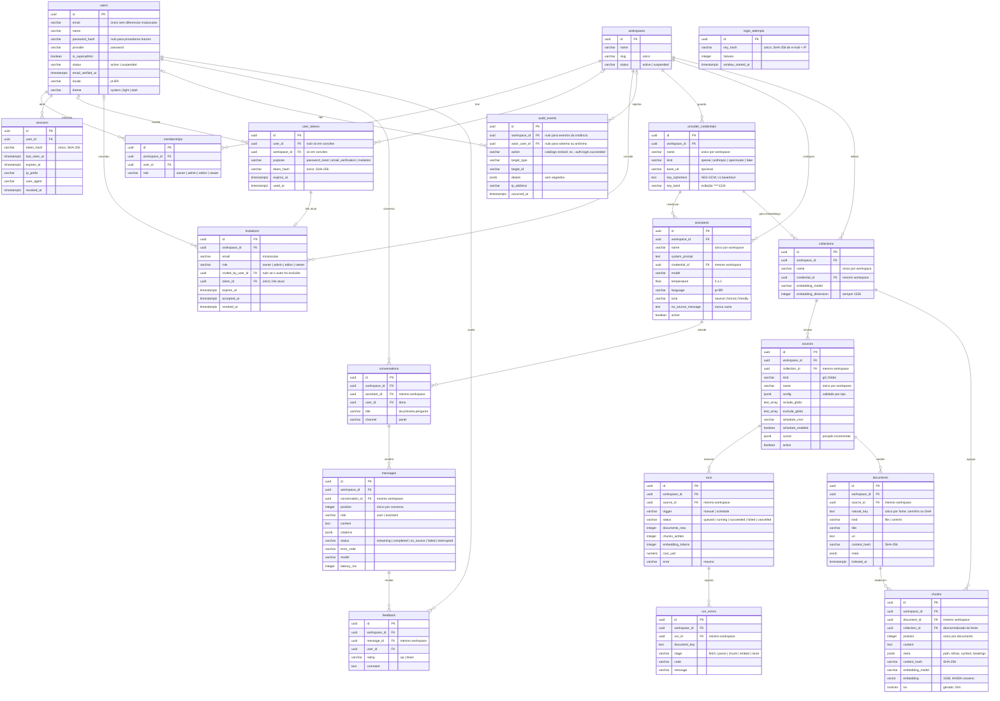

# Modelo de dados

> Rascunho v0.3 · 2026-10-10 · Em uso (planos 0002 e 0003)
>
> **Mudanças da v0.3**: índice de conhecimento da migração `0010` (plano 0003, F1.1): `collections`, `sources`, `runs`, `run_errors`, `documents` e `chunks`, com `vector(1536)`, HNSW e `tsvector` gerado ([ADR 0004](../adr/0004-indice-de-conhecimento.md)).

Tabelas do Postgres do KnoBridge, criadas pelas migrações em [`backend/migrations/`](../../backend/migrations/AGENTS.md). Modelos ORM em `backend/src/knobridge/<módulo>/models.py`. Regras de tenancy e RLS no [ADR 0001](../adr/0001-tenancy-e-rls.md); sessão, tokens e limitação de login no [ADR 0002](../adr/0002-sessao-server-side.md); segredos cifrados no [ADR 0003](../adr/0003-segredos-cifrados.md); índice de conhecimento no [ADR 0004](../adr/0004-indice-de-conhecimento.md). Autenticação e papéis em [autenticacao.md](autenticacao.md); chat em [chat.md](chat.md).

## Migrações

| Revisão | Arquivo | O que faz |
|---|---|---|
| `0001` | `20261010_0001_enable_pgvector.py` | Habilita a extensão `vector` (pgvector), usada por `chunks.embedding` (`0010`). |
| `0002` | `20261010_0002_tenancy.py` | `users`, `workspaces`, `memberships`; RLS forçada em `workspaces` e `memberships`. |
| `0003` | `20261010_0003_sessions_and_user_tokens.py` | `sessions` e `user_tokens`, com RLS forçada pelo dono. |
| `0004` | `20261010_0004_audit_events.py` | `audit_events`, append-only, com políticas separadas de leitura, inserção e exclusão. |
| `0005` | `20261010_0005_login_attempts.py` | `login_attempts`, só em modo de sistema. |
| `0006` | `20261010_0006_invitations.py` | `invitations`; `user_tokens.workspace_id` (só convites) e política `user_tokens_owner` ampliada ([emenda do ADR 0001](../adr/0001-tenancy-e-rls.md#emenda-2026-10-10-tokens-de-convite-com-workspace_id)). |
| `0007` | `20261010_0007_provider_credentials.py` | `provider_credentials` (chave cifrada). |
| `0008` | `20261010_0008_assistants.py` | `assistants`; único `(workspace_id, id)` em `provider_credentials`. |
| `0009` | `20261010_0009_conversations.py` | `conversations`, `messages`, `feedback`; único `(workspace_id, id)` em `assistants`. |
| `0010` | `20261010_0010_knowledge_index.py` | Índice de conhecimento: `collections`, `sources`, `runs`, `run_errors`, `documents`, `chunks`; HNSW cosseno em `chunks.embedding` e GIN em `chunks.tsv` (gerado). |

Toda migração tem `downgrade` que desfaz o `upgrade`; o teste `test_migrations_match_orm_models` compara as migrações com os modelos ORM.

## Convenções

- Chave primária `id` UUID (gerada na aplicação ou por `gen_random_uuid()`).
- `created_at` e `updated_at` `timestamptz`, preenchidos pelo relógio do banco.
- Enums gravados como `varchar(32)` + `CHECK` (`ck_<tabela>_<coluna>`), com o valor em minúsculas.
- Nomes de restrição: `pk_<tabela>`, `uq_<tabela>_<colunas>`, `fk_<tabela>_<coluna>_<tabela_ref>`, `ix_<tabela>_<colunas>`.
- Tabela com dado de workspace: `workspace_id NOT NULL` e RLS `ENABLE` + `FORCE`.

## Escopo de RLS

| Configuração (por transação) | Quem define | Efeito |
|---|---|---|
| `app.workspace_id` | `scoped_session(workspace_id=...)` | Seleciona o workspace; já autorizado pela membership. |
| `app.user_id` | `scoped_session(user_id=...)` | Usuário autenticado; libera as próprias memberships e os workspaces dele. |
| `app.system` = `on` | `system_session()` | Modo de sistema: setup, superadmin, login. |

Sem nenhuma delas, as tabelas com RLS não retornam linhas. Exceção de modelo: `audit_events` aceita `workspace_id` nulo para eventos da instância, visíveis só em modo de sistema.

As políticas leem as configurações com `NULLIF(current_setting('app.workspace_id', true), '')::uuid`, `NULLIF(current_setting('app.user_id', true), '')::uuid` e `coalesce(current_setting('app.system', true), '') = 'on'`. Abaixo, "workspace" é `workspace_id = app.workspace_id`, "usuário" é `user_id = app.user_id` e "sistema" é `app.system = 'on'`.

### Resumo das políticas

Todas as tabelas abaixo têm `ENABLE` + `FORCE ROW LEVEL SECURITY`. `users` é a única sem RLS (identidade da instância; ADR 0001, item 1).

| Tabela | Política | Comando | Predicado |
|---|---|---|---|
| `workspaces` | `workspaces_select` | `SELECT` | `id` = workspace selecionado, ou o usuário tem membership nele, ou sistema |
| `workspaces` | `workspaces_write` | `ALL` | `id` = workspace selecionado, ou sistema |
| `memberships` | `memberships_select` | `SELECT` | workspace, ou usuário (as próprias memberships), ou sistema |
| `memberships` | `memberships_write` | `ALL` | workspace, ou sistema |
| `sessions` | `sessions_owner` | `ALL` | usuário, ou sistema |
| `user_tokens` | `user_tokens_owner` | `ALL` | usuário, ou workspace (tokens de convite), ou sistema |
| `audit_events` | `audit_events_select` | `SELECT` | workspace, ou sistema |
| `audit_events` | `audit_events_insert` | `INSERT` | workspace, ou (`workspace_id` nulo e `actor_user_id` = `app.user_id`), ou sistema |
| `audit_events` | `audit_events_delete` | `DELETE` | sistema |
| `login_attempts` | `login_attempts_system` | `ALL` | sistema |
| `invitations` | `invitations_workspace` | `ALL` | workspace, ou sistema |
| `provider_credentials` | `provider_credentials_workspace` | `ALL` | workspace, ou sistema |
| `assistants` | `assistants_select`, `assistants_insert`, `assistants_update`, `assistants_delete` | um por comando | workspace, ou sistema |
| `conversations` | `conversations_workspace` | `ALL` | workspace, ou sistema |
| `messages` | `messages_workspace` | `ALL` | workspace, ou sistema |
| `feedback` | `feedback_workspace` | `ALL` | workspace, ou sistema |
| `collections` | `collections_workspace` | `ALL` | workspace, ou sistema |
| `sources` | `sources_workspace` | `ALL` | workspace, ou sistema |
| `runs` | `runs_workspace` | `ALL` | workspace, ou sistema |
| `run_errors` | `run_errors_workspace` | `ALL` | workspace, ou sistema |
| `documents` | `documents_workspace` | `ALL` | workspace, ou sistema |
| `chunks` | `chunks_workspace` | `ALL` | workspace, ou sistema |

A RLS isola workspaces; regras dentro do workspace (papel mínimo, privacidade de conversa entre membros) são da aplicação ([autenticacao.md](autenticacao.md#matriz-de-permissões)). Cada consulta tem teste de isolamento contra Postgres real, junto dos testes do seu módulo (ex.: `backend/tests/tenancy/test_invitations_rls.py`).

## Diagrama

## Tabelas

### `users`

Identidade da instância. Sem `workspace_id` e sem RLS.

| Coluna | Tipo | Regras |
|---|---|---|
| `email` | `varchar(320)` | Obrigatório; único por `lower(email)` (`uq_users_email_lower`). |
| `name` | `varchar(200)` | Obrigatório. |
| `password_hash` | `varchar(255)` | Opcional (identidades OIDC futuras não têm senha). |
| `provider` | `varchar(32)` | `password` (padrão). |
| `is_superadmin` | `boolean` | Padrão `false`. |
| `status` | `varchar(32)` | `active` (padrão) ou `suspended`. |
| `email_verified_at` | `timestamptz` | Nulo até a verificação. |
| `locale` | `varchar(16)` | Padrão `pt-BR`. |
| `theme` | `varchar(32)` | `system` (padrão), `light` ou `dark`. |

### `workspaces`

Tenant. RLS forçada.

| Coluna | Tipo | Regras |
|---|---|---|
| `name` | `varchar(200)` | Obrigatório. |
| `slug` | `varchar(64)` | Obrigatório; único (`uq_workspaces_slug`). |
| `status` | `varchar(32)` | `active` (padrão) ou `suspended`. |

Políticas: `workspaces_select` (selecionado, membro pelo `app.user_id` ou sistema) e `workspaces_write` (selecionado ou sistema).

### `memberships`

Papel de um usuário num workspace. RLS forçada.

| Coluna | Tipo | Regras |
|---|---|---|
| `workspace_id` | `uuid` | FK `workspaces.id`, `ON DELETE CASCADE`. |
| `user_id` | `uuid` | FK `users.id`, `ON DELETE CASCADE`; índice `ix_memberships_user_id`. |
| `role` | `varchar(32)` | `owner`, `admin`, `editor` ou `viewer`. |

Única por (`workspace_id`, `user_id`). Políticas: `memberships_select` (workspace selecionado, próprias memberships ou sistema) e `memberships_write` (workspace selecionado ou sistema).

### `sessions`

Sessão de login server-side ([ADR 0002](../adr/0002-sessao-server-side.md)). Dado da instância (sem `workspace_id`), com RLS forçada pelo dono: política `sessions_owner` (`user_id = app.user_id` ou sistema). Validação por token roda em modo de sistema.

| Coluna | Tipo | Regras |
|---|---|---|
| `user_id` | `uuid` | FK `users.id`, `ON DELETE CASCADE`; índice `ix_sessions_user_id`. |
| `token_hash` | `varchar(64)` | SHA-256 em hex do token do cookie; único (`uq_sessions_token_hash`). O token em claro nunca é gravado. |
| `last_seen_at` | `timestamptz` | Última validação. |
| `expires_at` | `timestamptz` | `last_seen_at + session_ttl` (expiração deslizante). |
| `ip_prefix` | `varchar(64)` | Prefixo de rede do IP (IPv4 /24, IPv6 /48); opcional. |
| `user_agent` | `varchar(200)` | User-agent truncado; opcional. |
| `revoked_at` | `timestamptz` | Nulo enquanto a sessão vale. |

`created_at` vem do relógio da aplicação (o mesmo da expiração).

### `user_tokens`

Token de uso único enviado por e-mail. Dado da instância, com RLS forçada pelo dono: política `user_tokens_owner` (`user_id = app.user_id`, `workspace_id = app.workspace_id` ou sistema). Tokens de conta (reset, verificação) são emitidos e consumidos em modo de sistema. Tokens de convite pertencem ao workspace que convida: são emitidos, reenviados e revogados na transação do workspace, junto com o convite; a pré-visualização e o aceite (só com o token) rodam em modo de sistema.

| Coluna | Tipo | Regras |
|---|---|---|
| `user_id` | `uuid` | FK `users.id`, `ON DELETE CASCADE`; índice `ix_user_tokens_user_id`. Obrigatório, exceto em convites (`ck_user_tokens_user_required`). |
| `workspace_id` | `uuid` | FK `workspaces.id`, `ON DELETE CASCADE`; índice `ix_user_tokens_workspace_id`. Só em convites (`ck_user_tokens_workspace_only_invitation`). |
| `purpose` | `varchar(32)` | `password_reset`, `email_verification` ou `invitation`. |
| `token_hash` | `varchar(64)` | SHA-256 em hex; único (`uq_user_tokens_token_hash`). |
| `expires_at` | `timestamptz` | Após este instante o token é recusado. |
| `used_at` | `timestamptz` | Preenchido no consumo; token usado é recusado. |

### `invitations`

Convite de um e-mail para um workspace com um papel (plano 0002, F2.3), em `backend/src/knobridge/tenancy/`. Dado de workspace com RLS forçada: política `invitations_workspace` (`workspace_id = app.workspace_id` ou sistema). Pendente = sem `accepted_at` e sem `revoked_at` (um convite vencido continua pendente e pode ser reenviado). Reconvidar o mesmo e-mail revoga o pendente; reenviar troca o token (o antigo é marcado como usado) e recomeça a validade (`invitation_ttl`, padrão 7 dias); revogar marca o token como usado.

| Coluna | Tipo | Regras |
|---|---|---|
| `workspace_id` | `uuid` | FK `workspaces.id`, `ON DELETE CASCADE`. |
| `email` | `varchar(320)` | Obrigatório, em minúsculas. Um pendente por (`workspace_id`, `email`): índice único parcial `uq_invitations_pending_email` (`WHERE accepted_at IS NULL AND revoked_at IS NULL`). |
| `role` | `varchar(32)` | `owner`, `admin`, `editor` ou `viewer`; nunca acima do papel de quem convida. |
| `invited_by_user_id` | `uuid` | FK `users.id`, `ON DELETE SET NULL`. |
| `token_id` | `uuid` | FK `user_tokens.id`, `ON DELETE CASCADE`; único (`uq_invitations_token_id`). Link atual. |
| `expires_at` | `timestamptz` | Cópia da validade do token atual, para listar sem ler `user_tokens`. |
| `accepted_at` | `timestamptz` | Preenchido no aceite, junto com a membership. |
| `revoked_at` | `timestamptz` | Preenchido ao revogar ou ao ser substituído por novo convite. |

### `audit_events`

Trilha de auditoria, append-only ([`backend/src/knobridge/audit/`](../../backend/src/knobridge/audit/AGENTS.md)). Gravada pelo `AuditService.record` na mesma transação da mudança. Sem `created_at`/`updated_at`: a data é `occurred_at`, do relógio da aplicação. RLS forçada, com políticas separadas por comando:

- `audit_events_select`: `workspace_id = app.workspace_id` ou sistema. Eventos da instância (`workspace_id` nulo) só são legíveis em modo de sistema (superadmin).
- `audit_events_insert`: no workspace selecionado, evento da instância cujo ator é o `app.user_id`, ou sistema.
- `audit_events_delete`: só sistema (retenção).
- Sem política de UPDATE: nenhum evento é alterado, nem em modo de sistema.

| Coluna | Tipo | Regras |
|---|---|---|
| `workspace_id` | `uuid` | FK `workspaces.id`, `ON DELETE CASCADE`; nulo para eventos da instância (setup, login, superadmin). Índice `ix_audit_events_workspace_id_occurred_at` (`workspace_id`, `occurred_at`). |
| `actor_user_id` | `uuid` | FK `users.id`, `ON DELETE SET NULL`; nulo para o próprio sistema ou chamador anônimo (ex.: login falho). Índice `ix_audit_events_actor_user_id`. |
| `action` | `varchar(64)` | Obrigatório; valor do catálogo `AuditAction` (sem `CHECK`, para ação nova não exigir migração). Índice `ix_audit_events_action`. |
| `target_type` | `varchar(64)` | Tipo do alvo (ex.: `membership`); opcional. |
| `target_id` | `varchar(64)` | Id do alvo; opcional. |
| `details` | `jsonb` | Metadados da ação, padrão `{}`. Nunca segredo; dado pessoal só o necessário (chaves com `password`, `secret`, `token`, `cookie`, `authorization`, `api_key` são recusadas). |
| `ip_address` | `varchar(45)` | IP do chamador normalizado; opcional. |
| `occurred_at` | `timestamptz` | Obrigatório; relógio injetado da aplicação. |

### `login_attempts`

Limitação de tentativas de login ([ADR 0002](../adr/0002-sessao-server-side.md)), em `backend/src/knobridge/security/throttle.py`. Uma linha por chave: o SHA-256 de `lower(email)|ip`, de modo que a tabela não guarda e-mail nem IP. Janela fixa contada da primeira falha (`login_attempt_window`, padrão 15 min); atingido `login_max_attempts` (padrão 5) dentro da janela, o login responde 429 até ela acabar, mesmo com a senha certa. Login bem-sucedido apaga a linha. Sem `created_at`/`updated_at`: as datas vêm do relógio da aplicação. RLS forçada com uma única política, `login_attempts_system` (só modo de sistema), porque quem tenta logar ainda é anônimo.

A mesma tabela guarda o limite de e-mails de conta por endereço (plano 0002, F2.2), com chaves de escopo próprio: SHA-256 de `password_reset|lower(email)|` e de `email_verification|lower(email)|` (sem IP, para limitar o que chega a uma caixa de entrada vinda de qualquer origem). Até `account_email_max_requests` (padrão 3) por `account_email_window` (padrão 1 h); acima disso, o "esqueci a senha" responde igual sem enviar e o reenvio de verificação responde 429. O contador conta pedidos, inclusive para e-mails sem conta.

| Coluna | Tipo | Regras |
|---|---|---|
| `key_hash` | `varchar(64)` | SHA-256 em hex da chave; único (`uq_login_attempts_key_hash`). |
| `failures` | `integer` | Falhas na janela atual. |
| `window_started_at` | `timestamptz` | Primeira falha da janela atual; janela vencida recomeça em 1 na próxima falha. |

### `provider_credentials`

Chave de API de um provedor de LLM, por workspace (plano 0002, F4.1), em [`backend/src/knobridge/llm/`](../../backend/src/knobridge/llm/AGENTS.md). Dado de workspace com RLS forçada: política `provider_credentials_workspace` (`workspace_id = app.workspace_id` ou sistema). A chave é gravada só cifrada com AES-256-GCM ([ADR 0003](../adr/0003-segredos-cifrados.md)), com chave de dados derivada de `KNOBRIDGE_SECRET_KEY` (HKDF, `info` `knobridge/provider-credentials/v1`) e dados associados `provider_credential:<workspace_id>:<id>`, de modo que o texto cifrado não decifra em outra linha nem em outro workspace. A API nunca devolve a chave, só `****` + `key_last4`. Owner, admin e editor gerenciam; viewer não. Criar, alterar e excluir auditam `provider.created`, `provider.updated` (`fields`: `name`, `base_url`, `key`) e `provider.deleted`, sem a chave. O teste de conexão (`POST .../providers/{id}/test`, F4.2) decifra a chave só em memória e audita `provider.tested` (`name`, `kind`, `ok`, `error_code`).

| Coluna | Tipo | Regras |
|---|---|---|
| `workspace_id` | `uuid` | FK `workspaces.id`, `ON DELETE CASCADE`. |
| `name` | `varchar(200)` | Obrigatório; único por workspace (`uq_provider_credentials_workspace_id_name`; 409 `provider_name_taken`). |
| `kind` | `varchar(32)` | `openai`, `anthropic`, `openrouter` ou `fake`. `fake` é recusado em produção (422 `provider_kind_not_allowed`). Não muda depois de criado. |
| `base_url` | `varchar(500)` | Opcional; endpoint alternativo (`http(s)://`), ex.: gateway ou servidor compatível. |
| `key_ciphertext` | `text` | `v<versão da chave>.<base64url(nonce ‖ cifrado ‖ tag)>`. Recifrado a cada troca de chave. |
| `key_last4` | `varchar(4)` | Últimos 4 caracteres da chave (que tem no mínimo 8), para exibição. |

Único extra `uq_provider_credentials_workspace_id_id` (`workspace_id`, `id`), alvo da FK composta de `assistants`. Credencial usada por assistente não pode ser excluída (409 `provider_in_use`).

### `assistants`

Configuração de um assistente do workspace (plano 0002, F4.3), em [`backend/src/knobridge/assistants/`](../../backend/src/knobridge/assistants/AGENTS.md). Dado de workspace com RLS forçada, com o predicado padrão (`workspace_id = app.workspace_id` ou sistema) em políticas separadas: `assistants_select`, `assistants_insert`, `assistants_update` e `assistants_delete`. Todo membro lê; viewer só vê os ativos (filtro da aplicação); owner, admin e editor gerenciam. Criar, alterar e excluir auditam `assistant.created` (`name`, `model`, `provider_id`), `assistant.updated` (`name`, `fields`) e `assistant.deleted` (`name`), sem prompt nem mensagens.

| Coluna | Tipo | Regras |
|---|---|---|
| `workspace_id` | `uuid` | FK `workspaces.id`, `ON DELETE CASCADE`. |
| `name` | `varchar(200)` | Obrigatório; único por workspace (`uq_assistants_workspace_id_name`; 409 `assistant_name_taken`). |
| `description` | `text` | Até 1000 caracteres (validado na API); vazio permitido. |
| `system_prompt` | `text` | Até 20000 caracteres (validado na API); vazio permitido. |
| `credential_id` | `uuid` | FK composta `(workspace_id, credential_id)` → `provider_credentials (workspace_id, id)` (`fk_assistants_workspace_id_provider_credentials`), `NO ACTION` na exclusão: a credencial é sempre do mesmo workspace (422 `assistant_provider_invalid` na API) e não se exclui em uso; excluir o workspace cascateia para as duas tabelas. Na API, `provider_id`. |
| `model` | `varchar(200)` | Identificador do modelo no provedor (ex.: `gpt-4.1-mini`), sem espaços. |
| `temperature` | `double precision` | De 0 a 2 (`ck_assistants_temperature_range`); padrão da API 0,2. |
| `language` | `varchar(35)` | Tag BCP 47 das respostas; padrão da API `pt-BR`. |
| `tone` | `varchar(32)` | `neutral`, `formal` ou `friendly`. |
| `no_source_message` | `text` | Resposta quando não há fonte (regra 8 do AGENTS.md). Nunca vazia (`ck_assistants_no_source_message_not_empty`): vazio ou nulo na API grava a mensagem padrão em pt-BR, que diz que não sabe e oferece abrir chamado. |
| `active` | `boolean` | Padrão `true`. Inativo some para viewer e não aceita conversa nova nem mensagem (409 `assistant_inactive`). |

Único extra `uq_assistants_workspace_id_id` (`workspace_id`, `id`), alvo da FK composta de `conversations`. Excluir um assistente exclui as conversas dele (com mensagens e feedback); para preservar o histórico, desative-o.

### `conversations`

Conversa de um membro com um assistente (plano 0002, F4.4), em [`backend/src/knobridge/conversations/`](../../backend/src/knobridge/conversations/AGENTS.md). Dado de workspace com RLS forçada e uma política padrão (`conversations_workspace`, `USING` e `WITH CHECK`). A privacidade entre membros é regra da aplicação: só o dono envia mensagens e exclui; owner e admin do workspace leem qualquer conversa; os demais recebem 404. Owner e admin também têm a visão administrativa (plano 0002, F4.5: `/v1/workspaces/{id}/admin/conversations`, com contagens por conversa e totais do período, em consultas de número constante de statements). Só a exclusão é auditada (`conversation.deleted`, com `assistant_id` e `message_count`, sem conteúdo).

| Coluna | Tipo | Regras |
|---|---|---|
| `workspace_id` | `uuid` | FK `workspaces.id`, `ON DELETE CASCADE`. |
| `assistant_id` | `uuid` | FK composta `(workspace_id, assistant_id)` → `assistants (workspace_id, id)` (`fk_conversations_workspace_id_assistants`), `ON DELETE CASCADE`. |
| `user_id` | `uuid` | Dono da conversa. FK `users.id`, `ON DELETE CASCADE`. |
| `title` | `varchar(200)` | Nulo até a primeira pergunta; depois, a pergunta numa linha, cortada em 80 caracteres (sem LLM). |
| `channel` | `varchar(32)` | `panel` (`ck_conversations_channel`; outros canais depois). |

Únicos e índices: `uq_conversations_workspace_id_id` (alvo da FK de `messages`) e `ix_conversations_workspace_id_user_id_updated_at` ("minhas conversas", da mais recente). `updated_at` muda a cada pergunta.

### `messages`

Pergunta ou resposta de uma conversa. RLS forçada, política `messages_workspace`.

| Coluna | Tipo | Regras |
|---|---|---|
| `workspace_id` | `uuid` | FK `workspaces.id`, `ON DELETE CASCADE`. |
| `conversation_id` | `uuid` | FK composta `(workspace_id, conversation_id)` → `conversations (workspace_id, id)` (`fk_messages_workspace_id_conversations`), `ON DELETE CASCADE`. |
| `position` | `integer` | Ordem na conversa a partir de 0 (`ck_messages_position_not_negative`), única por conversa (`uq_messages_conversation_id_position`); atribuída com a conversa travada (`FOR UPDATE`). |
| `role` | `varchar(32)` | `user` ou `assistant` (`ck_messages_role`). |
| `content` | `text` | Texto; numa resposta interrompida ou com erro, o que chegou a ser gerado. |
| `citations` | `jsonb` | Lista de `{index, title, uri, snippet, document_id}`; padrão `[]`. Vazia em perguntas e em `no_source`. |
| `status` | `varchar(32)` | `streaming`, `completed`, `no_source`, `failed`, `interrupted` (`ck_messages_status`; ver [chat.md](chat.md#estados-das-mensagens)). Perguntas são `completed`. Uma resposta `streaming` com `updated_at` de mais de 5 minutos atrás é órfã (o processo morreu no meio do stream): as leituras a mostram como `interrupted`, e a próxima pergunta da conversa grava `interrupted` nela. |
| `error_code` | `varchar(64)` | Código de domínio de uma resposta `failed` (ex.: `provider_unavailable`). |
| `model` | `varchar(200)` | Modelo que respondeu; nulo em perguntas e em `no_source`. |
| `input_tokens`, `output_tokens` | `integer` | Uso informado pelo provedor, quando há. |
| `latency_ms` | `integer` | Da pergunta ao fim da resposta, pelo relógio injetado. |

Único extra `uq_messages_workspace_id_id`, alvo da FK de `feedback`.

### `feedback`

Avaliação (👍/👎 e comentário) de uma resposta do assistente por um usuário que pode ler a conversa. RLS forçada, política `feedback_workspace`. Um por mensagem e usuário (`uq_feedback_message_id_user_id`); enviar de novo substitui (upsert).

| Coluna | Tipo | Regras |
|---|---|---|
| `workspace_id` | `uuid` | FK `workspaces.id`, `ON DELETE CASCADE`. |
| `message_id` | `uuid` | FK composta `(workspace_id, message_id)` → `messages (workspace_id, id)` (`fk_feedback_workspace_id_messages`), `ON DELETE CASCADE`. Só mensagens `assistant` (422 `feedback_target_invalid` na API). |
| `user_id` | `uuid` | Quem avaliou. FK `users.id`, `ON DELETE CASCADE`. |
| `rating` | `varchar(32)` | `up` ou `down`. |
| `comment` | `text` | Até 2000 caracteres (validado na API); vazio permitido. |

## Índice de conhecimento

Tabelas do conhecimento indexado (plano 0003, F1.1; [ADR 0004](../adr/0004-indice-de-conhecimento.md)), em [`backend/src/knobridge/ingestion/`](../../backend/src/knobridge/ingestion/AGENTS.md). As seis são dado de workspace com RLS forçada e uma política padrão por tabela (`<tabela>_workspace`, `USING` e `WITH CHECK`). Toda referência entre elas é composta, `(workspace_id, <pai>_id)` → `<pai> (workspace_id, id)`, e por isso cada pai tem o único `uq_<pai>_workspace_id_id`. Exclusões: credencial → coleção e coleção → fonte são `NO ACTION` (em uso não se exclui); da fonte para execuções, erros, documentos e chunks, `ON DELETE CASCADE`; excluir o workspace apaga tudo.

### `collections`

Agrupa as fontes que um assistente consulta e fixa o embedding delas: um modelo por coleção, uma coleção por fonte.

| Coluna | Tipo | Regras |
|---|---|---|
| `workspace_id` | `uuid` | FK `workspaces.id`, `ON DELETE CASCADE`. |
| `name` | `varchar(200)` | Obrigatório; único por workspace (`uq_collections_workspace_id_name`). |
| `description` | `text` | Vazio permitido. |
| `credential_id` | `uuid` | Credencial do provedor de embedding. FK composta `(workspace_id, credential_id)` → `provider_credentials (workspace_id, id)` (`fk_collections_workspace_id_provider_credentials`), `NO ACTION`: credencial em uso não se exclui (409 `provider_in_use`). |
| `embedding_model` | `varchar(200)` | Identificador do modelo no provedor (ex.: `text-embedding-3-small`). |
| `embedding_dimension` | `integer` | Sempre 1536 (`ck_collections_embedding_dimension_fixed`); modelos maiores usam dimensão de saída reduzida. |

### `sources`

Uma fonte de conteúdo de uma coleção: repositório Git ou pasta local.

| Coluna | Tipo | Regras |
|---|---|---|
| `workspace_id` | `uuid` | FK `workspaces.id`, `ON DELETE CASCADE`. |
| `collection_id` | `uuid` | FK composta → `collections (workspace_id, id)` (`fk_sources_workspace_id_collections`), `NO ACTION`: coleção com fontes não se exclui. |
| `kind` | `varchar(32)` | `git` ou `folder` (`ck_sources_kind`). |
| `name` | `varchar(200)` | Obrigatório; único por workspace (`uq_sources_workspace_id_name`). |
| `config` | `jsonb` | Objeto (`ck_sources_config_is_object`) com o formato do tipo, validado pela aplicação (`parse_source_config`). `git`: exatamente um entre `path` (caminho local absoluto) e `url` (https pública, sem credenciais), `branch` opcional (nulo = branch padrão) e `initial_commit_limit` (0 a 5000, padrão 200: quantos commits recentes a primeira execução indexa). `folder`: `path` absoluto. Campos desconhecidos são recusados. |
| `include_globs`, `exclude_globs` | `text[]` | Padrões glob sobre o caminho dos documentos, padrão `{}`. Colunas, e não parte de `config`, porque valem para todo tipo e são aplicados pelo motor de ingestão. |
| `schedule_cron` | `varchar(100)` | Expressão cron das execuções agendadas; nula sem agendamento. |
| `schedule_enabled` | `boolean` | Padrão `false`; ligado exige `schedule_cron` (`ck_sources_schedule_needs_cron`). |
| `cursor` | `jsonb` | Posição incremental do conector (ex.: último commit indexado); nulo antes da primeira execução. |
| `active` | `boolean` | Padrão `true`. |

### `runs`

Uma execução da ingestão de uma fonte. `created_at` é o momento em que entrou na fila. Índice `ix_runs_workspace_id_source_id_created_at` (histórico da fonte).

| Coluna | Tipo | Regras |
|---|---|---|
| `workspace_id` | `uuid` | FK `workspaces.id`, `ON DELETE CASCADE`. |
| `source_id` | `uuid` | FK composta → `sources (workspace_id, id)` (`fk_runs_workspace_id_sources`), `ON DELETE CASCADE`. |
| `trigger` | `varchar(32)` | `manual` ou `schedule` (`ck_runs_trigger`). |
| `status` | `varchar(32)` | `queued`, `running`, `succeeded`, `failed` ou `cancelled` (`ck_runs_status`). |
| `documents_new`, `documents_changed`, `documents_removed`, `documents_failed` | `integer` | Contagens de documentos, padrão 0. |
| `chunks_written` | `integer` | Chunks gravados, padrão 0. |
| `embedding_tokens` | `integer` | Tokens enviados ao provedor de embedding, padrão 0. Todas as contagens ≥ 0 (`ck_runs_counts_not_negative`). |
| `cost_usd` | `numeric(12,6)` | Custo estimado; nulo se o preço do modelo é desconhecido. |
| `started_at`, `finished_at` | `timestamptz` | Nulos enquanto na fila ou rodando. |
| `error` | `varchar(500)` | Resumo do motivo de uma execução `failed`; sem stack trace nem conteúdo. |

### `run_errors`

Um documento que falhou numa execução; a execução segue com os demais. Índice `ix_run_errors_run_id`.

| Coluna | Tipo | Regras |
|---|---|---|
| `workspace_id` | `uuid` | FK `workspaces.id`, `ON DELETE CASCADE`. |
| `run_id` | `uuid` | FK composta → `runs (workspace_id, id)` (`fk_run_errors_workspace_id_runs`), `ON DELETE CASCADE`. |
| `document_key` | `text` | Chave natural do documento (pode ter falhado antes de existir em `documents`). |
| `stage` | `varchar(32)` | `fetch`, `parse`, `chunk`, `embed` ou `store` (`ck_run_errors_stage`). |
| `code` | `varchar(64)` | Código estável do erro. |
| `message` | `varchar(500)` | Mensagem curta, sem conteúdo do documento. |

### `documents`

Um arquivo ou commit de uma fonte, na versão indexada.

| Coluna | Tipo | Regras |
|---|---|---|
| `workspace_id` | `uuid` | FK `workspaces.id`, `ON DELETE CASCADE`. |
| `source_id` | `uuid` | FK composta → `sources (workspace_id, id)` (`fk_documents_workspace_id_sources`), `ON DELETE CASCADE`. |
| `natural_key` | `text` | Caminho (`file`) ou SHA (`commit`); único por fonte (`uq_documents_source_id_natural_key`), chave do incremental. |
| `kind` | `varchar(32)` | `file` ou `commit` (`ck_documents_kind`). |
| `title` | `varchar(500)` | Título exibido na citação. |
| `uri` | `text` | Para onde a citação aponta (URL do arquivo ou do commit, ou caminho local). |
| `content_hash` | `varchar(64)` | SHA-256 (hex) do conteúdo; igual ao anterior = nada a reindexar. |
| `language` | `varchar(64)` | Linguagem detectada, quando conhecida. |
| `meta` | `jsonb` | Metadados do documento, padrão `{}`. |
| `indexed_at` | `timestamptz` | Quando o conteúdo atual terminou de ser indexado; nulo durante a (re)indexação. |

### `chunks`

Um trecho indexado de um documento. Índices: `ix_chunks_workspace_id_collection_id` (filtro da busca), `ix_chunks_embedding_hnsw` (HNSW, `vector_cosine_ops`) e `ix_chunks_tsv_gin` (GIN).

| Coluna | Tipo | Regras |
|---|---|---|
| `workspace_id` | `uuid` | FK `workspaces.id`, `ON DELETE CASCADE`. |
| `document_id` | `uuid` | FK composta → `documents (workspace_id, id)` (`fk_chunks_workspace_id_documents`), `ON DELETE CASCADE`. |
| `collection_id` | `uuid` | Coleção da fonte do documento, desnormalizada para a busca filtrar sem junção. FK composta → `collections (workspace_id, id)` (`fk_chunks_workspace_id_collections`), `ON DELETE CASCADE`. |
| `position` | `integer` | Ordem no documento a partir de 0 (`ck_chunks_position_not_negative`); única por documento (`uq_chunks_document_id_position`). |
| `content` | `text` | Texto do chunk. |
| `meta` | `jsonb` | Dados da citação: `path`, `start_line`, `end_line`, `symbol`, `headings`. Padrão `{}`. |
| `content_hash` | `varchar(64)` | SHA-256 (hex) do conteúdo; chave do cache de embeddings. |
| `embedding_model` | `varchar(200)` | Modelo que gerou o vetor; diferente do da coleção depois de uma troca de modelo, até reindexar. |
| `embedding` | `vector(1536)` | Vetor (pgvector). |
| `tsv` | `tsvector` | Gerado (`GENERATED ALWAYS AS ... STORED`): `to_tsvector('portuguese', content)` concatenado a `to_tsvector('simple', ...)` sobre `meta->>'path'` (inteiro e quebrado em `/` e `.`) e `meta->>'symbol'`. Nunca escrito pela aplicação. |
