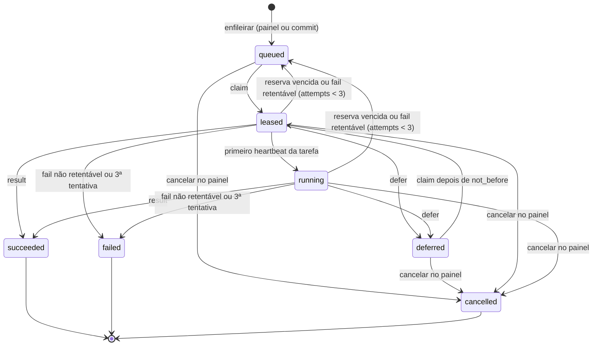

# Protocolo do runner

> Rascunho v0.1 · 2026-10-11 · Em definição (plano 0004)

Como o `knobridge-runner`, que roda na máquina do usuário, conversa com o servidor do KnoBridge: autenticação por token, endpoints `/v1/runner/*`, fila de tarefas com reserva, estados e transições, códigos de erro, limites, versionamento do protocolo e o que pode e o que não pode sair da máquina. O que o runner faz com uma tarefa (camada 0, briefing, prompt, schema da saída, verificação, excertos, itens de conhecimento e flags dos executores) está em [harness.md](harness.md). A arquitetura está no [ADR 0005](../adr/0005-runner-local-do-harness.md); as tabelas, em [modelo-de-dados.md](modelo-de-dados.md).

Código (a criar no plano 0004): servidor em `backend/src/knobridge/harness/` (fila, resultado, módulos) e `backend/src/knobridge/api/` (rotas); runner em `runner/` (pacote `knobridge-runner`).

## Visão geral

```mermaid
sequenceDiagram
    participant R as Runner (máquina do usuário)
    participant A as API /v1/runner
    participant DB as Postgres
    participant T as Temporal
    loop a cada 30 s
        R->>A: POST /heartbeat (versão, executores, repositórios + HEAD)
        A->>DB: runners.last_seen_at, capabilities
        A-->>R: fontes ligadas ao runner (configuração, último commit relatado)
    end
    R->>A: POST /sources/{sid}/report (HEAD, alterados, inventário, módulos sugeridos)
    A->>DB: upsert de módulos; com auto_on_commit, enfileira os alterados
    R->>A: POST /jobs/claim (espera até 25 s)
    A->>DB: FOR UPDATE SKIP LOCKED → leased, reserva de 2 min
    A-->>R: 200 tarefa (ou 204 sem tarefa)
    par durante a execução
        R->>A: POST /jobs/{id}/heartbeat a cada 30 s
        A-->>R: reserva renovada (ou cancelled)
    and
        R->>R: camada 0 → briefing → claude/codex → verificação → excertos
    end
    alt sucesso
        R->>A: POST /jobs/{id}/result (itens, rejeições, métricas)
        A->>DB: grava itens, rejeições, métricas; succeeded
        A->>T: start_sync da fonte (conector knowledge)
    else falha
        R->>A: POST /jobs/{id}/fail (código, retentável?)
    else limite de franquia ou executor sem login
        R->>A: POST /jobs/{id}/defer (motivo, retry_after_seconds)
    end
```

## Convenções do fio

- **Base**: `https://<servidor>/v1/runner`. O runner recusa `http://`, exceto para `localhost`, `127.0.0.1` e `::1` (dev e E2E). TLS sempre verificado; proxy pelas variáveis padrão (`HTTPS_PROXY`, `NO_PROXY`).
- **Headers obrigatórios em toda requisição**:
  - `Authorization: Bearer kbr_<prefixo>_<segredo>`;
  - `KnoBridge-Runner-Protocol: 1` (ver [Versionamento](#versionamento-do-protocolo));
  - `User-Agent: knobridge-runner/<versão>`;
  - `Content-Type: application/json` quando há corpo.
- **Sem sessão nem CSRF**: rotas `/v1/runner/*` ignoram o cookie de sessão e não exigem o header CSRF; só aceitam o token de runner. O token de runner não abre nenhuma outra rota da API.
- **JSON**: UTF-8, nomes de campo em `snake_case` inglês; instantes em ISO 8601 UTC com `Z` (`2026-10-11T12:00:00Z`); ids UUID; dinheiro em US$ como número (até 6 casas decimais).
- **Requisições** são validadas com campos desconhecidos recusados (422 `validation_error`). **Respostas** podem ganhar campos novos dentro da mesma versão do protocolo; o runner ignora campos que não conhece.
- **Erros** no formato único da API: `{"error": {"code": "...", "message": "...", "details": ...}}`. A mensagem é para log; o runner decide pelo `code` e pelo status HTTP.
- **Nomes dos schemas no OpenAPI** (o teste de contrato do runner compara os modelos dele com estes componentes de `docs/specs/openapi.json`): `RunnerHeartbeatIn`, `RunnerHeartbeatOut`, `RunnerReportIn`, `RunnerReportOut`, `RunnerClaimIn`, `RunnerJobOut`, `RunnerJobHeartbeatIn`, `RunnerJobHeartbeatOut`, `RunnerJobResultIn`, `RunnerJobResultOut`, `RunnerJobFailIn`, `RunnerJobDeferIn`, `RunnerJobStateOut`, e os tipos aninhados com o mesmo prefixo (`RunnerExecutorInfo`, `RunnerRepositoryInfo`, `RunnerSourceOut`, `RunnerModuleIn`, `RunnerInventory`, `RunnerJobModule`, `RunnerJobMetrics`, `RunnerKnowledgeItemIn`, `RunnerEvidenceIn`, `RunnerRejectionIn`).

### Formatos validados

| Nome | Regra |
|---|---|
| `repository` (nome do repositório declarado no runner) | `^[A-Za-z0-9][A-Za-z0-9._-]{0,63}$`. Nunca um caminho. |
| `module_key` | `^[a-z0-9]+(-[a-z0-9]+)*$`, até 100 caracteres (derivação em [harness.md](harness.md#chave-do-módulo)). |
| `commit` | SHA hex minúsculo de 40 (SHA-1) ou 64 (SHA-256) caracteres: `^[0-9a-f]{40}([0-9a-f]{24})?$`. |
| `branch` | Até 255 caracteres, sem caracteres de controle; `null` em HEAD destacado. |
| Caminho relativo (`path`) | POSIX, relativo à raiz do repositório, até 500 caracteres. Recusados: vazio, começando com `/`, com `\`, com letra de drive (`^[A-Za-z]:`), com segmento vazio, `.` ou `..`, com caractere de controle ou NUL. |
| Padrão de módulo (`paths[]`) | Sintaxe gitwildmatch (a mesma dos globs das fontes), relativo à raiz, até 300 caracteres; mesmas recusas do caminho relativo, exceto que `*`, `**`, `?`, `[...]`, `!` inicial (negação) e `/` final (só diretórios) são permitidos. A lista é avaliada como um `.gitignore`: o último padrão que casa decide ([harness.md](harness.md#sugestão-de-módulos)). |
| `executor` | `claude_code` ou `codex`. |
| `model` | Até 100 caracteres de `[A-Za-z0-9._:/-]`; `null` = padrão do executor. |

## Token de runner

- **Formato**: `kbr_<prefixo>_<segredo>`, validado por `^kbr_([a-z0-9]{8})_([A-Za-z0-9_-]{43})$`.
  - `prefixo`: 8 caracteres aleatórios de `[a-z0-9]`; identifica o runner, guardado em claro em `runners.token_prefix` (único na instância) e mostrado no painel.
  - `segredo`: 32 bytes aleatórios em base64url sem padding (43 caracteres, `secrets.token_urlsafe(32)`).
  - O prefixo fixo `kbr_` permite varredura de segredos (gitleaks) e redação nos excertos ([harness.md](harness.md#redação-de-segredos)).
- **Criação**: `POST /v1/workspaces/{wid}/runners` devolve o token inteiro **uma única vez**. O servidor guarda só `token_hash` = SHA-256 hex do token inteiro (a string completa). Não existe rota que mostre o token de novo; perdeu, cria outro runner ou gira o token (excluir e criar).
- **Verificação** (dependência `current_runner`):
  1. header ausente, sem `Bearer` ou fora do formato → 401;
  2. busca o runner por `token_prefix` em modo de sistema (índice único; o workspace ainda não é conhecido);
  3. compara `SHA-256(token)` com `token_hash` em tempo constante (`hmac.compare_digest`);
  4. runner inexistente, hash diferente ou `revoked_at` preenchido → 401 (mesma resposta nos três casos);
  5. workspace suspenso → 403 `workspace_suspended`;
  6. abre a transação com `SET LOCAL app.workspace_id` do runner; toda consulta da requisição roda nesse escopo.
- Toda resposta 401 leva `WWW-Authenticate: Bearer`. O token nunca é logado nem gravado em auditoria (só `token_prefix` e `runner_id`).
- **Revogação** vale na hora: a requisição seguinte do runner recebe 401. Tarefas reservadas por ele voltam para a fila quando a reserva vence.

## Endpoints

Todos exigem o token de runner. "Fonte do runner" = fonte com `kind = runner`, `config.runner_id` igual ao runner autenticado, no workspace do token. Fonte ou tarefa que não é do runner responde 404 (sem distinguir de inexistente).

| Método e rota | Função | Sucesso |
|---|---|---|
| `POST /v1/runner/heartbeat` | Presença, versão, executores e repositórios; devolve as fontes ligadas. | 200 `RunnerHeartbeatOut` |
| `POST /v1/runner/sources/{source_id}/report` | HEAD, arquivos alterados, inventário e módulos sugeridos de uma fonte. | 200 `RunnerReportOut` |
| `POST /v1/runner/jobs/claim` | Pede uma tarefa, com long-poll de até 25 s. | 200 `RunnerJobOut` ou 204 |
| `POST /v1/runner/jobs/{job_id}/heartbeat` | Renova a reserva e informa a fase. | 200 `RunnerJobHeartbeatOut` |
| `POST /v1/runner/jobs/{job_id}/result` | Entrega o resultado. | 200 `RunnerJobResultOut` |
| `POST /v1/runner/jobs/{job_id}/fail` | Informa falha. | 200 `RunnerJobStateOut` |
| `POST /v1/runner/jobs/{job_id}/defer` | Adia a tarefa (franquia, login). | 200 `RunnerJobStateOut` |

Toda requisição autenticada com sucesso atualiza `runners.last_seen_at` (no máximo uma escrita a cada 10 s por runner, para não gerar escrita a cada claim).

### `POST /v1/runner/heartbeat`

Enviado ao iniciar e a cada 30 s (`heartbeat_interval_seconds` da resposta), esteja o runner ocioso ou não.

Corpo (`RunnerHeartbeatIn`, até 64 KiB):

| Campo | Tipo | Regras |
|---|---|---|
| `runner_version` | texto | Versão do pacote, até 64 caracteres (ex.: `0.1.0`). |
| `platform` | texto | `windows`, `linux` ou `darwin`. |
| `executors` | lista de `RunnerExecutorInfo` | Até 2, um por nome. |
| `executors[].name` | `executor` | `claude_code` ou `codex`. |
| `executors[].available` | booleano | Executável encontrado no PATH (ou no caminho configurado). |
| `executors[].version` | texto ou `null` | Saída de `--version`, até 64 caracteres. |
| `executors[].authenticated` | booleano ou `null` | Resultado de `claude auth status` / `codex login status` ou de chave de API presente; `null` = não verificado. Nunca o e-mail ou a conta. |
| `repositories` | lista de `RunnerRepositoryInfo` | Até 50, nomes únicos. |
| `repositories[].name` | `repository` | Nome declarado na configuração do runner. |
| `repositories[].head_commit` | `commit` ou `null` | HEAD atual; `null` se o repositório não pôde ser lido. |
| `repositories[].branch` | `branch` | Branch atual. |
| `repositories[].dirty` | booleano | Há alterações não commitadas no checkout. |
| `active_job_ids` | lista de UUID | Tarefas em execução neste runner, até 16. |

Efeito: grava `runners.version` e `runners.capabilities` (`{"platform", "executors", "repositories"}`, sem `active_job_ids`) e `last_seen_at`. Não muda `head_commit` de fonte (isso é do `report`).

Resposta 200 (`RunnerHeartbeatOut`):

| Campo | Tipo | Descrição |
|---|---|---|
| `runner_id` | UUID | Runner autenticado. |
| `name` | texto | Nome dado no painel. |
| `workspace_id` | UUID | Workspace do token. |
| `protocol` | inteiro | Versão do protocolo em uso (1). |
| `server_time` | instante | Relógio do servidor (o runner só usa para log; prazos vêm em segundos). |
| `heartbeat_interval_seconds` | inteiro | 30. |
| `sources` | lista de `RunnerSourceOut` | Fontes ativas ligadas a este runner. |
| `sources[].source_id` | UUID | |
| `sources[].name` | texto | |
| `sources[].repository` | `repository` | Repositório que a fonte usa. Se o runner não serve esse nome, ele registra aviso e não relata nem pega tarefas dessa fonte. |
| `sources[].last_reported_commit` | `commit` ou `null` | `head_commit` gravado na fonte pelo último `report`; base do cálculo de alterados. |
| `sources[].include_globs`, `sources[].exclude_globs` | lista de texto | Globs da fonte, aplicados pela camada 0 ([harness.md](harness.md#seleção-de-arquivos)). |
| `sources[].config` | objeto | `default_executor`, `models`, `budget_usd`, `timeout_seconds`, `auto_on_commit`, `excerpt_max_lines` ([Fonte do tipo runner](#fonte-do-tipo-runner)). |

Erros: 401, 403 `workspace_suspended`, 413, 422 `validation_error`, 426.

### `POST /v1/runner/sources/{source_id}/report`

Enviado para cada fonte servida ao iniciar e sempre que o HEAD do repositório muda (o runner confere a cada heartbeat). Também enviado depois de uma tarefa, se o HEAD mudou durante ela.

Corpo (`RunnerReportIn`, até 4 MiB):

| Campo | Tipo | Regras |
|---|---|---|
| `repository` | `repository` | Tem de ser o da fonte, senão 409 `repository_mismatch`. |
| `head_commit` | `commit` | HEAD atual. |
| `branch` | `branch` | |
| `base_commit` | `commit` ou `null` | O `last_reported_commit` que o runner usou como base (ou, se o runner já teve um `report` aceito para a fonte desde que iniciou, o `head_commit` desse `report`, que é o que o servidor gravou, mesmo antes de o heartbeat seguinte trazer o valor novo). |
| `changed_paths` | lista de caminho relativo, ou `null` | Arquivos alterados (adicionados, modificados, removidos, renomeados nos dois nomes) entre `base_commit` e `head_commit`, até 20 000. `null` = desconhecido: primeiro relatório, base ausente no repositório local (ex.: histórico reescrito) ou mais de 20 000 arquivos. |
| `inventory` | `RunnerInventory` | Do repositório selecionado inteiro: `files` (inteiro), `lines` (inteiro), `languages` (objeto `linguagem → {"files", "lines"}`, até 100 linguagens). |
| `modules` | lista de `RunnerModuleIn` | Módulos sugeridos pela camada 0, até 2000, chaves únicas. |
| `modules[].key` | `module_key` | Chave estável. |
| `modules[].title` | texto | Até 200 caracteres (padrão: o caminho da pasta). |
| `modules[].paths` | lista de padrão | 1 a 50 padrões. |
| `modules[].inventory` | `RunnerInventory` | Do módulo. |

Efeito, numa transação:

1. Upsert dos módulos sugeridos por `(source_id, key)`:
   - módulo novo → criado com `suggested = true`, `enabled = true`;
   - módulo existente com `suggested = true` (nunca editado) → título, padrões e inventário atualizados;
   - módulo existente com `suggested = false` (editado ou criado à mão) → só o inventário muda se a chave veio no relatório; título, padrões e `enabled` ficam;
   - módulo sugerido que não veio no relatório → continua existindo, com inventário zerado (`files = 0`, `lines = 0`); quem decide desligar é o usuário.
2. `sources.config.head_commit` = `head_commit`.
3. Se a fonte está ativa, `auto_on_commit` é `true`, `base_commit` é igual ao `head_commit` anterior da fonte e `changed_paths` não é `null`: para cada módulo `enabled` cujos `paths` casam (gitwildmatch) com algum caminho alterado e que não tem tarefa `queued` ou `deferred`, enfileira uma tarefa com `trigger = commit`, `executor = config.default_executor`, `model = config.models[executor]`, `commit_sha = head_commit`. Com `changed_paths = null`, nada é enfileirado automaticamente (sem gasto surpresa).

Resposta 200 (`RunnerReportOut`): `source_id`, `head_commit`, `modules_total` (inteiro), `modules_upserted` (inteiro), `jobs_enqueued` (lista de `{"job_id", "module_key"}`).

Erros: 401, 403, 404 `source_not_found`, 409 `repository_mismatch`, 413, 422, 426.

### `POST /v1/runner/jobs/claim`

Corpo (`RunnerClaimIn`, até 4 KiB):

| Campo | Tipo | Regras |
|---|---|---|
| `wait_seconds` | inteiro | 0 a 25, padrão 25. Quanto o servidor pode segurar a requisição se não houver tarefa. |
| `executors` | lista de `executor` | 1 ou 2. Só tarefas destes executores (os disponíveis e com login). |
| `repositories` | lista de `repository` | 1 a 50. Só tarefas de fontes destes repositórios. |

**Long-poll**: o servidor tenta reservar; sem tarefa, tenta de novo a cada 1 s (intervalo e espera injetados, para os testes não dormirem) até `wait_seconds`. Se o cliente desconectar, para. O runner usa timeout de leitura de `wait_seconds + 10` s.

**Elegível** (na ordem de `created_at`, mais antiga primeiro), sempre de fontes ativas do runner, com o executor e o repositório pedidos:

- `status = queued` (com `not_before` nulo ou vencido);
- `status = deferred` com `not_before` vencido;
- `status in (leased, running)` com `lease_expires_at` vencido: a reserva expirou. Antes de reservar de novo, `attempts = attempts + 1`; se chegar a 3, a tarefa vira `failed` com `error = "lease_expired: ..."` e não é entregue.

A reserva usa `SELECT ... FOR UPDATE SKIP LOCKED LIMIT 1` e, na mesma transação, grava `status = leased`, `runner_id`, `lease_expires_at = agora + 120 s`, `started_at` (se nulo), `not_before = null`. Duas reservas concorrentes nunca recebem a mesma tarefa.

Resposta 200 (`RunnerJobOut`):

| Campo | Tipo | Descrição |
|---|---|---|
| `job_id` | UUID | |
| `attempt` | inteiro | `attempts + 1` no momento da reserva (1 a 3). Volta em todo heartbeat, resultado, falha e adiamento. |
| `max_attempts` | inteiro | 3. |
| `source_id` | UUID | |
| `repository` | `repository` | |
| `module` | `RunnerJobModule` | `key`, `title`, `paths` e `last_commit` (`commit` ou `null`: o commit da última tarefa bem-sucedida do módulo, base dos `changed_paths` do resultado). |
| `executor` | `executor` | |
| `model` | texto ou `null` | |
| `budget_usd` | número | Teto de gasto da tarefa (Claude Code: `--max-budget-usd`). |
| `timeout_seconds` | inteiro | Tempo máximo do executor. |
| `excerpt_max_lines` | inteiro | 0 a 80; 0 = sem excerto. |
| `include_globs`, `exclude_globs` | lista de texto | Globs da fonte. |
| `commit_sha` | `commit` ou `null` | HEAD conhecido quando a tarefa foi enfileirada (informativo; o runner usa o HEAD do momento e o informa no resultado). |
| `trigger` | `manual` ou `commit` | |
| `schema_version` | inteiro | Versão do schema da saída do agente (1, [harness.md](harness.md#schema-da-saída-schema_version-1)). |
| `lease_seconds` | inteiro | 120. |
| `heartbeat_interval_seconds` | inteiro | 30. |

Resposta 204 (sem corpo): nenhuma tarefa no prazo. O runner chama de novo em seguida.

Erros: 401, 403, 413, 422, 426.

### `POST /v1/runner/jobs/{job_id}/heartbeat`

Enviado a cada 30 s enquanto a tarefa está com o runner, a partir da reserva. O primeiro heartbeat leva a tarefa de `leased` a `running`.

Corpo (`RunnerJobHeartbeatIn`, até 4 KiB): `attempt` (inteiro), `phase` (`preparing`, `briefing`, `executing`, `rescuing`, `verifying` ou `uploading`), `elapsed_seconds` (inteiro ≥ 0), `tool_calls` (inteiro ≥ 0: chamadas de ferramenta do agente até agora). Sem texto livre: nada do código ou do agente vai no heartbeat.

Efeito: se a tarefa está `leased` ou `running` com este runner e este `attempt` (mesmo que a reserva já tenha vencido sem ser retomada), renova `lease_expires_at = agora + 120 s` e grava `status = running`.

Resposta 200 (`RunnerJobHeartbeatOut`): `status` (`running` ou `cancelled`), `lease_expires_at` (instante ou `null`), `cancel_requested` (booleano). Com `cancelled`, o runner mata o executor, descarta o trabalho e não envia mais nada dessa tarefa.

Erros: 401, 403, 404 `job_not_found`, 409 `job_not_leased` (a tarefa não está com este runner neste `attempt`: reserva retomada por outra tentativa, tarefa terminada ou adiada; `details.status` traz o status atual). Com 409, o runner aborta a tarefa sem enviar resultado.

### `POST /v1/runner/jobs/{job_id}/result`

Corpo (`RunnerJobResultIn`, até 8 MiB):

| Campo | Tipo | Regras |
|---|---|---|
| `attempt` | inteiro | O da reserva. |
| `commit_sha` | `commit` | HEAD do checkout quando o executor começou. |
| `changed_paths` | lista de caminho relativo, ou `null` | Arquivos alterados entre `module.last_commit` e `commit_sha` (todo o repositório, até 20 000); `null` se `last_commit` é nulo, ausente localmente ou a lista passa do limite. Usado para marcar "evidência mudou". |
| `executor` | objeto | `name` (`executor`, igual ao da tarefa), `version` (texto ou `null`), `model` (texto ou `null`: o modelo efetivamente usado, quando o executor informa; senão o pedido), `session_id` (texto ou `null`, até 100). |
| `metrics` | `RunnerJobMetrics` | Ver abaixo. |
| `items` | lista de `RunnerKnowledgeItemIn` | Itens aceitos pela verificação: até 30 com `kind = rule` e até 1 com `kind = module` ([harness.md](harness.md#itens-de-conhecimento-no-resultado)). Pode ser vazia. |
| `rejections` | lista de `RunnerRejectionIn` | Itens rejeitados, até 300 ([harness.md](harness.md#rejeições-no-resultado)). |

`RunnerJobMetrics`:

| Campo | Tipo | Descrição |
|---|---|---|
| `duration_ms` | inteiro ≥ 0 | Tempo do executor, somando o resgate. |
| `cost_usd` | número ≥ 0 ou `null` | Informado pelo executor (Claude Code) ou estimado pelo preço configurado no runner (Codex); `null` sem preço. |
| `input_tokens` | inteiro ou `null` | Tokens de entrada, **incluindo** os lidos e gravados em cache. |
| `cached_input_tokens` | inteiro ou `null` | Parte de `input_tokens` lida do cache. |
| `output_tokens` | inteiro ou `null` | |
| `num_turns` | inteiro ou `null` | |
| `tool_calls` | inteiro ≥ 0 | |
| `rescued` | booleano | Houve resgate por `--resume`. |
| `sources_valid`, `sources_invalid` | inteiro ≥ 0 | Fontes citadas pelo agente aceitas e descartadas pela verificação. |
| `items_truncated` | inteiro ≥ 0 | Itens cortados por passar dos limites. |
| `redactions` | inteiro ≥ 0 | Trechos substituídos por `[REDACTED]`. |

**Validação do servidor** (qualquer violação → 422 `result_invalid`, com `details` = lista de `{"loc", "problem"}`, e nada é gravado):

- formatos da tabela [Formatos validados](#formatos-validados) em todo caminho, commit e chave;
- limites de quantidade e de tamanho de texto de [harness.md](harness.md#limites);
- todo item tem de 1 ao limite de evidências; evidência com `end_line ≥ start_line ≥ 1` e `end_line - start_line + 1 ≤ 80`;
- excerto com no máximo `excerpt_max_lines` linhas (da configuração da fonte no momento do resultado), nunca mais linhas que o intervalo, e até 8 KiB; com `excerpt_max_lines = 0`, todo excerto tem de ser `null`;
- `executor.name` igual ao da tarefa.

**Efeito**, numa transação, se a tarefa está `leased` ou `running` com este runner e este `attempt`:

1. Itens do módulo, por `review_status` e `edited`:
   - `pending` sem edição → apagados (substituídos pelo resultado novo);
   - `approved`, `discarded` ou com `edited` preenchido → **preservados**; se alguma evidência deles cita um caminho em `changed_paths` (ou `changed_paths` é `null` e o `commit_sha` do item difere do novo), `evidence_changed = true`.
2. Itens novos gravados com `review_status = pending`, `confidence = inferido`, `commit_sha`, `generated_by = harness:<executor>:<modelo>` (`harness:<executor>` sem modelo) e chave atribuída pelo servidor: regras `<module_key>.R<NNN>` e enriquecimento `<module_key>.E<NNN>` (3 dígitos, 4 se passar de 999), numerados na ordem recebida a partir do maior número já usado por item preservado do mesmo módulo e tipo, mais 1.
3. Rejeições gravadas em `harness_rejections`.
4. Tarefa: `status = succeeded`, `finished_at`, métricas, `items_accepted` = itens gravados, `items_rejected` = rejeições, `commit_sha`; `lease_expires_at = null`.
5. Módulo: `last_commit = commit_sha`.
6. Depois do commit da transação: `start_sync` da fonte (conector interno `knowledge`). Se já houver sincronização em andamento, a nova é pedida ao fim dela; falha ao falar com o Temporal não desfaz o resultado (a resposta traz `sync_run_id = null` e a próxima revisão ou resultado sincroniza).

**Idempotência**: um `result` repetido para uma tarefa já `succeeded` pelo mesmo runner e `attempt` devolve 200 com o mesmo resumo e `duplicate = true`, sem regravar (retentativa de rede segura).

Resposta 200 (`RunnerJobResultOut`): `job_id`, `status` (`succeeded`), `items_accepted`, `items_preserved`, `items_rejected`, `sync_run_id` (UUID ou `null`), `duplicate` (booleano).

Erros: 401, 403, 404 `job_not_found`, 409 `job_not_leased` (inclui tarefa cancelada), 413 `payload_too_large`, 422 `result_invalid`, 426. Ao receber 422, o runner registra o `details` no log local e chama `fail` com `result_rejected`.

### `POST /v1/runner/jobs/{job_id}/fail`

Corpo (`RunnerJobFailIn`, até 8 KiB): `attempt` (inteiro), `code` (tabela abaixo), `retryable` (booleano), `message` (até 500 caracteres, de modelos fixos do runner com números e códigos; **nunca** stderr, saída do agente ou caminho absoluto), `metrics` (`RunnerJobMetrics` ou `null`, para registrar o custo de uma tentativa que falhou).

| `code` | Quando | `retryable` que o runner envia |
|---|---|---|
| `executor_not_found` | O executável sumiu do PATH depois da reserva. | `false` |
| `repository_unavailable` | Checkout ausente, não é repositório Git ou `git` falhou. | `true` |
| `timeout` | O executor passou de `timeout_seconds` e a árvore de processos foi morta. | `false` |
| `budget_exceeded` | O executor parou por orçamento (`--max-budget-usd`). | `false` |
| `no_structured_output` | Terminou sem JSON mesmo depois do resgate. | `false` |
| `invalid_output` | JSON fora do schema `schema_version: 1`. | `false` |
| `unsafe_tool_use` | O agente tentou ferramenta fora de Read/Grep/Glob (Claude Code) ou alterar arquivo (Codex); o processo foi morto. | `false` |
| `executor_error` | O executor terminou com erro não classificado. | `true` |
| `result_rejected` | O servidor recusou o resultado (422). | `false` |
| `interrupted` | O runner foi parado (Ctrl+C, desligamento) no meio da tarefa. | `true` |
| `internal_error` | Exceção inesperada no runner. | `true` |

Efeito, se a tarefa está com este runner e `attempt`:

- `retryable = true` e `attempts + 1 < 3` → `attempts = attempts + 1`, `status = queued`, `not_before = agora + 60 s × attempts` (já incrementado), reserva limpa;
- caso contrário → `attempts = attempts + 1` se `retryable`, `status = failed`, `finished_at`;
- em todos: `error = "<code>: <message>"` (até 500 caracteres) e métricas somadas às da tarefa, se vieram.

Resposta 200 (`RunnerJobStateOut`): `job_id`, `status`, `attempts`, `not_before` (instante ou `null`), `duplicate` (booleano: a mesma falha já tinha sido registrada para este `attempt`).

Erros: 401, 403, 404, 409 `job_not_leased`, 413, 422, 426.

### `POST /v1/runner/jobs/{job_id}/defer`

Corpo (`RunnerJobDeferIn`, até 8 KiB): `attempt` (inteiro), `reason` (`quota_exhausted` ou `auth_failed`), `retry_after_seconds` (inteiro ou `null`), `message` (até 500 caracteres, mesmas regras de `fail`), `metrics` (`RunnerJobMetrics` ou `null`).

- `quota_exhausted`: limite de franquia ou de taxa do executor; `retry_after_seconds` = tempo até o reset lido da mensagem do executor ([harness.md](harness.md#limite-de-franquia-e-falha-de-autenticação)).
- `auth_failed`: o executor não está logado ou a chave é inválida. O runner também passa a informar `authenticated = false` no heartbeat e deixa de pedir tarefas desse executor até uma nova verificação (a cada 5 min, sem chamar LLM).

Efeito: `status = deferred`, `not_before = agora + clamp(retry_after_seconds ?? 1800, 60, 86 400)` (relógio do servidor, para não depender do relógio da máquina), reserva limpa, `error = "<reason>: <message>"`. `attempts` **não** muda: adiar não conta como tentativa.

Resposta 200 (`RunnerJobStateOut`). Erros: os mesmos de `fail`.

## Estados da tarefa



| Status | Significado | Campos relevantes |
|---|---|---|
| `queued` | Na fila; espera um runner online. Não expira. | `not_before` (só depois de falha retentável) |
| `leased` | Reservada por um runner, ainda sem heartbeat da tarefa. | `runner_id`, `lease_expires_at` |
| `running` | Em execução no runner. | `runner_id`, `lease_expires_at` |
| `deferred` | Adiada até `not_before` (franquia ou login). | `not_before`, `error` |
| `succeeded` | Resultado gravado. | métricas, `items_accepted`, `items_rejected`, `finished_at` |
| `failed` | Falhou de vez. | `error`, `attempts`, `finished_at` |
| `cancelled` | Cancelada pelo painel. | `finished_at` |

Regras de temporização (constantes do servidor, iguais para todos os runners):

| Constante | Valor | Papel |
|---|---|---|
| `CLAIM_MAX_WAIT_SECONDS` | 25 | Maior espera do long-poll. |
| `CLAIM_POLL_INTERVAL_SECONDS` | 1 | Intervalo entre tentativas de reserva durante o long-poll. |
| `LEASE_SECONDS` | 120 | Duração da reserva, renovada por heartbeat. |
| `HEARTBEAT_INTERVAL_SECONDS` | 30 | Heartbeat do runner e de cada tarefa. |
| `MAX_ATTEMPTS` | 3 | Tentativas (reserva vencida ou falha retentável contam; adiamento não). |
| `RETRY_DELAY_SECONDS` | 60 × tentativas | Espera antes de uma falha retentável voltar a ser elegível. |
| `ONLINE_WINDOW_SECONDS` | 90 | Runner online = `last_seen_at` nos últimos 90 s. |
| `DEFER_DEFAULT_SECONDS` | 1800 | Adiamento sem horário informado. |
| `DEFER_MIN_SECONDS`, `DEFER_MAX_SECONDS` | 60, 86 400 | Limites do adiamento. |

**Expiração preguiçosa**: não há varredor em segundo plano. Reservas vencidas são tratadas no `claim` (acima) e na leitura das tarefas pela API de sessão (a mesma função `expire_leases` roda na transação da listagem e do detalhe), então o painel mostra `queued` ou `failed` mesmo sem nenhum runner online.

**Cancelamento**: o painel grava `cancelled` na hora. Se a tarefa estava com um runner, o heartbeat seguinte responde `status = cancelled`; `result`, `fail` e `defer` passam a responder 409 `job_not_leased`.

## Códigos de erro

| Código | HTTP | Quando |
|---|---|---|
| `invalid_runner_token` | 401 | Header ausente ou malformado, token desconhecido, hash diferente ou runner revogado. |
| `workspace_suspended` | 403 | Workspace do runner suspenso. |
| `source_not_found` | 404 | Fonte inexistente, de outro runner ou que não é do tipo `runner`. |
| `job_not_found` | 404 | Tarefa inexistente ou de fonte de outro runner. |
| `repository_mismatch` | 409 | O `report` traz um repositório diferente do da fonte. |
| `job_not_leased` | 409 | A tarefa não está reservada por este runner neste `attempt` (`details.status`). |
| `payload_too_large` | 413 | Corpo acima do limite da rota (`details.max_bytes`). |
| `validation_error` | 422 | Corpo fora do schema (formato padrão da API, `details` com os erros do Pydantic). |
| `result_invalid` | 422 | Resultado viola os limites ou as regras de [harness.md](harness.md#limites) (`details` = lista de `{"loc", "problem"}`). |
| `runner_protocol_unsupported` | 426 | Header `KnoBridge-Runner-Protocol` ausente ou versão não suportada (`details.supported = [1]`). |
| `internal_error` | 500 | Erro inesperado do servidor. |
| `service_unavailable` | 503 | Banco indisponível. |

### Retentativas do runner

| Resposta | O que o runner faz |
|---|---|
| Erro de rede, timeout, 500, 502, 503, 504 | Repete com backoff exponencial: 1 s, ×2 a cada falha, teto de 60 s, jitter de ±20% (semente injetável nos testes). Durante uma tarefa, continua tentando enquanto a reserva pode estar viva; `result` é repetido até 10 vezes (é idempotente). |
| 401 | Para o laço principal, registra "token inválido ou revogado" e sai com código 3. Tarefa em andamento é abandonada (a reserva vence no servidor). |
| 403 `workspace_suspended` | Igual a 401, código de saída 4. |
| 404, 409 em rota de tarefa | Abandona a tarefa sem retentar. |
| 413, 422 em `result` | `fail` com `result_rejected`. |
| 426 | Sai com código 5 e a mensagem "atualize o knobridge-runner". |

## Limites de payload

| Rota | Corpo máximo |
|---|---|
| `heartbeat` (runner) | 64 KiB |
| `sources/{id}/report` | 4 MiB |
| `jobs/claim` | 4 KiB |
| `jobs/{id}/heartbeat` | 4 KiB |
| `jobs/{id}/result` | 8 MiB |
| `jobs/{id}/fail`, `jobs/{id}/defer` | 8 KiB |

O servidor confere `Content-Length` e corta a leitura do corpo no limite (413 mesmo sem `Content-Length`). Os limites de itens, textos e excertos estão em [harness.md](harness.md#limites).

## Versionamento do protocolo

- Toda requisição leva `KnoBridge-Runner-Protocol: <inteiro>`. Esta spec define a versão **1**. Sem o header ou com versão não suportada: 426 `runner_protocol_unsupported`, com `details.supported`.
- Dentro de uma versão só entram mudanças compatíveis: campos novos **opcionais** na requisição (o servidor aceita antes de o runner mandar) e campos novos na resposta (o runner ignora o que não conhece). Valores novos de enum em resposta exigem versão nova.
- Mudança incompatível (campo obrigatório novo, semântica diferente, rota removida) cria a versão 2; o servidor aceita 1 e 2 durante a transição e o painel avisa runners na versão antiga (`runners.version` e o protocolo do último contato).
- O schema da saída do agente tem versão própria (`schema_version`, [harness.md](harness.md#schema-da-saída-schema_version-1)), entregue na tarefa.

## Fonte do tipo runner

`sources.kind = runner`; `sources.config` validado por `parse_source_config` (`RunnerSourceConfig`, campos desconhecidos recusados, 422 `source_config_invalid`):

| Campo | Tipo | Regras |
|---|---|---|
| `runner_id` | UUID | Runner do mesmo workspace, não revogado na criação. |
| `repository` | `repository` | Nome declarado no runner. O par `(runner_id, repository)` é único no workspace (409 `runner_repository_in_use`). |
| `default_executor` | `executor` | Padrão `claude_code`. |
| `models` | objeto | `{"claude_code": texto ou null, "codex": texto ou null}`; padrão os dois `null` (padrão do executor). |
| `budget_usd` | número | 0,10 a 100, padrão 5. |
| `timeout_seconds` | inteiro | 60 a 7200, padrão 1200. |
| `auto_on_commit` | booleano | Padrão `false`. |
| `excerpt_max_lines` | inteiro | 0 a 80, padrão 30. |
| `head_commit` | `commit` ou `null` | Só leitura: gravado pelo `report`; ignorado se vier na escrita pelo painel. |

- **Sincronizar** uma fonte `runner` (`POST .../sources/{id}/sync`) indexa os itens de conhecimento já existentes pelo conector interno `knowledge`; não fala com o runner.
- **Testar conexão** (`POST .../sources/{id}/test`) responde sucesso se o runner está online e informou o repositório no último heartbeat; senão 502 `source_unavailable` com `details.reason` = `runner_offline`, `runner_revoked` ou `repository_not_served`.
- Os globs da fonte (`include_globs`, `exclude_globs`) valem para a camada 0 do runner.

## API de sessão (painel)

Rotas com sessão e CSRF, sob `/v1/workspaces/{workspace_id}`, paginadas com `limit` (1 a 200, padrão 50) e `offset` como as demais listagens. Papéis: o mínimo exigido, como na [matriz de permissões](autenticacao.md#matriz-de-permissões).

| Rota | Papel | O que faz |
|---|---|---|
| `GET /runners`, `GET /runners/{id}` | editor | Lista (por nome, revogados incluídos) e detalhe (para escolher o runner de uma fonte). Nunca devolve token nem hash. Runner ausente ou de outro workspace: 404 `runner_not_found` (também no `PATCH` e no `DELETE`). |
| `POST /runners` | admin | `{"name"}` (1 a 200 caracteres, único no workspace, 409 `runner_name_taken`) → 201 `{"runner": RunnerOut, "token": "kbr_..."}`. |
| `PATCH /runners/{id}` | admin | `{"name"?, "revoked"?}`. `revoked: true` grava `revoked_at`; revogar é irreversível (`revoked: false` em runner revogado → 422 `runner_revoked`). |
| `DELETE /runners/{id}` | admin | 204; 409 `runner_in_use` se alguma fonte usa o runner. |
| `GET /sources/{sid}/modules` | viewer | Módulos da fonte (chave, título, padrões, `suggested`, `enabled`, inventário, `last_commit`, status da última tarefa). |
| `POST /sources/{sid}/modules` | editor | Módulo manual: `{"key"?, "title", "paths", "enabled"?}`; sem `key`, derivada do título; criado com `suggested = false`. 409 `module_key_taken`. |
| `PATCH /sources/{sid}/modules/{module_id}` | editor | `{"title"?, "paths"?, "enabled"?}`. Mudar título ou padrões grava `suggested = false`; mudar só `enabled`, não. |
| `POST /sources/{sid}/harness-jobs` | editor | `{"module_ids": [1 a 200], "executor"?: executor, "model"?: texto ou null}` → 202 `{"jobs": [...], "skipped": [{"module_id", "reason"}]}`. `reason`: `already_queued` (já há tarefa `queued`, `leased`, `running` ou `deferred` do módulo) ou `module_disabled`. 409 `source_inactive`. |
| `GET /sources/{sid}/harness-jobs` | viewer | Tarefas da fonte, mais recentes primeiro, filtro `status`. |
| `GET /harness-jobs/{jid}` | viewer | Detalhe com as rejeições (paginadas em `rejections`, até 300). |
| `POST /harness-jobs/{jid}/cancel` | editor | 200 com a tarefa; 409 `job_finished` se já terminou. |
| `GET /sources/{sid}/knowledge`, `PATCH /sources/{sid}/knowledge/{iid}`, `GET /sources/{sid}/knowledge/export` | viewer / editor / viewer | Revisão e exportação ([harness.md](harness.md#revisão-e-exportação)). |

`RunnerOut`: `id`, `name`, `token_prefix`, `online` (derivado de `last_seen_at`, janela de 90 s; sempre `false` para runner revogado), `last_seen_at`, `version`, `capabilities` (`RunnerCapabilitiesOut`: `platform`, `executors`, `repositories` do último heartbeat; `null` e listas vazias antes do primeiro), `revoked_at`, `created_at`, `created_by`. `PATCH` sem mudança (mesmo nome, `revoked: true` em runner já revogado, `revoked: false` em runner ativo) não grava nem audita.

Tarefa (`HarnessJobOut`): `id`, `source_id`, `module_id`, `module_key`, `module_title`, `runner_id`, `executor`, `model`, `trigger`, `status`, `attempts`, `not_before`, `lease_expires_at`, `commit_sha`, `input_tokens`, `output_tokens`, `cost_usd`, `duration_ms`, `items_accepted`, `items_rejected`, `error`, `created_at`, `started_at`, `finished_at`.

Auditoria (na mesma transação): `runner.created`, `runner.updated` (renomear), `runner.revoked`, `runner.deleted` (nome e `prefix`, o prefixo público do token), `harness_module.created`, `harness_module.updated`, `harness_job.enqueued` (um evento por lote, com as chaves), `harness_job.cancelled`, `knowledge_item.updated` (verbo no particípio, como o catálogo de `audit/actions.py`). Sem token, sem hash, sem conteúdo de conhecimento.

## O que sai e o que não sai da máquina

O runner é a fronteira: tudo que vai para o servidor passa pelos modelos desta spec (campos desconhecidos são recusados dos dois lados) e todo texto enviado em itens e rejeições passa pela [redação de segredos](harness.md#redação-de-segredos).

| Sai para o servidor | Nunca sai |
|---|---|
| Versão do runner, plataforma (`windows`, `linux`, `darwin`) | Caminho absoluto do checkout, nome de usuário do sistema, nome da máquina |
| Executores disponíveis, versão e se há login (sim/não) | Credenciais dos CLIs (`~/.claude`, `~/.codex`), chaves de API, conta ou e-mail do login |
| Nome declarado de cada repositório, HEAD, branch, se há alteração local | Conteúdo de arquivos (inteiros ou além do excerto), diffs |
| Caminhos relativos: padrões de módulo, arquivos alterados, arquivos citados como evidência | O briefing e as extrações da camada 0 (mensagens, nomes de variáveis, rotas, `git log`) |
| Contagens de arquivos, linhas e linguagens | O prompt e o schema enviados ao agente |
| Conhecimento gerado pelo agente (textos curtos dos itens) | Log JSONL do executor, saída bruta do agente, stderr |
| Por evidência: arquivo, linhas, símbolo e excerto de até `excerpt_max_lines` linhas (padrão 30), com segredos redigidos | Excerto de arquivo sensível por nome (`.env`, chaves, certificados) |
| Rejeições: rótulo do item, códigos, caminho relativo e linhas | Caminhos citados pelo agente que apontam para fora do checkout (vão como `null`) |
| Métricas: custo, tokens, duração, turnos, chamadas de ferramenta, contagens de verificação | Variáveis de ambiente do runner, mensagens de commit e autores |
| Códigos de erro e mensagens curtas de modelos fixos | Mensagens de erro do executor ou do sistema operacional |

O log local do runner (JSON, sem conteúdo de código) e os logs JSONL dos executores ficam na pasta de estado do runner, na máquina do usuário, e são apagados depois de 14 dias (configurável).

## Configuração do runner (resumo)

Detalhada em `runner/README.md` e no guia de uso (plano 0004, F5.1). Arquivo TOML na pasta de configuração do usuário (`%APPDATA%\knobridge-runner\config.toml` no Windows, `$XDG_CONFIG_HOME/knobridge-runner/config.toml` ou `~/.config/knobridge-runner/config.toml` nos demais), com sobreposição por variáveis de ambiente:

| Chave | Variável | Descrição |
|---|---|---|
| `server_url` | `KNOBRIDGE_RUNNER_URL` | URL base do servidor. |
| `token` | `KNOBRIDGE_RUNNER_TOKEN` | Token `kbr_...` (o arquivo de configuração fica só com permissão do usuário). |
| `[repositories]` | — | `nome = "caminho absoluto do checkout"`. Só o nome sai da máquina. |
| `concurrency` | `KNOBRIDGE_RUNNER_CONCURRENCY` | Tarefas simultâneas, padrão 1. |
| `executors` | — | Executores habilitados e caminho opcional de cada executável. |
| `[pricing.codex."<modelo>"]` | — | Preço por milhão de tokens (entrada, entrada em cache, saída) para estimar o custo do Codex. |
| `state_dir`, `log_retention_days` | — | Pasta de estado (logs) e retenção, padrão 14 dias. |

Variáveis `KNOBRIDGE_*` nunca são repassadas aos executores ([harness.md](harness.md#ambiente-do-subprocesso)).

## Referências

- Long polling (RFC 6202, seção 2): <https://www.rfc-editor.org/rfc/rfc6202#section-2>
- `SELECT ... FOR UPDATE SKIP LOCKED` (Postgres 17): <https://www.postgresql.org/docs/17/sql-select.html#SQL-FOR-UPDATE-SHARE>
- Bearer token (RFC 6750): <https://www.rfc-editor.org/rfc/rfc6750>
- 426 Upgrade Required (RFC 9110, seção 15.5.22): <https://www.rfc-editor.org/rfc/rfc9110#section-15.5.22>
- gitwildmatch (`pathspec`): <https://github.com/cpburnz/python-pathspec>
